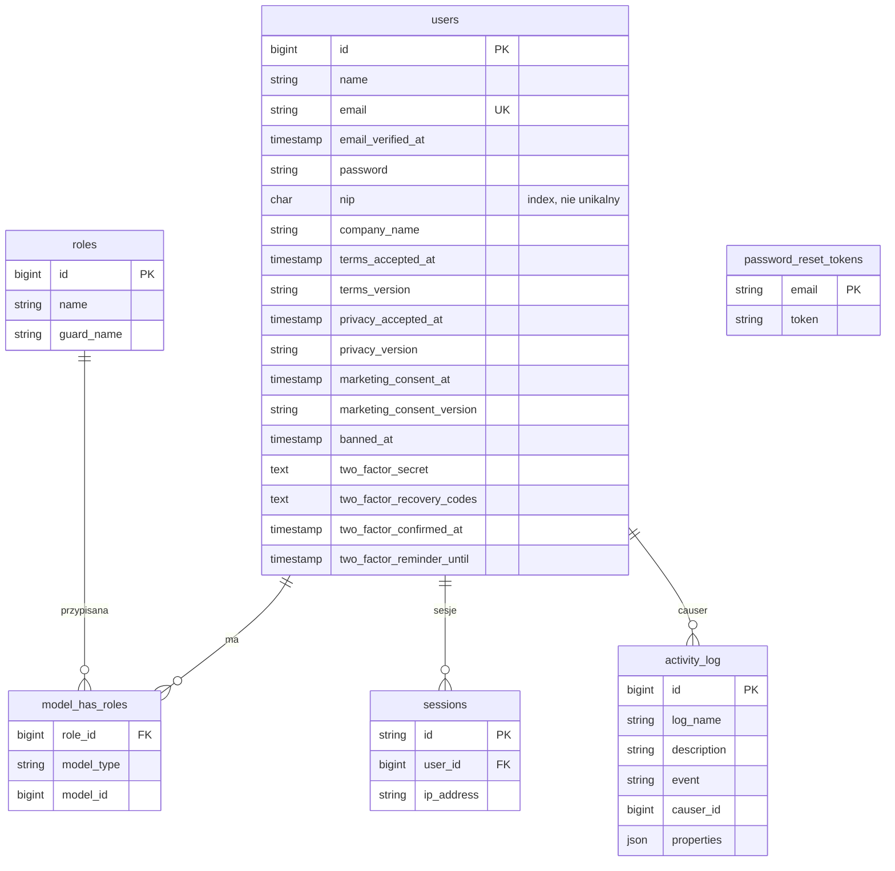
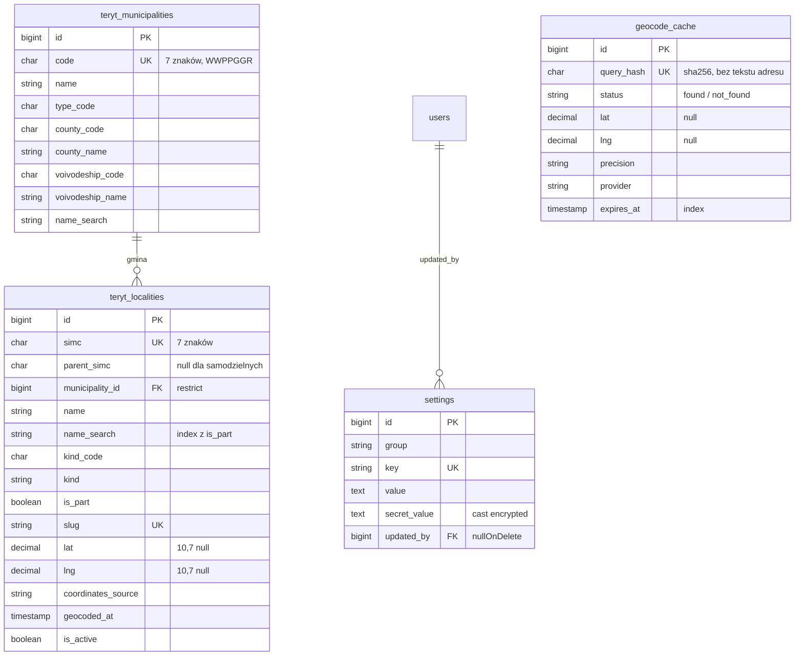

# Dokumentacja techniczna — kontroladomu.pl

## 1. Przegląd systemu

Kontroladomu.pl jest polską aplikacją webową do organizowania przeglądów nieruchomości.
Powstaje od zera w Laravel 12, z widokami Blade i zasobami budowanymi przez Vite.
Etap 0 jest w trakcie realizacji; aktualnie aplikacja udostępnia publiczną stronę startową.
Logowanie, role, profile fachowców, wyszukiwanie i rezerwacje nie są jeszcze wdrożone.

Główne ustalenia produktu i kolejność prac opisują [specyfikacja](SPECYFIKACJA.md),
[plan etapów](PLAN_ETAPOW.md) i [zadanie fundamentu](zadania/001-fundament.md).

## 2. Uruchomienie lokalne (Windows)

### Przygotowane środowisko

- Projekt: `C:\xampp\htdocs\kontroladomu`
- PHP CLI 8.3.36: instalacja WinGet obok XAMPP; PHP XAMPP 8.2 pozostaje bez zmian.
- Composer 2.11.0: `%LOCALAPPDATA%\Programs\Composer-2.11\composer83.cmd`
- Node.js 24 i npm 11.
- MariaDB 10.11.19: lokalny serwer na `127.0.0.1:3307`; konfiguracja i dane są poza
  repozytorium.
- Lokalny plik `.env` zawiera ustawienia połączenia i sekrety; nie kopiować go do Git.

PHP 8.3 można wskazać w PowerShell tak:

```powershell
$php83 = "$env:LOCALAPPDATA\Microsoft\WinGet\Packages\PHP.PHP.NTS.8.3_Microsoft.Winget.Source_8wekyb3d8bbwe\php.exe"
```

W nowej kopii projektu:

```powershell
Copy-Item .env.example .env
& "$env:LOCALAPPDATA\Programs\Composer-2.11\composer83.cmd" install
npm install
```

Przed migracjami uzupełnij `.env` o lokalne dane dostępowe do MariaDB. Następnie:

```powershell
& $php83 artisan key:generate
& $php83 artisan migrate
npm run build
```

Na przygotowanym komputerze lokalna baza i `.env` są już skonfigurowane. Serwer MariaDB
uruchomiono jako proces użytkownika, nie jako usługę Windows; po jego zatrzymaniu należy
uruchomić go ponownie z lokalnym plikiem `my.ini` znajdującym się poza repozytorium.

### Uruchomienie aplikacji

W pierwszym terminalu:

```powershell
& $php83 artisan serve --host=127.0.0.1 --port=8000
```

W drugim terminalu:

```powershell
npm run dev
```

Następnie otwórz `http://127.0.0.1:8000`. Do podglądu bez serwera Vite można wykonać
`npm run build`; skompilowane zasoby są dostępne w `public/build/`.

### Testy i kontrola jakości

Uruchamiaj wszystkie polecenia PHP z PHP 8.3. Narzędzia `vendor\bin\*.bat` wybierają
PHP z `PATH`, więc przed ich użyciem ustaw:

```powershell
$php83Dir = Split-Path $php83
$env:PATH = "$php83Dir;$env:PATH"
```

Następnie:

```powershell
& $php83 artisan test
& .\vendor\bin\pint.bat --test
composer phpstan   # skrypt z composer.json: phpstan analyse --no-progress --memory-limit=1G
npm run build
```

Testy używają SQLite in-memory, aby nie wykonywać migracji testowych na lokalnej bazie MariaDB.

## 3. Struktura katalogów

- `app/` — kod aplikacji Laravel; docelowe moduły domenowe i akcje będą dodawane wraz z etapami.
- `bootstrap/`, `config/`, `routes/` — konfiguracja frameworka i tras.
- `database/migrations/`, `database/factories/`, `database/seeders/` — schemat i dane testowe.
- `resources/views/` — widoki Blade i layout publiczny.
- `resources/css/`, `resources/js/` — źródła zasobów Vite/Tailwind.
- `lang/pl/` — polskie teksty interfejsu.
- `tests/Feature/`, `tests/Unit/` — testy Pest.
- `docs/` — specyfikacja, decyzje, plan i dokumentacja techniczna.

## 4. Model danych

Laravelowy szkielet zawiera domyślne migracje użytkowników, resetu haseł i kolejek. Tabele
ustawień, ról, fachowców, nieruchomości i rezerwacji nie zostały jeszcze zaimplementowane.
Założenia i reguły biznesowe przedstawią kolejne zadania przed dodaniem migracji.

Planowany model kont (zadanie 002, jeszcze niezaimplementowany; szczegóły w `docs/zadania/002-konta-i-uwierzytelnianie.md`):



Planowane dane geograficzne i ustawienia (zadanie 003, jeszcze niezaimplementowane; szczegóły w `docs/zadania/003-teryt-geokodowanie-kopie.md`):



## 5. Kluczowe procesy

Procesy logowania, weryfikacji fachowca, rezerwacji, przypomnień i protokołów pozostają
w zakresie kolejnych etapów; nie są jeszcze dostępne w aplikacji.

## 6. Uprawnienia

Nie wdrożono jeszcze kont ani ról. Docelowe zasady weryfikacji, widoczności i anulowania
rezerwacji opisuje [specyfikacja produktu](SPECYFIKACJA.md).

## 7. Harmonogram i kolejki

Kolejka i harmonogram zadań nie są jeszcze skonfigurowane do procesów produktu.
Etap 0 ma przygotować lokalne mechanizmy oraz instrukcję zgodną z ograniczeniami hostingu.

## 8. Bezpieczeństwo

- Sekrety lokalne przechowuj wyłącznie w `.env`, który jest ignorowany przez Git.
- Nie zapisuj dokumentów fachowców w publicznym katalogu; obsługa dokumentów nie została
  jeszcze zaimplementowana.
- Używaj PHP 8.3 dla Artisan i narzędzi projektu; PHP XAMPP nie jest modyfikowane.
- Testy korzystają z odizolowanej bazy SQLite in-memory.
- 2FA, role, limity, nagłówki i dziennik aktywności są zaplanowane, ale nie są jeszcze wdrożone.

## 9. Wdrożenie na home.pl

Wdrożenie produkcyjne nie jest jeszcze przygotowane. Przed etapem wdrożenia należy potwierdzić
wersję PHP, bazę danych, cron, uprawnienia katalogów i możliwość przechowywania kopii poza
serwerem.

## 10. Kopie zapasowe i przywracanie

Procedura kopii i przywracania zostanie opisana po wdrożeniu rozwiązania kopii w Etapie 0
i potwierdzeniu ograniczeń hostingu.

## 11. Znane ograniczenia i dług techniczny

- Aplikacja zawiera obecnie szkielet Laravel i podstawową stronę publiczną.
- Brak zdalnego repozytorium Git oraz skonfigurowanej tożsamości Git; publikowanie zmian
  wymaga wcześniejszego uzgodnienia z właścicielem.
- Przed użyciem triala powiązanego z NIP-em trzeba ustalić podstawę prawną i okres
  przechowywania identyfikatora, również po usunięciu konta.
- Warunki TERYT, Nominatim i hostingu home.pl należy zweryfikować przed integracją i wdrożeniem.

## Uwierzytelnianie: uwagi wdrożeniowe (zadanie 002, backend)

- Komunikaty `validation.custom.name.*` i `validation.custom.email.*` w `lang/pl/validation.php` są globalne (dotyczą każdego pola o tej nazwie).
  Przy kolejnych formularzach z polem `name` (np. nazwa nieruchomości) trzeba nadać polu inną nazwę albo dopisać komunikat per formularz.
- PHPStan wymaga większej pamięci niż domyślne 128 MB. Uruchamiaj go skryptem Composera: `composer phpstan` (to samo co `phpstan analyse --no-progress --memory-limit=1G`).
- `APP_KEY` szyfruje sekrety 2FA; jego zmiana unieważnia 2FA wszystkich użytkowników (kopia `.env` poza serwerem).
- Za Cloudflare ustaw `TRUSTED_PROXIES`, inaczej limity żądań „na IP" liczą adres proxy zamiast klienta.
- Utrata telefonu i kodów awaryjnych: `php artisan user:reset-2fa adres@example.pl --reason="..."` (wpis w dzienniku `security_admin`).

## Wdrożenie: checklista bezpieczeństwa (po audycie zadania 002)

1. Skopiuj `.env.production.example` na serwer jako `.env` i uzupełnij puste wartości (klucz aplikacji: `php artisan key:generate`). Aplikacja **nie wystartuje** na produkcji, gdy:
   `APP_DEBUG=true`, Turnstile wyłączony lub z kluczami testowymi Cloudflare (`1x0000…`, `2x0000…`, `3x0000…`), `QUEUE_CONNECTION=sync`, `MAIL_MAILER=log|array`,
   `SESSION_SECURE_COOKIE` różne od `true` albo `AUTH_CHECK_PWNED=false` (`App\Support\Security\ProductionConfigGuard`). Komendy `package:discover`, `key:generate`, `config:cache` i podobne mają wyjątek, żeby `composer install` działał przed uzupełnieniem `.env`.
2. **Zaufane proxy:** `TRUSTED_PROXIES` = zakresy IP Cloudflare po przecinku (aktualna lista: https://www.cloudflare.com/ips/; przykład w `.env.example`), nie `*`. Aplikacja ufa tylko `X-Forwarded-For/-Port/-Proto`, nigdy `X-Forwarded-Host`.
   Jeśli adres origin home.pl jest osiągalny z pominięciem Cloudflare, ogranicz ruch do zakresów Cloudflare (reguła w `.htaccess` lub zapora, o ile home.pl pozwala), bo inaczej napastnik może podszyć IP w `X-Forwarded-For`.
   Kontrola: `curl -H "X-Forwarded-For: 1.2.3.4" https://<adres-origin>/` nie może zmieniać adresu IP widzianego przez aplikację (podgląd w dzienniku aktywności po logowaniu).
3. **Hosty:** aplikacja akceptuje wyłącznie host z `APP_URL` (bez subdomen); obcy nagłówek `Host` dostaje 400. Na produkcji adresy URL są budowane z `APP_URL` po https.
4. **Sesje:** `AuthenticateSession` kończy sesje po zmianie/resecie hasła niezależnie od sterownika; zalecany `SESSION_DRIVER=database` (dodatkowo usuwa wiersze `sessions`).
5. **Limity:** rejestracja i reset hasła są ograniczone tylko po IP (10/h i 5/h); liczbę maili resetu ogranicza się po adresie (3/h, bez błędu dla użytkownika). Logowanie: po 3 błędach z IP albo 5 błędach na konto (z dowolnych IP) wymagany jest Turnstile; nie ma blokady 429 na konto, żeby nie dało się zablokować cudzego logowania.
6. Zmiana adresu e-mail na koncie niepotwierdzonym nie ujawnia, czy nowy adres ma konto (jak rejestracja).

### Wdrożenie: uzupełnienia po re-audycie

- **Strażnik konfiguracji** działa w każdym środowisku poza `local` i `testing` (także `staging`) i dodatkowo wymaga: `APP_URL` z `https://` i hostem oraz niepustego `TRUSTED_PROXIES` różnego od `*`.
- **Hosty i `www.`:** akceptowany jest wyłącznie host z `APP_URL` (bez subdomen). Jeśli `APP_URL` to `https://kontroladomu.pl`, adres `www.kontroladomu.pl` dostanie 400, więc w Cloudflare ustaw przekierowanie `www` na domenę główną (Redirect Rule) przed uruchomieniem. Gdy `APP_URL` nie ma hosta, żaden host nie jest zaufany (fail-closed).
- **Sesje:** wersja sesji konta (`users.session_version`) kończy sesje po resecie 2FA oraz zmianie/resecie hasła niezależnie od sterownika. Zalecany nadal `SESSION_DRIVER=database` (wiersze `sessions` są wtedy usuwane); `file` działa, ale nie jest sprawdzany przez strażnika.
- **Kontrola IP za Cloudflare/home.pl (R6, obowiązkowa na stagingu):** zanim ruch trafi na produkcję, sprawdź `request()->ip()` (np. tymczasową trasą chronioną hasłem lub wpisem w logu) i potwierdź, że (1) pokazuje adres klienta, nie adres Cloudflare/home.pl, (2) nagłówek `X-Forwarded-For` wysłany spoza Cloudflare nie zmienia adresu. Jeśli między Cloudflare a PHP stoi jeszcze proxy home.pl, jego adres też musi być w `TRUSTED_PROXIES`, inaczej wszystkie żądania mają jedno IP (limity 10 rejestracji i 5 resetów/h działają globalnie). Listę zakresów Cloudflare przeglądaj raz na kwartał.
- **Zmiana adresu e-mail:** `users.email` zmienia się dopiero po kliknięciu w link wysłany na NOWY adres (kolumna `pending_email`). Wolny i zajęty adres są obsługiwane identycznie przez żądanie HTTP; rozróżnia je dopiero zadanie w kolejce, więc kolejka musi działać (cron `schedule:run`). Limit: 3 maile weryfikacyjne i 3 maile resetu na godzinę na adres odbiorcy (także bez konta).

## Wdrożenie: uzupełnienia po audycie zadania 003

- Ustalić `BACKUP_NOTIFICATION_EMAIL` i `NOMINATIM_CONTACT_EMAIL` (adresy w domenie kontroladomu.pl). Do czasu ustawienia pierwszego raz w tygodniu wykonywać `php artisan backup:list` i sprawdzać, że istnieje kopia plików z ostatnich 7 dni.
- Ustawić `BACKUP_ARCHIVE_PASSWORD` (min. 20 znaków) i zapisać je w menedżerze haseł poza serwerem. Bez hasła i `APP_KEY` kopii nie da się odczytać.
- Na home.pl sprawdzić: `mysqldump`, `proc_open`, rozszerzenie zip, limity czasu i pamięci, wolne miejsce (limit kopii 3000 MB).
- Po awarii kopii sprawdzić i wyczyścić `storage/app/backup-temp` (może zawierać niezaszyfrowany zrzut bazy).
- Import TERYT zrobić lokalnie i przenieść tabele `teryt_*` przez phpMyAdmin, jeśli hosting nie daje SSH.
- Cloudflare: reguła ograniczenia zapytań dla `/miejscowosci/*` oraz cache tej ścieżki.
- Przed odpowiedzią GUS w sprawie licencji nie reklamować serwisu publicznie.

