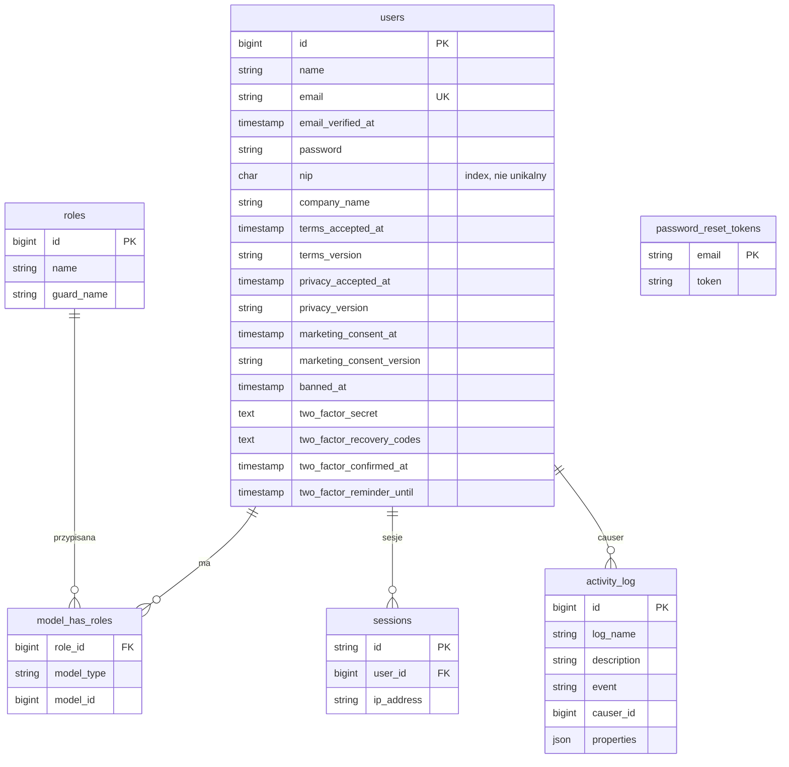
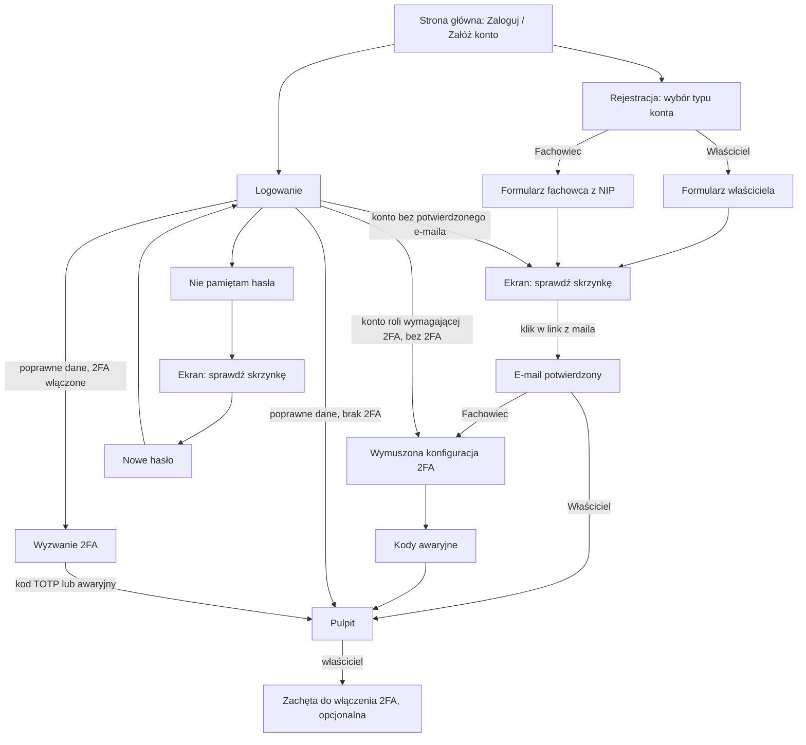

# Zadanie 002: Konta, role i uwierzytelnianie

- **Status:** gotowe (30.10.2026)
- **Etap:** Etap 0 — Fundament (v0.1.0), podzadania 0.6 (reszta) i 0.7
- **Gałąź:** develop
- **Utworzono:** 2026-10-29

## Cel (koordynator)
Dodać logowanie, rejestrację (właściciel nieruchomości / fachowiec), reset hasła, weryfikację e-mail,
2FA TOTP (obowiązkowe dla admina i właściciela konta fachowca), role Spatie, Turnstile, nagłówki
bezpieczeństwa, rate limiting, dziennik aktywności, komendę tworzącą administratora.
Zgodnie z `docs/SPECYFIKACJA.md` §1 oraz `docs/zadania/001-fundament.md`.

## Zakres
- W zakresie: Fortify, Spatie permission + activitylog, polskie teksty `lang/pl`, ekrany
  auth i prosty pulpit po zalogowaniu (puste stany), testy Pest.
- Poza zakresem: profile fachowców, wyszukiwarka, rezerwacje, TERYT, kopie (osobne podzadania).

## Decyzje właściciela (29.10.2026) i poprawki koordynatora do sekcji UX

**Decyzje właściciela:** (1) jedno konto z wieloma rolami (owner + specialist) na jednym e-mailu;
(2) utrata telefonu i kodów awaryjnych = reset ręcznie przez administratora (z wpisem w dzienniku);
(3) NIP: tylko format + suma kontrolna, bez zapytań do GUS/CEIDG/VIES.

**Poprawki — sekcja UX poniżej zawiera błędy; w razie sprzeczności obowiązuje ta lista:**
1. **NIP zajęty NIE blokuje rejestracji.** `SPECYFIKACJA.md` §10: kolejne konto z tym NIP-em jest dozwolone,
   tylko nie dostaje okresu próbnego. Usunąć klucz `nip_taken` i ekran blokady. Ten sam NIP nie może
   ujawniać istnienia innego konta. W tym zadaniu nie wdrażamy okresu próbnego (tylko normalizacja NIP).
2. **Zajęty e-mail: wariant neutralny** (bez ujawniania konta): zawsze ekran „Sprawdź skrzynkę”, a
   posiadacz konta dostaje mail `register_attempt_*`. Klucz `email_taken` nie jest używany.
3. `nip_hint` nie może obiecywać „sprawdzimy z rejestrem” — usunąć to zdanie (decyzja 3).
4. **Kody awaryjne Fortify mają format `xxxxxxxxxx-xxxxxxxxxx`** (2×10 znaków), nie `xxxxx-xxxxx`.
5. **Okno potwierdzenia hasła:** Laravel domyślnie 3 h (`auth.password_timeout`); ustawić 15 minut
   (900 s), tak jak opisuje UX.
6. **Ważność linku weryfikacji e-mail:** domyślnie 60 min; UX obiecuje 24 h → ustawić 1440 min albo
   zmienić tekst. Obowiązuje 24 h (spec §5 też mówi 24 h).
7. **Blokada po 5 błędnych kodach 2FA na 15 min** wymaga własnego limitera (domyślny Fortify to
   5/min). Zaimplementować i przetestować.
8. **Liczby mnogie:** `codes_low` używa `:count` w złej odmianie — użyć `trans_choice` (1 kod / 2–4 kody / 5+ kodów).
9. **Brak linków do nieistniejących stron (kryterium 6):** Regulamin, Polityka prywatności, Cookies,
   Zgłoś treść, Kontakt, Szukaj fachowca — w tym zadaniu zrobić proste strony-szkice z komentarzem
   `<!-- DO WERYFIKACJI PRZEZ PRAWNIKA -->` (regulamin, prywatność, cookies, kontakt), a pozycje bez strony
   (Szukaj fachowca, Zgłoś treść) wyświetlać jako nieaktywne „Wkrótce”.
10. **Zgody (RODO):** zapisać w bazie `terms_accepted_at`, `privacy_accepted_at`, `marketing_consent_at`
    (null = brak zgody) oraz wersję tekstu; marketing osobno i nieobowiązkowo. Wpis do `docs/RODO_REJESTR.md`.
11. **Jedno konto, wiele ról:** ekran rejestracji tworzy rolę wybraną przy rejestracji. Dodawanie
    drugiej roli do istniejącego konta i przełącznik panelu są POZA zakresem (osobne zadanie); do tego
    czasu rejestracja na istniejący e-mail działa wg punktu 2.
12. **Turnstile:** na rejestracji i resecie hasła zawsze; na logowaniu po 3 nieudanych próbach.
    Klucze w `.env`; lokalnie tryb testowy (klucze testowe Cloudflare). Weryfikacja przez HTTP Client, bez paczki.
13. **Utrata 2FA:** administrator resetuje 2FA użytkownika komendą artisan `user:reset-2fa {email}` z wpisem
    w dzienniku aktywności (panel admina jest w późniejszym etapie).
14. Pole `lang`: pliki `lang/pl/auth.php`, `dashboard.php`, `mail.php` — nie nadpisywać istniejącego `app.php`;
    Laravel i Fortify wymagają też `lang/pl/validation.php`, `passwords.php` (polskie tłumaczenia).
15. Pulpit pod `/pulpit`; po logowaniu przekierowanie zależne od stanu (e-mail → 2FA → pulpit).
    Nagłówek H1 „Dzień dobry, :name”; bez emoji.

**Domyślne odpowiedzi koordynatora na pytania architekta (§16) — do zmiany przez właściciela:**
1. Retencja dziennika aktywności: 90 dni dla zdarzeń zwykłych, 12 miesięcy dla działań administratorów
   (do potwierdzenia z prawnikiem).
2. Usuwanie niepotwierdzonych kont po 7 dniach: tak (`accounts:prune-unverified`).
3. Reset 2FA: prośba tylko z e-maila konta; admin weryfikuje tożsamość ręcznie (dla fachowca dodatkowo
   oddzwonienie na telefon z profilu); wynik w dzienniku i mail do użytkownika.
4. Sesja: 120 minut bezczynności dla wszystkich.
5. Bany (DSA): w tym zadaniu kolumna `banned_at` + komunikat przy logowaniu; pełny proces w Etapie 6.
6. Zmiana hasła (zalogowany) tak; zmiana e-maila tylko przed potwierdzeniem.
7. Nadawca maili i adres kontaktowy: z `.env` (`MAIL_FROM_ADDRESS`, `CONTACT_EMAIL`); wartość
   tymczasowa `kontakt@kontroladomu.pl` — **właściciel musi podać prawdziwy adres przed wdrożeniem**.

## Architekt

Autor: architekt, 29.10.2026. Decyzje: ADR-005 do ADR-010 w `docs/DECYZJE.md`. Zadanie jest większe niż 1 dzień,
więc podzielone na podzadania A–G (patrz "Kolejność"). Obowiązują "Decyzje właściciela i poprawki koordynatora" + korekty z podsekcji "Korekty do sekcji UX" poniżej.

### 1. Paczki (szczegóły i licencje: ADR-005)

Instalacja przez `composer83.cmd` (PHP 8.3), w katalogu projektu:

```
composer83.cmd require laravel/fortify:"^1.41" spatie/laravel-permission:"^8.3" spatie/laravel-activitylog:"^4.12"
npm install @alpinejs/csp
```

- Fortify 1.41.0 (06.10.2026), MIT. Permission 8.3.2 (19.10.2026), MIT, wymaga PHP ^8.3. Activitylog **4.12.x** (nie 5.x: 5.x wymaga PHP ^8.4).
- Livewire 3.8.x: NIE instalować w tym zadaniu (ADR-007). Tailwind 4 jest już w `package.json`.
- Publikacja: `vendor:publish` dla Fortify (config + migracja kolumn 2FA), Permission (config + migracja), Activitylog (config + 3 migracje).
  Nie używać `fortify:install` w sposób, który tworzy `app/Actions/Fortify` (nasze akcje są w `app/Domain/Accounts/Actions`); jeśli powstanie, przenieść.

### 2. Model danych

Istniejące tabele (`users`, `password_reset_tokens`, `sessions`) zostają; **nie edytować istniejących migracji**, tylko nowe.

**2.1 Nowa migracja `2026_10_30_000001_add_account_fields_to_users_table.php` (tabela `users`)**

| Kolumna | Typ | Null | Indeks / uwagi | Podstawa i cel (do RODO) |
|---|---|---|---|---|
| `nip` | `CHAR(10)` | tak | INDEX `users_nip_index`, **nie unikalny** | 6.1.b; tylko cyfry po normalizacji; ustawiany tylko dla roli fachowiec |
| `company_name` | `VARCHAR(190)` | tak | — | 6.1.b; nazwa firmy fachowca |
| `terms_accepted_at` | `TIMESTAMP` | tak | UTC | 6.1.b; dowód akceptacji regulaminu |
| `terms_version` | `VARCHAR(32)` | tak | np. `2026-10-29` z `config/legal.php` | j.w. |
| `privacy_accepted_at` | `TIMESTAMP` | tak | UTC | potwierdzenie zapoznania z polityką (obowiązek informacyjny) |
| `privacy_version` | `VARCHAR(32)` | tak | — | j.w. |
| `marketing_consent_at` | `TIMESTAMP` | tak | `NULL` = brak zgody | 6.1.a; osobno i nieobowiązkowo |
| `marketing_consent_version` | `VARCHAR(32)` | tak | — | j.w. |
| `banned_at` | `TIMESTAMP` | tak | — | zaślepka pod DSA/ban; w tym zadaniu tylko sprawdzenie przy logowaniu (powód i tabela w zadaniu admina) |
| `two_factor_reminder_until` | `TIMESTAMP` | tak | — | "Przypomnij później" (30 dni) dla banera 2FA właściciela |

**2.2 Migracja Fortify** (`add_two_factor_columns_to_users_table`, z paczki): `two_factor_secret TEXT NULL`, `two_factor_recovery_codes TEXT NULL`,
`two_factor_confirmed_at TIMESTAMP NULL`. Wartości szyfrowane przez Fortify. Dodać do `$hidden` w `User`: `two_factor_secret`, `two_factor_recovery_codes`.

**2.3 Migracje Spatie Permission** (`roles`, `permissions`, `model_has_roles`, `model_has_permissions`, `role_has_permissions`; bez `teams`) i **Activitylog** (`activity_log` + `event` + `batch_uuid`).
Cache uprawnień Spatie idzie do domyślnego cache (`database`; w testach `array`).

**2.4 `$fillable` w `User`:** `name`, `email`, `password`, `nip`, `company_name`, `terms_accepted_at`, `terms_version`, `privacy_accepted_at`, `privacy_version`,
`marketing_consent_at`, `marketing_consent_version`. **Bez** `banned_at`, `two_factor_*`, `email_verified_at` (ustawiane tylko w akcjach). `User implements MustVerifyEmail`, `use HasRoles, TwoFactorAuthenticatable`.
Cast: `nip` brak (string), znaczniki jako `datetime`.

**2.5 Role (Spatie, guard `web`):** `owner`, `specialist`, `technician`, `admin`. Brak uprawnień szczegółowych w tym zadaniu (decyduje rola + Policy). Role tworzy idempotentnie
`RolesSeeder` (`firstOrCreate`) wywoływany: przez `RegisterAccount` i `CreateAdminAccount` (`UserRole::ensureExist()`), więc **nie trzeba pamiętać o seedzie na produkcji**.

**2.6 Diagram ER (do `docs/DOKUMENTACJA_TECHNICZNA.md` §4 — dopisany przez architekta)**



**2.7 Enum `App\Domain\Accounts\Enums\UserRole`** (string-backed): `Owner='owner'`, `Specialist='specialist'`, `Technician='technician'`, `Admin='admin'`.
Metody: `requiresTwoFactor(): bool` (admin, specialist), `isRegistrable(): bool` (owner, specialist), `label()` (z `lang`),
`static priority()` (kolejność roli głównej: admin > specialist > technician > owner — rola decyduje o wyglądzie pulpitu i menu, gdy konto ma ich kilka).
Tabela słownikowa nie jest potrzebna (role nie są edytowane przez admina).

**2.8 Dane techniczne poza tabelami:** wersje tekstów prawnych w `config/legal.php` (`terms_version`, `privacy_version`, `marketing_version`); licznik nieudanych logowań w cache (klucz `login-failures:{ip}`, TTL 15 min).

### 3. Struktura kodu

```
app/Domain/Accounts/
  Actions/       RegisterAccount, CreateAdminAccount, ResetTwoFactor, RevokeUserSessions, VerifyEmailAddress,
                 ChangeUnverifiedEmail, UpdateUserPassword (Fortify), ResetUserPassword (Fortify), DismissTwoFactorReminder
  Data/          RegisterAccountData (readonly DTO: type, name, email, password, companyName, nip, consents)
  Enums/         UserRole
  Listeners/     RecordAuthenticationActivity, MarkPasswordConfirmedOnLogin, CountTwoFactorFailure, ClearTwoFactorFailures,
                 StartTwoFactorChallengeClock, CountLoginFailure, ClearLoginFailures
  Notifications/ VerifyEmailNotification, ResetPasswordNotification, PasswordChangedNotification,
                 RegisterAttemptNotification, TwoFactorResetNotification   (wszystkie ShouldQueue)
  Policies/      UserPolicy
  Rules/         ValidNip
  Support/       Nip (normalize + checksum), TwoFactorLockout, LoginFailureCounter
app/Services/Turnstile/TurnstileVerifier.php
app/Support/AuditLogger.php            (opakowanie activitylog: dokłada ip, user_agent, operatora CLI)
app/Support/Security/ContentSecurityPolicy.php
app/Http/Controllers/Auth/             RegisterController, EmailVerificationController, TwoFactorSettingsController,
                                       RecoveryCodesController, PasswordSettingsController
app/Http/Controllers/                  DashboardController (invokable)
app/Http/Requests/Auth/                RegisterRequest (bazowy), RegisterOwnerRequest, RegisterSpecialistRequest,
                                       ChangeEmailRequest, UpdatePasswordRequest, ConfirmTwoFactorRequest
app/Http/Responses/                    NeutralPasswordResetLinkResponse (sukces i "błąd"), TwoFactorLockedResponse
app/Http/Middleware/                   SecurityHeaders, VerifyTurnstile, RequireTwoFactorForPrivilegedRoles,
                                       TwoFactorChallengeGuard, RejectRememberedPrivilegedSessions, NoStore
app/Console/Commands/                  CreateAdmin (admin:create), ResetUserTwoFactor (user:reset-2fa), PruneUnverifiedAccounts (accounts:prune-unverified)
app/Providers/FortifyServiceProvider.php   (widoki, kontrakty, limitery, pipeline logowania)
```

Policy `UserPolicy` (przypięta atrybutem `#[UsePolicy]` na `User`, bo katalog nie jest standardowy): `manageSecurity(User $actor, User $target)` = własne konto;
`disableTwoFactor` = własne konto i `!requiresTwoFactor()`; `resetTwoFactor` = tylko `admin` (użyte przez przyszły panel; komenda artisan działa poza Policy, bo nie ma użytkownika, ale loguje operatora).
Żadnych `if ($user->id == 1)`.

### 4. Kontrakt tras (ścieżki i nazwy; backend i frontend trzymają się tej tabeli)

| Metoda i ścieżka | Nazwa | Kontroler / akcja | Middleware |
|---|---|---|---|
| GET `/logowanie` | `login` | Fortify `AuthenticatedSessionController@create` | `guest` |
| POST `/logowanie` | `login.store` | Fortify `@store` | `guest`, `throttle:login`, `turnstile:after-failures` |
| POST `/wyloguj` | `logout` | Fortify `@destroy` | `auth` |
| GET `/rejestracja` | `register` | `RegisterController@choose` | `guest` |
| GET `/rejestracja/wlasciciel`, `/rejestracja/fachowiec` | `register.owner`, `register.specialist` | `@form` | `guest` |
| POST te same ścieżki | `register.owner.store`, `register.specialist.store` | `@store` → `RegisterAccount` | `guest`, `throttle:register`, `turnstile:always` |
| GET `/rejestracja/sprawdz-skrzynke` | `register.sent` | `@sent` | `guest` |
| GET `/nie-pamietam-hasla` | `password.request` | Fortify `PasswordResetLinkController@create` | `guest` |
| POST `/nie-pamietam-hasla` | `password.email` | Fortify `@store` | `guest`, `throttle:password-reset`, `turnstile:always` |
| GET `/nowe-haslo/{token}` | `password.reset` | Fortify `NewPasswordController@create` | `guest` |
| POST `/nowe-haslo` | `password.store` | Fortify `@store` | `guest`, `throttle:password-reset`, `turnstile:always` (reset: Turnstile tylko na prośbie o link, patrz korekta K9) |
| GET `/email/potwierdz` | `verification.notice` | `EmailVerificationController@notice` | `auth` |
| POST `/email/ponow` | `verification.send` | `@resend` | `auth`, `throttle:verification` |
| GET `/email/potwierdz/{id}/{hash}` | `verification.verify` | `@verify` → `VerifyEmailAddress` | `signed`, `throttle:6,1` (bez `auth`) |
| GET `/email/potwierdzono` | `verification.done` | `@done` | — |
| GET, POST `/email/zmien` | `email.change`, `email.change.store` | `@changeForm`, `@change` | `auth`, `throttle:email-change` (tylko konto niepotwierdzone) |
| GET `/logowanie/kod` | `two-factor.login` | Fortify `TwoFactorAuthenticatedSessionController@create` | `guest`, `two-factor.guard` |
| POST `/logowanie/kod` | `two-factor.login.store` | Fortify `@store` | `guest`, `two-factor.guard`, `throttle:two-factor` |
| GET, POST `/potwierdz-haslo` | `password.confirm`, `password.confirm.store` | Fortify `ConfirmablePasswordController` | `auth`, `throttle:6,1` |
| GET `/konto/bezpieczenstwo` | `account.security` | `TwoFactorSettingsController@show` | `auth`, `verified` |
| POST `/konto/bezpieczenstwo/2fa` | `two-factor.enable` | `@enable` (akcja Fortify) | `auth`, `verified`, `password.confirm` |
| POST `/konto/bezpieczenstwo/2fa/potwierdz` | `two-factor.confirm` | `@confirm` | `auth`, `verified`, `password.confirm`, `throttle:two-factor-setup` |
| DELETE `/konto/bezpieczenstwo/2fa` | `two-factor.disable` | `@disable` (Policy `disableTwoFactor`) | `auth`, `verified`, `password.confirm` |
| GET `/konto/bezpieczenstwo/kody-awaryjne.txt` | `two-factor.codes.download` | `RecoveryCodesController@download` (`Content-Disposition: attachment`, `no-store`) | `auth`, `verified`, `password.confirm` |
| POST `/konto/bezpieczenstwo/kody-awaryjne` | `two-factor.codes.regenerate` | `@regenerate` | j.w. |
| POST `/konto/przypomnienie-2fa` | `two-factor.reminder.dismiss` | `DismissTwoFactorReminder` | `auth`, `verified` |
| POST `/konto/haslo` | `password.change` | `PasswordSettingsController@update` | `auth`, `verified`, `throttle:6,1` |
| GET `/pulpit` | `dashboard` | `DashboardController` | `auth`, `verified`, `two-factor.required`, `no-store` |
| GET `/regulamin`, `/polityka-prywatnosci`, `/polityka-cookies`, `/kontakt` | `terms`, `privacy`, `cookies`, `contact` | `Route::view` | — |

Strony statyczne to szkice z komentarzem `<!-- DO WERYFIKACJI PRZEZ PRAWNIKA -->`. "Kontakt" w tym zadaniu to tylko dane firmy i adres e-mail (formularz kontaktowy wymaga osobnego zadania: Turnstile, limit, mail).

### 5. Bramki dostępu i egzekwowanie 2FA (ADR-009)

Kolejność dla panelu: `auth` → `verified` (wbudowany `EnsureEmailIsVerified`, przekierowanie na `verification.notice`) → `two-factor.required`.

`RequireTwoFactorForPrivilegedRoles` (alias `two-factor.required`):
1. Użytkownik nie ma ról wymagających 2FA → przepuść.
2. Ma 2FA **potwierdzone** (`two_factor_confirmed_at` nie null) → przepuść.
3. W przeciwnym razie przekieruj na `account.security` z flagą "tryb wymuszony" (żądanie JSON: 403).

Trasy `account.security`, `two-factor.*`, `password.confirm`, `verification.*`, `logout` leżą **poza** trzecią bramką (inaczej pętla przekierowań); mają `auth` + `verified`. Gdy e-mail niepotwierdzony, wygrywa bramka 2. Menu panelu w trybie wymuszonym ukryte (flaga w widoku z `View::composer`).

Pozostałe zasady:
- `Login` (listener `MarkPasswordConfirmedOnLogin`) ustawia `auth.password_confirmed_at` w sesji, żeby świeżo zalogowany nie musiał od razu potwierdzać hasła przed włączeniem 2FA (zgodne z opisem UX "hasło podane w ostatnich 15 min").
- `RejectRememberedPrivilegedSessions` (grupa `web`, po `StartSession`): `Auth::viaRemember()` + konto z wymogiem 2FA → wylogowanie i przekierowanie na `login`. Sesja odtworzona z ciasteczka "zapamiętaj mnie" omijałaby 2FA.
- `config/auth.php`: `password_timeout` = `env('AUTH_PASSWORD_TIMEOUT', 900)`; `verification.expire` = `1440` (24 h; dopisać klucz, obecnie brak); `passwords.users.expire` zostaje 60; `throttle` 60 s.
- Dokończenie zmiany hasła i reset 2FA: `RevokeUserSessions` usuwa wiersze `sessions` użytkownika (driver `database`), zeruje `remember_token`. Wołane z `ResetUserPassword`, `UpdateUserPassword`, `ResetTwoFactor`.
- Czas wyzwania 2FA (10 min, korekta UX): listener `StartTwoFactorChallengeClock` (zdarzenie `TwoFactorAuthenticationChallenged`) zapisuje w sesji znacznik czasu; middleware `two-factor.guard` po 10 min kasuje `login.id` i przekierowuje na `login` z komunikatem `twofa.challenge_expired`.

### 6. Rate limity (definicje w `FortifyServiceProvider::boot` przez `RateLimiter::for`)

| Nazwa | Limit | Klucz | Uwagi |
|---|---|---|---|
| `login` | 5/min oraz 30/godz. | `lower(email)|ip` oraz `ip` | Fortify ma własny `LoginRateLimiter` (5/min na email+IP); nasz limiter dokłada limit godzinowy po IP. W `config/fortify.php`: `limiters.login = 'login'`. Komunikat: `auth.throttle` (`:seconds`, `:minutes`). |
| `register` | 10/godz. na IP i 3/godz. na `lower(email)` | `ip`, `email` | Zwracane 429 nie zdradza istnienia konta (limit liczy każde żądanie). |
| `password-reset` | 5/godz. na IP i 3/godz. na `lower(email)` | j.w. | Plus 60 s odstępu Laravela (odpowiedź neutralna, patrz niżej). |
| `verification` | 1/min i 6/godz. | `user->id` | UX: ponowne wysłanie co 60 s. |
| `email-change` | 3/godz. | `user->id` | |
| `two-factor` | 20/15 min | `ip` | Zgrubny limit anty-flood. |
| `two-factor-setup` | 10/15 min | `user->id` | kod potwierdzający w kreatorze |
| blokada kodu 2FA | **5 błędów → 15 min** | `user->id` z sesji `login.id` | własny `TwoFactorLockout` (poniżej) |
| `register-attempt` (wewn.) | 1 mail/godz. na adres | `sha1(email)` | `RateLimiter::attempt` w `RegisterAccount`, żeby nie spamować właściciela konta |

**Blokada kodu 2FA:** Fortify liczy żądania, nie błędy. `TwoFactorLockout` używa `RateLimiter::hit('2fa-fail:'.$userId, 900)` wołanego przez listener
na `TwoFactorAuthenticationFailed`, a `RateLimiter::clear` przez listener na `ValidTwoFactorAuthenticationCodeProvided`. Middleware `two-factor.guard` sprawdza
`tooManyAttempts(…, 5)` przed GET i POST wyzwania i zwraca widok 429 z `Retry-After` (`TwoFactorLockedResponse`). Zdarzenia dotyczą zarówno kodu z aplikacji, jak i awaryjnego
(**tester ma to potwierdzić testem**; jeśli Fortify nie emituje zdarzenia dla kodu awaryjnego, zliczać w `TwoFactorChallengeGuard` po odpowiedzi z błędem walidacji).
Limiter działa przy sterowniku cache `database`, więc przetrwa żądania na hostingu bez Redisa; w testach `array`.

**Turnstile na logowaniu po 3 nieudanych próbach:** `LoginFailureCounter` (cache `login-failures:{ip}`, TTL 15 min), zwiększany na zdarzeniu `Failed`, kasowany na `Login`.
Middleware `turnstile:after-failures` wymaga tokenu, gdy licznik ≥ 3. Widok logowania dostaje flagę `requiresTurnstile` (z tego samego licznika). Odpowiedź z błędnymi danymi jest identyczna dla istniejącego i nieistniejącego konta.

**Neutralny reset hasła:** Fortify domyślnie zwraca błąd walidacji dla nieistniejącego e-maila oraz inny komunikat przy `throttled`. Obie odpowiedzi
(`FailedPasswordResetLinkRequestResponse`) podmienić na `NeutralPasswordResetLinkResponse` (zawsze `status` z `passwords.sent`), niezależnie od wyniku brokera.

### 7. Turnstile jako serwis (ADR-008)

- `config/services.php`: `'turnstile' => ['enabled' => env('TURNSTILE_ENABLED', true), 'site_key' => env('TURNSTILE_SITE_KEY'), 'secret' => env('TURNSTILE_SECRET_KEY')]`.
  Dopisać do `.env.example` klucze testowe Cloudflare (zawsze przechodzi: site `1x00000000000000000000AA`, secret `1x0000000000000000000000000000000AA`). Produkcyjne klucze tylko na serwerze.
- `TurnstileVerifier::verify(?string $token, ?string $ip): bool` → `Http::asForm()->timeout(5)->post('https://challenges.cloudflare.com/turnstile/v0/siteverify', ...)`; pusty token = `false` bez wywołania; wyjątek/HTTP ≠ 200 = `false` + `Log::warning`. Gdy `enabled=false` zwraca `true` (tylko `local`/`testing`; w `production` aplikacja ma rzucić wyjątek przy starcie, jeśli `enabled=false` — sprawdzić w `AppServiceProvider::boot`).
- Middleware `VerifyTurnstile` (alias `turnstile`, parametry `always` / `after-failures`): pole `cf-turnstile-response`; błąd → `ValidationException::withMessages(['cf-turnstile-response' => __('auth.turnstile_invalid')])`.
- Komponent Blade `<x-turnstile />`: element `.cf-turnstile` z `data-sitekey`, skrypt `api.js` (`async defer`, atrybut `nonce`) dołączany tylko na stronach, które go używają (`@push('scripts')`). Komunikat `auth.turnstile_failed` pokazywany przez Alpine, gdy skrypt nie załaduje się w 10 s (timeout).

### 8. Nagłówki bezpieczeństwa i CSP (ADR-007)

Middleware `SecurityHeaders` dopisane globalnie (`$middleware->append`), konfiguracja w `config/security.php`, polityka budowana przez `ContentSecurityPolicy`
z nonce na żądanie (`Vite::useCspNonce($nonce)`; nonce dostępny w Blade jako `$cspNonce`). Nagłówki:

| Nagłówek | Wartość |
|---|---|
| `Content-Security-Policy` | `default-src 'self'; script-src 'self' 'nonce-{n}' https://challenges.cloudflare.com; style-src 'self'; img-src 'self' data:; font-src 'self'; connect-src 'self' https://challenges.cloudflare.com; frame-src https://challenges.cloudflare.com; form-action 'self'; frame-ancestors 'none'; base-uri 'self'; object-src 'none'` plus `upgrade-insecure-requests` w produkcji |
| `X-Frame-Options` | `DENY` |
| `X-Content-Type-Options` | `nosniff` |
| `Referrer-Policy` | `strict-origin-when-cross-origin` |
| `Permissions-Policy` | `camera=(), microphone=(), payment=(), usb=(), geolocation=(self)` (geolokalizacja potrzebna później do "Użyj mojej lokalizacji") |
| `Strict-Transport-Security` | `max-age=31536000` (bez `preload`, bez `includeSubDomains` na starcie); tylko `https` i `production` |
| `Cross-Origin-Opener-Policy` | `same-origin` |
| `Cache-Control` | `no-store, private` na trasach z `auth` (middleware `no-store`), by przycisk "Wstecz" po wylogowaniu nie pokazywał pulpitu |

Zasady dla frontendu wynikające z CSP: zero `style=""` i zero `<script>` bez `nonce`; zero obsługi zdarzeń `onclick=""`; Alpine tylko jako `x-data="nazwa"` zarejestrowane w `resources/js`;
`data:` w `img-src` jest po to, by pokazać kod QR jako `` (bez `{!! !!}`). Lokalnie (`APP_ENV=local`) dodać do `script-src`/`connect-src`
serwer Vite (`http://127.0.0.1:5173`, `http://localhost:5173`, `ws:`) — wyłącznie w `local`. Dla Mailpit/map/kafelków OSM dopisać domeny dopiero w ich zadaniach.
HSTS i nagłówki dla plików statycznych z `public/` ustawia Cloudflare/`.htaccess` (opisać w rozdziale "Wdrożenie"). Test: odpowiedź każdej strony zawiera komplet nagłówków.

### 9. Komendy artisan

**`admin:create {email} {--name=}`** (`app/Console/Commands/CreateAdmin.php` → akcja `CreateAdminAccount`)
- Pyta o hasło ukrytym polem (`secret`) i potwierdzenie; hasła **nie** przekazuje się argumentem (historia powłoki). Walidacja jak w rejestracji (`Password::defaults()`).
- Błąd, jeśli e-mail istnieje (komenda nie dopisuje roli istniejącemu kontu).
- Tworzy konto z rolą `admin`, `email_verified_at = now()`, bez zgód marketingowych, bez NIP. 2FA wymusi bramka przy pierwszym logowaniu.
- Wpis w dzienniku: log `security`, zdarzenie `admin_created`, `properties`: `operator` (użytkownik systemu), host; `causer` = null.
- Kod wyjścia 0/1; komunikaty po polsku. Działa w `--no-interaction` tylko z zmienną środowiskową `ADMIN_PASSWORD` (przydatne w testach; nie dokumentować jako zalecane).

**`user:reset-2fa {email} {--reason=}`** (`ResetUserTwoFactor` → akcja `ResetTwoFactor`)
- Wymaga podania powodu (opcja lub pytanie; puste = odmowa) oraz potwierdzenia `yes/no` z wyświetleniem imienia i ról konta. Nieistniejący e-mail: komunikat błędu, kod 1.
- Zeruje `two_factor_secret`, `two_factor_recovery_codes`, `two_factor_confirmed_at`; wywołuje `RevokeUserSessions`; wysyła `TwoFactorResetNotification` do użytkownika (kolejka).
- Wpis w dzienniku: `two_factor_reset`, na obiekcie (`subject`) = użytkownik, `properties`: `reason`, `operator`, `host`.
- Po resecie konto z wymogiem 2FA przy następnym logowaniu trafia do kreatora (bramka).

**`accounts:prune-unverified`** (harmonogram dzienny w `routes/console.php`, wraz z `activitylog:clean` i `auth:clear-resets`): usuwa konta niepotwierdzone starsze niż 7 dni (minimalizacja danych, odblokowuje adres zajęty przez kogoś,
kto zarejestrował cudzy e-mail). Okres 7 dni to propozycja, patrz pytania.

### 10. Rejestracja, NIP, zgody (przepływ `RegisterAccount`)

1. Form Request (`RegisterOwnerRequest` / `RegisterSpecialistRequest`) waliduje: `name` (wymagane, max 120), `email` (`email:rfc`, max 190, lowercase przez `prepareForValidation`; **bez reguły `unique`**),
   `password` (`Password::defaults()` = min 12 + `uncompromised()`), `terms` (accepted), `marketing` (boolean opcjonalna), dla fachowca: `company_name` (max 190), `nip` (`ValidNip`), `business_declaration` (accepted).
   `config('auth.check_pwned')` (env `AUTH_CHECK_PWNED`, domyślnie `true`; `false` w `phpunit.xml`) włącza/wyłącza `uncompromised()`, żeby testy nie wołały sieci. Przy awarii API HIBP Laravel przepuszcza hasło (fail open — zapisać w ryzykach).
2. `Nip::normalize()` usuwa spacje i myślniki, zostawia 10 cyfr; suma kontrolna: wagi `6,5,7,2,3,4,5,6,7`, `sum % 11`, reszta 10 = niepoprawny, reszta = ostatnia cyfra.
3. `RegisterAccount`:
   - E-mail wolny: transakcja → utwórz `User` (zgody z czasem `now()` UTC i wersjami z `config/legal.php`; marketing tylko gdy zaznaczone), przypisz rolę, `sendEmailVerificationNotification()` (kolejka), wpis w dzienniku (`registered`, ip). Nie loguje użytkownika.
   - E-mail zajęty (każda rola, także inna niż wybrana): **nic nie tworzy**, wysyła `RegisterAttemptNotification` (z limitem 1/godz.), wykonuje `Hash::make` na dummy-haśle, by wyrównać czas odpowiedzi.
   - W obu przypadkach kontroler przekierowuje na `register.sent` z `session('registered_email')`.
   - NIP zajęty: bez żadnej reakcji (ani błędu, ani maila). Okres próbny poza zakresem.
4. Zgoda biznesowa fachowca (`business_declaration`) jest tylko walidowana; dowodem jest `terms_accepted_at` + wersja (osobna kolumna zbędna).

### 11. Dziennik aktywności (`AuditLogger`)

Log `security` (zdarzenia kont) zapisywany z `ip`, `user_agent` w `properties`; zapisujemy: rejestracja, udane logowanie, wylogowanie, zmiana/reset hasła, włączenie/potwierdzenie/wyłączenie 2FA,
użycie kodu awaryjnego, regeneracja kodów, `admin_created`, `two_factor_reset`, zmiana zgody marketingowej. **Nie zapisujemy**: haseł, kodów, sekretów, tokenów, nieudanych logowań z adresem e-mail (nieudane próby tylko w liczniku cache).
Retencja `activitylog:clean`: 90 dni zgodnie z `docs/RODO_REJESTR.md` (wiersz "adres IP, logi"); pytanie o dłuższy okres dla działań admina poniżej.
Listenery na zdarzeniach Laravel (`Login`, `Logout`, `PasswordReset`) i Fortify (`TwoFactorAuthenticationEnabled/Confirmed/Disabled`, `RecoveryCodeReplaced`).

### 12. Pliki do utworzenia / zmiany

**Backend**
- `composer.json` / `composer.lock` (paczki), `bootstrap/providers.php` (dodać `FortifyServiceProvider`), `bootstrap/app.php` (routing `routes/auth.php`, aliasy middleware, `append(SecurityHeaders)`, wyjątek `TokenMismatchException` → przekierowanie na `login` z komunikatem `auth.session_expired`).
- `config/fortify.php` (`guard=web`, `username=email`, `home=/pulpit`, `views=true`, features: `resetPasswords`, `twoFactorAuthentication(['confirm'=>true,'confirmPassword'=>true])`; bez `registration`, bez `emailVerification`), `config/permission.php`, `config/activitylog.php` (`delete_records_older_than_days=90`), `config/security.php`, `config/legal.php`, `config/auth.php` (patrz §5), `config/services.php` (Turnstile), `.env.example` (Turnstile, `AUTH_CHECK_PWNED`, `AUTH_PASSWORD_TIMEOUT=900`, `MAIL_FROM_*`, komentarz o `QUEUE_CONNECTION`), `phpunit.xml` (`TURNSTILE_ENABLED=false`, `AUTH_CHECK_PWNED=false`).
- Migracje (§2), `database/seeders/RolesSeeder.php` + wywołanie w `DatabaseSeeder`, `database/factories/UserFactory.php` (stany: `owner()`, `specialist()`, `admin()`, `technician()`, `unverified()`, `withTwoFactor()`).
- `app/Models/User.php`, wszystkie klasy z §3, `routes/auth.php`, `routes/web.php` (`require auth.php`, `/pulpit`, strony statyczne), `routes/console.php` (harmonogram), `app/Providers/AppServiceProvider.php` (`Password::defaults`, `VerifyEmail::toMailUsing`, `ResetPassword::toMailUsing`, rejestracja listenerów, `Gate`/Policy, kontrola Turnstile w produkcji).
- `lang/pl/validation.php`, `lang/pl/passwords.php` (+ komunikaty `custom` dla `password.min` i `password.uncompromised`, `nip`, `terms`), merge kluczy z sekcji UX §12 do `lang/pl/auth.php`, `dashboard.php`, `mail.php` (plus brakujące klucze z korekt).
- `resources/views/mail/*` (szablony markdown: przycisk 44 px, stopka z danymi administratora, `brand-700`), publikacja `vendor:publish --tag=laravel-mail` tylko dla motywu CSS.

**Frontend**
- `resources/js/app.js` (import `@alpinejs/csp`, `Alpine.start()`), `resources/js/alpine/{passwordToggle,copyToClipboard,resendCountdown,printPage,turnstileGuard}.js`.
- `resources/css/app.css` (tokeny z palety UX już istnieją; tylko komponenty wspólne, fokus 3 px `brand-600`).
- Layouty: `resources/views/layouts/auth.blade.php` (karta 440 px, nagłówek z logo i "Wróć na stronę główną"), `layouts/app.blade.php` (menu lewe 240 px / dolny pasek mobile, skip link, stopka zalogowanych, blok flash), partiale `partials/nav-*`, `partials/footer-app`.
- Komponenty `resources/views/components/`: `form-field`, `password-field`, `code-field`, `checkbox-field`, `turnstile`, `alert` (info/warn/error), `error-summary`, `empty-state`, `nav-item` (aktywny/nieaktywny "Wkrótce"), `step-card`.
- Widoki `resources/views/auth/`: `login`, `register-choose`, `register-owner`, `register-specialist`, `register-sent`, `forgot-password`, `reset-password`, `reset-invalid`, `verify-notice`, `verify-done`, `change-email`, `two-factor-challenge`, `confirm-password`.
- `resources/views/account/security.blade.php` (+ partiale `two-factor-intro`, `two-factor-scan`, `two-factor-codes`, `two-factor-manage`, `change-password`).
- `resources/views/dashboard/{owner,specialist,admin,technician}.blade.php` (puste stany z UX §8, pojedyncze zapytania, `with()` w razie potrzeby), `pages/{terms,privacy,cookies,contact}.blade.php`, `errors/{419,429,403}.blade.php`.
- Stopka strony publicznej (`layouts/public.blade.php`): dodać linki do 4 nowych stron i "Zaloguj się / Załóż konto" w nagłówku (to jedyna zmiana publicznego layoutu).

**Testy (tester):** `tests/Feature/Accounts/*` (rejestracja obu ról, neutralność, NIP, zgody, weryfikacja, reset, bramki, 2FA, lockout, remember, komendy, nagłówki, Turnstile z `Http::fake`), `tests/Unit/Nip*`.

### 13. Kolejność prac

1. **A. Fundament (backend):** paczki, publikacja configów, migracje, `UserRole`, `RolesSeeder`, `User`, factory, config/auth, `config/legal.php`, `phpunit.xml`, harmonogram. Zielone `php artisan test` i migracje na MariaDB.
2. **B. Infrastruktura bezpieczeństwa (backend):** `SecurityHeaders` + `ContentSecurityPolicy`, `TurnstileVerifier` + middleware, limitery, `AuditLogger`, `NoStore`.
3. **C. Auth bez 2FA (backend):** `FortifyServiceProvider`, `routes/auth.php`, `RegisterAccount`, weryfikacja e-mail, reset hasła (neutralny), zmiana hasła, powiadomienia + `lang`. Równolegle **frontend D1**: layouty, komponenty, `app.js`/Alpine CSP, widoki login/rejestracja/reset/weryfikacja (po zamrożeniu kontraktu tras z §4, nazwy tras gotowe od kroku A).
4. **E. 2FA (backend):** middleware bramek, `TwoFactorLockout`, listenery, `TwoFactorSettingsController`, `RecoveryCodesController`, komendy `admin:create`, `user:reset-2fa`. Frontend D2: kreator 2FA, wyzwanie, potwierdzenie hasła.
5. **F. Pulpit i strony (frontend):** layout `app`, nawigacja, 4 pulpity, strony statyczne, błędy 419/429. Backend: `DashboardController`, `User::primaryRole()`.
6. **G. Zamknięcie:** wpisy w `docs/RODO_REJESTR.md` (audytor, lista w §14), `docs/DOKUMENTACJA_TECHNICZNA.md`, CHANGELOG (koordynator), testy (tester), audyt.

### 14. Ryzyka

| Ryzyko | Ocena i środek zaradczy |
|---|---|
| Enumeracja kont (rejestracja, reset, login, zmiana e-maila) | Odpowiedzi neutralne + wyrównanie czasu przez kolejkowane maile i dummy hash. Wyjątek: `email.change` używa walidacji `unique` (konto zalogowane, limit 3/godz.): akceptowalne, odnotować w audycie. Zbanowane konto ujawniane tylko po poprawnym haśle. |
| Kolejka bazodanowa i cron (ADR-003): maile z opóźnieniem do ~1 min | UX "Wyślij ponownie po 60 s" jest zgodne; lokalnie bez `queue:work` maile nie wyjdą: w `.env` lokalnym `QUEUE_CONNECTION=sync` albo `php artisan queue:work`; opisać w dokumentacji. |
| Cache `database` pod limiterami i powtórzeniem kodów OTP (Fortify blokuje ponowne użycie kodu przez cache) | Działa na hostingu; zmiana na `array` na produkcji zepsułaby limity. Test w CI na `array` jest OK. |
| `APP_KEY` szyfruje sekrety 2FA | Zmiana klucza unieważnia 2FA wszystkich; kopia `.env` poza serwerem; wpis w rozdziale "Wdrożenie". |
| Skrypt Turnstile z zewnętrznej domeny, bez SRI | Wymóg Cloudflare; zawężone CSP; wpis w polityce prywatności i rejestrze RODO. |
| `Password::uncompromised()` odpytuje HIBP (k-anonimowość) | Przy awarii API hasło przechodzi (fail open); w testach wyłączone. Wspomnieć w polityce prywatności jako odbiorcę (nie wysyłamy całego hasła). |
| Wydajność hostingu: hashowanie bcrypt (`BCRYPT_ROUNDS=12`), 2FA i QR | Pomijalne; QR generowany raz na kreator. Sesje i cache w tabelach: dodać indeksy (są); `activitylog:clean` dziennie. |
| Pre-hijacking (ktoś rejestruje cudzy e-mail) | Konto niepotwierdzone nie ma dostępu do panelu; `accounts:prune-unverified` po 7 dniach; reset hasła potwierdza własność adresu. |
| Atakujący znający hasło blokuje 2FA ofiary na 15 min | Skutek: tylko utrudnienie logowania; zapisane w ADR-009. |
| Aktualizacja Fortify zmienia trasy | `routes/auth.php` utrzymywany ręcznie; test sprawdza nazwy tras. |
| RODO | Nowe dane (zgody, NIP, dziennik z IP, sesje z IP/UA, Cloudflare Turnstile, HIBP) wpisać do `docs/RODO_REJESTR.md`; retencje: konta niepotwierdzone 7 dni, dziennik 90 dni, sesje wg `SESSION_LIFETIME`; eksport i usuwanie konta (menu "Moje dane i prywatność") pozostają "Wkrótce" i **muszą** powstać w kolejnym zadaniu przed uruchomieniem produkcyjnym. |

Wpisy do `docs/RODO_REJESTR.md` (audytor uzupełnia w kroku G): imię i nazwisko, e-mail, hasło (hash), nazwa firmy, NIP (6.1.b, do usunięcia konta); zgody z czasem i wersją (6.1.a/6.1.b, do usunięcia konta + okres przedawnienia roszczeń do ustalenia);
sekret i kody 2FA (6.1.f, do wyłączenia 2FA/usunięcia konta); dziennik aktywności z IP i user-agent (6.1.f, 90 dni); sesje z IP i user-agent (6.1.f, czas życia sesji); Cloudflare Turnstile (6.1.f, podmiot przetwarzający/odbiorca); Have I Been Pwned (częściowy skrót SHA-1 hasła, 6.1.f).

### 15. Korekty do sekcji UX (wykryte przez architekta; obowiązują obok poprawek koordynatora 1-15)

- **K1. Klucze `lang/pl/auth.php`:** Laravel/Fortify używają kluczy najwyższego poziomu `auth.failed`, `auth.password`, `auth.throttle`. UX umieścił `failed` w `login.failed`, więc Fortify wyświetli brak tłumaczenia. Dodać `failed`, `password`, `throttle` (z `:seconds` i `:minutes`) na górnym poziomie. Klucz `throttle_seconds` z UX nieużywany przez framework.
- **K2. Reset hasła ujawnia konta:** domyślne odpowiedzi Fortify (błąd "nie znaleziono użytkownika", osobny komunikat przy `throttled`) łamią kryterium akceptacji 2. Obowiązuje neutralna odpowiedź (§6). `lang/pl/passwords.php`: tylko neutralne `sent`.
- **K3. Wyzwanie 2FA 10 min:** Fortify nie ma takiego limitu; wymaga własnego kodu (§5). Zostaje (UX tego chciał), ale to nie "gotowa funkcja".
- **K4. Sprzeczność w tekstach kodów awaryjnych:** krok 3 mówi "Pokazujemy je tylko teraz", ale UX 7a oferuje "Pokaż kody awaryjne" (Fortify pozwala je odczytać). Zmienić `twofa.step3_text` na: "Każdy działa tylko raz. Później zobaczysz je po ponownym podaniu hasła." Zostaje przycisk po potwierdzeniu hasła. Wymuszenie zaznaczenia "Zapisałem(-am) kody" jest tylko miękkie: 2FA jest już włączone po kroku 2, a po kroku 3 użytkownik może po prostu opuścić stronę (bramka nie ma jak tego wymusić; akceptujemy).
- **K5. Menu fachowca sprzeczne ze `SPECYFIKACJA.md` §7:** spec: Dziś, Kalendarz, Prośby, Historia i statystyki, Profil i ustawienia. UX: Dziś, Prośby, Kalendarz, Profil, Konto. Obowiązuje spec; "Konto" (dane, hasło, 2FA, wylogowanie) dostępne z bloku użytkownika/ikony w nagłówku, nie jako 5. pozycja. Pozycje bez modułów: nieaktywne "Wkrótce" (Kalendarz, Prośby, Historia, Profil). Analogicznie sprawdzić menu właściciela (spec §6) przy zadaniu panelu właściciela; w tym zadaniu zostaje wersja UX.
- **K6. Pulpit: "Dzień dobry, {imię}":** pole `name` to "Imię i nazwisko" jednym ciągiem; wyświetlamy `:name` w całości (poprawka 15 koordynatora jest zgodna), nie wydzielamy imienia.
- **K7. "Ustawienia cookies" w stopce zalogowanych (UX §9)** wskazuje na baner, którego jeszcze nie ma (kryterium 6: brak martwych linków). Pozycję wyświetlić jako nieaktywne "Wkrótce" razem z "Szukaj fachowca" i "Zgłoś treść" (poprawka 9 nie wymieniła tej pozycji).
- **K8. Brakujące ekrany i mikroteksty** (UX odwołuje się do nich, ale ich nie projektuje): zmiana adresu e-mail przed potwierdzeniem (§6a), zmiana hasła (menu "Hasło i bezpieczeństwo"), strona 429, strona 419 "Sesja wygasła", komunikat blokady 2FA po 5 błędach, e-mail `TwoFactorResetNotification` i `PasswordChangedNotification`, banner "mało kodów" (jest tylko `codes_low`), strona `register.sent` dla niezalogowanych (UX §6a zakłada sesję), komunikaty `validation`. **Zadanie dla ux-designera** przed startem frontendu D1 (lista kluczy do dopisania). Ekran 6a opisuje stan "zalogowany, niepotwierdzony"; po rejestracji użytkownik NIE jest zalogowany (ADR-006), więc potrzebny jest wariant bez przycisku "Wyślij ponownie": zamiast niego "Zaloguj się, aby wysłać wiadomość ponownie".
- **K9. Turnstile na `/nowe-haslo` (poprawka 12 mówi "reset hasła zawsze"):** token resetu jest już jednorazowym sekretem z maila; Turnstile na prośbie o link wystarcza (`password.email`). Na `password.store` zostaje tylko limit. Jeśli koordynator chce Turnstile w obu miejscach, wystarczy dopisać middleware (zmiana w trasach, bez przebudowy).
- **K10. Link weryfikacyjny nie loguje (ADR-006):** UX 6a "przy braku sesji dodajemy przycisk Zaloguj się" jest teraz regułą, nie wyjątkiem. Ekran `verify-done` zawsze pokazuje "Zaloguj się" dla niezalogowanych; dla fachowca tekst o 2FA bez przycisku "Ustaw kod z aplikacji" (ten pojawia się po zalogowaniu przez bramkę).
- **K11. Liczba kodów awaryjnych:** `codes_low` (zostały mniej niż 3) liczone z `recoveryCodes()` Fortify; Fortify generuje 8 kodów; format `xxxxxxxxxx-xxxxxxxxxx` (poprawka 4). Pole wpisywania kodu awaryjnego: `autocomplete="off"`, bez limitu `maxlength=11`.
- **K12. Plik kodów awaryjnych:** "Pobierz jako plik tekstowy" realizowane przez trasę serwerową (`two-factor.codes.download`, §4), a nie przez Blob w JS (CSP i brak ryzyka przechowywania kodów w historii przeglądarki).
- **K13. Kreator 2FA bez JS-owej maszyny stanów:** krok 1 to ekran informacyjny, krok 2 powstaje po POST `two-factor.enable` (zapisuje niepotwierdzony sekret), krok 3 po POST `two-factor.confirm`. "Wstecz" w przeglądarce działa, ponowne wejście w krok 2 używa tego samego sekretu. QR dostarczany jako `` z data URI, klucz tekstem w grupach po 4.
- **K14. Wybór typu konta (UX 3a):** pytanie "formularz na tej samej stronie czy osobne adresy" rozstrzygnięte: osobne adresy `/rejestracja/wlasciciel` i `/rejestracja/fachowiec` (ekran wyboru to dwa linki-bloki, bez przycisku "Dalej" i bez JS).
- **K15. Wersje prawne:** teksty zgód odwołują się do wersji z `config/legal.php`; zmiana tekstu regulaminu = nowa wersja (nie zmienia zgód już zapisanych).
- **K16. Sesja:** `SESSION_LIFETIME=120` min (obecny `.env.example`) mniej niż zwykle w panelu rzemieślnika (wiele godzin pracy w terenie). Komunikat "Sesja wygasła" będzie widoczny często dla fachowców; do decyzji (pytanie 4), nie zmieniać samodzielnie.

### 16. Pytania do właściciela

1. **Retencja dziennika aktywności:** domyślnie 90 dni (zgodnie z rejestrem RODO, "adres IP, logi"). Czy działania administratorów (reset 2FA, tworzenie admina) mają być przechowywane dłużej, np. 12 miesięcy? Dłuższy okres wymaga uzasadnienia w polityce prywatności.
2. **Konta niepotwierdzone:** czy usuwać je automatycznie po 7 dniach (propozycja)? Użytkownik zostanie poproszony o ponowną rejestrację.
3. **Weryfikacja tożsamości przy resecie 2FA** (decyzja 2 mówi "ręcznie przez administratora"): jak potwierdzamy tożsamość? Propozycja minimalna: prośba tylko z adresu e-mail konta + dla fachowca odpowiedź na pytanie o dane z zaświadczeń/oddzwonienie na telefon podany w profilu. Czy akceptujesz?
4. **Czas sesji:** 120 minut bezczynności dla wszystkich ról, czy dłużej dla fachowców (np. 8 godzin)? Dłuższa sesja jest wygodniejsza w terenie, ale mniej bezpieczna; 2FA jest wymagane przy logowaniu.
5. **Zablokowane konta (DSA):** w tym zadaniu dodajemy tylko kolumnę `banned_at` i komunikat przy logowaniu; panel i uzasadnienia w zadaniu admina. Czy tak?
6. **Zmiana hasła i zmiana adresu e-mail przez użytkownika:** architekt włączył do zakresu minimalną zmianę hasła (wymagana przez menu) oraz zmianę adresu tylko przed potwierdzeniem; zmiana adresu na koncie już potwierdzonym jest poza zakresem. Czy akceptujesz?
7. **Mail administracyjny nadawcy:** jaki adres `MAIL_FROM_ADDRESS` (np. `powiadomienia@kontroladomu.pl`) i jaki adres kontaktowy w tekstach "Napisz do nas" (do stron `kontakt` i `help_line`)?

## UX

Autor: ux-designer, 29.10.2026. Bez kodu. Paleta i typografia wg `.claude/agents/ux-designer.md`
(przyciski `brand-700`, linki `brand-600`, błędy `danger`, ostrzeżenia `warn`, ramki `line`, tło strony
`paper-2`, karta formularza `paper`, promień 8 px, cień brak lub bardzo delikatny).

### 0. Zasady wspólne dla wszystkich ekranów tego zadania

- **Ton:** ekrany logowania, rejestracji, resetu i weryfikacji są publiczne, więc piszemy bezosobowo
  ("Wpisz" jest dopuszczalne tylko w poleceniach przy przyciskach i polach; unikamy "Pan/Pani").
  Zalogowany pulpit i ekrany 2FA w panelu: forma "Ty".
- **Układ formularzy:** jedna kolumna, szerokość karty max 440 px (desktop), na 375 px karta zajmuje
  całą szerokość z marginesem 16 px. Etykiety zawsze nad polem (nigdy sam placeholder). Pole min. 48 px
  wysokości, przycisk główny pełnej szerokości, min. 48 px wysokości. Jeden przycisk główny na ekran.
- **Nagłówek ekranów auth:** logo tekstowe po lewej, link "Wróć na stronę główną" po prawej (bez menu
  głównego, żeby nie rozpraszać). Pod kartą jedna linia pomocy (np. "Problem z kontem? Napisz do nas").
- **Błędy:** komunikat przy polu (tekst `danger` + ikona liniowa wykrzyknika, nie sam kolor) oraz
  podsumowanie nad formularzem, gdy błędów jest więcej niż 1 (`role="alert"`, fokus przenosi się na
  podsumowanie, każdy punkt jest linkiem do pola). Komunikat mówi, co zrobić, nie "Błąd 422".
- **Ładowanie:** po kliknięciu przycisk zostaje na miejscu, tekst zmienia się na wersję "...trwa",
  przycisk jest nieaktywny (`aria-disabled`), zapobiega to podwójnemu wysłaniu.
- **Hasło:** pole z przyciskiem "Pokaż" / "Ukryj" (przycisk tekstowy, min. 44×44 px, `aria-pressed`).
  Wskazówka widoczna zawsze (nie dopiero po błędzie): "Co najmniej 12 znaków. Najlepiej kilka
  niepowiązanych słów, np. zielony-dach-w-lutym." Bez wymogu cyfr i znaków specjalnych (zgodnie z
  `Password::min(12)->uncompromised()`). Pole ma `autocomplete="new-password"` (rejestracja, reset)
  lub `current-password` (logowanie). Wklejanie z menedżera haseł nie jest blokowane.
- **Turnstile:** widżet pod ostatnim polem, nad przyciskiem. Gdy się nie załaduje: komunikat
  "Nie udało się załadować zabezpieczenia przed robotami. Odśwież stronę albo wyłącz blokadę skryptów
  dla tej strony." Przycisk pozostaje aktywny, serwer i tak odrzuci żądanie.
- **Rate limit (429):** osobny stan strony/formularza: "Zbyt wiele prób. Spróbuj ponownie za X minut."
  z licznikiem tekstowym (nie samym paskiem). Nie zdradzamy, czy konto istnieje.
- **Bezpieczeństwo w komunikatach:** logowanie i reset nie ujawniają, czy e-mail jest w bazie.
- **Cookies:** ekrany auth używają tylko cookies niezbędnych (sesja, CSRF). Brak śledzenia.

### 1. Mapa przepływu



Zasada kolejności dla roli wymagającej 2FA (admin, właściciel konta fachowca): logowanie → e-mail
potwierdzony? → 2FA skonfigurowane? Dopóki nie, każdy adres panelu przekierowuje na ekran konfiguracji
2FA (ekran jest jedyną dostępną stroną poza "Wyloguj"). Pulpit i panel są dostępne dopiero po tym kroku.

### 2. Logowanie (`/logowanie`)

**Układ desktop (od 768 px):** tło `paper-2`, karta 440 px wyśrodkowana pionowo-poziomo od góry z odstępem
64 px. Tytuł H1 "Logowanie". Pola: E-mail, Hasło (z "Pokaż"). Pod hasłem w jednym rzędzie: pole wyboru
"Zapamiętaj mnie na tym urządzeniu" (po lewej), link "Nie pamiętam hasła" (po prawej). Przycisk "Zaloguj się".
Pod kartą, odseparowane linią: "Nie masz konta? Załóż konto".
**Mobile 375 px:** karta bez ramki bocznej (pełna szerokość z paddingiem 16 px), link "Nie pamiętam hasła"
schodzi pod pole wyboru (osobna linia, cel dotyku min. 44 px). Klawiatura: pole e-mail ma `type=email`,
`inputmode=email`, `autocomplete=username`.
**Pomoc przy "Zapamiętaj mnie":** podpowiedź pod polem: "Nie zaznaczaj na cudzym lub wspólnym komputerze."
**Turnstile:** nie na logowaniu przy pierwszej próbie; pojawia się po 3 nieudanych próbach z tego adresu
IP (decyzja do potwierdzenia przez architekta; CLAUDE.md §8 wymienia Turnstile na rejestracji, rezerwacji,
kontakcie i resecie, nie na logowaniu).

**Stany:**
- *Domyślny:* puste pola, fokus na E-mail.
- *Ładowanie:* przycisk "Logowanie...".
- *Błąd danych:* nad formularzem ramka `danger` (tło jasne, tekst `ink-900`): "Nie udało się zalogować.
  Sprawdź adres e-mail i hasło. Pamiętaj, że w haśle liczy się wielkość liter." Pola nie są czyszczone
  poza hasłem.
- *Błąd walidacji:* puste pole: "Wpisz adres e-mail." / "Wpisz hasło."
- *Zbyt wiele prób:* patrz 0.
- *Konto niepotwierdzone:* po poprawnym hasle przekierowanie na ekran 6 z informacją
  "Najpierw potwierdź adres e-mail."
- *Zbanowane/zablokowane konto:* "To konto jest zablokowane. Powód i sposób odwołania wysłaliśmy na adres
  e-mail konta. Możesz też napisać do nas: kontakt." (powiązane z DSA; treść do uzgodnienia z audytorem).
- *Sukces:* przekierowanie na pulpit (lub 2FA); komunikat flash "Zalogowano." (role=status) na pulpicie.
- *Wymuszone wylogowanie z powodu bezczynności (sesja wygasła):* informacja nad formularzem: "Sesja wygasła
  z powodu braku aktywności. Zaloguj się ponownie."

**Dostępność:** `<h1>`, etykiety powiązane `for/id`, błąd powiązany `aria-describedby`, fokus widoczny
(obrys 3 px `brand-600` z odstępem 2 px), Enter wysyła formularz, kolejność Tab: e-mail, hasło, Pokaż,
zapamiętaj, nie pamiętam, zaloguj, załóż konto.

### 3. Rejestracja (`/rejestracja`)

#### 3a. Wybór typu konta
**Desktop:** H1 "Załóż konto". Pod nim zdanie: "Wybierz, do czego będzie służyć konto." Dwie duże
opcje obok siebie (nie jednakowe: lewa szersza, 7/12, bo właściciele to większość; prawa 5/12), każda
to duży klikalny blok (radio ukryte wizualnie, cały blok jest etykietą) z ramką 1 px `line`, a po
zaznaczeniu ramką 2 px `brand-700` i tłem `brand-100`:
1. "Szukam fachowca do przeglądu" — "Właściciel lub zarządca nieruchomości. Rezerwujesz przeglądy,
   pilnujesz terminów, wystawiasz opinie."
2. "Wykonuję przeglądy" — "Kominiarz, elektryk, uprawniony budowlaniec, firma od szamb. Konto wymaga
   NIP i weryfikacji uprawnień."
Pod blokami przycisk "Dalej" (nieaktywny do wyboru). Pod spodem: "Masz już konto? Zaloguj się".
Sam wybór nie jest zapisywany do bazy; formularz poniżej ładuje się na tej samej stronie (Livewire) albo
jako krok 2 pod `/rejestracja/wlasciciel` i `/rejestracja/fachowiec` (do decyzji frontendu; dla
użytkownika ważne, że przycisk "Wstecz" w przeglądarce działa).
**Mobile 375 px:** bloki jeden pod drugim, "Szukam fachowca" pierwszy; cały blok min. 88 px wysokości.
Informacja o liczbie kroków: "Krok 1 z 2" (tekst, nie tylko pasek).

#### 3b. Formularz właściciela
Pola (kolejność): Imię i nazwisko, E-mail, Hasło, Powtórz hasło *(pomijamy na mobile? NIE, zostaje; przy
"Pokaż" użytkownik widzi hasło, ale powtórzenie ogranicza literówki; decyzja: zostaje tylko jedno pole
hasła z "Pokaż", bez powtórzenia — mniej pól, mniej błędów u osób starszych)*. **Ustalone: jedno pole hasła.**
Telefon nie jest wymagany przy rejestracji właściciela (minimalizacja, podawany dopiero przy rezerwacji).
Zgody: (1) wymagane: "Akceptuję regulamin i potwierdzam, że zapoznałem(-am) się z polityką prywatności."
z linkami otwieranymi w nowej karcie z oznaczeniem tekstowym "(otwiera się w nowej karcie)";
(2) nieobowiązkowa, odznaczona domyślnie, osobny wiersz: "Chcę dostawać przypomnienia o terminach
przeglądów i informacje o serwisie e-mailem." Turnstile. Przycisk "Załóż konto".
Pod przyciskiem krótka informacja RODO (pierwsza warstwa): "Administratorem danych jest Dariusz Magdziak,
ul. Modrzewiowa 6, 62-069 Dąbrówka. Dane służą do prowadzenia konta. Szczegóły w polityce prywatności."

#### 3c. Formularz fachowca
Pola: Imię i nazwisko osoby zakładającej konto, Nazwa firmy (podpowiedź: "Tak, jak na fakturze. Dla
jednoosobowej działalności może to być imię i nazwisko."), NIP, E-mail, Hasło, zgody jak wyżej (1) wymagana
(regulamin + prywatność + "Oświadczam, że podane dane dotyczą mojej działalności gospodarczej"), (2)
nieobowiązkowa marketingowa, Turnstile, przycisk "Załóż konto fachowca".
- **NIP:** pole `inputmode=numeric`, akceptuje wpisanie z myślnikami i spacjami (normalizacja po
  stronie serwera, w UX nie ganimy za myślniki). Podpowiedź: "10 cyfr, np. 693-117-18-24. Myślniki i spacje
  nie przeszkadzają." [POPRAWIONE: bez obietnicy sprawdzenia w rejestrze] Walidacja sumy kontrolnej od razu po
  opuszczeniu pola (nie przy każdym znaku). Błędy: "NIP ma 10 cyfr." / "Ten NIP jest niepoprawny.
  Sprawdź, czy nie ma literówki."
- **NIP już w bazie:** [UNIEWAŻNIONE po przeglądzie] ekran blokady nie istnieje. Zajęty NIP nie blokuje
  rejestracji i niczego nie ujawnia (patrz "Poprawki po przeglądzie", P1).
- **Informacja o dalszych krokach** w ramce `brand-100` nad przyciskiem, 3 punkty w kolejności:
  "1. Potwierdzisz adres e-mail. 2. Skonfigurujesz kod z aplikacji (wymagane dla kont fachowców).
  3. Dodasz zaświadczenia, a administrator je sprawdzi. Do czasu sprawdzenia profil widnieje jako
  »Oczekuje na weryfikację«."
- Brak obietnicy darmowego okresu w tym zadaniu (kwestia biznesowa, abonament to późny etap).

**Stany rejestracji (3b i 3c):**
- *Ładowanie:* "Zakładanie konta...".
- *E-mail zajęty:* [ROZSTRZYGNIĘTE] brak błędu przy polu. Zawsze ekran "Sprawdź skrzynkę" (`register.sent`),
  a posiadacz konta dostaje mail "Ktoś próbował założyć konto na Twój adres" (P2).
- *Hasło za krótkie / wyciek:* "Hasło musi mieć co najmniej 12 znaków." / "To hasło pojawiło się w
  publicznych wyciekach danych. Wybierz inne."
- *Brak zgody:* "Aby założyć konto, zaznacz akceptację regulaminu."
- *Sukces:* przejście na ekran 6 (Sprawdź skrzynkę).

**Dostępność rejestracji:** wybór typu to grupa radio (`fieldset` + `legend`), obsługa strzałkami;
zaznaczenie nie opiera się wyłącznie na kolorze (znacznik w rogu bloku). Zgody to osobne checkboksy,
każdy z własną etykietą; etykieta wymaganej zgody zawiera słowo "wymagane" tekstem, nie samą gwiazdką.
`autocomplete`: name, organization, email, new-password.

### 4. Reset hasła

#### 4a. Prośba o link (`/nie-pamietam-hasla`)
Karta jak logowanie. H1 "Nie pamiętam hasła". Zdanie: "Wpisz adres e-mail konta. Wyślemy link do
ustawienia nowego hasła. Link działa 60 minut." Pole E-mail, Turnstile, przycisk "Wyślij link".
Pod spodem "Wróć do logowania".
- *Sukces (zawsze ten sam, także gdy konta nie ma):* zastępuje formularz ramką `brand-100`: "Jeśli konto
  z tym adresem istnieje, wysłaliśmy na nie link do zmiany hasła. Sprawdź też folder ze spamem." plus
  przycisk drugorzędny "Wyślij ponownie" aktywny po 60 sekundach (tekstowy licznik: "Ponowne wysłanie
  za 42 s").
- *Błąd:* "Wpisz poprawny adres e-mail." / Turnstile / 429.
- *Ładowanie:* "Wysyłanie...".

#### 4b. Nowe hasło (`/nowe-haslo/{token}`)
H1 "Ustaw nowe hasło". E-mail wstępnie wypełniony i tylko do odczytu (widoczny, żeby osoba wiedziała, którego
konta dotyczy zmiana), pole Nowe hasło z "Pokaż", wskazówka o 12 znakach, przycisk "Zapisz nowe hasło".
- *Sukces:* przekierowanie na logowanie z komunikatem "Hasło zostało zmienione. Zaloguj się nowym
  hasłem." Wszystkie inne sesje wylogowane (informacja w mailu potwierdzającym).
- *Link wygasły lub już użyty:* osobny stan strony zamiast formularza: "Ten link jest już nieważny.
  Linki do zmiany hasła działają 60 minut i tylko raz." przycisk "Poproś o nowy link".
- *Hasło niezgodne z zasadami:* jak w rejestracji.
- Jeśli konto ma 2FA, po zmianie hasła i tak obowiązuje wyzwanie 2FA przy logowaniu (nie obchodzimy go).

**Dostępność:** po wysłaniu fokus przechodzi na komunikat sukcesu (`role=status`, `tabindex=-1`).
Licznik ponownego wysłania nie jest odczytywany co sekundę (aktualizacja wizualna, `aria-live=off`; po
upływie czasu komunikat "Możesz wysłać link ponownie").

### 5. Treść maili (dla backendu, krótkie)
Temat i pierwsze zdanie muszą wyjaśniać, po co mail przyszedł; jeden przycisk akcji (min. 44 px
wysokości, `brand-700`) plus adres URL tekstem pod przyciskiem. Podpis: "kontroladomu.pl". Bez obrazków
niezbędnych do zrozumienia. Teksty w sekcji mikrotekstów (`mail.*`).

### 6. Weryfikacja adresu e-mail

#### 6a. Ekran "Sprawdź skrzynkę" (`/email/potwierdz`)
Widoczny po rejestracji i dla zalogowanych z niepotwierdzonym adresem. Układ: karta 440 px (desktop i
mobile jak wyżej). H1 "Sprawdź skrzynkę". Treść: "Wysłaliśmy wiadomość na adres **{email}**. Kliknij w niej
przycisk »Potwierdź adres e-mail«. Link działa 24 godziny." Pod spodem lista "Nie ma wiadomości?":
sprawdź folder ze spamem; upewnij się, że adres jest poprawny; wyślij ponownie. Przyciski: "Wyślij
wiadomość ponownie" (drugorzędny, z 60 s odstępem), link "To nie ten adres? Zmień adres e-mail" (tylko
przed potwierdzeniem; prowadzi do prostego formularza zmiany adresu, ponownie wysyła mail), "Wyloguj".
- *Sukces ponownego wysłania:* "Wysłaliśmy wiadomość ponownie." (`role=status`).
- *Błąd 429:* standard.
- *Gdy użytkownik jest niezalogowany po kliknięciu w link:* link weryfikacyjny jest podpisany;
  po kliknięciu pokazujemy ekran 6b, a przy braku sesji dodajemy przycisk "Zaloguj się".

#### 6b. Po kliknięciu w link (`/email/potwierdzono`)
- *Sukces:* H1 "Adres e-mail potwierdzony". Tekst: "Konto jest aktywne." Dla fachowca dodatkowo:
  "Zostało jeszcze jedno: ustaw kod z aplikacji (2FA). Bez tego konto fachowca nie może działać."
  Przycisk "Ustaw kod z aplikacji" (fachowiec) albo "Przejdź do pulpitu" (właściciel).
- *Link wygasły/nieprawidłowy:* "Ten link jest nieważny lub wygasł." + przycisk "Wyślij nowy link" (po
  zalogowaniu) lub "Zaloguj się, aby wysłać nowy".
- *Adres już potwierdzony:* "Ten adres jest już potwierdzony." + "Przejdź do pulpitu".
Dostępność: wynik w `<h1>`, fokus na nagłówku po załadowaniu.

### 7. Dwuskładnikowe uwierzytelnianie (2FA)

Język: nie używamy skrótu "TOTP". Na ekranach: "kod z aplikacji". Nazwa funkcji: "Weryfikacja
dwuetapowa". Skrót 2FA tylko w pomocy pomocniczej w nawiasie raz.

#### 7a. Ustawienia: włączenie (`/konto/bezpieczenstwo`)
Ekran w panelu (po zalogowaniu), sekcja "Weryfikacja dwuetapowa". Stany sekcji:
- *Wyłączona (właściciel):* opis "Oprócz hasła będzie potrzebny kod z aplikacji w telefonie. To chroni
  konto, nawet gdy ktoś pozna hasło." Przycisk "Włącz weryfikację dwuetapową".
- *Wyłączona (fachowiec/admin) — stan wymuszony:* cała strona w trybie "wymagane" (patrz 7b).
- *Włączona:* zielony znacznik tekstowy "Włączona od {data}", przyciski "Pokaż kody awaryjne",
  "Wygeneruj nowe kody", "Wyłącz" (ukryty dla ról wymagających; zamiast niego: "Dla kont fachowców
  weryfikacja jest obowiązkowa"). Wyłączenie wymaga ponownego podania hasła.

#### 7b. Kreator konfiguracji (3 kroki, jedna strona, kroki widoczne jako lista numerowana)
Klik "Włącz" lub przymusowe przekierowanie → przed rozpoczęciem **potwierdzenie hasła** (ekran "Potwierdź
hasło", pole + "Potwierdź"; pomijane, jeśli hasło podano w ostatnich 15 minutach).

**Krok 1 z 3: Zainstaluj aplikację.** Tekst: "Potrzebna jest bezpłatna aplikacja do kodów, np. Google
Authenticator, Microsoft Authenticator albo Aegis. Zainstaluj ją na telefonie i wróć tutaj." Przycisk
"Mam aplikację, dalej". Link "Nie mam telefonu z aplikacją" rozwija pomoc (dopuszczalne: menedżer haseł z
obsługą kodów, np. KeePassXC na komputerze).
**Krok 2 z 3: Zeskanuj kod.** Desktop: dwie kolumny, po lewej kod QR (min. 200×200 px, białe tło, cisza
wokół), po prawej instrukcja: "1. Otwórz aplikację. 2. Wybierz »Dodaj konto« i »Zeskanuj kod QR«.
3. Skieruj telefon na kod." Pod spodem: "Nie możesz zeskanować? Wpisz klucz ręcznie:" oraz klucz w
grupach po 4 znaki, czcionka monospace, przycisk "Kopiuj klucz". Mobile 375 px: **na telefonie nie da się
zeskanować kodu z tego samego ekranu**, więc kolejność odwrócona: najpierw przycisk "Otwórz w aplikacji"
(link `otpauth://`, działa na części telefonów) i klucz do wpisania/kopiowania, kod QR zwinięty pod
"Pokaż kod QR (do skanowania z innego urządzenia)". Pole 6-cyfrowe: "Wpisz 6-cyfrowy kod z aplikacji"
(`inputmode=numeric`, `autocomplete=one-time-code`, `maxlength=6`, spacje wklejone są ignorowane),
przycisk "Potwierdź kod".
- *Błąd:* "Kod jest nieprawidłowy lub wygasł. Kod zmienia się co 30 sekund. Sprawdź, czy czas w telefonie
  ustawiany jest automatycznie, i wpisz nowy kod."
- *Sukces:* przejście do kroku 3.
**Krok 3 z 3: Zapisz kody awaryjne.** Ramka `warn` (tło jasnożółte, tekst `ink-900`, ikona + słowo
"Ważne"): "Te kody pozwolą wejść na konto, gdy zgubisz telefon. Każdy działa tylko raz. Później zobaczysz je
po ponownym podaniu hasła." Siatka 8 kodów (2 kolumny desktop, 1 kolumna 375 px), czcionka monospace 18 px, odstęp do
zaznaczania palcem. Przyciski: "Pobierz jako plik tekstowy" (trasa serwerowa), "Drukuj", "Kopiuj wszystkie". Pole wyboru
"Zapisałem(-am) kody w bezpiecznym miejscu." jest tylko przypomnieniem (miękkie: 2FA jest już włączone po kroku 2), "Zakończ" jest zawsze aktywny. Po "Zakończ":
flash "Weryfikacja dwuetapowa jest włączona." i powrót do miejsca, z którego użytkownik przyszedł
(fachowiec: pulpit).
Stany: ładowanie (QR: szkielet szarego kwadratu, tekst "Przygotowujemy kod..."); błąd generowania:
"Nie udało się przygotować kodu. Odśwież stronę i spróbuj ponownie."

**Wymuszenie (fachowiec, admin):** u góry tytuł "Wymagana weryfikacja dwuetapowa", pod nim: "Dla kont
fachowców i administratorów ta funkcja jest obowiązkowa, bo konto zawiera dane klientów." Brak linku
"Pomiń". Dostępny tylko "Wyloguj". Menu panelu ukryte.

**Regeneracja kodów:** po potwierdzeniu hasła: ostrzeżenie "Dotychczasowe kody przestaną działać."
Przyciski "Wygeneruj nowe kody" / "Anuluj". Ostrzeżenie, gdy zostało mniej niż 3 kody: baner `warn` na
pulpicie "Zostały {n} kody awaryjne. Wygeneruj nowe."

#### 7c. Wyzwanie 2FA przy logowaniu (`/logowanie/kod`)
H1 "Kod z aplikacji". Tekst: "Wpisz 6-cyfrowy kod z aplikacji uwierzytelniającej." Jedno duże pole
(min. 56 px, czcionka 24 px, odstęp między cyframi, `autocomplete=one-time-code`, autofokus), przycisk
"Zaloguj się". Poniżej link tekstowy "Nie mam dostępu do telefonu. Użyj kodu awaryjnego" przełącza pole na
"Kod awaryjny" (format `xxxxxxxxxx-xxxxxxxxxx`, zwykłe pole tekstowe, `autocomplete="off"`, bez limitu `maxlength`, bez numerycznej klawiatury), z linkiem powrotnym
"Użyj kodu z aplikacji". Po 6 wpisanych cyfrach formularz **nie** wysyła się automatycznie (osoby wolniej
piszące; przycisk jest widoczny).
- *Błąd:* "Kod jest nieprawidłowy lub wygasł. Wpisz aktualny kod z aplikacji." / "Ten kod awaryjny jest
  nieprawidłowy albo został już użyty."
- *Zbyt wiele prób:* 429 wg wzoru, po 5 błędnych kodach blokada 15 minut.
- *Sukces:* pulpit. Po użyciu kodu awaryjnego flash `warn` na pulpicie: "Użyto kodu awaryjnego. Zostało ich: {n}."
- *Utrata telefonu i kodów:* ramka pomocy pod formularzem: "Nie masz ani telefonu, ani kodów? Napisz do nas
  z adresu e-mail konta. Potwierdzimy tożsamość przed wyłączeniem zabezpieczenia." (proces ręczny, do
  zatwierdzenia przez właściciela projektu - kwestia biznesowa).
- *Sesja wyzwania wygasa po 10 minutach:* "Czas na wpisanie kodu minął. Zaloguj się ponownie."
Dostępność: etykieta pola widoczna; błąd w `role=alert`; zmiana trybu (aplikacja/kod awaryjny) przenosi
fokus do pola i ogłasza zmianę etykiety.

### 8. Pulpit po zalogowaniu (`/pulpit`)

Zakres tego zadania: tylko szkielet z pustymi stanami; docelowe panele (Dziś, rezerwacje) powstaną w
kolejnych zadaniach. Forma "Ty". Jeden dominujący element: ramka "Co teraz zrobić" zależna od roli.

**Układ desktop:** lewa kolumna menu (240 px) lub górny pasek (patrz sekcja 9), treść max 960 px. Nagłówek
H1 "Dzień dobry, {imię}" (do 11:00 nadal "Dzień dobry"; bez godzinowych wariantów, żeby nie tworzyć
fałszywej personalizacji). Pod nim dominująca karta "Co teraz zrobić", niżej dwie sekcje w układzie
asymetrycznym 2/3 + 1/3.
**Mobile 375 px:** jedna kolumna; karta "Co teraz zrobić" pierwsza; menu dolne (patrz 9).

**Pulpit właściciela (`owner`):**
- Karta "Co teraz zrobić" (zależnie od stanu, pierwszy pasujący):
  1. e-mail niepotwierdzony: "Potwierdź adres e-mail. Do tego czasu nie możesz rezerwować przeglądów z
     konta." [Wyślij wiadomość ponownie]
  2. brak nieruchomości: "Dodaj pierwszą nieruchomość. Dzięki temu serwis przypomni o terminach
     przeglądów." [Dodaj nieruchomość] (przycisk aktywny dopiero, gdy moduł powstanie; w tym zadaniu
     jako wyłączony z dopiskiem "Wkrótce")
  3. w przeciwnym razie: "Znajdź fachowca" [Szukaj fachowca].
- Sekcja "Najbliższe przeglądy": *pusty stan*: "Nie ma jeszcze zaplanowanych przeglądów. Gdy zarezerwujesz
  termin, pojawi się tutaj." [Szukaj fachowca]
- Sekcja "Moje nieruchomości": *pusty stan*: "Nie dodano nieruchomości. Podaj adres i rodzaj budynku, a
  podpowiemy, jakie przeglądy i w jakich terminach są wymagane."
- Baner opcjonalnej 2FA (można zamknąć na 30 dni, przycisk "Przypomnij później"): "Zabezpiecz konto
  kodem z aplikacji. Zajmie to około 3 minuty." [Włącz weryfikację dwuetapową]

**Pulpit fachowca (`specialist`):**
- Baner stanu weryfikacji (kolor `warn`, tekst + ikona, nie sam kolor): "Profil oczekuje na weryfikację.
  Dodaj zaświadczenia, a administrator je sprawdzi. Do tego czasu klienci widzą przy Twoim profilu
  napis »Oczekuje na weryfikację«." Lista brakujących elementów (checklista): "Potwierdzony adres e-mail",
  "Weryfikacja dwuetapowa", "Zaświadczenia uprawniające", "Opis i zakres przeglądów", "Obszar działania
  i cennik". Elementy ukończone: znacznik + przekreślenie niestosowane (tylko znacznik i słowo "Gotowe").
  Elementy jeszcze niedostępne (moduły przyszłe): "Wkrótce".
- Karta "Dziś": *pusty stan*: "Na dziś nie ma zaplanowanych przeglądów. Gdy klienci zarezerwują terminy,
  zobaczysz tutaj trasę dnia."
- Karta "Prośby o termin": *pusty stan*: "Nie ma nowych próśb o termin. Gdy klient poprosi o przegląd,
  dostaniesz powiadomienie e-mailem i zobaczysz je tutaj."
Docelowo ekran startowy fachowca to "Dziś" z mapą i przyciskiem trasy (osobne zadanie); ten pulpit ma
się dać zastąpić bez zmiany nawigacji.

**Pulpit administratora (`admin`):** tylko szkielet: "Konta do weryfikacji" (pusty: "Brak kont czekających
na weryfikację."), "Zgłoszone treści" (pusty: "Brak zgłoszeń."). Pasek informacyjny "Jesteś w panelu
administratora" w kolorze `ink-900` na `brand-100`.

**Pulpit pracownika (`technician`):** nie jest w zakresie rejestracji tej fazy; jeśli konto istnieje:
tylko "Mój dzień" (pusty: "Na dziś nie masz przypisanych przeglądów.").

**Stany pulpitu ogólne:** *Ładowanie* — szkielety kart (szare bloki, bez animacji dla
`prefers-reduced-motion`); *błąd ładowania sekcji* — "Nie udało się wczytać tej części strony. [Spróbuj
ponownie]" (reszta pulpitu działa); *sukces* — flash nad treścią (zamykany, `role=status`, 6 s lub do
zamknięcia; komunikaty o błędach nie znikają same).

### 9. Nawigacja i stopka dla zalogowanych

**Zasada:** maksymalnie 5 pozycji menu, ikona liniowa + zawsze podpis tekstowy, cel dotyku min. 44×44 px.

**Menu właściciela:** Pulpit, Szukaj fachowca, Moje rezerwacje (wkrótce), Nieruchomości (wkrótce),
Konto. W tym zadaniu pozycje nieistniejących modułów: nieaktywne, podpis "Wkrótce", `aria-disabled`,
bez linku (żeby nie prowadziły na 404).
**Menu fachowca:** [POPRAWIONE wg SPECYFIKACJA §7] Dziś, Kalendarz, Prośby, Historia i statystyki, Profil i
ustawienia (teraz Dziś = pulpit, reszta "Wkrótce"). "Konto" to blok użytkownika/ikona w nagłówku, nie pozycja menu.
**Menu admina:** Pulpit, Fachowcy, Zgłoszenia, Dziennik, Konto.
**Menu pracownika:** Mój dzień, Konto.

**Mobile 375 px:** dolny pasek z 5 pozycjami (równe pola, podpis pod ikoną, 12-13 px nie mniej niż 12);
aktywna pozycja: tło `brand-100`, tekst `brand-700` i podkreślenie 3 px (nie tylko kolor);
"Konto" otwiera pełnoekranowe menu konta (zamiast rozwijanej listy). Dolny pasek nie zasłania treści
(padding dolny strony), uwzględnia `safe-area-inset`.
**Desktop:** pionowa lewa kolumna 240 px z tymi samymi pozycjami, na górze logo, na dole blok użytkownika.

**Menu konta (po kliknięciu "Konto"):** Imię/nazwa i e-mail (nagłówek), "Dane konta", "Hasło i
bezpieczeństwo" (zmiana hasła, 2FA, kody awaryjne), "Moje dane i prywatność" (eksport, usunięcie konta;
wkrótce), "Wyloguj się" (osobna linia na dole, wyraźnie oddzielona; jedno kliknięcie, bez potwierdzenia,
z komunikatem po wylogowaniu "Wylogowano.").
**Przełączanie panelu (właściciel + fachowiec):** w tym zadaniu nie projektujemy; zob. pytanie otwarte 1.

**Link "Przejdź do głównej treści"** (skip link) pierwszy w kolejności Tab. Odstęp między elementami menu
min. 8 px.

**Stopka dla zalogowanych (cienka):** jedna linia na desktopie, kilka linii na mobile, nad dolnym
paskiem menu (na mobile stopka jest na końcu treści, nie przyklejona): "kontroladomu.pl" + linki:
Regulamin, Polityka prywatności, Polityka cookies, Kontakt (aktywne strony-szkice); "Zgłoś nielegalną treść"
i "Ustawienia cookies" jako nieaktywne "Wkrótce" (K7, poprawka 9).
Pod spodem drobnym drukiem (min. 14 px): "Serwis nie pośredniczy w płatnościach za przeglądy. Rozliczenie
następuje bezpośrednio między klientem a fachowcem." Dla fachowca i admina stopka bez linków marketingowych.
Komentarz w szablonie: `<!-- DO WERYFIKACJI PRZEZ PRAWNIKA -->` (teksty prawne to szkice).
Stopka strony publicznej zostaje z zadania 001 (nie zmieniamy).

### 10. Dostępność: podsumowanie wymagań

1. Kontrast: tekst `ink-900` na `paper`: ok; `ink-600` na `paper-2` ok (do sprawdzenia narzędziem);
   biały na `brand-700` ok; tekst `warn` (#B7791F) na białym **nie spełnia 4.5:1** - używać go tylko
   jako obramowania/ikony na jasnym tle, a tekst ostrzeżenia w `ink-900`.
2. Każde pole: widoczna etykieta, `autocomplete`, błąd tekstem + `aria-describedby`, `aria-invalid`.
3. Fokus zawsze widoczny; po zmianie stanu (sukces, błąd, kolejny krok) fokus przenoszony na nagłówek
   lub komunikat; `role=alert` dla błędów, `role=status` dla potwierdzeń.
4. Sterowanie samą klawiaturą, kolejność Tab zgodna z kolejnością wizualną; brak pułapek fokusa.
5. Cele dotyku min. 44×44 px, odstępy min. 8 px; pole kodu 2FA min. 56 px wysokości.
6. Nie używamy limitów czasu bez ostrzeżenia; komunikaty błędów nie znikają same.
7. Teksty linków opisowe ("Regulamin", nie "tutaj"); linki w nowej karcie oznaczone tekstem.
8. Zoom 200% i tekst powiększony w przeglądarce nie łamią układu; brak poziomego przewijania przy 375 px.
9. `prefers-reduced-motion`: bez animacji szkieletów i przejść.
10. Strony auth mają `<title>` w formacie "Logowanie | kontroladomu.pl", `lang="pl"`.
11. Menedżery haseł: pola poprawnie otagowane; wklejanie dozwolone.

### 11. Pytania otwarte do koordynatora / właściciela (decyzje biznesowe lub techniczne)

1. **Jedna osoba = konto właściciela i fachowca** (SPECYFIKACJA §1): czy to ten sam e-mail z dwiema rolami
   i przełącznikiem panelu, czy dwa oddzielne konta na różne e-maile? UX rekomenduje jedno konto z wieloma
   rolami i przełącznikiem "Panel: Właściciel / Fachowiec" w menu konta (osobne zadanie). Do czasu decyzji
   ten sam e-mail nie może założyć drugiego konta.
2. Czy ujawniać, że e-mail jest już zajęty (wygodne) czy używać neutralnego komunikatu (bezpieczniejsze)?
   Rekomendacja: neutralny + mail do posiadacza. Decyzja architekta/audytora.
3. Turnstile na logowaniu: tylko po 3 nieudanych próbach (rekomendacja) czy zawsze?
4. Odzyskanie konta przy utracie telefonu i kodów awaryjnych: proces ręczny przez administratora - potrzebna
   decyzja właściciela, jak potwierdzamy tożsamość.
5. Sprawdzanie NIP w rejestrze (GUS/CEIDG/VIES) przy rejestracji: w tym zadaniu tylko suma kontrolna;
   rejestr to osobna decyzja (koszt, API).
6. Teksty informacji o zgodach i polityce prywatności to szkice (do weryfikacji przez prawnika).

### 12. Mikroteksty do `lang/pl`

> **UWAGA (po przeglądzie): ten podrozdział jest PRZESTARZAŁY.** Obowiązujące, kompletne pliki `lang/pl/*.php`
> są w podrozdziale "18. Pliki lang/pl (obowiązujące)". Nie kopiować kodu z tego podrozdziału (zawiera
> `nip_taken`, `email_taken`, złe `failed`/`throttle`, `codes_low` bez odmiany, kody `xxxxx-xxxxx`).

Poniżej wersja pierwotna (tylko do porównania). Plik `lang/pl/auth.php` (w razie potrzeby podział na `ui.php`,
`mail.php`). Znaki `:nazwa` to parametry Laravela. Zalecenie: dołączyć do istniejącego `lang/pl/app.php`
tylko krótkie klucze wspólne (`app.logout` itd.), resztę w `auth.php` i `dashboard.php`.

```php
// lang/pl/auth.php
return [
    // --- wspólne
    'back_home' => 'Wróć na stronę główną',
    'help_line' => 'Problem z kontem? Napisz do nas',
    'show_password' => 'Pokaż',
    'hide_password' => 'Ukryj',
    'password_hint' => 'Co najmniej 12 znaków. Najlepiej kilka niepowiązanych słów, np. zielony-dach-w-lutym.',
    'required' => 'wymagane',
    'opens_new_tab' => '(otwiera się w nowej karcie)',
    'throttle' => 'Zbyt wiele prób. Spróbuj ponownie za :minutes min.',
    'throttle_seconds' => 'Zbyt wiele prób. Spróbuj ponownie za :seconds s.',
    'turnstile_failed' => 'Nie udało się załadować zabezpieczenia przed robotami. Odśwież stronę albo wyłącz blokadę skryptów dla tej strony.',
    'turnstile_invalid' => 'Nie udało się potwierdzić, że formularz wysyła człowiek. Spróbuj jeszcze raz.',
    'error_summary_title' => 'Formularz zawiera błędy',
    'error_summary_hint' => 'Popraw zaznaczone pola:',
    'session_expired' => 'Sesja wygasła z powodu braku aktywności. Zaloguj się ponownie.',
    'logged_out' => 'Wylogowano.',

    // --- logowanie
    'login' => [
        'title' => 'Logowanie',
        'email' => 'Adres e-mail',
        'password' => 'Hasło',
        'remember' => 'Zapamiętaj mnie na tym urządzeniu',
        'remember_hint' => 'Nie zaznaczaj na cudzym lub wspólnym komputerze.',
        'forgot' => 'Nie pamiętam hasła',
        'submit' => 'Zaloguj się',
        'submitting' => 'Logowanie...',
        'no_account' => 'Nie masz konta?',
        'register_link' => 'Załóż konto',
        'failed' => 'Nie udało się zalogować. Sprawdź adres e-mail i hasło. Pamiętaj, że w haśle liczy się wielkość liter.',
        'email_required' => 'Wpisz adres e-mail.',
        'password_required' => 'Wpisz hasło.',
        'unverified' => 'Najpierw potwierdź adres e-mail.',
        'blocked' => 'To konto jest zablokowane. Powód i sposób odwołania wysłaliśmy na adres e-mail konta.',
        'success' => 'Zalogowano.',
    ],

    // --- rejestracja
    'register' => [
        'title' => 'Załóż konto',
        'step' => 'Krok :current z :total',
        'choose_intro' => 'Wybierz, do czego będzie służyć konto.',
        'type_legend' => 'Rodzaj konta',
        'type_owner' => 'Szukam fachowca do przeglądu',
        'type_owner_text' => 'Właściciel lub zarządca nieruchomości. Rezerwujesz przeglądy, pilnujesz terminów, wystawiasz opinie.',
        'type_specialist' => 'Wykonuję przeglądy',
        'type_specialist_text' => 'Kominiarz, elektryk, uprawniony budowlaniec, firma od szamb. Konto wymaga NIP i weryfikacji uprawnień.',
        'next' => 'Dalej',
        'back' => 'Wstecz',
        'have_account' => 'Masz już konto?',
        'login_link' => 'Zaloguj się',
        'name' => 'Imię i nazwisko',
        'company' => 'Nazwa firmy',
        'company_hint' => 'Tak, jak na fakturze. Dla jednoosobowej działalności może to być imię i nazwisko.',
        'nip' => 'NIP',
        'nip_hint' => '10 cyfr, np. 693-117-18-24. Myślniki i spacje nie przeszkadzają.',
        'email' => 'Adres e-mail',
        'password' => 'Hasło',
        'consent_terms' => 'Akceptuję regulamin i potwierdzam, że zapoznałem(-am) się z polityką prywatności.',
        'consent_business' => 'Oświadczam, że podane dane dotyczą mojej działalności gospodarczej.',
        'consent_marketing' => 'Chcę dostawać przypomnienia o terminach przeglądów i informacje o serwisie e-mailem. (nieobowiązkowe)',
        'terms_link' => 'Regulamin',
        'privacy_link' => 'Polityka prywatności',
        'gdpr_note' => 'Administratorem danych jest Dariusz Magdziak, ul. Modrzewiowa 6, 62-069 Dąbrówka. Dane służą do prowadzenia konta. Szczegóły w polityce prywatności.',
        'steps_title' => 'Co dalej po założeniu konta',
        'step_1' => 'Potwierdzisz adres e-mail.',
        'step_2' => 'Skonfigurujesz kod z aplikacji (wymagane dla kont fachowców).',
        'step_3' => 'Dodasz zaświadczenia, a administrator je sprawdzi. Do czasu sprawdzenia profil widnieje jako „Oczekuje na weryfikację".',
        'submit_owner' => 'Załóż konto',
        'submit_specialist' => 'Załóż konto fachowca',
        'submitting' => 'Zakładanie konta...',
        'errors' => [
            'type_required' => 'Wybierz rodzaj konta.',
            'name_required' => 'Wpisz imię i nazwisko.',
            'company_required' => 'Wpisz nazwę firmy.',
            'nip_digits' => 'NIP ma 10 cyfr.',
            'nip_invalid' => 'Ten NIP jest niepoprawny. Sprawdź, czy nie ma literówki.',
            'nip_taken' => 'Konto z tym NIP już istnieje. Zaloguj się albo odzyskaj hasło. Jeśli to nie Ty zakładałeś(-aś) konto, napisz do nas.',
            'email_invalid' => 'Wpisz poprawny adres e-mail.',
            'email_taken' => 'Na ten adres e-mail założono już konto. Zaloguj się albo odzyskaj hasło.',
            'password_short' => 'Hasło musi mieć co najmniej 12 znaków.',
            'password_leaked' => 'To hasło pojawiło się w publicznych wyciekach danych. Wybierz inne.',
            'terms_required' => 'Aby założyć konto, zaznacz akceptację regulaminu.',
            'business_required' => 'Aby założyć konto fachowca, zaznacz oświadczenie o działalności.',
        ],
    ],

    // --- reset hasła
    'forgot' => [
        'title' => 'Nie pamiętam hasła',
        'intro' => 'Wpisz adres e-mail konta. Wyślemy link do ustawienia nowego hasła. Link działa 60 minut.',
        'email' => 'Adres e-mail',
        'submit' => 'Wyślij link',
        'submitting' => 'Wysyłanie...',
        'back' => 'Wróć do logowania',
        'sent' => 'Jeśli konto z tym adresem istnieje, wysłaliśmy na nie link do zmiany hasła. Sprawdź też folder ze spamem.',
        'resend' => 'Wyślij ponownie',
        'resend_in' => 'Ponowne wysłanie za :seconds s',
        'resend_ready' => 'Możesz wysłać link ponownie.',
        'email_invalid' => 'Wpisz poprawny adres e-mail.',
    ],
    'reset' => [
        'title' => 'Ustaw nowe hasło',
        'email' => 'Adres e-mail konta',
        'password' => 'Nowe hasło',
        'submit' => 'Zapisz nowe hasło',
        'submitting' => 'Zapisywanie...',
        'success' => 'Hasło zostało zmienione. Zaloguj się nowym hasłem.',
        'invalid_title' => 'Ten link jest już nieważny',
        'invalid_text' => 'Linki do zmiany hasła działają 60 minut i tylko raz.',
        'request_new' => 'Poproś o nowy link',
    ],

    // --- weryfikacja e-mail
    'verify' => [
        'title' => 'Sprawdź skrzynkę',
        'sent_to' => 'Wysłaliśmy wiadomość na adres :email. Kliknij w niej przycisk „Potwierdź adres e-mail". Link działa 24 godziny.',
        'no_mail_title' => 'Nie ma wiadomości?',
        'no_mail_1' => 'Sprawdź folder ze spamem.',
        'no_mail_2' => 'Upewnij się, że adres jest poprawny.',
        'no_mail_3' => 'Wyślij wiadomość ponownie.',
        'resend' => 'Wyślij wiadomość ponownie',
        'resent' => 'Wysłaliśmy wiadomość ponownie.',
        'change_email' => 'To nie ten adres? Zmień adres e-mail',
        'logout' => 'Wyloguj się',
        'done_title' => 'Adres e-mail potwierdzony',
        'done_text' => 'Konto jest aktywne.',
        'done_specialist' => 'Zostało jeszcze jedno: ustaw kod z aplikacji (weryfikacja dwuetapowa). Bez tego konto fachowca nie może działać.',
        'go_2fa' => 'Ustaw kod z aplikacji',
        'go_dashboard' => 'Przejdź do pulpitu',
        'already' => 'Ten adres jest już potwierdzony.',
        'invalid_title' => 'Ten link jest nieważny lub wygasł',
        'send_new' => 'Wyślij nowy link',
        'login_to_send' => 'Zaloguj się, aby wysłać nowy link',
    ],

    // --- weryfikacja dwuetapowa
    'twofa' => [
        'section_title' => 'Weryfikacja dwuetapowa',
        'section_text' => 'Oprócz hasła będzie potrzebny kod z aplikacji w telefonie. To chroni konto, nawet gdy ktoś pozna hasło.',
        'enable' => 'Włącz weryfikację dwuetapową',
        'enabled_since' => 'Włączona od :date',
        'show_codes' => 'Pokaż kody awaryjne',
        'regenerate' => 'Wygeneruj nowe kody',
        'regenerate_warning' => 'Dotychczasowe kody przestaną działać.',
        'disable' => 'Wyłącz',
        'mandatory_note' => 'Dla kont fachowców i administratorów weryfikacja jest obowiązkowa.',
        'required_title' => 'Wymagana weryfikacja dwuetapowa',
        'required_text' => 'Dla kont fachowców i administratorów ta funkcja jest obowiązkowa, bo konto zawiera dane klientów.',
        'confirm_password_title' => 'Potwierdź hasło',
        'confirm_password_text' => 'To ustawienie wymaga ponownego podania hasła.',
        'confirm_password_submit' => 'Potwierdź',
        'confirm_password_failed' => 'Hasło jest nieprawidłowe.',
        'step1_title' => 'Zainstaluj aplikację',
        'step1_text' => 'Potrzebna jest bezpłatna aplikacja do kodów, np. Google Authenticator, Microsoft Authenticator albo Aegis. Zainstaluj ją na telefonie i wróć tutaj.',
        'step1_next' => 'Mam aplikację, dalej',
        'step1_no_phone' => 'Nie mam telefonu z aplikacją',
        'step1_no_phone_text' => 'Kody może też tworzyć menedżer haseł z obsługą kodów jednorazowych, np. KeePassXC na komputerze.',
        'step2_title' => 'Dodaj konto w aplikacji',
        'step2_scan_1' => 'Otwórz aplikację.',
        'step2_scan_2' => 'Wybierz „Dodaj konto" i „Zeskanuj kod QR".',
        'step2_scan_3' => 'Skieruj telefon na kod.',
        'qr_alt' => 'Kod QR do dodania konta w aplikacji uwierzytelniającej',
        'qr_loading' => 'Przygotowujemy kod...',
        'qr_show' => 'Pokaż kod QR (do skanowania z innego urządzenia)',
        'open_in_app' => 'Otwórz w aplikacji',
        'manual_key' => 'Nie możesz zeskanować? Wpisz klucz ręcznie:',
        'copy_key' => 'Kopiuj klucz',
        'copied' => 'Skopiowano.',
        'code_label' => 'Wpisz 6-cyfrowy kod z aplikacji',
        'code_submit' => 'Potwierdź kod',
        'code_invalid' => 'Kod jest nieprawidłowy lub wygasł. Kod zmienia się co 30 sekund. Sprawdź, czy czas w telefonie ustawiany jest automatycznie, i wpisz nowy kod.',
        'setup_failed' => 'Nie udało się przygotować kodu. Odśwież stronę i spróbuj ponownie.',
        'step3_title' => 'Zapisz kody awaryjne',
        'step3_important' => 'Ważne',
        'step3_text' => 'Te kody pozwolą wejść na konto, gdy zgubisz telefon. Każdy działa tylko raz. Pokazujemy je tylko teraz.',
        'download_codes' => 'Pobierz jako plik tekstowy',
        'print_codes' => 'Drukuj',
        'copy_codes' => 'Kopiuj wszystkie',
        'codes_saved' => 'Zapisałem(-am) kody w bezpiecznym miejscu.',
        'finish' => 'Zakończ',
        'enabled_flash' => 'Weryfikacja dwuetapowa jest włączona.',
        'codes_low' => 'Zostało :count kodów awaryjnych. Wygeneruj nowe.',
        'owner_banner' => 'Zabezpiecz konto kodem z aplikacji. Zajmie to około 3 minuty.',
        'remind_later' => 'Przypomnij później',
        'challenge_title' => 'Kod z aplikacji',
        'challenge_text' => 'Wpisz 6-cyfrowy kod z aplikacji uwierzytelniającej.',
        'challenge_submit' => 'Zaloguj się',
        'use_recovery' => 'Nie mam dostępu do telefonu. Użyj kodu awaryjnego',
        'recovery_label' => 'Kod awaryjny',
        'use_app_code' => 'Użyj kodu z aplikacji',
        'challenge_invalid' => 'Kod jest nieprawidłowy lub wygasł. Wpisz aktualny kod z aplikacji.',
        'recovery_invalid' => 'Ten kod awaryjny jest nieprawidłowy albo został już użyty.',
        'recovery_used' => 'Użyto kodu awaryjnego. Zostało ich: :count.',
        'challenge_expired' => 'Czas na wpisanie kodu minął. Zaloguj się ponownie.',
        'lost_everything' => 'Nie masz ani telefonu, ani kodów? Napisz do nas z adresu e-mail konta. Potwierdzimy tożsamość przed wyłączeniem zabezpieczenia.',
    ],
];

// lang/pl/dashboard.php
return [
    'greeting' => 'Dzień dobry, :name',
    'next_title' => 'Co teraz zrobić',
    'admin_bar' => 'Jesteś w panelu administratora',
    'soon' => 'Wkrótce',
    'flash_close' => 'Zamknij komunikat',
    'section_error' => 'Nie udało się wczytać tej części strony.',
    'retry' => 'Spróbuj ponownie',
    'owner' => [
        'verify_email' => 'Potwierdź adres e-mail. Do tego czasu nie możesz rezerwować przeglądów z konta.',
        'verify_email_cta' => 'Wyślij wiadomość ponownie',
        'add_property' => 'Dodaj pierwszą nieruchomość. Dzięki temu serwis przypomni o terminach przeglądów.',
        'add_property_cta' => 'Dodaj nieruchomość',
        'find' => 'Znajdź fachowca do przeglądu.',
        'find_cta' => 'Szukaj fachowca',
        'upcoming_title' => 'Najbliższe przeglądy',
        'upcoming_empty' => 'Nie ma jeszcze zaplanowanych przeglądów. Gdy zarezerwujesz termin, pojawi się tutaj.',
        'properties_title' => 'Moje nieruchomości',
        'properties_empty' => 'Nie dodano nieruchomości. Podaj adres i rodzaj budynku, a podpowiemy, jakie przeglądy i w jakich terminach są wymagane.',
    ],
    'specialist' => [
        'pending_title' => 'Profil oczekuje na weryfikację',
        'pending_text' => 'Dodaj zaświadczenia, a administrator je sprawdzi. Do tego czasu klienci widzą przy Twoim profilu napis „Oczekuje na weryfikację".',
        'checklist_title' => 'Do uzupełnienia',
        'check_email' => 'Potwierdzony adres e-mail',
        'check_2fa' => 'Weryfikacja dwuetapowa',
        'check_certs' => 'Zaświadczenia uprawniające',
        'check_profile' => 'Opis i zakres przeglądów',
        'check_area' => 'Obszar działania i cennik',
        'done' => 'Gotowe',
        'todo' => 'Do zrobienia',
        'today_title' => 'Dziś',
        'today_empty' => 'Na dziś nie ma zaplanowanych przeglądów. Gdy klienci zarezerwują terminy, zobaczysz tutaj trasę dnia.',
        'requests_title' => 'Prośby o termin',
        'requests_empty' => 'Nie ma nowych próśb o termin. Gdy klient poprosi o przegląd, dostaniesz powiadomienie e-mailem i zobaczysz je tutaj.',
    ],
    'admin' => [
        'to_verify_title' => 'Konta do weryfikacji',
        'to_verify_empty' => 'Brak kont czekających na weryfikację.',
        'reports_title' => 'Zgłoszone treści',
        'reports_empty' => 'Brak zgłoszeń.',
    ],
    'technician' => [
        'my_day' => 'Mój dzień',
        'my_day_empty' => 'Na dziś nie masz przypisanych przeglądów.',
    ],
    'nav' => [
        'skip' => 'Przejdź do głównej treści',
        'dashboard' => 'Pulpit',
        'search' => 'Szukaj fachowca',
        'bookings' => 'Moje rezerwacje',
        'properties' => 'Nieruchomości',
        'today' => 'Dziś',
        'requests' => 'Prośby',
        'calendar' => 'Kalendarz',
        'profile' => 'Profil',
        'specialists' => 'Fachowcy',
        'reports' => 'Zgłoszenia',
        'log' => 'Dziennik',
        'account' => 'Konto',
        'main_label' => 'Menu główne',
    ],
    'account_menu' => [
        'data' => 'Dane konta',
        'security' => 'Hasło i bezpieczeństwo',
        'privacy' => 'Moje dane i prywatność',
        'logout' => 'Wyloguj się',
    ],
    'footer' => [
        'terms' => 'Regulamin',
        'privacy' => 'Polityka prywatności',
        'cookies' => 'Polityka cookies',
        'report' => 'Zgłoś nielegalną treść',
        'contact' => 'Kontakt',
        'cookie_settings' => 'Ustawienia cookies',
        'payments_note' => 'Serwis nie pośredniczy w płatnościach za przeglądy. Rozliczenie następuje bezpośrednio między klientem a fachowcem.',
    ],
];

// lang/pl/mail.php  (treść maili; nadawca: kontroladomu.pl)
return [
    'verify_subject' => 'Potwierdź adres e-mail w kontroladomu.pl',
    'verify_intro' => 'Aby aktywować konto, potwierdź adres e-mail. Link działa 24 godziny.',
    'verify_button' => 'Potwierdź adres e-mail',
    'verify_ignore' => 'Jeśli to nie Ty zakładałeś(-aś) konto, zignoruj tę wiadomość. Konto nie zostanie aktywowane.',
    'reset_subject' => 'Zmiana hasła w kontroladomu.pl',
    'reset_intro' => 'Dostaliśmy prośbę o zmianę hasła do konta. Link działa 60 minut i tylko raz.',
    'reset_button' => 'Ustaw nowe hasło',
    'reset_ignore' => 'Jeśli to nie Ty prosiłeś(-aś) o zmianę hasła, zignoruj tę wiadomość. Hasło pozostaje bez zmian.',
    'reset_done_subject' => 'Hasło zostało zmienione',
    'reset_done_text' => 'Hasło do Twojego konta zostało zmienione, a pozostałe urządzenia wylogowane. Jeśli to nie Ty, skontaktuj się z nami od razu.',
    'link_fallback' => 'Jeśli przycisk nie działa, skopiuj ten adres do przeglądarki:',
    'signature' => 'kontroladomu.pl',
    'register_attempt_subject' => 'Ktoś próbował założyć konto na Twój adres',
    'register_attempt_text' => 'Na ten adres e-mail istnieje już konto. Jeśli to Ty, zaloguj się lub użyj opcji „Nie pamiętam hasła". Jeśli nie, nic nie musisz robić.',
];
```

### 13. Uwagi dla frontendu (bez kodu)

- Jeden wspólny układ "karta auth" i jeden "panel" (menu + treść); komponenty: pole formularza z etykietą i
  błędem, pole hasła z "Pokaż", pole kodu, baner (info/ostrzeżenie/błąd), pusty stan (tytuł + zdanie +
  opcjonalny przycisk), karta kroku kreatora.
- Brak emoji; ikony liniowe SVG (dom, kłódka, tarcza, wykrzyknik, znacznik), zawsze z tekstem obok.
- Brak gradientów, szkła i trzech jednakowych kafelków korzyści. Ekran wyboru typu konta to jedyne
  zestawienie dwóch bloków i celowo są nierówne.
- Czcionka lokalna (Source Sans 3), bazowo 17 px na ekranach auth.

### 14. Poprawki po przeglądzie

Autor: ux-designer, 29.10.2026 (po przeglądzie architekta, korekty K1-K16, i decyzjach koordynatora 1-15).
Poniższe poprawki mają pierwszeństwo przed wcześniejszymi podrozdziałami 2-13. Miejsca w tekście, których dotyczyły, oznaczono
w nich dopiskiem [POPRAWIONE] / [UNIEWAŻNIONE].

| Nr | Źródło | Co się zmieniło w UX |
|---|---|---|
| P1 | koord. 1, 3 | Zajęty NIP nie blokuje rejestracji i nic nie ujawnia. Usunięty klucz `nip_taken` i ekran blokady. `nip_hint` bez obietnicy sprawdzenia w rejestrze (tylko format i suma kontrolna). |
| P2 | koord. 2, K2 | Zajęty e-mail: brak błędu przy polu, zawsze ekran `register.sent` (neutralny tekst, patrz 15.3); posiadacz konta dostaje mail `register_attempt_*`. Klucz `email_taken` usunięty. Reset hasła: tylko neutralne `passwords.sent` (także dla nieistniejącego konta i przy limicie 60 s); klucze `passwords.user` i `passwords.throttled` mają ten sam neutralny tekst. |
| P3 | K1 | `failed`, `password`, `throttle` na najwyższym poziomie `auth.php`; `login.failed` i `throttle_seconds` usunięte. `auth.throttle` używa `:minutes` (zaokrąglone w górę), bo `__()` nie odmienia liczebników. |
| P4 | K4, K12 | Krok 3 kreatora: "Później zobaczysz je po ponownym podaniu hasła". Pole "Zapisałem(-am) kody" jest tylko przypomnieniem, przycisk "Zakończ" zawsze aktywny. "Pobierz jako plik" to link do trasy serwerowej. Kryterium akceptacji 4 poprawione. |
| P5 | koord. 4, K11 | Kody awaryjne: 8 sztuk, format `xxxxxxxxxx-xxxxxxxxxx`. Pole kodu awaryjnego: `autocomplete="off"`, bez `maxlength`, bez klawiatury numerycznej. |
| P6 | koord. 5 | Okno potwierdzenia hasła 15 min: tekst w kreatorze zgodny (bez zmian w treści). |
| P7 | koord. 6 | Link weryfikacji e-mail działa 24 godziny: teksty zgodne (bez zmian). |
| P8 | koord. 7 | Blokada po 5 błędnych kodach 2FA na 15 min: nowy ekran (15.5) i klucze `twofa.locked_*`. |
| P9 | koord. 8, K11 | `codes_low` przez `trans_choice` (1 / 2-4 / 5+), osobny klucz `codes_none` dla zera. Tak samo `recovery_used`. |
| P10 | koord. 9, K7 | Stopka zalogowanych: aktywne tylko Regulamin, Polityka prywatności, Polityka cookies, Kontakt. Nieaktywne z dopiskiem "Wkrótce": "Zgłoś nielegalną treść", "Ustawienia cookies". W nawigacji nieaktywne "Szukaj fachowca" i pozostałe moduły. |
| P11 | K5 | Menu fachowca wg `SPECYFIKACJA.md` §7: Dziś, Kalendarz, Prośby, Historia i statystyki, Profil i ustawienia. "Konto" w bloku użytkownika / ikonie w nagłówku (nie jako pozycja menu). Menu właściciela bez zmian w tym zadaniu (do sprawdzenia ze spec. §6 w zadaniu panelu). |
| P12 | K10 | Link weryfikacyjny nigdy nie loguje. Ekran `verification.done` dla niezalogowanych zawsze z przyciskiem "Zaloguj się"; dla fachowca tekst o 2FA bez przycisku "Ustaw kod z aplikacji" (patrz 15.4). |
| P13 | K6, koord. 15 | H1 pulpitu: "Dzień dobry, :name", gdzie `:name` to całe pole "Imię i nazwisko". |
| P14 | K3 | Czas wyzwania 2FA 10 min: tekst `twofa.challenge_expired` bez zmian; po wygaśnięciu przekierowanie na logowanie z tym komunikatem (komunikat widoczny na ekranie logowania). |
| P15 | koord. 10, K15 | Zgody: ten sam tekst; wersje z `config/legal.php`. Zgoda marketingowa osobno, nieobowiązkowa, odznaczona. |
| P16 | pyt. 7 | Adres kontaktowy ze zmiennej `.env` `CONTACT_EMAIL`, w tekstach jako parametr `:email` (config `app.contact_email`). Tymczasowo `kontakt@kontroladomu.pl`. Właściciel musi podać prawdziwy adres przed wdrożeniem. |
| P17 | pyt. 3 | Tekst o utracie telefonu i kodów nie obiecuje oddzwonienia ani czasu odpowiedzi (patrz `twofa.lost_everything`). |
| P18 | K9 | Turnstile na `/nowe-haslo` (POST) nie jest wymagany: formularz nowego hasła nie ma widżetu. Widżet jest na prośbie o link. |
| P19 | K16 | Komunikat "Sesja wygasła" używa liczby minut z konfiguracji (`:minutes`, dziś 120); nie zakładamy wartości w tekście. |

### 15. Brakujące ekrany i mikroteksty (K8)

Wszystkie teksty poniżej są w plikach z podrozdziału 18. Ekrany publiczne: bezosobowo. Panel: forma "Ty". Maile: forma "Ty"
(to wiadomości do konkretnej osoby) i bez form zależnych od płci tam, gdzie się da.

#### 15.1 Hasło i bezpieczeństwo (`/konto/bezpieczenstwo`, zmiana hasła)
Ekran w panelu, pozycja "Hasło i bezpieczeństwo" w menu konta. Jedna strona, dwie sekcje jedna pod drugą (nie zakładki):
1. **Zmiana hasła.** H1 strony "Hasło i bezpieczeństwo", H2 "Zmiana hasła". Pola: Obecne hasło (`current-password`),
   Nowe hasło (`new-password`, wskazówka o 12 znakach, "Pokaż"/"Ukryj"). Przycisk "Zmień hasło". Pod polem informacja:
   "Po zmianie hasła wylogujemy Cię na pozostałych urządzeniach." Brak pola powtórzenia (spójnie z rejestracją).
2. **Weryfikacja dwuetapowa** (sekcja z 7a) pod spodem; w trybie wymuszonym (fachowiec/admin bez 2FA) sekcja haseł jest ukryta,
   zostaje tylko kreator (jak w 7b).
Desktop: treść max 640 px, sekcje w ramce 1 px `line`, odstęp 32 px. Mobile: pełna szerokość, przyciski pełnej szerokości.
Stany:
- *Ładowanie:* "Zapisywanie...", przycisk nieaktywny.
- *Sukces:* flash (`role=status`) "Hasło zostało zmienione." i mail `PasswordChanged`.
- *Błędy:* "Wpisz obecne hasło." / "Obecne hasło jest nieprawidłowe." / "Wpisz nowe hasło." / "Nowe hasło musi różnić się od obecnego." /
  "Hasło musi mieć co najmniej 12 znaków." / "To hasło pojawiło się w publicznych wyciekach danych. Wybierz inne." /
  429: "Zbyt wiele prób. Spróbuj ponownie za :minutes min."
- *Pusty:* nie dotyczy.

#### 15.2 Zmiana adresu e-mail przed potwierdzeniem (`/email/zmien`)
Dostępna tylko dla konta z niepotwierdzonym adresem (link z ekranu 6a). Karta 440 px jak ekrany auth, ale z menu "Wyloguj".
H1 "Zmiana adresu e-mail". Tekst: "Wpisz poprawny adres. Wyślemy na niego nową wiadomość z linkiem potwierdzającym. Poprzedni link przestanie działać."
Wiersz informacyjny "Obecny adres: :email". Pole "Nowy adres e-mail" (`type=email`, `autocomplete=email`). Przycisk "Zmień adres i wyślij wiadomość".
Link "Wróć" do ekranu 6a.
- *Sukces:* przekierowanie na `verification.notice` z flashem "Adres został zmieniony. Wysłaliśmy wiadomość na :email."
- *Błędy:* "Wpisz poprawny adres e-mail." / "To jest obecny adres konta. Wpisz inny." / "Ten adres nie może zostać użyty. Wpisz inny adres."
  (zasada architekta: tu dopuszczalna walidacja `unique`, komunikat ogólny) / 429.
- Konto już potwierdzone: strona 403 (15.6).

#### 15.3 "Sprawdź skrzynkę" po rejestracji, dla niezalogowanych (`/rejestracja/sprawdz-skrzynke`)
Po rejestracji użytkownik NIE jest zalogowany. Karta 440 px. H1 "Sprawdź skrzynkę".
Tekst neutralny (prawdziwy w obu przypadkach: adres wolny i zajęty): "Na adres :email wysłaliśmy wiadomość z dalszymi wskazówkami.
Jeśli zakładasz konto, kliknij w niej przycisk »Potwierdź adres e-mail«. Link działa 24 godziny. Wiadomość może dotrzeć po minucie lub dwóch."
Lista "Nie ma wiadomości?": sprawdź folder ze spamem; upewnij się, że adres jest poprawny; zarejestruj się ponownie (link "Wróć do rejestracji").
**Bez** przycisku "Wyślij ponownie" (wymaga sesji). Zamiast niego link "Zaloguj się, aby wysłać wiadomość ponownie" (prowadzi do logowania,
po zalogowaniu konto niepotwierdzone trafia na `verification.notice`, ekran 6a z przyciskiem). Gdy w sesji brak adresu (odświeżenie po czasie,
wejście bezpośrednie): tekst bez adresu: "Wysłaliśmy wiadomość z dalszymi wskazówkami na podany adres e-mail." + te same linki.
Stany: *ładowanie/błąd* nie dotyczą (strona statyczna); *429* jest zwracane wcześniej, przez formularz rejestracji.
Dostępność: fokus na H1, adres e-mail w `<strong>` (nie tylko kolorem).

#### 15.4 Po kliknięciu w link weryfikacyjny, dla niezalogowanych (`/email/potwierdzono`)
Link nie loguje (ADR-006), więc to jest zwykły przypadek, nie wyjątek.
- *Sukces, niezalogowany:* H1 "Adres e-mail potwierdzony". Tekst: "Konto jest aktywne. Zaloguj się, aby kontynuować." Przycisk główny "Zaloguj się".
  Dla fachowca (rola w flashu sesji `verified_role`; gdy brak flasha, wariant ogólny): dodatkowy akapit "Po zalogowaniu trzeba jeszcze ustawić kod z aplikacji
  (weryfikacja dwuetapowa). Bez tego konto fachowca nie może działać." **Bez** przycisku "Ustaw kod z aplikacji" (pojawia się po zalogowaniu przez bramkę).
- *Sukces, zalogowany:* jak 6b (właściciel: "Przejdź do pulpitu"; fachowiec: "Ustaw kod z aplikacji").
- *Adres już potwierdzony, niezalogowany:* "Ten adres jest już potwierdzony. Zaloguj się." + przycisk "Zaloguj się".
- *Link nieważny lub wygasły, niezalogowany:* H1 "Ten link jest nieważny lub wygasł". Tekst: "Zaloguj się, aby wysłać nowy link." Przycisk "Zaloguj się, aby wysłać nowy link".
- *Link nieważny, zalogowany:* przycisk "Wyślij nowy link".

#### 15.5 Blokada kodu 2FA (5 błędów, 15 minut)
Po 5 błędnych kodach (z aplikacji lub awaryjnych) widok zastępuje formularz wyzwania (HTTP 429, `Retry-After`). Karta 440 px.
H1 "Logowanie chwilowo wstrzymane". Tekst: "Pięć razy wpisano nieprawidłowy kod. Dla bezpieczeństwa konta kolejna próba będzie możliwa za :wait."
(`:wait` = "15 minut", potem malejąco: "1 minutę", "2 minuty"... przez `trans_choice`; poniżej minuty "mniej niż minutę"). Drugi akapit:
"Jeśli to nie Ty wpisywałeś(-aś) kody, po zalogowaniu zmień hasło." Link "Wróć do logowania". Ramka pomocy "Nie masz telefonu ani kodów awaryjnych? Napisz do nas: :email."
Bez automatycznego odświeżania i bez licznika sekund (tekst stały; użytkownik odświeża sam). Dostępność: `role=alert` na komunikacie, fokus na H1.
Po upływie czasu to samo wejście pokazuje normalne wyzwanie.

#### 15.6 Strony błędów (wspólny układ: karta 440 px jak ekrany auth, H1, jedno zdanie wyjaśnienia, jeden przycisk główny)
- **419 "Sesja wygasła":** "Strona była otwarta zbyt długo albo sesja się zakończyła (po :minutes min bez aktywności). Dane z formularza nie zostały zapisane.
  Wróć do poprzedniej strony, odśwież ją i spróbuj ponownie." Przyciski: "Wróć do poprzedniej strony" (link), "Zaloguj się" (niezalogowani).
  Zwykle użytkownik zobaczy zamiast tego logowanie z komunikatem `auth.session_expired` (decyzja architekta); 419 to rezerwa.
- **429 "Zbyt wiele prób":** "Wysłano zbyt wiele żądań w krótkim czasie. To zabezpieczenie przed nadużyciami. Spróbuj ponownie za :wait." Gdy brak `Retry-After`:
  "Spróbuj ponownie za kilka minut." Przycisk "Wróć na stronę główną". Bez wskazywania, czy konto istnieje.
- **403 "Brak dostępu":** "Ta strona nie jest dostępna dla Twojego konta albo wymaga dodatkowych uprawnień. Jeśli to pomyłka, napisz do nas: :email."
  Przycisk "Przejdź do pulpitu" (zalogowani) lub "Zaloguj się" (niezalogowani).
- **404 "Nie znaleziono strony":** "Adres mógł zostać wpisany z błędem albo strona została przeniesiona. Zacznij od strony głównej." Przycisk "Wróć na stronę główną";
  zalogowani dodatkowo link "Przejdź do pulpitu".
- **500 "Coś poszło nie tak":** "To nasz błąd. Zapisaliśmy go w dzienniku. Spróbuj ponownie za chwilę. Jeśli problem się powtarza, napisz do nas: :email." (bez szczegółów technicznych).
- **503 "Przerwa techniczna":** "Serwis jest chwilowo niedostępny z powodu prac technicznych. Spróbuj ponownie za kilka minut."
Wspólnie: tytuł strony "Brak dostępu | kontroladomu.pl" itd., bez numeru błędu w H1 (numer małym drukiem pod kartą: "Kod błędu: 404"), bez emoji, bez ilustracji.
Dostępność: `<h1>`, fokus na H1, linki opisowe.

#### 15.7 Maile `TwoFactorReset` i `PasswordChanged` (oraz uzupełnienie reszty)
Każdy mail: temat opisuje zdarzenie, pierwsze zdanie mówi, co się stało, jeden przycisk (44 px, `brand-700`), adres URL tekstem pod przyciskiem,
stopka z administratorem i adresem kontaktowym.
- **PasswordChanged** — temat "Hasło do konta zostało zmienione". Treść: "Hasło do Twojego konta w kontroladomu.pl zostało zmienione dnia :date o godz. :time.
  Inne urządzenia zostały wylogowane. Jeśli to Ty, nic więcej nie trzeba robić. Jeśli to nie Ty, od razu ustaw nowe hasło i napisz do nas: :email."
  Przycisk "Ustaw nowe hasło" (link do `password.request`). Nie podajemy adresu IP ani nazwy urządzenia (minimalizacja danych).
- **TwoFactorReset** — temat "Weryfikacja dwuetapowa została wyłączona w Twoim koncie". Treść: "Administrator serwisu zresetował weryfikację dwuetapową Twojego konta dnia :date,
  na Twoją prośbę. Wylogowaliśmy Cię ze wszystkich urządzeń." Dwa warianty: dla ról wymagających (fachowiec, admin): "Przy następnym logowaniu trzeba będzie
  ustawić kod z aplikacji od nowa." Dla pozostałych: "Możesz włączyć ją ponownie w ustawieniach konta." Zakończenie: "Jeśli o to nie prosiłeś(-aś), od razu zmień hasło i napisz do nas: :email."
  Przycisk "Zaloguj się".
- **RegisterAttempt** — temat "Ktoś próbował założyć konto na Twój adres"; tekst w `mail.php` (zachowany, ujednolicony).
- Wszystkie maile mają powitanie "Dzień dobry," (bez imienia: powiadomienie `RegisterAttempt` nie powinno ujawniać danych), podpis "kontroladomu.pl".

#### 15.8 Strony statyczne-szkice (`/regulamin`, `/polityka-prywatnosci`, `/polityka-cookies`, `/kontakt`)
Układ: layout publiczny; kolumna tekstu max 720 px (dla czytelności), H1, nad treścią ramka `brand-100` z napisem "Szkic dokumentu. Treść zostanie zweryfikowana przed uruchomieniem serwisu."
Sekcje jako H2 (numerowane w regulaminie i polityce prywatności), akapity krótkie, listy. Na końcu data wersji z `config/legal.php` ("Wersja z dnia ...").
W każdym pliku Blade pierwszy wiersz: `<!-- DO WERYFIKACJI PRZEZ PRAWNIKA -->`. Znaczniki `[do uzupełnienia]` pozostają widoczne w tekście
(nie wymyślamy przepisów, terminów ani danych firmy poza CLAUDE.md §1). Teksty szkiców są w `lang/pl/pages.php` (podrozdział 18).
Stany: *pusty/ładowanie/błąd* nie dotyczą (statyczne). Mobile 375 px: jedna kolumna, spis treści nie jest potrzebny.
Strona "Kontakt": dane administratora, adres `:email` jako link `mailto:`, informacja, że formularz kontaktowy jest w przygotowaniu.

#### 15.9 Dostępność nowych ekranów
`<h1>` na każdej stronie i fokus na nim po załadowaniu strony błędu/blokady; komunikaty błędów w `role=alert`; flash sukcesu w `role=status`;
przyciski w mailach min. 44 px; linki opisowe ("Wróć do logowania", nie "tutaj"); tekst `:wait` nigdy jako sam licznik; kontrast `ink-900` na `brand-100`;
strony statyczne: nagłówki w kolejności H1-H2, listy jako `<ul>`/`<ol>`, `mailto:` z tekstem adresu.

### 16. Uwagi dla architekta i wykonawców (do rozstrzygnięcia przy wdrożeniu)

1. **Zmiana hasła a sesje:** `RevokeUserSessions` wołane z `UpdateUserPassword` ma zachować bieżącą sesję (inaczej flash "Hasło zostało zmienione." nie będzie widoczny,
   a użytkownik zostanie wylogowany). Mail `PasswordChanged` mówi "Inne urządzenia zostały wylogowane".
2. **Klucze `validation.custom.name.*` i `email.*`** zawierają przyjazne komunikaty rejestracji. Przy kolejnych formularzach z polem `name` (np. nazwa nieruchomości) trzeba
   nadać polu inną nazwę albo dopisać komunikat per formularz.
3. **Fortify używa tłumaczeń JSON** (`__('The provided two factor ...')`). Dlatego potrzebny jest nowy plik `lang/pl.json` (podrozdział 18); sam `auth.php` nie wystarczy.
4. **Reguła `ValidNip`:** komunikaty `validation.nip.digits` i `validation.nip.checksum`.
5. **Parametr `:email` w tekstach** (kontakt) = `config('app.contact_email')` (env `CONTACT_EMAIL`); frontend przekazuje go do każdego `__()` z tym parametrem.
6. **Flash `verified_role`** po kliknięciu w link: ustawia `VerifyEmailAddress` (tylko `owner`/`specialist`); bez niego widok pokazuje wariant ogólny.
7. **Odmiana liczebników:** `trans_choice` z trzema formami (pl: 1 / 2-4 oprócz 12-14 / reszta). Nie mieszać z zakresami `{0}` i `[2,4]` w tym samym kluczu (Laravel pomija wtedy zasady języka).

### 17. Zasady korzystania z plików lang

- Parametry: `:name`, `:email`, `:date` (format `29.10.2026`), `:time` (`14:05`), `:minutes`, `:wait` (gotowy tekst z `auth.wait.*` przez `trans_choice`), `:count`.
- Klucze z liczebnikami (`trans_choice`): `auth.wait.minutes`, `auth.wait.seconds`, `auth.twofa.codes_low`, `auth.twofa.recovery_used`, `validation.min.*`, `validation.max.*`, `validation.size.*`.
  Zero obsługiwane osobnym kluczem (`codes_none`, `recovery_used_none`).
- Teksty prawne i strony: wyłącznie `lang/pl/pages.php`.
- Nie dodawać emoji ani cudzysłowów prostych w tekstach widocznych (używać „ ").

### 18. Pliki lang/pl (obowiązujące)

Gotowe do skopiowania. `lang/pl/app.php` zostaje bez zmian (nie nadpisywać). Nowe pliki: `auth.php`, `dashboard.php`, `mail.php`, `validation.php`, `passwords.php`, `pages.php`, `lang/pl.json`.

#### lang/pl/auth.php

```php
<?php

// DO WERYFIKACJI PRZEZ PRAWNIKA: teksty zgód i informacji RODO to szkice.

return [
    // --- klucze wymagane przez Laravel/Fortify (poziom najwyższy)
    'failed' => 'Nie udało się zalogować. Sprawdź adres e-mail i hasło. Pamiętaj, że w haśle liczy się wielkość liter.',
    'password' => 'Podane hasło jest nieprawidłowe.',
    'throttle' => 'Zbyt wiele prób logowania. Spróbuj ponownie za :minutes min.',

    // --- wspólne
    'back_home' => 'Wróć na stronę główną',
    'help_line' => 'Problem z kontem? Napisz do nas: :email',
    'show_password' => 'Pokaż',
    'hide_password' => 'Ukryj',
    'password_hint' => 'Co najmniej 12 znaków. Najlepiej kilka niepowiązanych słów, np. zielony-dach-w-lutym.',
    'required' => 'wymagane',
    'optional' => 'nieobowiązkowe',
    'opens_new_tab' => '(otwiera się w nowej karcie)',
    'turnstile_failed' => 'Nie udało się załadować zabezpieczenia przed robotami. Odśwież stronę albo wyłącz blokadę skryptów dla tej strony.',
    'turnstile_invalid' => 'Nie udało się potwierdzić, że formularz wysyła człowiek. Spróbuj jeszcze raz.',
    'error_summary_title' => 'Formularz zawiera błędy',
    'error_summary_hint' => 'Popraw zaznaczone pola:',
    'session_expired' => 'Sesja wygasła z powodu braku aktywności. Zaloguj się ponownie.',
    'logged_out' => 'Wylogowano.',
    'throttled_form' => 'Zbyt wiele prób. Spróbuj ponownie za :minutes min.',

    // --- odstęp czasu do wstawienia jako :wait (trans_choice)
    'wait' => [
        'minutes' => ':count minutę|:count minuty|:count minut',
        'seconds' => ':count sekundę|:count sekundy|:count sekund',
        'less_than_minute' => 'mniej niż minutę',
        'few_minutes' => 'kilka minut',
    ],

    // --- logowanie
    'login' => [
        'title' => 'Logowanie',
        'email' => 'Adres e-mail',
        'password' => 'Hasło',
        'remember' => 'Zapamiętaj mnie na tym urządzeniu',
        'remember_hint' => 'Nie zaznaczaj na cudzym lub wspólnym komputerze.',
        'forgot' => 'Nie pamiętam hasła',
        'submit' => 'Zaloguj się',
        'submitting' => 'Logowanie...',
        'no_account' => 'Nie masz konta?',
        'register_link' => 'Załóż konto',
        'email_required' => 'Wpisz adres e-mail.',
        'password_required' => 'Wpisz hasło.',
        'unverified' => 'Najpierw potwierdź adres e-mail.',
        'blocked' => 'To konto jest zablokowane. Powód i sposób odwołania wysłaliśmy na adres e-mail konta. Możesz też napisać do nas: :email.',
        'success' => 'Zalogowano.',
        'password_changed' => 'Hasło zostało zmienione. Zaloguj się nowym hasłem.',
    ],

    // --- rejestracja
    'register' => [
        'title' => 'Załóż konto',
        'step' => 'Krok :current z :total',
        'choose_intro' => 'Wybierz, do czego będzie służyć konto.',
        'type_legend' => 'Rodzaj konta',
        'type_owner' => 'Szukam fachowca do przeglądu',
        'type_owner_text' => 'Właściciel lub zarządca nieruchomości. Rezerwujesz przeglądy, pilnujesz terminów, wystawiasz opinie.',
        'type_specialist' => 'Wykonuję przeglądy',
        'type_specialist_text' => 'Kominiarz, elektryk, uprawniony budowlaniec, firma od szamb. Konto wymaga NIP i weryfikacji uprawnień.',
        'next' => 'Dalej',
        'back' => 'Wstecz',
        'have_account' => 'Masz już konto?',
        'login_link' => 'Zaloguj się',
        'name' => 'Imię i nazwisko',
        'company' => 'Nazwa firmy',
        'company_hint' => 'Tak, jak na fakturze. Dla jednoosobowej działalności może to być imię i nazwisko.',
        'nip' => 'NIP',
        'nip_hint' => '10 cyfr, np. 693-117-18-24. Myślniki i spacje nie przeszkadzają.',
        'email' => 'Adres e-mail',
        'password' => 'Hasło',
        'consent_terms' => 'Akceptuję regulamin i potwierdzam, że zapoznałem(-am) się z polityką prywatności.',
        'consent_business' => 'Oświadczam, że podane dane dotyczą mojej działalności gospodarczej.',
        'consent_marketing' => 'Chcę dostawać przypomnienia o terminach przeglądów i informacje o serwisie e-mailem.',
        'terms_link' => 'Regulamin',
        'privacy_link' => 'Polityka prywatności',
        'gdpr_note' => 'Administratorem danych jest Dariusz Magdziak, ul. Modrzewiowa 6, 62-069 Dąbrówka. Dane służą do prowadzenia konta. Szczegóły w polityce prywatności.',
        'steps_title' => 'Co dalej po założeniu konta',
        'step_1' => 'Potwierdzisz adres e-mail.',
        'step_2' => 'Skonfigurujesz kod z aplikacji (wymagane dla kont fachowców).',
        'step_3' => 'Dodasz zaświadczenia, a administrator je sprawdzi. Do czasu sprawdzenia profil widnieje jako „Oczekuje na weryfikację”.',
        'submit_owner' => 'Załóż konto',
        'submit_specialist' => 'Załóż konto fachowca',
        'submitting' => 'Zakładanie konta...',
        'errors' => [
            'type_required' => 'Wybierz rodzaj konta.',
            'name_required' => 'Wpisz imię i nazwisko.',
            'company_required' => 'Wpisz nazwę firmy.',
            'nip_digits' => 'NIP ma 10 cyfr.',
            'nip_invalid' => 'Ten NIP jest niepoprawny. Sprawdź, czy nie ma literówki.',
            'email_invalid' => 'Wpisz poprawny adres e-mail.',
            'password_short' => 'Hasło musi mieć co najmniej 12 znaków.',
            'password_leaked' => 'To hasło pojawiło się w publicznych wyciekach danych. Wybierz inne.',
            'terms_required' => 'Aby założyć konto, zaznacz akceptację regulaminu.',
            'business_required' => 'Aby założyć konto fachowca, zaznacz oświadczenie o działalności.',
        ],
    ],

    // --- ekran po rejestracji, dla niezalogowanych (register.sent)
    'register_sent' => [
        'title' => 'Sprawdź skrzynkę',
        'text' => 'Na adres :email wysłaliśmy wiadomość z dalszymi wskazówkami. Jeśli zakładasz konto, kliknij w niej przycisk „Potwierdź adres e-mail”. Link działa 24 godziny. Wiadomość może dotrzeć po minucie lub dwóch.',
        'text_unknown' => 'Wysłaliśmy wiadomość z dalszymi wskazówkami na podany adres e-mail. Jeśli zakładasz konto, kliknij w niej przycisk „Potwierdź adres e-mail”. Link działa 24 godziny.',
        'no_mail_title' => 'Nie ma wiadomości?',
        'no_mail_1' => 'Sprawdź folder ze spamem.',
        'no_mail_2' => 'Upewnij się, że adres jest poprawny.',
        'back_to_register' => 'Wróć do rejestracji',
        'login_to_resend' => 'Zaloguj się, aby wysłać wiadomość ponownie',
    ],

    // --- reset hasła
    'forgot' => [
        'title' => 'Nie pamiętam hasła',
        'intro' => 'Wpisz adres e-mail konta. Wyślemy link do ustawienia nowego hasła. Link działa 60 minut.',
        'email' => 'Adres e-mail',
        'submit' => 'Wyślij link',
        'submitting' => 'Wysyłanie...',
        'back' => 'Wróć do logowania',
        'sent' => 'Jeśli konto z tym adresem istnieje, wysłaliśmy na nie link do zmiany hasła. Sprawdź też folder ze spamem.',
        'resend' => 'Wyślij ponownie',
        'resend_in' => 'Ponowne wysłanie za :seconds s',
        'resend_ready' => 'Możesz wysłać link ponownie.',
        'email_invalid' => 'Wpisz poprawny adres e-mail.',
    ],
    'reset' => [
        'title' => 'Ustaw nowe hasło',
        'email' => 'Adres e-mail konta',
        'password' => 'Nowe hasło',
        'submit' => 'Zapisz nowe hasło',
        'submitting' => 'Zapisywanie...',
        'success' => 'Hasło zostało zmienione. Zaloguj się nowym hasłem.',
        'invalid_title' => 'Ten link jest już nieważny',
        'invalid_text' => 'Linki do zmiany hasła działają 60 minut i tylko raz.',
        'request_new' => 'Poproś o nowy link',
    ],

    // --- weryfikacja adresu e-mail
    'verify' => [
        'title' => 'Sprawdź skrzynkę',
        'sent_to' => 'Wysłaliśmy wiadomość na adres :email. Kliknij w niej przycisk „Potwierdź adres e-mail”. Link działa 24 godziny.',
        'no_mail_title' => 'Nie ma wiadomości?',
        'no_mail_1' => 'Sprawdź folder ze spamem.',
        'no_mail_2' => 'Upewnij się, że adres jest poprawny.',
        'no_mail_3' => 'Wyślij wiadomość ponownie.',
        'resend' => 'Wyślij wiadomość ponownie',
        'resend_in' => 'Ponowne wysłanie za :seconds s',
        'resent' => 'Wysłaliśmy wiadomość ponownie.',
        'change_email' => 'To nie ten adres? Zmień adres e-mail',
        'logout' => 'Wyloguj się',
        'done_title' => 'Adres e-mail potwierdzony',
        'done_text' => 'Konto jest aktywne.',
        'done_specialist' => 'Zostało jeszcze jedno: ustaw kod z aplikacji (weryfikacja dwuetapowa). Bez tego konto fachowca nie może działać.',
        'go_2fa' => 'Ustaw kod z aplikacji',
        'go_dashboard' => 'Przejdź do pulpitu',
        'done_guest' => 'Konto jest aktywne. Zaloguj się, aby kontynuować.',
        'done_guest_specialist' => 'Po zalogowaniu trzeba jeszcze ustawić kod z aplikacji (weryfikacja dwuetapowa). Bez tego konto fachowca nie może działać.',
        'go_login' => 'Zaloguj się',
        'already' => 'Ten adres jest już potwierdzony.',
        'already_guest' => 'Ten adres jest już potwierdzony. Zaloguj się.',
        'invalid_title' => 'Ten link jest nieważny lub wygasł',
        'invalid_guest' => 'Zaloguj się, aby wysłać nowy link.',
        'send_new' => 'Wyślij nowy link',
        'login_to_send' => 'Zaloguj się, aby wysłać nowy link',
    ],

    // --- zmiana adresu e-mail przed potwierdzeniem
    'email_change' => [
        'title' => 'Zmiana adresu e-mail',
        'intro' => 'Wpisz poprawny adres. Wyślemy na niego nową wiadomość z linkiem potwierdzającym. Poprzedni link przestanie działać.',
        'current' => 'Obecny adres: :email',
        'new_email' => 'Nowy adres e-mail',
        'submit' => 'Zmień adres i wyślij wiadomość',
        'submitting' => 'Zapisywanie...',
        'back' => 'Wróć',
        'success' => 'Adres został zmieniony. Wysłaliśmy wiadomość na :email.',
        'same' => 'To jest obecny adres konta. Wpisz inny.',
        'unavailable' => 'Ten adres nie może zostać użyty. Wpisz inny adres.',
    ],

    // --- hasło i bezpieczeństwo (panel)
    'security' => [
        'title' => 'Hasło i bezpieczeństwo',
        'password_title' => 'Zmiana hasła',
        'current_password' => 'Obecne hasło',
        'new_password' => 'Nowe hasło',
        'password_note' => 'Po zmianie hasła wylogujemy Cię na pozostałych urządzeniach.',
        'submit' => 'Zmień hasło',
        'submitting' => 'Zapisywanie...',
        'success' => 'Hasło zostało zmienione.',
        'errors' => [
            'current_required' => 'Wpisz obecne hasło.',
            'current_wrong' => 'Obecne hasło jest nieprawidłowe.',
            'new_required' => 'Wpisz nowe hasło.',
            'same_as_old' => 'Nowe hasło musi różnić się od obecnego.',
        ],
    ],

    // --- weryfikacja dwuetapowa
    'twofa' => [
        'section_title' => 'Weryfikacja dwuetapowa',
        'section_text' => 'Oprócz hasła będzie potrzebny kod z aplikacji w telefonie. To chroni konto, nawet gdy ktoś pozna hasło.',
        'enable' => 'Włącz weryfikację dwuetapową',
        'enabled_since' => 'Włączona od :date',
        'show_codes' => 'Pokaż kody awaryjne',
        'regenerate' => 'Wygeneruj nowe kody',
        'regenerate_warning' => 'Dotychczasowe kody przestaną działać.',
        'regenerate_cancel' => 'Anuluj',
        'regenerated_flash' => 'Wygenerowano nowe kody awaryjne. Poprzednie nie działają.',
        'disable' => 'Wyłącz',
        'disabled_flash' => 'Weryfikacja dwuetapowa została wyłączona.',
        'mandatory_note' => 'Dla kont fachowców i administratorów weryfikacja jest obowiązkowa.',
        'required_title' => 'Wymagana weryfikacja dwuetapowa',
        'required_text' => 'Dla kont fachowców i administratorów ta funkcja jest obowiązkowa, bo konto zawiera dane klientów.',
        'confirm_password_title' => 'Potwierdź hasło',
        'confirm_password_text' => 'To ustawienie wymaga ponownego podania hasła.',
        'confirm_password_submit' => 'Potwierdź',
        'confirm_password_failed' => 'Hasło jest nieprawidłowe.',
        'step_of' => 'Krok :current z :total',
        'step1_title' => 'Zainstaluj aplikację',
        'step1_text' => 'Potrzebna jest bezpłatna aplikacja do kodów, np. Google Authenticator, Microsoft Authenticator albo Aegis. Zainstaluj ją na telefonie i wróć tutaj.',
        'step1_next' => 'Mam aplikację, dalej',
        'step1_no_phone' => 'Nie mam telefonu z aplikacją',
        'step1_no_phone_text' => 'Kody może też tworzyć menedżer haseł z obsługą kodów jednorazowych, np. KeePassXC na komputerze.',
        'step2_title' => 'Dodaj konto w aplikacji',
        'step2_scan_1' => 'Otwórz aplikację.',
        'step2_scan_2' => 'Wybierz „Dodaj konto” i „Zeskanuj kod QR”.',
        'step2_scan_3' => 'Skieruj telefon na kod.',
        'qr_alt' => 'Kod QR do dodania konta w aplikacji uwierzytelniającej',
        'qr_loading' => 'Przygotowujemy kod...',
        'qr_show' => 'Pokaż kod QR (do skanowania z innego urządzenia)',
        'open_in_app' => 'Otwórz w aplikacji',
        'manual_key' => 'Nie możesz zeskanować? Wpisz klucz ręcznie:',
        'copy_key' => 'Kopiuj klucz',
        'copied' => 'Skopiowano.',
        'code_label' => 'Wpisz 6-cyfrowy kod z aplikacji',
        'code_submit' => 'Potwierdź kod',
        'code_invalid' => 'Kod jest nieprawidłowy lub wygasł. Kod zmienia się co 30 sekund. Sprawdź, czy czas w telefonie ustawiany jest automatycznie, i wpisz nowy kod.',
        'setup_failed' => 'Nie udało się przygotować kodu. Odśwież stronę i spróbuj ponownie.',
        'step3_title' => 'Zapisz kody awaryjne',
        'step3_important' => 'Ważne',
        'step3_text' => 'Te kody pozwolą wejść na konto, gdy zgubisz telefon. Każdy działa tylko raz. Później zobaczysz je po ponownym podaniu hasła.',
        'download_codes' => 'Pobierz jako plik tekstowy',
        'print_codes' => 'Drukuj',
        'copy_codes' => 'Kopiuj wszystkie',
        'codes_saved' => 'Zapisałem(-am) kody w bezpiecznym miejscu.',
        'finish' => 'Zakończ',
        'enabled_flash' => 'Weryfikacja dwuetapowa jest włączona.',
        // trans_choice: 1 kod / 2-4 kody / 5+ kodów (zero: osobny klucz codes_none)
        'codes_low' => 'Został :count kod awaryjny. Wygeneruj nowe.|Zostały :count kody awaryjne. Wygeneruj nowe.|Zostało :count kodów awaryjnych. Wygeneruj nowe.',
        'codes_none' => 'Nie zostały żadne kody awaryjne. Wygeneruj nowe.',
        'owner_banner' => 'Zabezpiecz konto kodem z aplikacji. Zajmie to około 3 minuty.',
        'remind_later' => 'Przypomnij później',
        'challenge_title' => 'Kod z aplikacji',
        'challenge_text' => 'Wpisz 6-cyfrowy kod z aplikacji uwierzytelniającej.',
        'challenge_submit' => 'Zaloguj się',
        'use_recovery' => 'Nie mam dostępu do telefonu. Użyj kodu awaryjnego',
        'recovery_label' => 'Kod awaryjny',
        'recovery_hint' => 'Kod ma dwie części połączone myślnikiem.',
        'use_app_code' => 'Użyj kodu z aplikacji',
        'challenge_invalid' => 'Kod jest nieprawidłowy lub wygasł. Wpisz aktualny kod z aplikacji.',
        'recovery_invalid' => 'Ten kod awaryjny jest nieprawidłowy albo został już użyty.',
        // trans_choice: po użyciu kodu awaryjnego (zero: recovery_used_none)
        'recovery_used' => 'Użyto kodu awaryjnego. Został :count kod.|Użyto kodu awaryjnego. Zostały :count kody.|Użyto kodu awaryjnego. Zostało :count kodów.',
        'recovery_used_none' => 'Użyto ostatniego kodu awaryjnego. Wygeneruj nowe.',
        'challenge_expired' => 'Czas na wpisanie kodu minął. Zaloguj się ponownie.',
        'lost_everything' => 'Nie masz ani telefonu, ani kodów? Napisz do nas z adresu e-mail konta: :email. Przed wyłączeniem zabezpieczenia administrator potwierdzi tożsamość.',
        'locked_title' => 'Logowanie chwilowo wstrzymane',
        'locked_text' => 'Pięć razy wpisano nieprawidłowy kod. Dla bezpieczeństwa konta kolejna próba będzie możliwa za :wait.',
        'locked_hint' => 'Jeśli to nie Ty wpisywałeś(-aś) kody, po zalogowaniu zmień hasło.',
        'locked_back' => 'Wróć do logowania',
    ],

    // --- strony błędów
    'errors' => [
        'code' => 'Kod błędu: :code',
        'home' => 'Wróć na stronę główną',
        'dashboard' => 'Przejdź do pulpitu',
        'login' => 'Zaloguj się',
        'previous' => 'Wróć do poprzedniej strony',
        '419_title' => 'Sesja wygasła',
        '419_text' => 'Strona była otwarta zbyt długo albo sesja się zakończyła (po :minutes min bez aktywności). Dane z formularza nie zostały zapisane. Wróć do poprzedniej strony, odśwież ją i spróbuj ponownie.',
        '429_title' => 'Zbyt wiele prób',
        '429_text' => 'Wysłano zbyt wiele żądań w krótkim czasie. To zabezpieczenie przed nadużyciami. Spróbuj ponownie za :wait.',
        '403_title' => 'Brak dostępu',
        '403_text' => 'Ta strona nie jest dostępna dla Twojego konta albo wymaga dodatkowych uprawnień. Jeśli to pomyłka, napisz do nas: :email.',
        '404_title' => 'Nie znaleziono strony',
        '404_text' => 'Adres mógł zostać wpisany z błędem albo strona została przeniesiona. Zacznij od strony głównej.',
        '500_title' => 'Coś poszło nie tak',
        '500_text' => 'To nasz błąd. Zapisaliśmy go w dzienniku. Spróbuj ponownie za chwilę. Jeśli problem się powtarza, napisz do nas: :email.',
        '503_title' => 'Przerwa techniczna',
        '503_text' => 'Serwis jest chwilowo niedostępny z powodu prac technicznych. Spróbuj ponownie za kilka minut.',
    ],
];
```

#### lang/pl/dashboard.php

```php
<?php

return [
    'greeting' => 'Dzień dobry, :name',
    'next_title' => 'Co teraz zrobić',
    'admin_bar' => 'Jesteś w panelu administratora',
    'soon' => 'Wkrótce',
    'flash_close' => 'Zamknij komunikat',
    'section_error' => 'Nie udało się wczytać tej części strony.',
    'retry' => 'Spróbuj ponownie',
    'owner' => [
        'verify_email' => 'Potwierdź adres e-mail. Do tego czasu nie możesz rezerwować przeglądów z konta.',
        'verify_email_cta' => 'Wyślij wiadomość ponownie',
        'add_property' => 'Dodaj pierwszą nieruchomość. Dzięki temu serwis przypomni o terminach przeglądów.',
        'add_property_cta' => 'Dodaj nieruchomość',
        'find' => 'Znajdź fachowca do przeglądu.',
        'find_cta' => 'Szukaj fachowca',
        'upcoming_title' => 'Najbliższe przeglądy',
        'upcoming_empty' => 'Nie ma jeszcze zaplanowanych przeglądów. Gdy zarezerwujesz termin, pojawi się tutaj.',
        'properties_title' => 'Moje nieruchomości',
        'properties_empty' => 'Nie dodano nieruchomości. Podaj adres i rodzaj budynku, a podpowiemy, jakie przeglądy i w jakich terminach są wymagane.',
    ],
    'specialist' => [
        'pending_title' => 'Profil oczekuje na weryfikację',
        'pending_text' => 'Dodaj zaświadczenia, a administrator je sprawdzi. Do tego czasu klienci widzą przy Twoim profilu napis „Oczekuje na weryfikację”.',
        'checklist_title' => 'Do uzupełnienia',
        'check_email' => 'Potwierdzony adres e-mail',
        'check_2fa' => 'Weryfikacja dwuetapowa',
        'check_certs' => 'Zaświadczenia uprawniające',
        'check_profile' => 'Opis i zakres przeglądów',
        'check_area' => 'Obszar działania i cennik',
        'done' => 'Gotowe',
        'todo' => 'Do zrobienia',
        'today_title' => 'Dziś',
        'today_empty' => 'Na dziś nie ma zaplanowanych przeglądów. Gdy klienci zarezerwują terminy, zobaczysz tutaj trasę dnia.',
        'requests_title' => 'Prośby o termin',
        'requests_empty' => 'Nie ma nowych próśb o termin. Gdy klient poprosi o przegląd, dostaniesz powiadomienie e-mailem i zobaczysz je tutaj.',
    ],
    'admin' => [
        'to_verify_title' => 'Konta do weryfikacji',
        'to_verify_empty' => 'Brak kont czekających na weryfikację.',
        'reports_title' => 'Zgłoszone treści',
        'reports_empty' => 'Brak zgłoszeń.',
    ],
    'technician' => [
        'my_day' => 'Mój dzień',
        'my_day_empty' => 'Na dziś nie masz przypisanych przeglądów.',
    ],
    'nav' => [
        'skip' => 'Przejdź do głównej treści',
        'main_label' => 'Menu główne',
        // właściciel
        'dashboard' => 'Pulpit',
        'search' => 'Szukaj fachowca',
        'bookings' => 'Moje rezerwacje',
        'properties' => 'Nieruchomości',
        // fachowiec (SPECYFIKACJA §7)
        'today' => 'Dziś',
        'calendar' => 'Kalendarz',
        'requests' => 'Prośby',
        'history' => 'Historia i statystyki',
        'profile' => 'Profil i ustawienia',
        // administrator
        'specialists' => 'Fachowcy',
        'reports' => 'Zgłoszenia',
        'log' => 'Dziennik',
        // wspólne
        'account' => 'Konto',
        'my_day' => 'Mój dzień',
    ],
    'account_menu' => [
        'data' => 'Dane konta',
        'security' => 'Hasło i bezpieczeństwo',
        'privacy' => 'Moje dane i prywatność',
        'logout' => 'Wyloguj się',
    ],
    'footer' => [
        'terms' => 'Regulamin',
        'privacy' => 'Polityka prywatności',
        'cookies' => 'Polityka cookies',
        'report' => 'Zgłoś nielegalną treść',
        'contact' => 'Kontakt',
        'cookie_settings' => 'Ustawienia cookies',
        'payments_note' => 'Serwis nie pośredniczy w płatnościach za przeglądy. Rozliczenie następuje bezpośrednio między klientem a fachowcem.',
    ],
];
```

#### lang/pl/mail.php

```php
<?php

return [
    // --- wspólne
    'greeting' => 'Dzień dobry,',
    'signature' => 'kontroladomu.pl',
    'link_fallback' => 'Jeśli przycisk nie działa, skopiuj ten adres do przeglądarki:',
    'footer_admin' => 'Administratorem danych jest Dariusz Magdziak, ul. Modrzewiowa 6, 62-069 Dąbrówka.',
    'footer_questions' => 'Pytania: :email',
    'footer_automatic' => 'To wiadomość wygenerowana automatycznie.',

    // --- potwierdzenie adresu e-mail
    'verify_subject' => 'Potwierdź adres e-mail w kontroladomu.pl',
    'verify_intro' => 'Aby aktywować konto, potwierdź adres e-mail. Link działa 24 godziny.',
    'verify_button' => 'Potwierdź adres e-mail',
    'verify_ignore' => 'Jeśli konto nie zostało założone przez Ciebie, zignoruj tę wiadomość. Konto nie zostanie aktywowane.',

    // --- reset hasła
    'reset_subject' => 'Zmiana hasła w kontroladomu.pl',
    'reset_intro' => 'Dostaliśmy prośbę o zmianę hasła do konta. Link działa 60 minut i tylko raz.',
    'reset_button' => 'Ustaw nowe hasło',
    'reset_ignore' => 'Jeśli to nie Ty prosiłeś(-aś) o zmianę hasła, zignoruj tę wiadomość. Hasło pozostaje bez zmian.',

    // --- hasło zmienione (PasswordChanged)
    'password_changed_subject' => 'Hasło do konta zostało zmienione',
    'password_changed_intro' => 'Hasło do Twojego konta w kontroladomu.pl zostało zmienione dnia :date o godz. :time. Inne urządzenia zostały wylogowane.',
    'password_changed_ok' => 'Jeśli to Ty zmieniałeś(-aś) hasło, nic więcej nie trzeba robić.',
    'password_changed_alert' => 'Jeśli to nie Ty, od razu ustaw nowe hasło i napisz do nas: :email.',
    'password_changed_button' => 'Ustaw nowe hasło',

    // --- reset weryfikacji dwuetapowej (TwoFactorReset)
    'twofa_reset_subject' => 'Weryfikacja dwuetapowa została wyłączona w Twoim koncie',
    'twofa_reset_intro' => 'Administrator serwisu zresetował weryfikację dwuetapową Twojego konta dnia :date, na Twoją prośbę. Wylogowaliśmy Cię ze wszystkich urządzeń.',
    'twofa_reset_required' => 'Przy następnym logowaniu trzeba będzie ustawić kod z aplikacji od nowa.',
    'twofa_reset_optional' => 'Możesz włączyć ją ponownie w ustawieniach konta.',
    'twofa_reset_alert' => 'Jeśli o to nie prosiłeś(-aś), od razu zmień hasło i napisz do nas: :email.',
    'twofa_reset_button' => 'Zaloguj się',

    // --- próba rejestracji na istniejący adres (RegisterAttempt)
    'register_attempt_subject' => 'Ktoś próbował założyć konto na Twój adres',
    'register_attempt_text' => 'Na ten adres e-mail istnieje już konto w kontroladomu.pl. Jeśli to Ty, zaloguj się lub użyj opcji „Nie pamiętam hasła”. Jeśli nie, nic nie musisz robić.',
    'register_attempt_button' => 'Przejdź do logowania',
];
```

#### lang/pl/passwords.php

```php
<?php

// Wszystkie komunikaty o wysłaniu linku są celowo takie same (neutralne),
// żeby nie ujawniać, czy konto z danym adresem istnieje.
return [
    'reset' => 'Hasło zostało zmienione. Zaloguj się nowym hasłem.',
    'sent' => 'Jeśli konto z tym adresem istnieje, wysłaliśmy na nie link do zmiany hasła. Sprawdź też folder ze spamem.',
    'throttled' => 'Jeśli konto z tym adresem istnieje, wysłaliśmy na nie link do zmiany hasła. Sprawdź też folder ze spamem.',
    'token' => 'Ten link do zmiany hasła jest nieważny lub wygasł. Poproś o nowy link.',
    'user' => 'Jeśli konto z tym adresem istnieje, wysłaliśmy na nie link do zmiany hasła. Sprawdź też folder ze spamem.',
];
```

#### lang/pl/validation.php

```php
<?php

return [
    'accepted' => 'Pole :attribute musi zostać zaakceptowane.',
    'accepted_if' => 'Pole :attribute musi zostać zaakceptowane, gdy :other ma wartość :value.',
    'active_url' => 'Pole :attribute musi być poprawnym adresem URL.',
    'after' => 'Pole :attribute musi być datą późniejszą niż :date.',
    'after_or_equal' => 'Pole :attribute musi być datą nie wcześniejszą niż :date.',
    'alpha' => 'Pole :attribute może zawierać tylko litery.',
    'alpha_dash' => 'Pole :attribute może zawierać tylko litery, cyfry, myślniki i podkreślenia.',
    'alpha_num' => 'Pole :attribute może zawierać tylko litery i cyfry.',
    'array' => 'Pole :attribute musi być tablicą.',
    'ascii' => 'Pole :attribute może zawierać tylko jednobajtowe znaki alfanumeryczne i symbole.',
    'before' => 'Pole :attribute musi być datą wcześniejszą niż :date.',
    'before_or_equal' => 'Pole :attribute musi być datą nie późniejszą niż :date.',
    'between' => [
        'array' => 'Pole :attribute musi zawierać od :min do :max elementów.',
        'file' => 'Plik w polu :attribute musi mieć od :min do :max kB.',
        'numeric' => 'Pole :attribute musi mieścić się między :min a :max.',
        'string' => 'Pole :attribute musi mieć od :min do :max znaków.',
    ],
    'boolean' => 'Pole :attribute musi mieć wartość prawda albo fałsz.',
    'confirmed' => 'Potwierdzenie w polu :attribute nie jest zgodne.',
    'current_password' => 'Obecne hasło jest nieprawidłowe.',
    'date' => 'Pole :attribute musi być poprawną datą.',
    'date_equals' => 'Pole :attribute musi być datą równą :date.',
    'date_format' => 'Pole :attribute musi mieć format :format.',
    'declined' => 'Pole :attribute musi zostać odrzucone.',
    'declined_if' => 'Pole :attribute musi zostać odrzucone, gdy :other ma wartość :value.',
    'different' => 'Pola :attribute i :other muszą się różnić.',
    'digits' => 'Pole :attribute musi składać się z :digits cyfr.',
    'digits_between' => 'Pole :attribute musi mieć od :min do :max cyfr.',
    'dimensions' => 'Obraz w polu :attribute ma nieprawidłowe wymiary.',
    'distinct' => 'Pole :attribute zawiera powtórzoną wartość.',
    'doesnt_end_with' => 'Pole :attribute nie może kończyć się jedną z wartości: :values.',
    'doesnt_start_with' => 'Pole :attribute nie może zaczynać się od jednej z wartości: :values.',
    'email' => 'Wpisz poprawny adres e-mail.',
    'ends_with' => 'Pole :attribute musi kończyć się jedną z wartości: :values.',
    'enum' => 'Wybrana wartość pola :attribute jest nieprawidłowa.',
    'exists' => 'Wybrana wartość pola :attribute jest nieprawidłowa.',
    'file' => 'Pole :attribute musi być plikiem.',
    'filled' => 'Pole :attribute nie może być puste.',
    'gt' => [
        'array' => 'Pole :attribute musi zawierać więcej niż :value elementów.',
        'file' => 'Plik w polu :attribute musi być większy niż :value kB.',
        'numeric' => 'Pole :attribute musi być większe niż :value.',
        'string' => 'Pole :attribute musi mieć więcej niż :value znaków.',
    ],
    'gte' => [
        'array' => 'Pole :attribute musi zawierać co najmniej :value elementów.',
        'file' => 'Plik w polu :attribute musi mieć co najmniej :value kB.',
        'numeric' => 'Pole :attribute musi być nie mniejsze niż :value.',
        'string' => 'Pole :attribute musi mieć co najmniej :value znaków.',
    ],
    'image' => 'Plik w polu :attribute musi być obrazem.',
    'in' => 'Wybrana wartość pola :attribute jest nieprawidłowa.',
    'in_array' => 'Pole :attribute musi występować w :other.',
    'integer' => 'Pole :attribute musi być liczbą całkowitą.',
    'ip' => 'Pole :attribute musi być poprawnym adresem IP.',
    'ipv4' => 'Pole :attribute musi być poprawnym adresem IPv4.',
    'ipv6' => 'Pole :attribute musi być poprawnym adresem IPv6.',
    'json' => 'Pole :attribute musi być poprawnym ciągiem JSON.',
    'lowercase' => 'Pole :attribute musi być zapisane małymi literami.',
    'lt' => [
        'array' => 'Pole :attribute musi zawierać mniej niż :value elementów.',
        'file' => 'Plik w polu :attribute musi być mniejszy niż :value kB.',
        'numeric' => 'Pole :attribute musi być mniejsze niż :value.',
        'string' => 'Pole :attribute musi mieć mniej niż :value znaków.',
    ],
    'lte' => [
        'array' => 'Pole :attribute nie może zawierać więcej niż :value elementów.',
        'file' => 'Plik w polu :attribute nie może być większy niż :value kB.',
        'numeric' => 'Pole :attribute musi być nie większe niż :value.',
        'string' => 'Pole :attribute nie może mieć więcej niż :value znaków.',
    ],
    'mac_address' => 'Pole :attribute musi być poprawnym adresem MAC.',
    'max' => [
        'array' => 'Pole :attribute nie może zawierać więcej niż :max elementów.',
        'file' => 'Plik w polu :attribute nie może być większy niż :max kB.',
        'numeric' => 'Pole :attribute nie może być większe niż :max.',
        'string' => 'Pole :attribute nie może mieć więcej niż :max znaków.',
    ],
    'max_digits' => 'Pole :attribute nie może mieć więcej niż :max cyfr.',
    'mimes' => 'Plik w polu :attribute musi być jednego z typów: :values.',
    'mimetypes' => 'Plik w polu :attribute musi być jednego z typów: :values.',
    'min' => [
        'array' => 'Pole :attribute musi zawierać co najmniej :min elementów.',
        'file' => 'Plik w polu :attribute musi mieć co najmniej :min kB.',
        'numeric' => 'Pole :attribute musi być nie mniejsze niż :min.',
        'string' => 'Pole :attribute musi mieć co najmniej :min znaków.',
    ],
    'min_digits' => 'Pole :attribute musi mieć co najmniej :min cyfr.',
    'multiple_of' => 'Pole :attribute musi być wielokrotnością :value.',
    'not_in' => 'Wybrana wartość pola :attribute jest nieprawidłowa.',
    'not_regex' => 'Format pola :attribute jest nieprawidłowy.',
    'numeric' => 'Pole :attribute musi być liczbą.',
    'password' => [
        'letters' => 'Pole :attribute musi zawierać co najmniej jedną literę.',
        'mixed' => 'Pole :attribute musi zawierać co najmniej jedną małą i jedną wielką literę.',
        'numbers' => 'Pole :attribute musi zawierać co najmniej jedną cyfrę.',
        'symbols' => 'Pole :attribute musi zawierać co najmniej jeden symbol.',
        'uncompromised' => 'To hasło pojawiło się w publicznych wyciekach danych. Wybierz inne.',
    ],
    'present' => 'Pole :attribute musi być obecne.',
    'prohibited' => 'Pole :attribute jest zabronione.',
    'prohibited_if' => 'Pole :attribute jest zabronione, gdy :other ma wartość :value.',
    'prohibited_unless' => 'Pole :attribute jest zabronione, chyba że :other ma wartość :values.',
    'regex' => 'Format pola :attribute jest nieprawidłowy.',
    'required' => 'Pole :attribute jest wymagane.',
    'required_array_keys' => 'Pole :attribute musi zawierać wpisy dla: :values.',
    'required_if' => 'Pole :attribute jest wymagane, gdy :other ma wartość :value.',
    'required_if_accepted' => 'Pole :attribute jest wymagane, gdy :other jest zaakceptowane.',
    'required_unless' => 'Pole :attribute jest wymagane, chyba że :other ma wartość :values.',
    'required_with' => 'Pole :attribute jest wymagane, gdy podano :values.',
    'required_with_all' => 'Pole :attribute jest wymagane, gdy podano wszystkie wartości: :values.',
    'required_without' => 'Pole :attribute jest wymagane, gdy nie podano :values.',
    'required_without_all' => 'Pole :attribute jest wymagane, gdy nie podano żadnej z wartości: :values.',
    'same' => 'Pola :attribute i :other muszą być takie same.',
    'size' => [
        'array' => 'Pole :attribute musi zawierać :size elementów.',
        'file' => 'Plik w polu :attribute musi mieć :size kB.',
        'numeric' => 'Pole :attribute musi być równe :size.',
        'string' => 'Pole :attribute musi mieć :size znaków.',
    ],
    'starts_with' => 'Pole :attribute musi zaczynać się od jednej z wartości: :values.',
    'string' => 'Pole :attribute musi być tekstem.',
    'timezone' => 'Pole :attribute musi być poprawną strefą czasową.',
    'unique' => 'Wartość pola :attribute jest już zajęta.',
    'uploaded' => 'Nie udało się wgrać pliku w polu :attribute.',
    'uppercase' => 'Pole :attribute musi być zapisane wielkimi literami.',
    'url' => 'Pole :attribute musi być poprawnym adresem URL.',
    'uuid' => 'Pole :attribute musi być poprawnym identyfikatorem UUID.',

    // reguła ValidNip (komunikaty dla pola NIP)
    'nip' => [
        'digits' => 'NIP ma 10 cyfr.',
        'checksum' => 'Ten NIP jest niepoprawny. Sprawdź, czy nie ma literówki.',
    ],

    'custom' => [
        'name' => [
            'required' => 'Wpisz imię i nazwisko.',
            'max' => 'Imię i nazwisko jest za długie.',
        ],
        'company_name' => [
            'required' => 'Wpisz nazwę firmy.',
            'max' => 'Nazwa firmy jest za długa.',
        ],
        'nip' => [
            'required' => 'Wpisz NIP.',
        ],
        'email' => [
            'required' => 'Wpisz adres e-mail.',
            'email' => 'Wpisz poprawny adres e-mail.',
            'max' => 'Adres e-mail jest za długi.',
            'unique' => 'Ten adres nie może zostać użyty. Wpisz inny adres.',
        ],
        'password' => [
            'required' => 'Wpisz hasło.',
            'min' => 'Hasło musi mieć co najmniej 12 znaków.',
            'uncompromised' => 'To hasło pojawiło się w publicznych wyciekach danych. Wybierz inne.',
            'different' => 'Nowe hasło musi różnić się od obecnego.',
        ],
        'current_password' => [
            'required' => 'Wpisz obecne hasło.',
            'current_password' => 'Obecne hasło jest nieprawidłowe.',
        ],
        'terms' => [
            'accepted' => 'Aby założyć konto, zaznacz akceptację regulaminu.',
            'required' => 'Aby założyć konto, zaznacz akceptację regulaminu.',
        ],
        'business_declaration' => [
            'accepted' => 'Aby założyć konto fachowca, zaznacz oświadczenie o działalności.',
            'required' => 'Aby założyć konto fachowca, zaznacz oświadczenie o działalności.',
        ],
        'code' => [
            'required' => 'Wpisz 6-cyfrowy kod z aplikacji.',
        ],
        'recovery_code' => [
            'required' => 'Wpisz kod awaryjny.',
        ],
    ],

    'attributes' => [
        'name' => 'imię i nazwisko',
        'company_name' => 'nazwa firmy',
        'nip' => 'NIP',
        'email' => 'adres e-mail',
        'password' => 'hasło',
        'current_password' => 'obecne hasło',
        'password_confirmation' => 'powtórzone hasło',
        'terms' => 'akceptacja regulaminu',
        'business_declaration' => 'oświadczenie o działalności',
        'marketing' => 'zgoda marketingowa',
        'code' => 'kod z aplikacji',
        'recovery_code' => 'kod awaryjny',
        'cf-turnstile-response' => 'zabezpieczenie przed robotami',
    ],
];
```

Uwaga do `validation.php`: Laravel wywołuje komunikaty walidacji zwykłym `__()` (nie `trans_choice`), więc znak `|` w tych kluczach wyświetliłby się dosłownie.
Dlatego `min`, `max`, `size`, `digits` są pojedynczymi zdaniami bez odmiany liczebnika ("co najmniej 2 znaków" to akceptowalne uproszczenie, bo minima w formularzach
tego zadania są duże). Dla haseł obowiązuje stały tekst z `custom.password.min` ("12 znaków"). `trans_choice` stosujemy tylko tam, gdzie kod sam go woła
(`auth.wait.*`, `auth.twofa.codes_low`, `auth.twofa.recovery_used`).

#### lang/pl/pages.php (szkice stron statycznych; w Blade pierwszy wiersz: `<!-- DO WERYFIKACJI PRZEZ PRAWNIKA -->`)

```php
<?php

// DO WERYFIKACJI PRZEZ PRAWNIKA: wszystkie teksty w tym pliku to szkice.
// Dane administratora pochodzą wyłącznie z CLAUDE.md §1. Miejsca oznaczone
// [do uzupełnienia] wymagają decyzji właściciela lub prawnika.
return [
    'draft_notice' => 'Szkic dokumentu. Treść zostanie zweryfikowana przed uruchomieniem serwisu.',
    'version' => 'Wersja z dnia :date',
    'administrator_name' => 'Dariusz Magdziak',
    'administrator_address' => 'ul. Modrzewiowa 6, 62-069 Dąbrówka',
    'administrator_nip' => 'NIP 6931171824',

    'terms' => [
        'title' => 'Regulamin',
        'description' => 'Zasady korzystania z serwisu kontroladomu.pl (szkic).',
        'sections' => [
            ['title' => 'Kto prowadzi serwis', 'text' => 'Serwis kontroladomu.pl prowadzi Dariusz Magdziak, ul. Modrzewiowa 6, 62-069 Dąbrówka, NIP 6931171824 (dalej: administrator). Kontakt: :email.'],
            ['title' => 'Czym jest serwis', 'text' => 'Serwis łączy właścicieli i zarządców nieruchomości ze specjalistami od okresowych przeglądów: kominiarskich, instalacji elektrycznej i piorunochronnej, ogólnobudowlanych, gazowych oraz ekologicznych (szamba i przydomowe oczyszczalnie ścieków). Serwis jest w budowie, a zakres funkcji będzie rozszerzany.'],
            ['title' => 'Rozliczenia', 'text' => 'Serwis nie pośredniczy w płatnościach za przeglądy. Rozliczenie następuje bezpośrednio między klientem a fachowcem.'],
            ['title' => 'Konta', 'text' => 'Konto można założyć jako właściciel lub zarządca nieruchomości albo jako fachowiec. Adres e-mail trzeba potwierdzić. Dla kont fachowców i administratorów obowiązkowa jest weryfikacja dwuetapowa. [do uzupełnienia: zasady usuwania i blokowania kont]'],
            ['title' => 'Weryfikacja fachowców', 'text' => 'Administrator sprawdza zaświadczenia i uprawnienia dodane przez fachowców. Oznaczenie weryfikacji dotyczy wyłącznie sprawdzonych dokumentów. [do uzupełnienia: zakres i skutki weryfikacji]'],
            ['title' => 'Opinie', 'text' => 'Opinię może wystawić tylko zalogowany klient po przeglądzie oznaczonym jako wykonany. Fachowiec może odpowiedzieć na opinię i ją zgłosić, ale nie może jej usunąć. Sposób weryfikowania opinii zostanie opisany na stronie serwisu.'],
            ['title' => 'Treści promowane', 'text' => 'Wyróżnienia płatne są oznaczone w wynikach wyszukiwania napisem „Promowane”.'],
            ['title' => 'Protokoły kominiarskie', 'text' => 'Protokół z okresowej kontroli przewodów kominowych sporządza się elektronicznie w systemie CEEB. Serwis nie zastępuje CEEB. Fachowiec wpisuje numer e-protokołu z CEEB i może dołączyć jego PDF. Dokument wygenerowany przez serwis ma charakter informacyjny.'],
            ['title' => 'Zgłaszanie treści', 'text' => 'Mechanizm zgłaszania nielegalnych treści jest w przygotowaniu. Do czasu jego uruchomienia zgłoszenia można wysyłać na adres :email.'],
            ['title' => 'Reklamacje, odpowiedzialność i zmiany regulaminu', 'text' => '[do uzupełnienia przez prawnika]'],
        ],
    ],

    'privacy' => [
        'title' => 'Polityka prywatności',
        'description' => 'Informacje o przetwarzaniu danych osobowych w serwisie kontroladomu.pl (szkic).',
        'sections' => [
            ['title' => 'Administrator danych', 'text' => 'Administratorem danych jest Dariusz Magdziak, ul. Modrzewiowa 6, 62-069 Dąbrówka, NIP 6931171824. Kontakt: :email.'],
            ['title' => 'Jakie dane i po co', 'items' => [
                'Imię i nazwisko, adres e-mail, hasło (przechowywane w postaci nieodwracalnego skrótu): prowadzenie konta (art. 6 ust. 1 lit. b RODO).',
                'Nazwa firmy i NIP (konta fachowców): prowadzenie konta fachowca (art. 6 ust. 1 lit. b RODO).',
                'Zgoda na przypomnienia i informacje o serwisie: wysyłka wiadomości e-mail (art. 6 ust. 1 lit. a RODO). Zgoda jest dobrowolna i można ją cofnąć w każdej chwili.',
                'Adres IP, dziennik zdarzeń i sesje: bezpieczeństwo konta i serwisu (art. 6 ust. 1 lit. f RODO).',
                'Tajny klucz weryfikacji dwuetapowej i kody awaryjne (przechowywane w postaci zaszyfrowanej): zabezpieczenie konta (art. 6 ust. 1 lit. f RODO).',
            ]],
            ['title' => 'Odbiorcy danych', 'items' => [
                'Cloudflare: zabezpieczenie formularzy przed robotami (Turnstile) i ochrona serwisu. [do uzupełnienia: dane podmiotu, transfer poza EOG]',
                'Have I Been Pwned: sprawdzamy, czy hasło nie występuje w wyciekach. Wysyłamy tylko fragment skrótu hasła, nigdy samo hasło.',
                'Dostawca hostingu i poczty: [do uzupełnienia: nazwa podmiotu].',
            ]],
            ['title' => 'Jak długo przechowujemy dane', 'items' => [
                'Dane konta: do czasu usunięcia konta. [do uzupełnienia: okresy związane z roszczeniami]',
                'Konta z niepotwierdzonym adresem e-mail: do 7 dni. [propozycja, do potwierdzenia]',
                'Dziennik zdarzeń: do 90 dni. [propozycja; dla działań administratorów dłużej, do potwierdzenia]',
            ]],
            ['title' => 'Twoje prawa', 'text' => 'Masz prawo dostępu do danych, ich sprostowania, usunięcia, ograniczenia przetwarzania, przenoszenia oraz sprzeciwu, a także prawo cofnięcia zgody i wniesienia skargi do Prezesa Urzędu Ochrony Danych Osobowych. Eksport i usunięcie konta z poziomu panelu będą dostępne wkrótce. Do tego czasu napisz na adres :email.'],
        ],
    ],

    'cookies' => [
        'title' => 'Polityka cookies',
        'description' => 'Informacje o plikach cookies w serwisie kontroladomu.pl (szkic).',
        'sections' => [
            ['title' => 'Cookies niezbędne', 'text' => 'Serwis używa wyłącznie plików cookies niezbędnych do działania: utrzymania sesji po zalogowaniu i ochrony formularzy przed fałszowaniem żądań. Nie wymagają zgody.'],
            ['title' => 'Zabezpieczenie przed robotami', 'text' => 'Na wybranych formularzach (rejestracja, reset hasła, a po kilku nieudanych próbach także logowanie) działa narzędzie Cloudflare Turnstile. Może ono zapisywać własne dane techniczne w przeglądarce.'],
            ['title' => 'Analityka i marketing', 'text' => 'Serwis nie używa obecnie analityki ani reklam. Gdy się pojawią, przed ich uruchomieniem zostanie pokazany wybór zgód, a domyślnie pozostaną włączone tylko cookies niezbędne.'],
            ['title' => 'Usuwanie cookies', 'text' => 'Cookies można usunąć w ustawieniach przeglądarki. Po usunięciu cookies sesji trzeba zalogować się ponownie.'],
        ],
    ],

    'contact' => [
        'title' => 'Kontakt',
        'description' => 'Dane kontaktowe administratora serwisu kontroladomu.pl (szkic).',
        'admin_title' => 'Administrator serwisu',
        'email_label' => 'Adres e-mail',
        'form_note' => 'Formularz kontaktowy jest w przygotowaniu. Na razie prosimy o wiadomość na adres e-mail.',
        'report_note' => 'Zgłoszenia nielegalnych treści: mechanizm w przygotowaniu. Do tego czasu prosimy o wiadomość na ten sam adres.',
    ],
];
```

#### lang/pl.json (tłumaczenia komunikatów Fortify; nowy plik)

```json
{
    "The provided two factor authentication code was invalid.": "Kod jest nieprawidłowy lub wygasł. Wpisz aktualny kod z aplikacji.",
    "The provided two factor recovery code was invalid.": "Ten kod awaryjny jest nieprawidłowy albo został już użyty.",
    "The provided password was incorrect.": "Hasło jest nieprawidłowe.",
    "Too Many Attempts.": "Zbyt wiele prób. Spróbuj ponownie za chwilę."
}
```

Uwaga: pierwszy klucz Fortify zwraca też przy złym kodzie w kreatorze (krok 2). Tam widok może dodać pod polem dłuższą wskazówkę `auth.twofa.code_invalid`.
Ścisłą listę kluczy JSON backend potwierdza w `vendor/laravel/fortify` (sprawdzono: cztery powyższe użycia `__()`; "Too Many Attempts." to klucz zapasowy, nieużywany przez Fortify; do usunięcia, jeśli nie jest potrzebny).

### Kryteria akceptacji UX

1. Na 375 px żaden z ekranów (logowanie, rejestracja obu typów, reset, weryfikacja, kreator 2FA, pulpit)
   nie ma poziomego przewijania, pola i przyciski mają min. 44 px, a przycisk główny jest widoczny bez
   przewijania na logowaniu.
2. Logowanie z błędnym hasłem i nieistniejącym adresem pokazuje ten sam komunikat; reset hasła pokazuje ten
   sam komunikat sukcesu dla istniejącego i nieistniejącego e-maila; rejestracja na zajęty e-mail kończy się
   tym samym ekranem "Sprawdź skrzynkę" co na wolny, a po 5 błędnych kodach 2FA pojawia się ekran blokady na 15 minut.
3. Rejestracja fachowca wymaga NIP (z poprawną sumą kontrolną; wpisanie z myślnikami działa), zgoda marketingowa
   jest osobna i domyślnie odznaczona, a po założeniu konta użytkownik trafia na ekran "Sprawdź skrzynkę".
4. Fachowiec po potwierdzeniu e-maila nie dostanie się na żaden inny adres panelu, dopóki nie skończy
   konfiguracji 2FA; kreator pokazuje 8 kodów awaryjnych w formacie `xxxxxxxxxx-xxxxxxxxxx` i przypomina
   o ich zapisaniu (pole "Zapisałem(-am) kody" jest miękkie, nie blokuje przycisku "Zakończ").
5. Przy logowaniu z włączonym 2FA można wejść zarówno kodem z aplikacji, jak i kodem awaryjnym; użyty kod
   awaryjny nie działa drugi raz, a pulpit informuje, ile ich zostało.
6. Pulpit każdej roli ma zaprojektowane puste stany z konkretnym zdaniem i przyciskiem (lub dopiskiem
   "Wkrótce") i nie zawiera linków prowadzących do nieistniejących stron (404).
7. Całą ścieżkę rejestracja → potwierdzenie e-maila → logowanie → pulpit da się przejść samą klawiaturą;
   fokus jest zawsze widoczny, błędy są odczytywane (`role=alert`), a żaden komunikat nie opiera się tylko na kolorze.
8. W całym interfejsie nie ma emoji, gradientów ani słów zakazanych; teksty są w `lang/pl`, bezosobowo na
   ekranach publicznych i w formie "Ty" w panelu.

## Backend

Autor: backend, 29.10.2026. Zrealizowane etapy A (fundament), B (bezpieczeństwo), C (auth bez 2FA) oraz E (2FA, komendy).
Nie ma jeszcze: widoków (frontend), `lang/pl` poza tym, co wkleił UX, panelu admina.

### Wyniki kontroli (prawdziwe, PHP 8.3.36, po ostatniej zmianie)
- `php artisan test`: **77 testów zielonych** (417 asercji), SQLite in-memory.
- `vendor/bin/pint --test`: **passed**.
- `vendor/bin/phpstan analyse --memory-limit=1G` (poziom 6): **11 błędów, wszystkie tego samego rodzaju** `view expects view-string, string given`
  (Larastan sprawdza, czy plik widoku istnieje; widoków `auth.*`, `account.security`, `dashboard.*` jeszcze nie ma). Znikną po dostarczeniu widoków przez frontend,
  nie wyciszano ich. Uwaga: domyślny limit pamięci PHPStan (128 MB) wywala analizę, trzeba `--memory-limit=1G` (do dopisania w `phpstan.neon`/dokumentacji).
- Migracje przeszły na lokalnej MariaDB (`php artisan migrate`, bez `fresh`): 6 nowych migracji.

### Zainstalowane paczki (wersje realne, szczegóły: korekta w ADR-005)
`laravel/fortify` v1.41.0, `spatie/laravel-permission` 8.3.2, `spatie/laravel-activitylog` 4.12.3. Fortify 1.41 wymusza zależność `laravel/passkeys` (nieużywana; funkcja wyłączona,
migrację passkeys usunięto). Nie instalowano `@alpinejs/csp` (to praca frontendu).

### Zmienione i nowe pliki
- Konfiguracja: `composer.json/lock`, `bootstrap/app.php` (aliasy, `SecurityHeaders`, `RejectRememberedPrivilegedSessions`, zaufane proxy z `TRUSTED_PROXIES`, 419 -> logowanie),
  `bootstrap/providers.php`, `config/{fortify,permission,activitylog,security,legal,auth,app,services}.php`, `phpunit.xml`, `.env.example`, `routes/{web,auth,console}.php`.
- Migracje: `2026_10_29_2030xx_*` (Fortify 2FA, Permission, Activitylog x3 — publikowane z paczek), `2026_10_30_000001_add_account_fields_to_users_table`.
- Model/seedery: `app/Models/User.php`, `database/factories/UserFactory.php` (stany `owner/specialist/technician/admin/withTwoFactor/banned/unverified`), `database/seeders/{RolesSeeder,DatabaseSeeder}.php`.
- `app/Domain/Accounts/`: `Enums/UserRole`, `Data/RegisterAccountData`, `Support/{Nip,LoginFailureCounter,TwoFactorLockout}`, `Rules/ValidNip`, `Policies/UserPolicy`,
  `Actions/{RegisterAccount,VerifyEmailAddress,ChangeUnverifiedEmail,ResetUserPassword,UpdateUserPassword,RevokeUserSessions,ResetTwoFactor,CreateAdminAccount,DismissTwoFactorReminder}`,
  `Listeners/{RecordAuthenticationActivity,MarkPasswordConfirmedOnLogin,CountLoginFailure,ClearLoginFailures,TwoFactorChallengeListeners,RecordTwoFactorActivity}`,
  `Notifications/{AccountNotification,VerifyEmail,ResetPassword,PasswordChanged,RegisterAttempt,TwoFactorReset}Notification` (wszystkie `ShouldQueue`).
- `app/Services/Turnstile/TurnstileVerifier.php`, `app/Support/AuditLogger.php`, `app/Support/Security/ContentSecurityPolicy.php`.
- HTTP: kontrolery `Auth/{Register,EmailVerification,PasswordSettings,TwoFactorSettings,RecoveryCodes}Controller`, `DashboardController`; requesty `Auth/{RegisterRequest(+Owner,+Specialist),ChangeEmail,UpdatePassword,ConfirmTwoFactor}Request`;
  `Responses/NeutralPasswordResetLinkResponse`; middleware `SecurityHeaders, VerifyTurnstile, RequireTwoFactorForPrivilegedRoles, TwoFactorChallengeGuard, RejectRememberedPrivilegedSessions, NoStore`.
- `app/Providers/{AppServiceProvider,FortifyServiceProvider}.php` (widoki Fortify, `authenticateUsing`, limitery, listenery, blokada startu bez Turnstile na produkcji).
- Komendy: `admin:create`, `user:reset-2fa`, `accounts:prune-unverified`, `activity:prune`.
- `lang/pl/*` (auth, dashboard, mail, passwords, validation, pages, `lang/pl.json`) skopiowane 1:1 z UX §18 (jedyny autor); własne: `lang/pl/roles.php`.
- Testy: `tests/Pest.php` (helper `fakeViews()`), `tests/Unit/Accounts/NipTest`, `tests/Feature/Accounts/{UserRole,Registration,EmailVerification,LoginAndPassword,TwoFactorAndGates,SecurityInfrastructure}Test`.

### Nowe komendy i harmonogram (`routes/console.php`)
- `queue:work --stop-when-empty --max-time=50 --tries=3` co minutę (cron hosting: `* * * * * php artisan schedule:run`), `auth:clear-resets` 03:00, `accounts:prune-unverified` 03:10 (7 dni),
  `activity:prune` 03:20 (90 dni; 12 miesięcy dla log `security_admin`), `queue:prune-failed --hours=336` 03:30.
- `php artisan admin:create adres@example.pl --name="Imię Nazwisko"` (hasło w ukrytym polu), `php artisan user:reset-2fa adres@example.pl --reason="..."` (pyta o potwierdzenie; `--force` pomija).
- Komendy `backup:*` oraz przypomnienia o przeglądach nie należą do tego zadania.

### Zmienne `.env` (wszystkie w `.env.example`, bez sekretów)
`CONTACT_EMAIL`, `AUTH_PASSWORD_TIMEOUT=900`, `AUTH_VERIFICATION_EXPIRE=1440`, `AUTH_CHECK_PWNED`, `TURNSTILE_ENABLED/SITE_KEY/SECRET_KEY` (klucze testowe Cloudflare), `CSP_ENABLED`, `CSP_REPORT_ONLY`,
`TRUSTED_PROXIES` (puste = brak zaufania; za Cloudflare ustawić, inaczej limity „na IP" liczą adres proxy), `MAIL_FROM_ADDRESS` (zmieniony na `powiadomienia@kontroladomu.pl`, tymczasowy).
Lokalnie bez crona: `QUEUE_CONNECTION=sync` w `.env` (maile idą przez kolejkę `database`, więc bez `queue:work` nie wyjdą).

### Kontrakt dla frontendu

**Widoki, które backend zwraca (nazwa => dane):**
- `auth.login` (`requiresTurnstile` bool), `auth.forgot-password`, `auth.reset-password` (`token`, `email`), `auth.two-factor-challenge`, `auth.confirm-password`,
  `auth.two-factor-locked` (429; `secondsLeft`, `minutesLeft`), `auth.register-choose`, `auth.register-owner`, `auth.register-specialist`, `auth.register-sent` (`email` lub null),
  `auth.verify-notice` (`user`), `auth.verify-done` (`status`: verified|already|invalid, `verifiedRole`: owner|specialist|null), `auth.change-email` (`user`).
- `account.security` (`user`, `step`: intro|scan|codes|manage, `forced` bool, `qrDataUri`, `otpauthUrl`, `secretKey` (grupy po 4) w kroku scan, `recoveryCodes` w kroku codes, `codesRemaining`, `codesLow`).
- `dashboard.{owner|specialist|technician|admin}` (`user`, `role`), `pages.{terms|privacy|cookies|contact}` (`Route::view`, bez danych).
- Strony błędów 403/404/419/429/500/503: `resources/views/errors/*` (backend ich nie tworzy).

**Trasy:** zgodnie z tabelą §4 architekta; dodane: GET `/konto/bezpieczenstwo/kody-awaryjne` (`two-factor.codes.show`, po potwierdzeniu hasła ustawia flagę i wraca na `account.security` w kroku `codes`).
Logowanie: pola `email`, `password`, `remember`; Turnstile: pole `cf-turnstile-response`. Rejestracja: `name, email, password, terms, marketing` (+ `company_name, nip, business_declaration` dla fachowca).
Kod 2FA: `code` (aplikacja) albo `recovery_code`; kreator: POST `/konto/bezpieczenstwo/2fa/potwierdz` z `code`. Zmiana hasła: `current_password`, `password` (bez pola powtórzenia). Zmiana e-maila: `email`.

**Flash/sesja:** `status` (komunikat tekstowy, już przetłumaczony — dotyczy logowania po resecie hasła, 419, wygaśnięcia wyzwania 2FA, zmiany hasła, ponownej wysyłki), `registered_email`,
`verify_status`, `verified_role`, `two_factor_required` (tryb wymuszony: ukryj menu panelu), sukces włączenia 2FA w `status`. Błędy walidacji w domyślnym worku pod kluczami pól (`email`, `password`, `code`, `cf-turnstile-response`...);
błąd potwierdzenia kodu 2FA jest pod `code` (nie w osobnym worku Fortify).
**CSP:** nonce w `$cspNonce` (Blade) i `Vite::cspNonce()`; zero `style=""`, zero inline `onclick`; skrypt Turnstile z `nonce`. Lokalnie CSP dopuszcza serwer Vite (5173) i `'unsafe-inline'` dla stylów — tylko w `APP_ENV=local`.
Wszystkie teksty z `:email` -> `config('app.contact_email')`.

### Decyzje i odstępstwa od projektu architekta (do wiadomości)
- `verification.verify` NIE ma middleware `signed` (nieważny/wygasły link kończy się ekranem „nieważny", nie 403); podpis sprawdza kontroler `hasValidSignature()`.
- Dziennik: zdarzenia zwykłe w logu `security` (90 dni), działania administratora (`admin_created`, `two_factor_reset`) w logu `security_admin` (12 miesięcy) — czyści własna komenda `activity:prune`, nie `activitylog:clean`.
- `validation.custom.name.*` i `validation.custom.email.*` są **globalne** (komunikaty rejestracji): przy innych formularzach z polem `name` trzeba osobnych komunikatów (zapisać w DOKUMENTACJA_TECHNICZNA).
- Nieudane hasło dla `authenticateUsing` liczy skrót także dla nieistniejącego konta (wyrównanie czasu).
- W trybie `local` CSP ma `style-src 'unsafe-inline'` (Vite dev wstrzykuje style); na produkcji brak.

### Poprawki po testach (B1-B8, B10, B11), 30.10.2026
Wyniki po poprawkach: `php artisan test` 324 zielone (2578 asercji), `pint --test` passed, `phpstan` (po clear-result-cache, `--memory-limit=1G`) bez błędów, `npm run build` OK.
- **B1 ban:** nowy middleware `EnsureAccountIsNotBanned` w grupie `web` (każde żądanie zalogowanego, także sesja „zapamiętaj mnie"): wylogowanie, unieważnienie sesji, przekierowanie na `login` z błędem pola `email` (`auth.login.blocked`); JSON: 403. `TwoFactorChallengeGuard` odrzuca też konto zbanowane w trakcie wyzwania 2FA.
- **B2:** `RegisterAccount` wysyła jeden mail (usunięto `event(new Registered)`, który uruchamiał drugi mail przez domyślny listener).
- **B3:** `User::replaceRecoveryCode()` nadpisane: zużyty kod jest USUWANY, bez uzupełniania; listener `TwoFactorChallengeListeners::recoveryCodeUsed` ustawia flash `recovery_codes_left` (liczba pozostałych); `components/dashboard-notices.blade.php` pokazuje baner `auth.twofa.recovery_used` / `recovery_used_none`; ostrzeżenie `codes_low` (<3) już było w tym komponencie.
- **B4:** `emailKey()` i callback `authenticateUsing` odporne na tablice zamiast tekstu (walidacja zwraca błąd, nie 500).
- **B5:** nowa `NeutralFailedPasswordResetResponse`: każdy nieudany reset (zły token, nieistniejący adres, token po terminie) daje `passwords.token` na polu `email`.
- **B6:** `no-store` dodane do grup tras `auth` w `routes/auth.php` (weryfikacja e-mail, potwierdzenie hasła, `/konto/*`).
- **B7:** usunięto źródła `[::1]` z CSP (`config/security.php`, `ContentSecurityPolicy`).
- **B8:** `Nip::normalize()` z flagą `u`, usuwa twardą spację i półpauzy (U+2010-2015).
- **B10 (decyzja koordynatora):** reguła `ValidNip` odrzuca NIP z jednej powtarzanej cyfry. Zrobione w regule, nie w `Nip::isValid()`, bo istniejący test `NipEdgeCasesTest` wymaga, by `isValid('0000000000')` zwracało true (sama suma kontrolna). Dodano `tests/Unit/Accounts/NipRepeatedDigitsTest.php`.
- **B11:** `admin:create --no-interaction` bierze hasło ze zmiennej środowiskowej `ADMIN_PASSWORD` (nie z argumentu); `ResetTwoFactor` nie wysyła maila, gdy konto nie miało 2FA; `AuditLogger` zapisuje `operator`/`host` dla zdarzeń z konsoli (kryterium: brak aktywnej trasy HTTP), `ip`/`user_agent` dla żądań HTTP.
- **B9:** bez zmian (dla audytora).

### Poprawki po audycie (S1-S6, N2, N5, N12), 30.10.2026
Wyniki: `php artisan test` 362 zielone (2747 asercji), `pint --test` passed, `phpstan` (po clear-result-cache) bez błędów, `npm run build` OK. Nowe testy: `tests/Feature/Accounts/AuditFixesTest.php`.
- **S1:** `ChangeEmailRequest` bez `Rule::unique`; `ChangeUnverifiedEmail` dla zajętego adresu nic nie zmienia i powiadamia właściciela (`TakenEmailNotifier`, wspólny z rejestracją, 1 mail/h); łapie `UniqueConstraintViolationException`. Odpowiedź identyczna jak dla wolnego adresu; kontroler zapisuje w sesji `pending_email`, a widoki `verify-notice` i `change-email` pokazują `$displayEmail` (wpisany adres), żeby ekran też nie zdradzał wyniku.
- **S2:** usunięte limity po adresie e-mail (`register`, `password-reset` zostały tylko po IP). Mail resetu hasła: `User::sendPasswordResetNotification` z `RateLimiter::attempt` 3/h na adres, po przekroczeniu cicho pomija wysyłkę (odpowiedź neutralna).
- **S3:** `LoginFailureCounter` liczy też błędy na konto (skrót SHA-1 adresu): po 5 błędach z dowolnych IP Turnstile jest wymagany dla tego konta (middleware `turnstile:after-failures` i flaga `requiresTurnstile` w widoku logowania, z `old('email')`). Bez blokady 429 na konto (celowo: byłaby narzędziem do blokowania cudzego logowania). `TrustedProxyConfig`: `TRUSTED_PROXIES` jako lista zakresów, tylko nagłówki FOR/PORT/PROTO; `.env.example` i dokumentacja podają zakresy Cloudflare zamiast `*` (zakresy przepisane z pamięci: zweryfikować na cloudflare.com/ips).
- **S4:** `AuthenticateSession` w grupie `web`; po zmianie hasła kontroler odświeża skrót hasła w bieżącej sesji (`password_hash_web`), więc ona zostaje.
- **S5:** `ProductionConfigGuard` + `AppServiceProvider::guardProductionConfig` (debug, Turnstile wyłączony/klucze testowe/puste, sync, mailer log/array, `session.secure`, HIBP); wyjątek dla komend `package:discover`, `key:generate`, `config:*`, `optimize*`, `cache:clear`, `storage:link`. Nowy plik `.env.production.example` (+ wyjątek w `.gitignore`).
- **S6:** `trustHosts` tylko host z `APP_URL` bez subdomen (obcy Host = 400); na produkcji `URL::forceRootUrl(APP_URL)` i `forceScheme('https')`. `phpunit.xml`: `APP_URL=http://kontroladomu.test` (testy zmieniające środowisko na production dostają teraz 400 dla obcych hostów, więc host testów musi zgadzać się z APP_URL).
- **N2:** udane logowanie zeruje tylko licznik konta, licznik IP wygasa sam (15 min).
- **N5 (w numeracji audytu; koordynator nazwał N4):** po resecie hasła przez link idzie `PasswordChangedNotification`. Audytowe N4 (zapamiętaj mnie a 2FA właściciela) nie ruszone.
- **N12 (część techniczna):** usunięty `resources/js/bootstrap.js` i pakiet `axios` (`npm uninstall axios`).
- **Zmienione istniejące testy** (kodowały zachowanie uznane za podatność): `EmailVerificationTest` (zajęty adres: brak błędu zamiast błędu walidacji), `NeutralityTest` (429 resetu po 5 żądaniach z IP zamiast 3 na adres), `RegistrationTest` (limit 10/h na IP zamiast 3/h na adres). Intencja (neutralność, limity) pozostaje.
- Zostawione: S7, pozostałe NISKIE (N1, N3, N4 audytu, N6-N11).

### Poprawki po re-audycie (R1-R6), 30.10.2026
Wyniki: patrz podsumowanie na końcu sekcji; nowe testy w `tests/Feature/Accounts/ReAuditFixesTest.php`. Nowa migracja `2026_10_30_100001_add_pending_email_and_session_version_to_users_table` (kolumny `pending_email`, `session_version`; uruchomiona na lokalnej MariaDB zwykłym `migrate`).
- **R1:** `users.email` nie zmienia się przy prośbie o zmianę. `ChangeUnverifiedEmail` zapisuje `pending_email` i kolejkuje `ProcessPendingEmailChange` (zawsze to samo w żądaniu HTTP, bez haszowania i bez maili). Dopiero zadanie w kolejce sprawdza, czy adres ma konto: wolny dostaje link (`VerifyPendingEmailNotification`, powiadomienie „na żądanie") na NOWY adres, zajęty powiadamia właściciela konta (`TakenEmailNotifier`, 1/h). Nowa trasa `email.change.verify` (`GET /email/zmien/potwierdz/{id}/{hash}`, podpisana, bez sesji, nie loguje) -> `ConfirmPendingEmail` (transakcja, ponowne sprawdzenie unikalności, łapie `UniqueConstraintViolationException`; zajęty w międzyczasie lub zły link = ekran „link nieważny" `verification.done` ze `verify_status=invalid`). Ponowna wysyłka (`verification.send`) przy oczekującej zmianie idzie tą samą ścieżką. Link do starego adresu jest nieważny, gdy zmiana czeka. Widoki dostają `$displayEmail` = `pending_email ?? email` (z bazy, nie z sesji). Nie można zalogować się nowym adresem przed kliknięciem.
- **R2:** `App\Support\EmailNormalizer::canonical()` (małe litery + transliteracja) użyty w `LoginFailureCounter` (więc też w `VerifyTurnstile`), w limiterze `login` i w `authenticateUsing`, który dodatkowo odrzuca logowanie wariantem adresu (`$user->email !== lower(trim(email))`).
- **R3:** `RecipientMailLimiter` (jedno miejsce): 3 maile/h danego rodzaju (`verify`, `reset`) na adres odbiorcy, `attempt` 1/h; używany przez `User::sendEmailVerificationNotification`, `User::sendPasswordResetNotification`, `ProcessPendingEmailChange` i `TakenEmailNotifier`. Po przekroczeniu wysyłka jest po cichu pomijana.
- **R4:** kolumna `users.session_version` + middleware `RejectRevokedSessions` (grupa `web`): `RevokeUserSessions` (reset 2FA, reset i zmiana hasła) podnosi wersję, sesje ze starą wersją są kończone przy sterowniku `file`/`array`/`database`; bieżąca sesja przy zmianie hasła dostaje nową wersję w `PasswordSettingsController`.
- **R5:** `ProductionConfigGuard` wymaga także `APP_URL` z `https://` i hostem oraz `TRUSTED_PROXIES` (nowy klucz `config('security.trusted_proxies')`) niepustego i różnego od `*`; strażnik działa poza `local`/`testing` (także staging); `trustHosts` fail-closed (`'^$'`, gdy `APP_URL` bez hosta). `www.` nadal dostaje 400 (opis w dokumentacji). `SESSION_DRIVER` nie jest wymagany, ostrzeżenie w dokumentacji.
- **R6:** checklista w `docs/DOKUMENTACJA_TECHNICZNA.md` (kontrola `request()->ip()` na stagingu, przegląd zakresów Cloudflare).
- **Zmienione istniejące testy:** (1) `EmailVerificationTest` „stary link przestaje działać po zmianie adresu": oczekiwał natychmiastowej zmiany `users.email` i zwykłego maila, co jest właśnie drogą (b) z R1 (konto przepisane przed potwierdzeniem); teraz sprawdza, że adres konta zostaje, `pending_email` jest ustawiony, mail idzie na nowy adres, a stary link jest nieważny. Linie 75-76 (`nie pozwala zmienić adresu na obecny, a zajęty adres traktuje neutralnie`) NIE wymagały zmiany: linia 75 oczekuje braku błędu dla zajętego adresu, linia 76 błędu przy wpisaniu własnego, bieżącego adresu konta, co niczego nie ujawnia (to adres zalogowanego), a droga (a) z R1 jest teraz pokryta testem `R1a`. (2) W `AuditFixesTest` (mój test z poprzedniej tury): wyścig przeniesiony z żądania zmiany na kliknięcie w link, a pomocnik `validProductionConfig` dostał `app.url` https i `security.trusted_proxies`.

### Poprawka V1 (bloker audytora): TRUSTED_PROXIES z pliku .env
Przyczyna: `bootstrap/app.php` czytał `env('TRUSTED_PROXIES')` w callbacku `withMiddleware`, który działa przed wczytaniem `.env`, więc wartość z `.env` była ignorowana (działała tylko jako zmienna procesu).
- Nowa klasa `App\Http\Middleware\TrustProxies` (podmieniona przez `$middleware->replace(...)`) czyta `config('security.trusted_proxies')` w czasie żądania; `env()` dla tej zmiennej jest tylko w `config/security.php`. Ufamy wyłącznie nagłówkom FOR/PORT/PROTO.
- Sprawdzenie pozostałych miejsc: `ProductionConfigGuard` i `trustHosts` czytają `config()` w czasie żądania/startu dostawcy (po wczytaniu `.env`), `CreateAdmin` czyta zmienną procesu `ADMIN_PASSWORD` celowo (nie z `.env`). Poza `config/` nie ma już wywołań `env('...')`.
- Testy (`tests/Feature/Accounts/EnvironmentLoadingTest.php`): architektoniczny zakaz `env('...')` w `bootstrap/`, `app/`, `routes/`, `resources/`, `database/`; trzy testy w OSOBNYM procesie php z tymczasowym `.env` (prawdziwy `.env` nietknięty, `TRUSTED_PROXIES` nie jest zmienną procesu): IP z `X-Forwarded-For` od zaufanego proxy, brak podrobienia IP spoza zakresu, brak zaufania bez wpisu w `.env`.

### Znane ograniczenia / do zrobienia
- (Nieaktualne od dostarczenia widoków przez frontend; PHPStan czysty.)
- Reset hasła nie oznacza e-maila jako potwierdzonego (decyzja do rozważenia).
- Test „zapamiętaj mnie" symuluje `viaRemember` przez refleksję (brak prostego sposobu w testach HTTP).
- Nie sprawdzono ręcznie w przeglądarce (brak widoków), maile sprawdzone tylko jako renderowanie w testach; dostarczanie przez SMTP nie testowane.
- HIBP (`Password::uncompromised`) niewywoływane w testach (wyłączone); działa przy `AUTH_CHECK_PWNED=true`.
- Brak `RODO_REJESTR.md` wpisów (robi audytor w kroku G).

## Frontend

Autor: frontend, 29.10.2026. Wszystkie widoki z kontraktu backendu są gotowe; PHPStan nie zgłasza już błędów `view-string`.

### Wyniki kontroli (prawdziwe)
- `npm run build`: bez błędów (CSS ok. 45 kB, JS ok. 75 kB, czcionki 29 + 60 kB).
- `php artisan test`: 77 testów zielonych. `vendor/bin/pint --test`: passed. `vendor/bin/phpstan analyse --memory-limit=1G`: **No errors** (po `phpstan clear-result-cache`; stary cache pokazywał jeszcze 11 błędów).
- Sprawdzone w prawdziwym Chrome (headless, przez DevTools Protocol, skrypty poza repozytorium): brak poziomego przewijania przy 375 i 1280 px na wszystkich stronach publicznych,
  brak błędów JS i naruszeń CSP w konsoli, pełna ścieżka właściciela i fachowca: rejestracja z prawdziwym widżetem Turnstile (klucze testowe), link z maila (log), błędne i poprawne logowanie,
  wymuszony kreator 2FA fachowca, QR/klucz, kod TOTP, 8 kodów awaryjnych, pulpit, ekran zarządzania 2FA. Zrzuty oglądane: logowanie, rejestracje, pulpity (375 i 1280), kody awaryjne.
- NIE sprawdzone wizualnie: strony 419/429/503, ekran blokady 2FA (429), ekran zmiany adresu e-mail, zmiana hasła, regeneracja/wyłączanie 2FA, maile w kliencie pocztowym, czytnik ekranu, nawigacja samą klawiaturą (tylko z kodu).

### Układy
`layouts/public` (dodane: Zaloguj się / Załóż konto lub Pulpit, linki prawne w stopce), `layouts/auth` (karta 440 px, `@section('wide')` dla wyboru typu konta, `@section('below')`),
`layouts/app` (panel: lewa kolumna 240 px od 768 px; telefon: górny pasek z logo i menu "Konto" oraz dolny pasek pozycji; `@section('minimal')` = tryb wymuszony 2FA, tylko wylogowanie).
Partiale: `partials/legal-links`, `partials/account-links`, `account/partials/*`, `pages/partials/document`.

### Komponenty (`resources/views/components`)
`icon`, `brand`, `button`, `button-disabled` ("Wkrótce"), `form` (CSRF, spoofing metody, blokada podwójnego wysłania), `submit-button`, `form-field`, `field-error`, `password-field` (Pokaż/Ukryj),
`code-field`, `checkbox-field`, `alert`, `flash`, `error-summary`, `empty-state`, `card`, `step-card`, `nav-item`, `turnstile`, `emphasize` (pogrubiona wartość w tekście z lang bez `{!! !!}`),
`dashboard-notices` (baner 2FA właściciela, mało kodów awaryjnych), `error-page`.
Alpine CSP (`resources/js/alpine`): `passwordToggle`, `formLock`, `copyToClipboard`, `resendCountdown`, `printPage`, `turnstileGuard`, `focusOnLoad`, `dismissible`, `challengeMode`, `disclosure`.

### Widoki
`auth/`: login, register-choose, register-owner, register-specialist, register-sent, forgot-password, reset-password (stan "link nieważny" w tym samym pliku, gdy błąd na polu `email`),
verify-notice, verify-done, change-email, two-factor-challenge, two-factor-locked, confirm-password. `account/security` (+ intro, scan, codes, manage, change-password).
`dashboard/` owner, specialist, admin, technician. `pages/` terms, privacy, cookies, contact (pierwszy wiersz `<!-- DO WERYFIKACJI PRZEZ PRAWNIKA -->`). `errors/` 403, 404, 419, 429, 500, 503.
Maile: opublikowano `resources/views/vendor/mail` (przycisk i linki w kolorze brand-700); angielskie teksty szablonu dopisane do `lang/pl.json`. Nowy plik `lang/pl/ui.php`.

### Odstępstwa od projektu UX (świadome)
- Menu "Konto" na telefonie jest w górnym pasku (lista rozwijana), a nie 5. pozycją dolnego paska; na komputerze to blok użytkownika na dole lewej kolumny.
- Pulpit: przyciski "Dodaj nieruchomość" i "Szukaj fachowca" są nieaktywne z dopiskiem "Wkrótce" (brak modułów). Baner "Użyto kodu awaryjnego. Zostało: n" NIE jest zrobiony (backend nie ustawia takiego flasha).
- "Zakończ" w kroku 3 kreatora zawsze prowadzi na pulpit. Po potwierdzeniu hasła POST (np. "Mam aplikację, dalej") wraca na stronę bezpieczeństwa i trzeba kliknąć jeszcze raz (zachowanie Laravela dla POST).
- Ekran kodu 2FA: bez JS widać oba pola (kod z aplikacji i awaryjny).
- `lang/pl/ui.php` zawiera tylko drobne etykiety układów; reszta tekstów pochodzi z plików UX.

### Sprawdź sam
1. Uruchom (PHP 8.3): `php artisan serve`, w innym oknie `npm run build` (po zmianach). W `.env` lokalnie: `QUEUE_CONNECTION=sync`, `MAIL_MAILER=log`, klucze testowe Turnstile (`1x00000000000000000000AA` / `1x0000000000000000000000000000000AA`).
2. UWAGA: PHP z WinGet nie ma bundla certyfikatów, więc weryfikacja Turnstile kończy się błędem połączenia ("Nie udało się potwierdzić…"). Ustaw w `php.ini` `curl.cainfo` i `openssl.cafile` na plik `cacert.pem` (np. z curl.se) i uruchom serwer ponownie.
3. Otwórz `http://127.0.0.1:8000/rejestracja`, wybierz typ konta, wypełnij formularz, poczekaj aż widżet Turnstile się zazieleni, kliknij "Załóż konto". Maila szukaj w `storage/logs/laravel.log` (adres `/email/potwierdz/...`; wklej go do przeglądarki).
4. Zaloguj się na `/logowanie`. Właściciel trafia na pulpit, fachowiec na wymuszony kreator 2FA (3 kroki, kod z aplikacji lub wpisz klucz). Sprawdź ekran "Hasło i bezpieczeństwo" w menu Konto.
5. Zmniejsz okno do 375 px (F12, tryb telefonu): dolny pasek menu, brak poziomego przewijania. Strony prawne: `/regulamin`, `/polityka-prywatnosci`, `/polityka-cookies`, `/kontakt`.
6. Administratora utworzysz: `php artisan admin:create adres@example.pl --name="Imię Nazwisko"`.

### Uwagi dla backendu
- CSP w trybie local zawiera źródła `http://[::1]:5173` i `ws://[::1]:5173` w złej składni (Chrome je ignoruje i wypisuje ostrzeżenie w konsoli); wystarczy usunąć je z `config/security.php`.
- Na kontach z wieloma rolami `primaryRole()` decyduje o menu; Konto bez ról dostaje 403 na pulpicie.
## Testy

Autor: tester, 30.10.2026. PHP 8.3.36. **Zadanie NIE jest gotowe: są błędy do poprawy (patrz niżej).**

### Wyniki (prawdziwe)
- `php artisan test`: **321 testów, 306 zielonych, 15 czerwonych** (2570 asercji, ok. 22 s). Czerwone testy to celowo zostawione testy wykrywające błędy aplikacji (lista niżej); po poprawkach backendu mają zozieleniać się bez zmian w testach.
- `vendor/bin/pint --test`: passed. `vendor/bin/phpstan analyse --memory-limit=1G` (po `clear-result-cache`): No errors.
- Dawne 77 testów: po usunięciu helpera `fakeViews()` (podstawiał puste widoki, więc maskował błędy Blade) wszystkie nadal przechodzą na PRAWDZIWYCH widokach. Helper usunięty z `tests/Pest.php`; wspólne funkcje pomocnicze (`ownerPayload`, `currentTotp`, `countQueries`...) są w `tests/Pest.php`.

### Nowe pliki testów
`RealViewsTest` (każda trasa publiczna i panelowa na prawdziwych widokach, brak 500, brak surowych kluczy lang, strony błędów 403/404/429/500/503, kreator 2FA krok po kroku), `AcceptanceCriteriaTest` (kryteria UX 1-8, część automatyczna), `GatesAndLockoutTest` (kolejność bramek e-mail, 2FA, pulpit dla 4 ról; blokada 5 błędów/15 min; wygasanie wyzwania 10 min), `NeutralityTest` (logowanie, reset, rejestracja, liczba zapytań), `HardeningTest` (nagłówki, CSP z nonce, HSTS, brak `{!! !!}` i `style=`, XSS, mass assignment, zbanowane konto, sesje, zgody RODO w UTC, okna czasowe), `CommandsAndQueueTest` (`admin:create`, `user:reset-2fa`, `accounts:prune-unverified`, kolejka, N+1), `tests/Unit/Accounts/NipEdgeCasesTest`.

### Znalezione błędy

| # | Priorytet | Opis | Test | Poprawia |
|---|---|---|---|---|
| B1 | WYSOKI | Konto zbanowane (`banned_at`), które jest już zalogowane (także przez "zapamiętaj mnie", ważne wiele lat), nadal ma dostęp do panelu: ban sprawdzany tylko przy logowaniu hasłem. Dodatkowo konto zbanowane w trakcie wyzwania 2FA zostaje zalogowane poprawnym kodem. Potrzebny middleware w grupie `web` (wylogowanie + przekierowanie na `login`) i sprawdzenie przy kodzie 2FA. | `HardeningTest`: "konto zbanowane po zalogowaniu traci dostęp...", "zbanowane w trakcie wyzwania 2FA..." | backend |
| B2 | WYSOKI | Podwójny mail weryfikacyjny przy rejestracji: `RegisterAccount` wywołuje `event(new Registered)` (Laravel sam wysyła `sendEmailVerificationNotification` przez listener) ORAZ ręcznie `$user->sendEmailVerificationNotification()`. Użytkownik dostaje dwa maile (2 zadania w kolejce). Usunąć jedno z wywołań. | `CommandsAndQueueTest`: "rejestracja wysyła ... dokładnie jeden mail", "...kolejkuje dokładnie jedną wiadomość" | backend |
| B3 | ŚREDNI | Kryterium UX 5 niespełnione: Fortify po użyciu kodu awaryjnego PODMIENIA go nowym, więc liczba kodów zawsze wynosi 8 i pulpit nie ma czego pokazać; baner "Użyto kodu awaryjnego. Zostało: n" (`auth.twofa.recovery_used`) nie jest zrobiony, a ostrzeżenie `codes_low` nigdy nie zadziała w normalnym użyciu. Decyzja: własna akcja usuwająca zużyty kod (bez podmiany) + flash dla pulpitu, albo zmiana kryterium. | `AcceptanceCriteriaTest`: "kryt. 5: po użyciu kodu awaryjnego pulpit informuje...", "...liczba kodów maleje..." | backend + frontend (decyzja architekta) |
| B4 | ŚREDNI | `FortifyServiceProvider::emailKey()` (linia ok. 141) rzutuje `$request->input('email')` na string bez sprawdzenia typu. Żądanie z `email[]=x` daje wyjątek "Array to string conversion" = HTTP 500 na `/logowanie`, `/nie-pamietam-hasla`, `/rejestracja/*` (limitery). Szum w logach, brak wycieku danych. Użyć `is_string(...)`. | `NeutralityTest`: trzy testy "tablica zamiast ... nie kończy się błędem 500" | backend |
| B5 | ŚREDNI | Enumeracja kont przez `POST /nowe-haslo`: zły token dla istniejącego e-maila daje komunikat "link nieważny" (`passwords.token`), dla nieistniejącego "Jeśli konto istnieje, wysłaliśmy link" (`passwords.user`). Różne odpowiedzi ujawniają istnienie konta (łagodzone limitem 5/godz. na IP i 3/godz. na adres). Oba przypadki mają dać komunikat `passwords.token`. | `NeutralityTest`: "reset hasła: błąd przy złym tokenie jest taki sam..." | backend |
| B6 | ŚREDNI | `Cache-Control: no-store` ustawia tylko trasa `/pulpit`. Brak go na `/konto/bezpieczenstwo` (tu po włączeniu 2FA pokazywane są kody awaryjne), `/potwierdz-haslo`, `/email/potwierdz` (jest `no-cache, private`). Projekt architekta (§8) mówi o wszystkich trasach z `auth`. Dodać `no-store` do całej grupy `auth`. | `HardeningTest`: 3 przypadki "trasy po zalogowaniu nie są cache'owane" | backend |
| B7 | NISKI | **Potwierdzone:** CSP w środowisku `local` zawiera `http://[::1]:5173` i `ws://[::1]:5173` (`config/security.php` oraz `ContentSecurityPolicy::build()`). Składnia CSP nie dopuszcza adresu IPv6 w nawiasach; Chrome ignoruje źródło i pisze ostrzeżenie. Usunąć oba wpisy. | `HardeningTest`: "CSP lokalne: źródła serwera Vite mają poprawną składnię" | backend |
| B8 | NISKI | NIP wklejony z twardą spacją (U+00A0, częste przy kopiowaniu ze stron WWW) lub półpauzą jest odrzucany jako zły format; `Nip::normalize()` usuwa tylko `\s` bez flagi `u`. Użyć `/[\s\x{00A0}\-\x{2010}-\x{2015}]+/u`. | `NipEdgeCasesTest`: "przyjmuje cyfry po twardej spacji" | backend |
| B9 | NISKI (informacja) | Różnice w liczbie zapytań: reset hasła istniejące/nieistniejące konto 4 vs 1, rejestracja zajęty/wolny e-mail 1 vs 10 (logowanie 1 vs 1: OK). Możliwy pomiar czasu odpowiedzi; łagodzone kolejką maili i limitami. Do rozważenia przez audytora. | `NeutralityTest` (progi: 4 i 15) | audytor |
| B10 | NISKI (informacja) | `Nip::isValid('0000000000')` i `'1111111111'` przechodzą sumę kontrolną (to wynik algorytmu; decyzja właściciela mówi "tylko format + suma"). Test dokumentuje zachowanie. | `NipEdgeCasesTest` | koordynator (decyzja) |
| B11 | NISKI (informacja) | `AuditLogger` w testach zapisuje `ip`/`user_agent` zamiast `operator`/`host` (gałąź `runningUnitTests`), więc zapis operatora komend CLI nie jest objęty testem automatycznym. `admin:create` nie obsługuje `ADMIN_PASSWORD` w trybie `--no-interaction` (architekt §9 to opisał; backend nie wdrożył). `user:reset-2fa` wysyła mail także dla konta, które nie miało 2FA. | ręcznie | backend |

Potwierdzone jako DZIAŁAJĄCE (testy zielone): neutralność logowania i resetu (ta sama odpowiedź), neutralna rejestracja na zajęty e-mail, zajęty NIP nie blokuje i nie ujawnia, kolejność bramek e-mail, 2FA, pulpit dla 4 ról, blokada 5 błędów/15 min (kod z aplikacji i awaryjny, suma z kilku sesji, nie dotyczy innych kont, zdjęcie po 15 min i po `user:reset-2fa`), wygasanie wyzwania po 10 min, kod awaryjny jednorazowy, zgody RODO z czasem UTC i wersjami, mass assignment (także przez HTTP), brak `{!! !!}`, `style=`, `<script>` bez nonce i emoji/gradientów/zakazanych słów w widokach aplikacji, CSP z nonce bez `unsafe-eval`, HSTS tylko HTTPS+produkcja, unieważnianie sesji i tokenu "zapamiętaj mnie" po resecie i zmianie hasła, okno potwierdzenia hasła 15 min, link weryfikacyjny 24 h, komendy `admin:create`, `user:reset-2fa`, `accounts:prune-unverified`, brak N+1 na pulpicie (stała liczba zapytań, `preventLazyLoading`).

### Czego testy automatyczne NIE sprawdzają (zostaje ręcznie)
Brak poziomego przewijania na 375 px, widoczność fokusu i praca samą klawiaturą (kryt. 1 i 7), kontrast, ton (bezosobowo/"Ty", kryt. 8), faktyczne dostarczenie maili przez SMTP, widżet Turnstile z prawdziwymi kluczami, wyszukiwarka z 1000 fachowców (poza zakresem tego zadania).

### Sprawdź sam (w przeglądarce)
Przygotowanie: PHP 8.3, `php artisan serve`, w `.env`: `QUEUE_CONNECTION=sync`, `MAIL_MAILER=log` (maile w `storage/logs/laravel.log`). Adres: `http://127.0.0.1:8000`.
1. `/rejestracja` -> "Właściciel": załóż konto (hasło min. 12 znaków). Powinien pojawić się ekran "Sprawdź skrzynkę". W logu znajdź link `/email/potwierdz/...` i sprawdź, że w logu są DWA takie maile (to błąd B2 do poprawy).
2. Otwórz link z maila (bez logowania): "Adres e-mail potwierdzony" z przyciskiem "Zaloguj się". Zaloguj się: trafiasz na `/pulpit` z tekstem "Dzień dobry, ..." i pustymi stanami, a pozycje bez modułów mają dopisek "Wkrótce".
3. Wyloguj się i spróbuj `/logowanie` z błędnym hasłem oraz z nieistniejącym adresem: komunikat musi być identyczny.
4. `/nie-pamietam-hasla`: wpisz istniejący i wymyślony adres: ta sama informacja w obu przypadkach.
5. `/rejestracja/fachowiec`: wpisz NIP `693-117-18-24` (przechodzi), potem `693-117-18-25` (błąd sumy). Zgoda marketingowa ma być odznaczona. Po rejestracji i potwierdzeniu e-maila zaloguj się: od razu trafiasz do kreatora 2FA i nie wejdziesz na `/pulpit`.
6. W kreatorze zeskanuj kod QR (lub wpisz klucz), podaj kod z aplikacji; zobaczysz 8 kodów w formacie `xxxxxxxxxx-xxxxxxxxxx`. Przycisk "Zakończ" działa także bez zaznaczenia pola "Zapisałem(-am) kody".
7. Wyloguj się i zaloguj ponownie: po haśle pojawia się pytanie o kod. Wpisz 5 razy błędny kod: ekran "Logowanie chwilowo wstrzymane" na 15 minut. Wejdź kodem awaryjnym (po odczekaniu lub resecie komendą) i sprawdź, czy pulpit mówi, ile kodów zostało (obecnie NIE mówi: błąd B3).
8. F12 -> tryb telefonu 375 px: sprawdź `/logowanie`, `/rejestracja/wlasciciel`, `/pulpit`: brak poziomego paska przewijania, przyciski wygodne w dotyku. Spróbuj przejść logowanie samym klawiszem Tab/Enter: fokus zawsze widoczny.
9. Administrator: `php artisan admin:create adres@example.pl --name="Imię Nazwisko"`, zaloguj się: wymuszony kreator 2FA. Reset 2FA: `php artisan user:reset-2fa adres@example.pl --reason="test"`.
10. Strony `/regulamin`, `/polityka-prywatnosci`, `/polityka-cookies`, `/kontakt` otwierają się i mają ramkę "Szkic dokumentu"; zły adres (np. `/xyz`) pokazuje stronę 404 z przyciskiem powrotu.

### Decyzja
Zadanie NIE może być oznaczone jako gotowe: do poprawy B1 i B2 (wysokie) oraz B3-B6 (średnie) przez backend; B7 i B8 niskie. Po poprawkach uruchomić pełny `php artisan test` ponownie (oczekiwane 0 czerwonych).

## Audyt bezpieczeństwa

Autor: audytor-bezpieczenstwa, 30.10.2026. Zakres: niezależny przegląd kodu (`app/`, `routes/`, `config/`, `resources/views`, `resources/js`, `database/migrations`, `bootstrap/app.php`, `.env.example`, `composer.json/lock`, `package.json`), bez poprawiania kodu. Nie opieram się na raportach innych agentów: sprawdziłem, że poprawki B1-B8 z sekcji "Testy" są w kodzie (middleware `EnsureAccountIsNotBanned`, jeden mail weryfikacyjny, `is_string` w `emailKey`, `NeutralFailedPasswordResetResponse`, `no-store` na grupie `auth`, poprawne źródła Vite, `Nip::normalize` z flagą `u`, własne `replaceRecoveryCode`). `php artisan test` (PHP 8.3.36): **324 testy zielone, 2578 asercji**.

### Wyniki narzędzi (30.10.2026)
- `composer audit --locked`: `No security vulnerability advisories found.` (także `--abandoned=report`: brak porzuconych paczek). Laravel 12.70.2.
- `npm audit`: `found 0 vulnerabilities`.
- Uwaga informacyjna: `laravel/fortify` 1.41 wciąga tranzytywnie `laravel/passkeys` i `web-auth/webauthn-lib` (ADR-005); funkcja jest wyłączona, ale paczki są w `vendor/` (powierzchnia ataku zależności). `resources/js/bootstrap.js` importuje `axios`, ale nie jest ładowany przez `app.js` (martwy plik).

### Ustalenia

Brak ustaleń KRYTYCZNYCH i WYSOKICH (brak blokerów). Poniżej: 7 ŚREDNICH i 12 NISKICH.

| # | Waga | Plik:linia | Problem i scenariusz ataku | Poprawka | Agent |
|---|---|---|---|---|---|
| S1 | ŚREDNIA | `app/Http/Requests/Auth/ChangeEmailRequest.php:45`; `EmailVerificationController.php:103-113`; `ChangeUnverifiedEmail.php:28` | **Enumeracja kont obchodząca neutralną rejestrację.** Napastnik rejestruje własne konto (Turnstile + 10/h na IP), loguje się (logowanie nie wymaga potwierdzonego e-maila) i wysyła `POST /email/zmien` z cudzym adresem. Reguła `unique:users,email` zwraca błąd walidacji dla zajętego adresu, a sukces dla wolnego: wiemy, kto ma konto. Limit 3/h na konto i 10 kont/h na IP daje ok. 30 sprawdzeń/h na IP, rośnie z liczbą IP. Przy okazji: wyścig między walidacją a zapisem kończy się wyjątkiem `UniqueConstraintViolationException` (HTTP 500), bo akcja go nie łapie. | Usunąć `Rule::unique`. Gdy adres zajęty: nic nie zmieniać, wysłać posiadaczowi `RegisterAttemptNotification` (z tym samym limitem 1/h co w `RegisterAccount`) i pokazać TEN SAM komunikat sukcesu co dla wolnego adresu. Złapać `UniqueConstraintViolationException` w akcji. Alternatywa: usunąć zmianę adresu przed potwierdzeniem (literówkę naprawia ponowna rejestracja, konta niepotwierdzone i tak giną po 7 dniach). | backend |
| S2 | ŚREDNIA | `FortifyServiceProvider.php:121-129`; `routes/auth.php:47-52, 59-61` | **Celowe zablokowanie cudzego resetu hasła / rejestracji.** Limiter `reset-email:{e-mail}` (3/h) nie zawiera IP i liczy KAŻDE żądanie, także odrzucone przez Turnstile (kolejność middleware potwierdzona `route:list`: `throttle:password-reset` przed `turnstile:always`). Napastnik wysyła z jednego IP 3 żądania na godzinę z adresem ofiary (token Turnstile może być pusty) i ofiara dostaje 429 przy próbie odzyskania hasła, bez końca. To samo dla `register-email` (zablokowanie rejestracji cudzego adresu). Dodatkowo każdy taki cykl to mail do ofiary (ograniczony do 3 weryfikacyjne + 3 reset + 1 próba rejestracji na godzinę: akceptowalny mail-bombing). | Limit po e-mailu nie może blokować żądań: albo kolejność `turnstile:always` PRZED `throttle:*`, albo (lepiej) usunąć klucz e-mail z `throttle:` i ograniczać liczbę WYSŁANYCH maili w akcji (wzorzec jak `register-attempt`), zawsze zwracając odpowiedź neutralną 200/302. Zostawić limit po IP. | backend |
| S3 | ŚREDNIA | `bootstrap/app.php:25-28`; `.env.example:83-85`; `FortifyServiceProvider.php:116-119` | **Limity "na IP" do obejścia przy złej konfiguracji proxy, a logowanie nie ma limitu na konto.** (a) Dokumentacja zaleca `TRUSTED_PROXIES=*`. Gdy adres IP serwera (origin) home.pl jest osiągalny z pominięciem Cloudflare, napastnik wysyła własny `X-Forwarded-For` i zmienia "swoje" IP przy każdym żądaniu: wszystkie limity po IP (login 30/h, rejestracja, reset, 2FA 20/15 min, licznik Turnstile) przestają działać. (b) Limiter `login` ma klucz `e-mail\|IP` i `IP`; nie ma limitu na samo konto, więc zgadywanie haseł do jednego konta z wielu IP (botnet lub spoofing z pkt a) nie jest ograniczone (chronią tylko: bcrypt, Turnstile po 3 błędach z TEGO IP i 2FA dla kont uprzywilejowanych). Konta właścicieli bez 2FA są najbardziej narażone. (c) Bez `TRUSTED_PROXIES` wszystko liczy się dla adresu Cloudflare (zbyt gruba blokada); dodatkowo bez zaufanego proxy `isSecure()` jest false, więc nie wysyła się HSTS, ciasteczko sesji może nie dostać `Secure`, a podpisane linki weryfikacyjne mogą mieć schemat `http` i zawodzić. | (1) Zamiast `*` podać zakresy IP Cloudflare (lista z cloudflare.com/ips) i ograniczyć nagłówki: `trustProxies(at: [...], headers: Request::HEADER_X_FORWARDED_FOR \| HEADER_X_FORWARDED_PORT \| HEADER_X_FORWARDED_PROTO)`. (2) W `public/.htaccess` (lub regułą Cloudflare) przepuszczać ruch tylko z zakresów Cloudflare, jeśli home.pl na to pozwala; opisać w "Wdrożeniu". (3) Dodać limit na konto, np. `Limit::perHour(20)->by('login-email:'.$email)` plus wymuszenie Turnstile po N błędach NA KONTO (nie tylko na IP); zdecydować o kompromisie z blokadą ofiary (patrz S2: nie zwracać 429 dla ofiary, tylko żądać Turnstile). (4) Test konfiguracji w checkliście wdrożeniowej: `curl -H "X-Forwarded-For: 1.2.3.4"` do origin nie może zmieniać `request->ip()`. | architekt + backend |
| S4 | ŚREDNIA | `app/Domain/Accounts/Actions/RevokeUserSessions.php:21` | **Zmiana/reset hasła i reset 2FA kończą sesje tylko przy `SESSION_DRIVER=database`.** Dla innych sterowników (CLAUDE.md §4 dopuszcza `file`) warunek `config('session.driver') === 'database'` po cichu nic nie robi. Skradziona sesja napastnika przeżywa reset hasła i `user:reset-2fa` (bez żadnego błędu czy logu). Zmieniany jest tylko `remember_token`. | Dodać `Illuminate\Session\Middleware\AuthenticateSession` do grupy `web` (porównuje skrót hasła zapisany w sesji; działa dla każdego sterownika), a w `guardProductionConfig` wymagać `SESSION_DRIVER=database` albo zalogować ostrzeżenie. Dopisać test dla sterownika `file`/`array`. | backend |
| S5 | ŚREDNIA | `app/Providers/AppServiceProvider.php:46-51`; `.env.example:38, 50, 77-79`; `config/session.php:172` | **Zabezpieczenia produkcyjne zależą od ręcznej pamięci wdrażającego.** (a) `.env.example` ma `TURNSTILE_ENABLED=true` z kluczami TESTOWYMI Cloudflare (zawsze przechodzą). Skopiowanie pliku na produkcję daje ochronę pozorną, bo strażnik w `guardProductionConfig` sprawdza tylko flagę `enabled`, nie klucz. (b) `QUEUE_CONNECTION=sync` (jest w lokalnym `.env`) wykonuje wysyłkę w żądaniu: powstaje różnica czasu odpowiedzi ujawniająca konta (N1) i linki w mailach budowane z nagłówka Host (S6). (c) `MAIL_MAILER=log` zapisuje w `storage/logs/laravel.log` pełne linki resetu hasła (potwierdzone: 24 takie wpisy w lokalnym logu). (d) `SESSION_SECURE_COOKIE` nie występuje w `.env.example`; `null` = flaga `Secure` tylko gdy `isSecure()` (zależne od S3). (e) `APP_DEBUG=true` i `LOG_LEVEL=debug` w `.env.example` bez ostrzeżenia. | Rozszerzyć `guardProductionConfig`: w `production` rzucać wyjątek, gdy `app.debug=true`, klucz Turnstile zaczyna się od `1x0000`/`2x0000`/`3x0000`, `queue.default` to `sync`, mailer to `log`/`array`, `session.secure` różne od `true`. Dodać `.env.production.example` z poprawnymi wartościami i `SESSION_SECURE_COOKIE=true`. | architekt + backend |
| S6 | ŚREDNIA | `bootstrap/app.php:22-28` (brak `trustHosts`; domyślnie zaufane `X-Forwarded-Host`) | **Host header injection / zatruwanie linków.** Aplikacja nie ogranicza nazw hostów. Linki w mailach (weryfikacja, reset) są dziś budowane w procesie kolejki z `APP_URL`, więc przy `QUEUE_CONNECTION=database` są bezpieczne (sprawdzone: powiadomienia `ShouldQueue`, URL w `toMail`). Ale przy `sync` albo przy dowolnym przyszłym `route()`/`temporarySignedRoute()` w kontrolerze napastnik wysyła `POST /nie-pamietam-hasla` z `Host: evil.example` lub `X-Forwarded-Host: evil.example` (Cloudflare przekazuje ten nagłówek) i ofiara dostaje mail z linkiem do domeny napastnika wraz z tokenem resetu. | `$middleware->trustHosts(at: [host z APP_URL])`; ograniczyć `trustProxies` do `X_FORWARDED_FOR\|PORT\|PROTO` (bez `HOST`); w `AppServiceProvider` na produkcji `URL::forceRootUrl(config('app.url'))` i `URL::forceScheme('https')`. Test: żądanie z obcym Host zwraca 400/404. | backend |
| S7 | ŚREDNIA (poza zakresem 002, wymagane przed produkcją) | `docs/RODO_REJESTR.md` (uzupełniony); `lang/pl/pages.php:43, 50` | **Obowiązki RODO jeszcze nie zrealizowane:** brak eksportu i usunięcia konta (CLAUDE.md §9.1), brak wycofania zgody marketingowej (kolumna jest, ekranu brak), brak baneru cookies/zgód, a skrypt Cloudflare Turnstile ładuje się na stronach auth bez żadnego wyboru (transfer IP do USA; uzasadnienie 6.1.f wymaga oceny prawnika). Polityka prywatności ma placeholdery "[do uzupełnienia]" i mówi o 90 dniach dla dziennika, podczas gdy kod trzyma działania admina 12 miesięcy. Usunięcie konta nie kasuje wierszy `sessions` ani nie anonimizuje `activity_log.causer_id`. | Zadania "Moje dane i prywatność" (eksport, usunięcie, wycofanie zgody), baner cookies, uzupełnienie polityki. Wpisać do planu przed Etapem wdrożenia. Zgodnie z "Luki RODO" w `docs/RODO_REJESTR.md`. | koordynator + architekt |
| N1 | NISKA | `app/Domain/Accounts/Actions/RegisterAccount.php:32-98`; `FortifyServiceProvider.php:126-129` (reset: broker Fortify) | **Różnica czasu/zapytań (B9): ocena.** Reset hasła: konto istnieje 4 zapytania + wpis do kolejki, nie istnieje 1. Rejestracja: wolny e-mail ok. 10 zapytań, zajęty 1 (+ `Hash::make` wyrównujące). Wykorzystywalność realna jest MAŁA: (1) najdroższe operacje (bcrypt, wysyłka SMTP) są wyrównane lub w kolejce, więc zostaje różnica rzędu pojedynczych milisekund (insert tokenu/użytkownika/roli) znikająca w szumie sieci przez Cloudflare; (2) napastnik może zebrać na jeden adres tylko 3 próby na godzinę (limiter po e-mailu) i 5/h na IP, z Turnstile na każdym żądaniu; do statystycznego odróżnienia ms potrzeba setek próbek na adres; (3) obie odpowiedzi mają identyczną treść i kod 302. Kolejka maili WYSTARCZA tylko przy `QUEUE_CONNECTION=database` (S5b); przy `sync` SMTP w żądaniu daje różnicę setek ms i enumerację praktycznie natychmiast. Groźniejsza niż czas jest enumeracja z S1. | Zaakceptować ryzyko po spełnieniu S5b. Opcjonalne utwardzenie: cała praca po odpowiedzi (`dispatch(...)->afterResponse()` lub `defer()`), co daje w żądaniu 0 zapytań w obu ścieżkach; albo stała minimalna długość odpowiedzi. Wymusić `queue != sync` w produkcji (S5). | backend |
| N2 | NISKA | `app/Domain/Accounts/Listeners/ClearLoginFailures.php:21`; `LoginFailureCounter.php:23-29`; `TurnstileVerifier.php:62` | Licznik błędów logowania (Turnstile po 3) jest czyszczony przy KAŻDYM udanym logowaniu z tego IP, więc napastnik z własnym kontem co 2 próby loguje się na swoje i nigdy nie dostaje Turnstile (ogranicza go wyłącznie 5/min i 30/h). Weryfikator Turnstile nie sprawdza `hostname`/`action` z odpowiedzi Cloudflare (przy kluczach produkcyjnych ryzyko znikome). | Nie czyścić licznika przy udanym logowaniu (niech wygasa po 15 min) albo czyścić tylko dla konta, które się zalogowało. Dodać sprawdzanie `hostname` w odpowiedzi `siteverify`. | backend |
| N3 | NISKA | `app/Http/Middleware/TwoFactorChallengeGuard.php:53-62`; `TwoFactorLockout.php:25-28` | Blokada 5 błędów jest sprawdzana PRZED żądaniem, a błąd zapisywany PO nim (`TwoFactorAuthenticationFailed`). Seria równoległych żądań (np. 20) może przejść przez bramkę zanim pierwsze zwiększy licznik, więc w jednej serii da się sprawdzić więcej niż 5 kodów. Ograniczają: 20 żądań/15 min na IP (`throttle:two-factor`), konieczność znajomości hasła oraz jednorazowość kodu TOTP w oknie. Przy spoofingu IP (S3) limit 20/15 min odpada. | Zwiększać licznik PRZED sprawdzeniem kodu (w middleware dla POST) i zerować po sukcesie (listener `succeeded`), co usuwa wyścig. | backend |
| N4 | NISKA | `app/Http/Middleware/RejectRememberedPrivilegedSessions.php:26` | Ciasteczko "zapamiętaj mnie" omija 2FA dla właściciela, który włączył 2FA dobrowolnie (middleware sprawdza tylko `requiresTwoFactor()`). Skradzione ciasteczko recaller daje wejście bez kodu, choć użytkownik uznaje konto za chronione 2FA. | Warunek `requiresTwoFactor() \|\| hasConfirmedTwoFactor()`. | backend |
| N5 | NISKA | `app/Domain/Accounts/Actions/ResetUserPassword.php:33-37` | Po resecie hasła przez link użytkownik nie dostaje maila "hasło zostało zmienione" (jest tylko przy zmianie z panelu). Przejęcie skrzynki lub link wykradziony z logu pozostają niezauważone przez właściciela. | Wysłać `PasswordChangedNotification` także po resecie. | backend |
| N6 | NISKA | `app/Domain/Accounts/Actions/RegisterAccount.php:46-62`; `PruneUnverifiedAccounts.php:28-34` | Pre-hijacking w granicach 7 dni: napastnik zakłada konto na cudzy, jeszcze niezarejestrowany e-mail (zna hasło, konto niepotwierdzone). Ofiara próbująca się zarejestrować dostaje tylko "ktoś próbował", a nie wie, że konto istnieje i jest cudze. Skutek ograniczony: nie można włączyć 2FA ani wejść na pulpit przed potwierdzeniem, reset hasła przez ofiarę odbiera konto i kończy sesje napastnika. Zostaje scenariusz, w którym ofiara kliknie link "potwierdź" z maila, nie rejestrując się (konto aktywne z hasłem napastnika). | Zostawić; rozważyć skrócenie okresu do 48-72 h i zdanie w mailu weryfikacyjnym "jeśli nie zakładałeś konta, nie klikaj". Opisać w DECYZJE.md jako ryzyko zaakceptowane. | architekt |
| N7 | NISKA | `app/Domain/Accounts/Notifications/ResetPasswordNotification.php:22-25`; tabele `jobs`/`failed_jobs` | Link resetu zawiera token w ścieżce i e-mail w query (GET). Trafia do logów dostępowych serwera/Cloudflare (CLAUDE.md audytora: nie loguj pełnych adresów w URL) i, jawnym tekstem, do tabel `jobs`/`failed_jobs` (14 dni). Referrer-Policy `strict-origin-when-cross-origin` chroni przed wyciekiem do innych witryn; strona resetu nie ładuje zewnętrznych skryptów. Token w `password_reset_tokens` jest skrótem. | Zaakceptować, ale w "Wdrożeniu" wskazać, żeby nie logować query w logach dostępowych (lub maskować), oraz utrzymać `queue:prune-failed`. Opcjonalnie szyfrować payload kolejki (`ShouldBeEncrypted` na powiadomieniach). | backend |
| N8 | NISKA | `app/Support/AuditLogger.php:61-65` | W komendach CLI "operator" to `get_current_user()`, czyli właściciel pliku/konta hostingowego, a nie osoba, która wykonała `user:reset-2fa`. Na home.pl wszystkie wpisy mają tego samego "operatora", więc rozliczalność działań administratora jest słaba. Zapis operatora nie jest objęty testem (zgłoszone też jako B11). | Wymagać opcji `--operator="Imię Nazwisko"` w `user:reset-2fa` i `admin:create` (zapis w `properties`), a `get_current_user()` zostawić jako dodatkowy ślad. | backend |
| N9 | NISKA | `app/Http/Controllers/Auth/TwoFactorSettingsController.php:48-57`; `routes/auth.php:95` | `GET /konto/bezpieczenstwo` nie wymaga `password.confirm`, a w stanie "sekret wygenerowany, niepotwierdzony" pokazuje kod QR i klucz TOTP. Przejęta sesja (bez znajomości hasła) może odczytać sekret w trakcie konfiguracji. Włączenie wymaga hasła, więc ryzyko wąskie. | Pokazywać QR/klucz tylko tuż po `POST enable` (flash) albo za `password.confirm`. | backend |
| N10 | NISKA | `app/Domain/Accounts/Actions/CreateAdminAccount.php:37`; `app/Console/Commands/CreateAdmin.php:36-40` | Konto admina ma e-mail uznany za potwierdzony i działa na samym haśle aż do pierwszej konfiguracji 2FA: kto pozna hasło przed administratorem, ustawi własne 2FA i przejmie konto. `ADMIN_PASSWORD` w trybie nieinteraktywnym trafia do środowiska procesu (widoczne dla innych procesów tego samego użytkownika). | Zalecić natychmiastowe zalogowanie po `admin:create` (dopisać do instrukcji); nie zalecać trybu nieinteraktywnego na produkcji. | architekt |
| N11 | NISKA | `docs/DOKUMENTACJA_TECHNICZNA.md:163, 165-169` | Dokumentacja nadal mówi, że 2FA, role, limity i nagłówki "nie są jeszcze wdrożone", a rozdział "Wdrożenie" jest pusty. Brakuje tam: `TRUSTED_PROXIES` z zakresami Cloudflare, `SESSION_SECURE_COOKIE`, `QUEUE_CONNECTION=database`, wymogu SMTP zamiast `log`, kluczy Turnstile, rotacji logów. | Koordynator aktualizuje dokumentację wg S3, S5, S6 (checklista produkcyjna). | koordynator |
| N12 | NISKA | `composer.lock` (`laravel/passkeys`, `web-auth/webauthn-lib`); `resources/js/bootstrap.js` | Nieużywane zależności zwiększają powierzchnię ataku; `bootstrap.js` (axios) nie jest ładowany. Audyty zależności czyste. | Usunąć `bootstrap.js` i `axios` z `package.json`; wrócić do passkeys, gdy Fortify uczyni zależność opcjonalną. | backend |

### Odpowiedzi na pytania szczegółowe
- **Fixacja sesji:** brak. `SessionGuard::login()` (hasło i krok 2FA) wywołuje `migrate(true)`; wylogowanie `invalidate()` + `regenerateToken()`; `EnsureAccountIsNotBanned` i `RejectRememberedPrivilegedSessions` unieważniają sesję.
- **Ciasteczka:** `HttpOnly=true`, `SameSite=lax` (domyślne); `Secure` tylko gdy żądanie jest HTTPS widziane przez Laravela (zależne od `TRUSTED_PROXIES`, patrz S3/S5); `SESSION_ENCRYPT=false` (w sesji nie ma sekretów).
- **CSRF:** włączony w grupie `web`; formularze przez `<x-form>` z `@csrf`, brak wyjątków; 419 przekierowuje na logowanie bez wycieku danych.
- **IDOR/autoryzacja:** brak tras z `{id}` poza `verification.verify` (podpisany URL, `id` i `hash` objęte podpisem, `hash_equals`); trasy konta działają wyłącznie na `$request->user()`; Policy `manageSecurity`/`disableTwoFactor` sprawdzane po stronie serwera. Rola nie jest przyjmowana z wejścia (`RegisterOwnerRequest`/`RegisterSpecialistRequest` ustalają ją same).
- **Mass assignment:** `$fillable` bez `banned_at`, `two_factor_*`, `email_verified_at`, `remember_token`; brak `$guarded = []`; brak `->fill($request->all())`. (`terms_*`, `marketing_*`, `nip` są w `$fillable`, ale ustawiane tylko w akcjach.)
- **XSS:** w widokach aplikacji brak `{!! !!}`, `style=`, `onclick`, `<script>` bez `nonce`. `{!! !!}` występuje wyłącznie w `resources/views/vendor/mail/*` (standardowe szablony Laravela): zawartość to wynik `Markdown::parse` (HTML escapowany), a do maili nie trafiają dane użytkownika (powitanie bez imienia, adres kontaktowy z `.env`), więc ryzyko zerowe. `x-emphasize` buduje pogrubienie bez `{!! !!}`.
- **CSP:** `script-src 'self' 'nonce-…' https://challenges.cloudflare.com`, brak `unsafe-eval` (Alpine CSP) i `unsafe-inline` dla skryptów; `style-src 'self'` (lokalnie `'unsafe-inline'` dla Vite, tylko `APP_ENV=local`); `frame-ancestors 'none'`, `object-src 'none'`, `base-uri`, `form-action 'self'`, `upgrade-insecure-requests` na produkcji. Źródła Vite dopisywane wyłącznie w `local`. Build produkcyjny w `public/build` nie zawiera zewnętrznych adresów (czcionki lokalne), brak `public/hot`. Nagłówki X-Frame-Options, nosniff, Referrer-Policy, Permissions-Policy, COOP są na każdej odpowiedzi; HSTS tylko na https+production (zależne od S3). Drobiazg: odpowiedź 503 z trybu serwisowego powstaje przed `SecurityHeaders`, więc nie ma nagłówków (pomijalne).
- **Szyfrowanie sekretów 2FA / kody awaryjne:** `two_factor_secret` i `two_factor_recovery_codes` szyfrowane `APP_KEY` (Fortify `currentEncrypter`), ukryte w `$hidden`; własne `replaceRecoveryCode` zapisuje listę po usunięciu zużytego kodu przez to samo szyfrowanie. Kody awaryjne są w bazie odwracalnie (szyfrowane), nie jako skróty: wyciek `APP_KEY` + bazy ujawnia je (ograniczenie Fortify, akceptowalne). Pobranie `.txt` przez GET za `password.confirm`, `no-store`.
- **Dziennik i logi:** `AuditLogger` zapisuje IP, user-agent, rolę, flagi; nie zapisuje haseł, kodów, sekretów, tokenów ani e-maili z nieudanych logowań (przegląd wszystkich wywołań `AuditLogger::record`). `Log::warning` w `TurnstileVerifier` nie zawiera danych osobowych. Lokalny `laravel.log` zawiera pełne linki resetu (tylko przy `MAIL_MAILER=log`, patrz S5c).
- **Komendy CLI:** `admin:create` pobiera hasło ukrytym polem (nie w argumencie ani historii powłoki), waliduje `Password::defaults()`, odmawia dla istniejącego konta; `user:reset-2fa` wymaga powodu i potwierdzenia, czyści sekret, kody, sesje i licznik blokady, pisze do dziennika `security_admin`. Uwagi: N8, N10.
- **Open redirect:** brak. `redirect()->intended()` korzysta z `url.intended` zapisywanego tylko dla GET z tego samego hosta (host: S6), `back()` używa Referera przeglądarki (zmiana tylko z formularza chronionego CSRF); brak redirectów z parametru wejściowego. `url()->previous()` na stronie błędu jest escapowane w `href`, a CSP blokuje `javascript:`.
- **Reset hasła:** odpowiedź neutralna dla istniejącego/nieistniejącego konta oraz dla błędnego tokenu (B5 naprawione); token 60 min, jednorazowy, sesje i `remember_token` kończone, hasło wg `Password::defaults()` (min. 12 + HIBP, fail-open przy awarii HIBP, zaakceptowane w §10 architekta). Uwagi: S2, N5, N7.
- **Rejestracja i 2FA:** hasła bcrypt (`BCRYPT_ROUNDS=12`), wyrównanie czasu przy zajętym e-mailu, brak auto-logowania, 2FA wymuszone bramką `two-factor.required` dla admina i fachowca (rola z enuma, nie z wejścia), wyłączenie zablokowane Policy, TOTP chroniony przed powtórzeniem kodu (cache Fortify), blokada 5 błędów/15 min po `user_id`.

### Zgodność z CLAUDE.md §8 i §9 (zadanie 002)
- §8: CSRF tak; escapowanie tak; `$fillable` tak; rate limiting login/rejestracja/reset tak (rezerwacja, wyszukiwarka, kontakt: poza zakresem); hasła min. 12 + wyciek tak; 2FA obowiązkowe tak; Turnstile na rejestracji, resecie i logowaniu po 3 błędach tak; nagłówki tak; dziennik aktywności administratora tak (słaba rozliczalność operatora CLI, N8); `APP_DEBUG=false` na produkcji: wymaga strażnika (S5).
- §9: zgody osobno i nieobowiązkowo, z czasem UTC i wersją tak; wycofanie zgody, eksport, usunięcie konta, baner cookies: nie (S7); retencja opisana w `docs/RODO_REJESTR.md`; DSA/Omnibus: nie dotyczą tego zadania (jest tylko kolumna `banned_at`).

### Rejestr RODO
Uzupełniono `docs/RODO_REJESTR.md` o wszystkie dane z zadania 002 (tabela "Konta i uwierzytelnianie"): `users.*`, role, sesje, tokeny resetu, dziennik `security` i `security_admin`, kolejka, klucze limiterów w cache, cookies, Cloudflare Turnstile, HIBP, dostawca poczty, logi, wraz z listą luk do domknięcia przed wdrożeniem.

### Werdykt
**ZATWIERDZONE.** Brak ustaleń KRYTYCZNYCH i WYSOKICH, więc nie ma blokerów i zadanie 002 może zostać zamknięte. Zalecam przed zamknięciem poprawić tanie S1 (enumeracja przez zmianę e-maila) i S2 (blokowanie cudzego resetu), bo oba podważają założenie "neutralnych odpowiedzi" z ADR-006. Ustalenia S3-S7 oraz N1-N12 trafiają na listę przed wdrożeniem produkcyjnym (checklista wdrożeniowa, zadanie RODO "Moje dane") i nie blokują tego zadania. Przed produkcją wymagany jest też pełny audyt aplikacji w `docs/audyty/AUDYT-RRRR-MM-DD.md`.

### Re-audyt (30.10.2026): poprawki S1-S6, N2, N5, N12

Zakres: tylko zmieniony kod (`ChangeUnverifiedEmail`, `TakenEmailNotifier`, `EmailVerificationController`, `ChangeEmailRequest`, limity w `FortifyServiceProvider`, `User::sendPasswordResetNotification`, `LoginFailureCounter`, `VerifyTurnstile`, `CountLoginFailure`/`ClearLoginFailures`, `AuthenticateSession` + `PasswordSettingsController`, `ProductionConfigGuard` + `AppServiceProvider`, `TrustedProxyConfig`, `trustHosts` w `bootstrap/app.php`, `.env.production.example`) oraz trzech zmienionych testów. `php artisan test`: 362 zielone (2747 asercji); `composer audit` i `npm audit`: czysto (axios usunięty z `package.json` i lockfile, `resources/js/bootstrap.js` nie istnieje).

**Stan poprawek:** S1 NIE jest zamknięte (R1). S2, S4, S5, S6 zamknięte z drobnymi uwagami (R3-R6). S3 zamknięte częściowo: IP i proxy poprawnie, ale licznik konta daje się obejść (R2). N2, N5, N12 zamknięte.

| # | Waga | Plik:linia | Problem i scenariusz ataku | Poprawka | Agent |
|---|---|---|---|---|---|
| R1 | ŚREDNIA (S1 nadal otwarte) | `app/Domain/Accounts/Actions/ChangeUnverifiedEmail.php:35-52`; `ChangeEmailRequest.php:44-48`; `EmailVerificationController.php:130-137` | **Odpowiedź HTTP jest neutralna, ale konto da się nadal odkryć trzema drogami (sprawdzone testem próbnym, usuniętym po użyciu).** (a) Ponowne wysłanie TEGO SAMEGO adresu: dla wolnego adresu `users.email` został już zmieniony, więc reguła `notIn` zwraca błąd "To jest obecny adres konta" (zmierzone: `second_errors` = komunikat), dla zajętego drugi POST znów przechodzi bez błędu. Dwa żądania = wiadomość, czy adres ma konto. (b) Po zmianie na wolny adres wylogowanie i logowanie nowym adresem + własnym hasłem się udaje (konto zostało przepisane), dla zajętego nie. (c) Czas: ścieżka "zajęty" robi `Hash::make` (`TakenEmailNotifier::notify`), ścieżka "wolny" nie robi żadnego haszowania. Zmierzone w testach przy niskim koszcie bcrypt: 62 ms vs 8 ms; na produkcji (12 rund) ok. 250 ms vs kilka ms, czyli oracle czasowy wyraźny, wbrew komentarzowi "czas wyrównany". Limit 3 zmiany/h na konto i 10 kont/h na IP daje kilkanaście sond/h na IP. Test `S1: zmiana adresu na zajęty...` sprawdza tylko pojedyncze żądanie, więc tych dróg nie wykrywa; `EmailVerificationTest` (linie 75-76) wręcz koduje drogę (a). | Nie zmieniać `users.email` przed potwierdzeniem: zapisać `pending_email` (kolumna lub wpis w cache), wysłać link na NOWY adres, podmienić adres dopiero po kliknięciu (skrót w linku powiązany z `pending_email`). Wtedy (a) i (b) znikają. Czas: ta sama praca w obu ścieżkach (dummy `Hash::make` także w ścieżce "wolny") albo wykonanie wszystkiego po odpowiedzi (`afterResponse`). Alternatywa najtańsza: usunąć funkcję zmiany adresu przed potwierdzeniem. Dopisać test: dwa kolejne żądania na ten sam adres dają identyczną odpowiedź i logowanie nowym adresem nie działa. | backend |
| R2 | ŚREDNIA (S3b częściowo otwarte) | `app/Domain/Accounts/Support/LoginFailureCounter.php:92-95`; `VerifyTurnstile.php:34-36`; `FortifyServiceProvider.php:~91` (`where('email', Str::lower($email))`) | **Licznik błędów na konto jest do obejścia wariantami adresu.** Klucz to `sha1(lower(trim(email)))` bez normalizacji znaków. Baza (MariaDB 10.11, kolumna `users.email` w `utf8mb4_unicode_ci`, sprawdzone zapytaniem: `'jo@x.pl' = 'jó@x.pl'` daje 1) traktuje `jó@x.pl` jako ten sam adres co `jo@x.pl`, a logowanie szuka konta samym `Str::lower`. Napastnik zgadujący hasło do `jan@x.pl` podaje `jan@x.pl`, `ján@x.pl`, `jàn@x.pl`, ...: każdy wariant ma inny skrót, licznik konta nigdy nie dochodzi do 5, a hasło i tak jest sprawdzane dla tego samego konta. Pozostają tylko limity po IP (S3a: skuteczne, jeśli IP nie jest podrabiane) i bcrypt. Dodatkowy skutek uboczny: wariant adresu loguje na cudze konto (dezorientacja, nie eskalacja). Limiter `login` (5/min) używa `Str::transliterate`, więc tam wariantów nie ma. | Klucz licznika i `VerifyTurnstile` liczyć z kanonicznej postaci tej samej, której używa baza: `Str::transliterate(Str::lower(trim($email)))` (jak `emailKey`), a najlepiej po znalezieniu konta: klucz = `user->id` (dla nieistniejących kont: skrót znormalizowanego adresu). W `authenticateUsing` odrzucać wariant, gdy `$user->email !== Str::lower($email)`. Test: pięć błędnych prób z wariantami akcentów wymusza Turnstile. | backend |
| R3 | NISKA | `app/Models/User.php:164-174`; `app/Domain/Accounts/Actions/ChangeUnverifiedEmail.php:57`; `RegisterAccount.php:80` | **S2: brak nowego wektora blokady istotnego, ale zostaje wąski.** Dobrze: limit po e-mailu zniknął z `register`/`password-reset`; żądanie odrzucone przez Turnstile nie zużywa limitu maili (wyjątek przed kontrolerem), a odpowiedź jest neutralna. Zostaje: limit 3 maili/h jest sprawdzany PO utworzeniu tokenu przez broker, który kasuje poprzedni token. Napastnik z poprawnym Turnstile (4 rozwiązania/h na adres ofiary, po 1 z różnych IP, odstęp >60 s) zużywa 3 maile, a czwarte żądanie wymienia token bez wysłania maila: link z skrzynki ofiary przestaje działać, a jej własne prośby są do końca godziny po cichu pomijane. Koszt napastnika jest wyższy niż przed poprawką (Turnstile), więc ryzyko niskie. Spam mailowy: brak nowego wektora dla adresów z kontem (reset 3/h, próba rejestracji 1/h, ponowna wysyłka weryfikacji 6/h tylko przez właściciela konta). **Nowa luka:** po usunięciu `register-email` wysyłka maila weryfikacyjnego na adres BEZ konta nie ma limitu na adres: konto A zmienia adres na V (wolny, mail do V), potem na V2, a konto B na V itd.; każde konto to 3 maile/h (`email-change`), konta 10/h na IP z Turnstile. Daje to powtarzalne maile do dowolnego niezarejestrowanego adresu (mail-bombing, utrata reputacji nadawcy). | Dodać limit na adres w `User::sendEmailVerificationNotification` (np. 3/h przez `RateLimiter::attempt('verify-mail:'.sha1(email))`, ciche pominięcie). Dla resetu: sprawdzać limit PRZED tworzeniem tokenu (własny broker) albo przy przekroczeniu nie wymieniać tokenu. | backend |
| R4 | NISKA | `bootstrap/app.php` (`AuthenticateSession`); `PasswordSettingsController.php:25-29`; `RevokeUserSessions.php:21` | **S4 zamknięte dla zmiany/resetu hasła.** Sprawdzone w `vendor/.../AuthenticateSession.php`: po zmianie hasła middleware i tak zapisuje nowy skrót w `tap()` po żądaniu, a ręczne `put('password_hash_web', ...)` jest akceptowane (walidacja przyjmuje format HMAC i surowy), więc bieżąca sesja zostaje, inne tracą dostęp przy najbliższym żądaniu niezależnie od sterownika. `remember_token` jest rotowany, więc ciasteczko "zapamiętaj mnie" na bieżącym urządzeniu przestaje działać (bieżąca sesja trwa do 120 min bezczynności, potem trzeba się zalogować): skutek zamierzony. Zostaje: `user:reset-2fa` nie zmienia hasła, więc przy sterowniku innym niż `database` nie kończy sesji napastnika; strażnik produkcyjny nie wymaga `SESSION_DRIVER=database`. | Dodać do `ProductionConfigGuard` wymóg `session.driver === 'database'` (lub w `ResetTwoFactor` dodatkowo `session()->invalidate` mechanizm przez wersjonowanie sesji). | backend |
| R5 | NISKA | `app/Providers/AppServiceProvider.php:50-68`; `app/Support/Security/ProductionConfigGuard.php:26-60`; `bootstrap/app.php` (`trustHosts`) | **S5: wyjątek dla komend nie otwiera obejścia webowego.** Lista dozwolonych komend jest czytana z `$_SERVER['argv'][1]` tylko gdy `runningInConsole()`; żądanie HTTP nie ma argv, a polecenie poprzedzone opcją (np. `artisan --env=production queue:work`) lub dowolna inna komenda (w tym cron `schedule:run`) uruchamia strażnika, więc błąd jest fail-closed. `config:cache` z błędną konfiguracją nie zapisuje niczego, co ominęłoby sprawdzenie przy pierwszym żądaniu. Uwagi: (1) strażnik i `forceScheme` działają tylko dla `APP_ENV=production` dokładnie; literówka (`prod`, `staging`) wyłącza wszystko, a `.env.production.example` zawiera właściwą wartość, więc ryzyko to błąd ludzki. (2) Nie sprawdza: `TRUSTED_PROXIES` puste lub `*`, `APP_URL` bez `https://`, `SESSION_DRIVER`. (3) `trustHosts`: gdy `APP_URL` nie ma poprawnego hosta, Laravel odfiltrowuje pusty wzorzec (`array_filter`) i zaufane hosty są wyłączone (fail-open); strażnik tego nie wychwytuje. (4) Subdomeny wyłączone: `www.` dostanie 400, jeśli Cloudflare nie przekierowuje na domenę główną. | Strażnik: dopisać wymagania (`APP_URL` zaczyna się od `https://` i ma host, `TRUSTED_PROXIES` niepuste i różne od `*`, `SESSION_DRIVER=database`) oraz uruchamiać go dla każdego środowiska poza `local`/`testing`. W dokumentacji: przekierowanie `www` -> domena główna w Cloudflare. | backend |
| R6 | NISKA (kontrola przy wdrożeniu) | `app/Support/Security/TrustedProxyConfig.php`; `.env.example:83-87` | **S3a/S6: kod poprawny.** Zaufane są tylko nagłówki FOR/PORT/PROTO, `X-Forwarded-Host` pomijany, lista zakresów zamiast `*` (zakresy Cloudflare zweryfikowane przez koordynatora). Ryzyko operacyjne: (1) jeśli między Cloudflare a PHP stoi jeszcze proxy home.pl, `REMOTE_ADDR` nie będzie w zakresach Cloudflare i nagłówek `X-Forwarded-For` zostanie zignorowany, więc wszystkie żądania będą miały jedno IP (limity 10 rejestracji i 5 resetów/h staną się globalne, czyli samo-DoS); (2) lista zakresów się zmienia, nieaktualna daje ten sam skutek; (3) `*` nadal da się wpisać (strażnik tego nie zabrania, patrz R5). | Na stagingu u home.pl sprawdzić `request()->ip()` za Cloudflare (np. tymczasowa trasa lub log) i potwierdzić, że `X-Forwarded-For` spoza Cloudflare nie zmienia IP; zapisać wynik w "Wdrożeniu". Skrypt/przypomnienie o przeglądzie zakresów raz na kwartał. | architekt |

### Testy zmienione przez backend
- `EmailVerificationTest` (linie 71-76): zmiana polega na zastąpieniu oczekiwanego błędu walidacji dla zajętego adresu brakiem błędu; to zgodne z S1, ale test nadal oczekuje błędu `email` przy ponownym wpisaniu własnego adresu, czyli utrwala drogę (a) z R1. Nie osłabia ochrony, ale jej nie dowodzi.
- `NeutralityTest` (linie 68-78): limit 429 sprawdzany po 5 żądaniach z jednego IP zamiast 3 na adres, identyczny dla istniejącego i nieistniejącego konta. Neutralność zachowana; limit po adresie zniknął celowo (S2). Nie osłabia, ale zniknął test limitu 3 maili/h na adres (zastąpiony w `AuditFixesTest`).
- `RegistrationTest` (linie 102-109): 10/h na IP zamiast 3/h na adres. Zgodne z S2. Zniknął per-adresowy limit maili weryfikacyjnych (patrz R3, nowa luka).
- Wniosek: żaden z trzech testów nie osłabia ochrony ponad zamierzony skutek poprawek, ale `AuditFixesTest` nie ma testów na ścieżki R1 (druga próba, logowanie nowym adresem, czas), R2 (warianty adresu) i R3 (limit weryfikacji na adres).

### Zamknięte w całości
- **N2:** udane logowanie zeruje tylko licznik konta, licznik IP wygasa sam (`ClearLoginFailures`).
- **N5:** `ResetUserPassword` wysyła `PasswordChangedNotification`.
- **N12:** `bootstrap.js` i `axios` usunięte.
- **S3a (IP/proxy), S4, S5, S6:** zamknięte w kodzie (uwagi R4-R6).
- Licznik konta jako ochrona S3b nie powoduje blokady cudzego logowania (tylko żąda Turnstile); drobna niedogodność: świeża strona `/logowanie` nie zna adresu, więc widżet Turnstile pokazuje się dopiero po pierwszej odrzuconej próbie.

### Werdykt re-audytu
**ZATWIERDZONE WARUNKOWO: brak ustaleń KRYTYCZNYCH i WYSOKICH, więc brak blokerów i zadanie 002 może zostać zamknięte.** Dwa ustalenia ŚREDNIE (R1: S1 nadal ujawnia konta trzema drogami; R2: licznik konta do obejścia akcentami) powinny zostać poprawione przed wdrożeniem produkcyjnym i bez nich nie wolno twierdzić, że rejestracja/zmiana e-maila są "neutralne". Zalecam poprawić je teraz, bo poprawki są małe (R2: jedna linia normalizacji; R1: wersja z `pending_email` albo usunięcie funkcji). R3-R6 do checklisty wdrożeniowej. Pozostałe z pierwszego audytu (S7, N1, N3, N4, N6-N11) bez zmian.

#### Weryfikacja poprawek R1–R5 (30.10.2026)

Sprawdzone w kodzie i próbami uruchomieniowymi (tymczasowe pliki usunięte, `.env` przywrócony). `php artisan test`: 383 zielone (2833 asercji); `composer audit` i `npm audit`: czysto.

| # | Waga | Plik:linia | Problem i scenariusz ataku | Poprawka | Agent |
|---|---|---|---|---|---|
| V1 | WYSOKA (bloker wdrożenia) | `bootstrap/app.php:28` (`TrustedProxyConfig::parse(env('TRUSTED_PROXIES'))`) | **`TRUSTED_PROXIES` wpisane w pliku `.env` jest ignorowane.** Callback `withMiddleware` wykonuje się przy tworzeniu jądra HTTP, PRZED wczytaniem `.env`, więc `env()` widzi tylko zmienne środowiska procesu. Dowód (skrypt uruchamiający jądro, żądanie z `REMOTE_ADDR=10.1.1.1` i `X-Forwarded-For: 9.9.9.9`, `TRUSTED_PROXIES=10.0.0.0/8`): jako zmienna procesu daje `ip=9.9.9.9`, `trusted=["10.0.0.0/8"]`; ta sama wartość w `.env` daje `ip=10.1.1.1`, `trusted=[]`. Na home.pl wartości trzyma się w `.env`, więc zaufane proxy nie zadziała. Skutki: (1) wszystkie limity "na IP" (login 30/h, rejestracja 10/h, reset 5/h, 2FA 20/15 min, licznik Turnstile) liczą adres brzegowy Cloudflare i dzielą go prawdziwi użytkownicy (samoblokada zwykłych ludzi, a napastnik ucieka wraz z nimi pod ten sam limit); (2) `isSecure()` jest false: brak HSTS, a podpisane linki weryfikacyjne mogą się nie zgadzać, bo `URL::forceScheme('https')` zmienia adres generowany, ale nie schemat sprawdzanego żądania; (3) `ProductionConfigGuard` czyta `config('security.trusted_proxies')` (ładowane później, działa), więc strażnik pokazuje "OK", gdy zaufanie proxy w rzeczywistości nie działa: fałszywe poczucie bezpieczeństwa. Ten błąd był już w pierwszej wersji z audytu S3 i mnie umknął; testy omijają go, bo ustawiają `config()` albo sprawdzają samo `parse()`. Nie jest to luka umożliwiająca podszycie IP (przy błędzie zaufanie jest wyłączone), ale uniemożliwia działanie kontroli, którą dokumentacja uznaje za wdrożoną. | Nie czytać `env()` w `bootstrap/app.php`. Użyć własnej klasy `App\Http\Middleware\TrustProxies` (dziedziczy po `Illuminate\Http\Middleware\TrustProxies`), która w `proxies()`/`headers()` czyta `config('security.trusted_proxies')`, i podmienić ją przez `$middleware->replace(\Illuminate\Http\Middleware\TrustProxies::class, ...)`. Dodać test uruchamiający prawdziwy cykl (jądro z wartością tylko w pliku `.env.testing`/podprocesu) albo test statyczny zakazujący `env(` w `bootstrap/app.php`. Na stagingu potwierdzić `request()->ip()` zgodnie z R6. | backend |
| V2 | NISKA | `app/Domain/Accounts/Support/RecipientMailLimiter.php`; `app/Models/User.php:154-169`; `ProcessPendingEmailChange.php:46-50` | **Limit maili na adres jest wspólny, więc da się nim zagłodzić cudzą rejestrację.** Konto napastnika (jedno, z Turnstile przy zakładaniu) może 3 razy na godzinę (`email-change`) wskazać adres ofiary jako `pending_email`; zadanie zużywa limit `verify` dla tego adresu. Gdy ofiara rejestruje się tym adresem (adres jest wolny, bo `users.email` nie zmienił się), jej mail weryfikacyjny jest po cichu pomijany do końca godziny, a napastnik powtarza to co godzinę. Wpływ: czasowe uniemożliwienie potwierdzenia konta konkretnej osoby; odpowiedź HTTP dla niej i dla napastnika nie zdradza różnicy. Osobno pozostaje poprzedni punkt R3: przy limicie `reset` broker i tak tworzy nowy token (kasując poprzedni), a pomija tylko mail, więc czwarta prośba (wymaga rozwiązania Turnstile) unieważnia link w skrzynce ofiary. | Osobne liczniki dla wiadomości inicjowanych przez właściciela adresu i przez obcych (np. limit `pending` ≠ `verify` rejestracyjny), albo przy pominięciu maila resetu nie wymieniać tokenu (sprawdzać limit przed `Password::sendResetLink`). | backend |
| V3 | NISKA | `ChangeEmailRequest.php:44-48`; `ConfirmPendingEmail.php`; `VerifyEmailAddress.php:36` | Dwie uwagi o zmianie adresu. (a) Wpisanie własnego, pierwotnego adresu jako nowego jest odrzucane (`notIn`), a link do starego adresu jest nieważny, gdy czeka zmiana: po literówce w nowym adresie użytkownik nie wróci do pierwotnego adresu inaczej niż przez inny adres (kwestia użyteczności, nie bezpieczeństwa). (b) Potwierdzenie linku ustawia `email_verified_at`: właściciel adresu, który kliknie link z maila "potwierdź" nie zakładając konta, aktywuje konto napastnika z jego hasłem (znane ryzyko N6, bez zmiany). | (a) Zezwolić na wpisanie pierwotnego adresu (anuluje zmianę: `pending_email = null`, ponowna wysyłka na pierwotny). (b) Zostaje w DECYZJE.md jako ryzyko zaakceptowane. | backend / architekt |

#### Wyniki weryfikacji punktów

1. **R1 (zmiana adresu przez `pending_email` + kolejkę): zamknięte, wszystkie trzy drogi.**
   - Druga próba: `users.email` nie zmienia się, więc `notIn` nie reaguje na ten sam adres; żądanie robi zawsze to samo (zapis `pending_email`, wpis w dzienniku, `dispatch` zadania). Ekran pokazuje `pending_email ?? email` z bazy, identycznie w obu przypadkach.
   - Logowanie nowym adresem: niemożliwe, `users.email` zmienia się dopiero w `ConfirmPendingEmail`.
   - Czas: cała praca rozróżniająca (`Hash::make`, zapytanie o właściciela, maile) jest w `ProcessPendingEmailChange` w kolejce; w żądaniu HTTP nie ma różnicy także przy `QUEUE_CONNECTION=database` (insert do `jobs` w obu ścieżkach). Przy `sync` zadanie wykonałoby się w żądaniu, ale strażnik produkcyjny to blokuje.
   - Trasa `email.change.verify`: podpisana (`hasValidSignature`), 24 h, bez logowania. `ConfirmPendingEmail` w transakcji z `lockForUpdate` wymaga: konto istnieje, `pending_email` nie jest null, konto niepotwierdzone, `hash_equals(sha1(pending_email), $hash)`. Gdy ktoś zdążył zmienić `pending_email`, stary link ma inny skrót i jest nieważny; po użyciu `pending_email` jest zerowane, więc powtórne użycie nie działa; adres zajęty w międzyczasie (sprawdzenie w transakcji + obsługa `UniqueConstraintViolationException`) daje neutralny ekran "link nieważny". Brak drogi do przejęcia cudzego, istniejącego konta: link jest związany z kontem o danym `id`, a `id` zmienia tylko ten, kto go dostał w mailu. Jedyny scenariusz to V3b (ryzyko N6).
   - `VerifyEmailAddress` odrzuca link do poprzedniego adresu, gdy czeka zmiana. Wyścig kolejkowany: zadanie sprawdza stan w chwili wykonania (null/zweryfikowane = nic nie robi).
2. **R2: zamknięte.** `EmailNormalizer::canonical()` (małe litery + transliteracja) jest w `LoginFailureCounter` (więc i w `VerifyTurnstile`), w limiterze `login` i w `RecipientMailLimiter`. `authenticateUsing` po sprawdzeniu hasła odrzuca wariant adresu (`$user->email !== Str::lower(trim($email))`), więc wariant nie może zalogować, a próba i tak liczy się na konto kanoniczne; kolejność (najpierw `Hash::check`) zachowuje wyrównanie czasu. Kierunek błędu normalizatora (scala więcej niż baza) jest bezpieczny.
3. **R3 (`RecipientMailLimiter`): odpowiedź HTTP się nie różni.** Ciche pominięcie następuje w kolejce (zmiana adresu, zajęty adres) lub po stwierdzeniu istnienia konta w resecie, a odpowiedź jest neutralna w każdym wariancie; limit jest wspólny dla adresów z kontem i bez konta, więc sam w sobie nic nie ujawnia. Zostają ograniczenia z V2 (zagłodzenie maila weryfikacyjnego, rotacja tokenu resetu).
4. **R4 (`session_version`): zamknięte.** `RevokeUserSessions` podnosi wersję, `RejectRevokedSessions` (po `AuthenticateSession`) kończy sesje ze starą wersją niezależnie od sterownika. Pętli przekierowań nie ma: po wylogowaniu użytkownik jest gościem na trasie `login`. Sesja bez zapisanej wersji dostaje bieżącą przy pierwszym żądaniu (nowa sesja po logowaniu zawsze jest stemplowana aktualną wartością). Przy zmianie hasła `PasswordSettingsController` ustawia nowy skrót hasła i nową wersję w bieżącej sesji, więc ta sesja zostaje, a pozostałe tracą dostęp. `user:reset-2fa` i reset hasła także podnoszą wersję. Wyjątek bez znaczenia praktycznego: sesja, która nigdy nie wykonała żądania po zalogowaniu, zostanie ostemplowana już po zmianie.
5. **R5 (strażnik i `trustHosts`): zamknięte co do treści reguł, z wyjątkiem V1.** Strażnik działa poza `local`/`testing`, wymaga `APP_URL` z `https://` i hostem oraz niepustych, różnych od `*` `TRUSTED_PROXIES`; `trustHosts` przy `APP_URL` bez hosta używa wzorca `^$` (fail-closed), subdomeny wyłączone. Wyjątek dla komend wdrożeniowych nie otwiera obejścia (argv istnieje tylko w CLI, wszystko inne uruchamia strażnika). Zastrzeżenie: strażnik ufa `config('security.trusted_proxies')`, a faktyczne zaufanie proxy ustawia `env()` w `bootstrap/app.php`, więc ich zgodność nie jest sprawdzana (V1).

#### Werdykt weryfikacji
**ODRZUCONE (bloker: V1).** Poprawki R1–R5 są poprawne, a R1 i R2 skutecznie zamykają wcześniejsze luki. Zadanie 002 nie powinno jednak zostać zamknięte, dopóki `TRUSTED_PROXIES` z pliku `.env` nie będzie rzeczywiście działać: bez tego limity "na IP", HSTS i podpisane linki w produkcji nie spełniają założeń, a strażnik pokazuje fałszywe OK. Poprawka jest mała (jedna klasa middleware czytająca `config()` i test); po niej wystarczy powtórzyć próbę uruchomieniową (wartość tylko w `.env`, `ip` ma wynosić adres z `X-Forwarded-For`) i werdykt zmienia się na ZATWIERDZONE. V2 i V3 do checklisty wdrożeniowej.

#### Wynik V1 po poprawce i końcowy werdykt (30.10.2026)

Powtórzona próba uruchomieniowa (jądro HTTP, `APP_ENV=local`, `REMOTE_ADDR=10.1.1.1`, `X-Forwarded-For: 9.9.9.9`, `X-Forwarded-Host: evil.example`, `X-Forwarded-Proto: https`; `.env` przywrócony po próbie):

| Wariant | Wynik |
|---|---|
| A) `TRUSTED_PROXIES=10.0.0.0/8` tylko w pliku `.env` | `ip=9.9.9.9`, `secure=true`, `host=127.0.0.1`, `trusted=["10.0.0.0/8"]` (wcześniej `ip=10.1.1.1`, `trusted=[]`) |
| B) brak `TRUSTED_PROXIES` | `ip=10.1.1.1`, `secure=false`, `trusted=[]` (brak zaufania, bezpiecznie) |
| C) wartość w `.env`, ale nadawca `8.8.8.8` spoza zakresu | `ip=8.8.8.8`: nagłówki obcego nadawcy ignorowane |

- `X-Forwarded-Host: evil.example` nie zmienia hosta (`host=127.0.0.1`): zaufane są wyłącznie nagłówki For/Port/Proto (`TrustProxies::headers()` zwraca `TrustedProxyConfig::headers()`).
- `bootstrap/app.php` nie wywołuje `env()` (jest tylko komentarz) i podmienia `TrustProxies` przez `replace`. W kodzie aplikacji poza `config/` nie ma innych `env()`; zostają: `getenv('ADMIN_PASSWORD')` w komendzie CLI `admin:create` (świadomie, tryb nieinteraktywny) oraz CSS `env(safe-area-inset-bottom)` w widoku.
- `php artisan test`: 388 zielonych (2843 asercje).

**Końcowy werdykt: ZATWIERDZONE.** V1 zamknięte, brak ustaleń KRYTYCZNYCH i WYSOKICH, zadanie 002 może zostać zamknięte. Do checklisty wdrożeniowej zostają: V2, V3, R6 (kontrola `request()->ip()` na stagingu home.pl za Cloudflare), S7 (RODO) oraz pozostałe NISKIE z pierwszego audytu.

## Podsumowanie (koordynator)

Zadanie zamknięte 30.10.2026. Przeszło pełny przepływ: UX → architekt → backend → frontend → tester → audytor
(audyt, re-audyt i weryfikacja poprawek; końcowy werdykt ZATWIERDZONE, brak ustaleń krytycznych i wysokich).
Kontrole koordynatora (uruchomione osobno od agentów): `php artisan test` 388 zielonych (2843 asercje),
`pint --test` bez uwag, `phpstan` poziom 6 bez błędów, `npm run build` poprawny, `composer audit` i `npm audit` czyste.

W trakcie przeglądu koordynatora wychwycono i naprawiono błędy w projekcie UX (blokada zajętego NIP wbrew
specyfikacji §10, ujawnianie istnienia konta, błędny format kodów awaryjnych, domyślne czasy Laravela niezgodne
z tekstami, linki do nieistniejących stron). Testy i audyt wykryły kolejne (ban nieaktywny po zalogowaniu, podwójny
mail, enumeracja przez zmianę e-maila, obejście licznika akcentami, ignorowane `TRUSTED_PROXIES` z `.env`).

Do domknięcia przed produkcją: S7 (eksport/usunięcie konta, wycofanie zgody marketingowej, baner cookies, teksty
prawne), V2, V3, R6 (adres IP za Cloudflare i home.pl na stagingu), niskie ustalenia audytu oraz `CONTACT_EMAIL`.
Odpowiedzi na pytania architekta (retencja dziennika, sesja 120 min itd.) są domyślne i czekają na akceptację właściciela.
