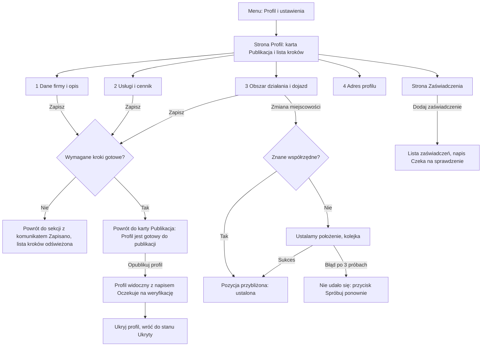

# Zadanie 004: Profil fachowca (edycja i strona publiczna)

- **Status:** gotowe (31.10.2026)
- **Etap:** Etap 1 — MVP: wyszukiwarka i profil (v0.2.0), pierwsze podzadanie
- **Gałąź:** feature/profil-fachowca
- **Utworzono:** 2026-10-31

## Cel (koordynator)
Fachowiec (rola `specialist`) ma wypełnić profil: dane firmy, rodzaje przeglądów, obsługiwane typy nieruchomości,
cennik, punkt startowy (miejscowość z TERYT) i promień dojazdu, zaświadczenia o uprawnieniach (pliki).
Publiczna strona profilu z przyjaznym adresem i jasnym oznaczeniem statusu weryfikacji.
Zgodnie z `docs/SPECYFIKACJA.md` (sekcje o fachowcu i wyszukiwarce) oraz `docs/PLAN_ETAPOW.md` Etap 1.

## Zakres
- W zakresie: model i migracje profilu, formularz edycji w panelu fachowca, strona publiczna profilu, wgrywanie
  zaświadczeń (bezpiecznie, poza `public/`), wykorzystanie TERYT i `GeocodingService` (geokodowanie wyłącznie w kolejce,
  warunek z audytu 003 #5), testy, dokumentacja.
- Poza zakresem: weryfikacja przez admina (zadanie 005), wyszukiwarka i mapa (zadanie 006), kalendarz i rezerwacje (Etap 2).

## Warunki z audytu zadania 003 (obowiązują to zadanie)
Geokodowanie tylko w kolejce (`ShouldBeUnique`), `withoutRedirecting()` i `https` dla `NOMINATIM_URL`,
HMAC w `geocode_cache`, frontend tylko `x-text`, `include_parts` jako `1`/`0`.

## Architekt
Data: 31.10.2026. Architekt. Decyzje techniczne: ADR-017 do ADR-020 w `docs/DECYZJE.md`; diagram ER w `docs/DOKUMENTACJA_TECHNICZNA.md` (rozdz. 4).
Zadanie jest większe niż 1 dzień (ok. 6,5 dnia pracy), więc jest podzielone na podzadania 004.1-004.9 (sekcja "Kolejność").
**Rewizja z 31.10.2026 (po sekcji UX):** uwzględnia decyzje właściciela (telefon publiczny tylko za zgodą, publikacja bez zaświadczenia, retencja skanów 12 miesięcy po usunięciu konta, brak zdjęcia/logo) i rozstrzyga sprzeczności S1-S13 z sekcji UX. Tabela rozstrzygnięć jest na końcu tej sekcji ("Rozstrzygnięcia S1-S13"), a konkretne zmiany tekstów UX w podsekcji "Uwagi do UX". Dodatkowy ADR: ADR-021. Gdzie decyzja jest biznesowa/prawna i nie ma jej wśród decyzji właściciela, przyjęto wariant bezpieczniejszy i oznaczono "do potwierdzenia przez właściciela".

### Założenia przyjęte przez architekta (koordynator proszony o potwierdzenie)
1. "Pozycja przybliżona" rozumiem tak: punkt startowy to środek miejscowości z TERYT, nie adres. UI pisze "pozycja przybliżona", a publicznie nie pokazujemy dokładniejszych współrzędnych niż 0,01 stopnia (ok. 1 km).
2. Mapy (Leaflet, kafelki OSM, CSP, wpis RODO o kafelkach) NIE wchodzą do 004, tylko do 006. Profil publiczny pokazuje obszar tekstem ("Dąbrówka, gm. Dopiewo, promień 30 km").
3. NIP zostaje w `users.nip` (ADR-010), w panelu tylko do odczytu (zmiana przez admina, bo NIP warunkuje okres próbny).
4. Pliki zaświadczeń nie są publiczne w żadnej formie w 004 (także miniatury).
5. (rewizja) Zdjęcie/logo jest poza zadaniem: w 004 nie ma kolumn `photo_*`, tras zdjęcia, Actions zdjęcia ani `PhotoController`. Dodanie zdjęcia później = osobne zadanie z własną migracją i ADR.

## 1. Model danych

Tabele (migracje w `database/migrations/2026_10_31_3000NN_*`). Typy kolumn wyliczeń to `varchar` (wartość enuma), bez CHECK (testy działają także na SQLite). Wszystkie FK z `onDelete` jak niżej.

### 1.1 Enumy (`app/Domain/...`)
| Enum | Klasa | Wartości | Uwagi |
|---|---|---|---|
| Rodzaj przeglądu | `App\Domain\Inspections\Enums\InspectionType` | `chimney`, `electrical`, `building_annual`, `building_five_year`, `gas`, `ecological` | `label()` z `lang/pl/inspections.php`. `electrical` obejmuje piorunochronną (spec §2). `ecological` = szamba i przydomowe oczyszczalnie. |
| Typ nieruchomości | `App\Domain\Properties\Enums\PropertyType` | `single_family_house`, `apartment`, `commercial_unit`, `multi_family_building`, `large_area_building` | `label()` z `lang/pl/properties.php`. |
| Status weryfikacji | `App\Domain\Specialists\Enums\VerificationStatus` | `pending`, `verified`, `rejected`, `revoked` | `label()`, `isPubliclyVisible()` (pending, verified). Zmienia je wyłącznie zadanie 005. |
| Typ konta | `App\Domain\Specialists\Enums\AccountType` | `sole_proprietor`, `company` | osoba (JDG) / firma z pracownikami. |
| Status pozycji | `App\Domain\Specialists\Enums\LocationStatus` | `pending`, `resolved`, `failed` | stan geokodowania punktu startowego. |
| Typ zaświadczenia | `App\Domain\Specialists\Enums\CertificateType` | `building_permit` (uprawnienia budowlane), `qualification_certificate` (świadectwo kwalifikacyjne), `master_chimney_sweep` (mistrz kominiarski), `other` | wyłącznie nazwy z `docs/PRZEPISY.md`; resztę łapie `other` + pole `title`. |
| Dokładność | istniejący `App\Domain\Geo\Enums\GeocodePrecision` | — | używany w `start_precision`. |

### 1.2 `specialist_profiles` (jeden profil na konto fachowca)
| Kolumna | Typ | Null | Domyślnie | Uwagi |
|---|---|---|---|---|
| `id` | bigint unsigned PK | nie | | |
| `user_id` | bigint unsigned | nie | | FK `users.id`, `cascadeOnDelete`, UNIQUE |
| `slug` | varchar(60) | nie | | UNIQUE (ADR-018) |
| `slug_changed_at` | timestamp | tak | | limit 1 zmiana / 30 dni po publikacji |
| `display_name` | varchar(120) | nie | | nazwa publiczna; start: `users.company_name` albo `users.name` |
| `account_type` | varchar(20) | nie | `sole_proprietor` | `AccountType` |
| `description` | text | tak | | czysty tekst, max 1500 znaków (walidacja), bez HTML |
| `phone` | varchar(20) | tak | | prywatny; format `+48XXXXXXXXX`; wymagany do publikacji (S10, `config('specialists.phone_required_to_publish')` = true; do potwierdzenia przez właściciela) |
| `phone_is_public` | boolean | nie | false | zgoda fachowca na pokazanie numeru (decyzja właściciela 1) |
| `phone_public_consent_at` | timestamp | tak | | moment włączenia zgody (dowód zgody, art. 7 ust. 1 RODO); ustawiane przez `UpdateSpecialistProfile` przy zmianie false -> true, zerowane przy wycofaniu; wycofanie działa od razu |
| `locality_simc` | char(7) | tak | | FK `teryt_localities.simc`, `restrictOnDelete` (miejscowości się nie kasuje, ADR-012) |
| `service_radius_km` | smallint unsigned | nie | 25 | 5-150 (walidacja, wartości w `config/specialists.php`) |
| `travel_rate_per_km_grosze` | int unsigned | nie | 0 | grosze za km dojazdu, 0-5000 |
| `travel_free_km` | smallint unsigned | nie | 0 | km gratis, nie więcej niż promień |
| `start_lat`, `start_lng` | decimal(10,7) | tak | | kopia środka miejscowości (pod bounding box w 006) |
| `start_precision` | varchar(20) | tak | | `GeocodePrecision` |
| `start_source` | varchar(20) | tak | | `locality_center` (zarezerwowane: `manual`) |
| `location_status` | varchar(20) | nie | `pending` | `LocationStatus` |
| `location_resolved_at` | timestamp | tak | | |
| `verification_status` | varchar(20) | nie | `pending` | `VerificationStatus` (tylko pole stanu; zapis przez 005) |
| `verified_at` | timestamp | tak | | |
| `is_published` | boolean | nie | false | decyzja fachowca "pokaż profil w serwisie" |
| `first_published_at` | timestamp | tak | | ustawiane raz; od niego liczy się reguła zmiany sluga |
| `created_at`, `updated_at` | timestamp | | | |

Indeksy: `UNIQUE(user_id)`, `UNIQUE(slug)`, `INDEX(verification_status)`, `INDEX(is_published, start_lat, start_lng)` (wstępny filtr bounding box w 006: najpierw `is_published = 1`, potem zakres `start_lat`, potem `start_lng`, na końcu haversine), `INDEX(locality_simc, location_status)` (job geokodowania i komenda ponowień).
`$fillable` zawiera tylko pola edytowalne przez fachowca (`display_name`, `account_type`, `description`, `phone`, `phone_is_public`, `service_radius_km`, `travel_rate_per_km_grosze`, `travel_free_km`). Pola `slug`, `locality_simc`, `start_*`, `location_*`, `verification_*`, `is_published`, `first_published_at`, `phone_public_consent_at` zapisują wyłącznie Actions przez `forceFill` (nigdy z `$request->all()`).
**Podział zapisu (S8):** `PUT /panel/profil` (`UpdateSpecialistProfile`) przyjmuje tylko `display_name`, `account_type`, `description`, `phone`, `phone_is_public`. Pola `service_radius_km`, `travel_rate_per_km_grosze`, `travel_free_km` przyjmuje wyłącznie `PUT /panel/profil/obszar` (`UpdateSpecialistServiceArea`), a `UpdateSpecialistServiceAreaRequest` waliduje `travel_free_km <= service_radius_km` na wartościach z tego samego formularza. Gdy `travel_rate_per_km_grosze = 0`, Action zapisuje też `travel_free_km = 0` (km gratis bez stawki nie mają sensu i nie są publiczne). Zmiana samego promienia/dojazdu NIE zeruje punktu startowego; zeruje go tylko zmiana `locality_simc`.

### 1.3 `specialist_services` (macierz: rodzaj przeglądu x typ nieruchomości + cena)
| Kolumna | Typ | Null | Uwagi |
|---|---|---|---|
| `id` | bigint unsigned PK | nie | |
| `specialist_profile_id` | bigint unsigned | nie | FK `specialist_profiles.id`, `cascadeOnDelete` |
| `inspection_type` | varchar(30) | nie | `InspectionType` |
| `property_type` | varchar(30) | nie | `PropertyType` |
| `price_grosze` | int unsigned | tak | cena brutto w groszach; NULL = "wycena indywidualna"; walidacja 100-5 000 000 (1-50 000 zł; mniej niż 1 zł traktujemy jako literówkę, zgodnie z propozycją UX) |
| `created_at`, `updated_at` | timestamp | | |

Indeksy: `UNIQUE(specialist_profile_id, inspection_type, property_type)`, `INDEX(inspection_type, property_type, specialist_profile_id)` (wyszukiwarka 006). Wiersz istnieje = fachowiec wykonuje ten rodzaj dla tego typu. "Rodzaje przeglądów" i "typy nieruchomości" w UI to dwie listy zaznaczeń, a Action `SyncSpecialistServices` zapisuje ich iloczyn (UX może też pokazać siatkę i pozwolić odznaczyć pojedyncze pola). Zapis: usuń brakujące, `upsert` pozostałych (jedno zapytanie), w transakcji.

### 1.4 `specialist_slug_redirects`
`id`, `specialist_profile_id` (FK, `cascadeOnDelete`), `old_slug` varchar(60) UNIQUE, `created_at`. Szczegóły: sekcja 2.

### 1.5 `specialist_certificates` (zaświadczenia: plik + metadane)
| Kolumna | Typ | Null | Uwagi |
|---|---|---|---|
| `id` | bigint unsigned PK | nie | |
| `ulid` | char(26) | nie | UNIQUE; klucz trasy (`getRouteKeyName`), nigdy numeryczne ID w adresie |
| `specialist_profile_id` | bigint unsigned | nie | FK, `cascadeOnDelete`, indeks `(specialist_profile_id, valid_until)` pod przypomnienia o wygaśnięciu (Etap 1/5) |
| `type` | varchar(30) | nie | `CertificateType` |
| `title` | varchar(150) | nie | zakres, np. "specjalność instalacyjna w zakresie sieci elektrycznych" (wolny tekst) |
| `number` | varchar(80) | nie | numer uprawnienia/świadectwa; prywatny |
| `issuer` | varchar(150) | tak | organ wydający |
| `valid_until` | date | tak | NULL = bezterminowo (jawny przełącznik w formularzu) |
| `file_path` | varchar(120) | nie | względna ścieżka na dysku `local`: `specialist-certificates/{40 losowych znaków}.{pdf|jpg}` |
| `file_original_name` | varchar(150) | nie | tylko do wyświetlania właścicielowi (oczyszczona, bez ścieżki); NIE używana do nazwy w systemie plików ani w nagłówku pobierania |
| `file_mime` | varchar(40) | nie | z `finfo` na zapisanej treści, nie od klienta |
| `file_size` | int unsigned | nie | bajty po przekodowaniu |
| `file_sha256` | char(64) | nie | kontrola integralności; zapobiega dwukrotnemu wgraniu tego samego pliku do jednego profilu |
| `created_at`, `updated_at` | timestamp | | |

**Znaczenie `updated_at` (S6):** zmiana metadanych zaświadczenia (`title`, `number`, `issuer`, `valid_until`) odświeża `updated_at`. Strona publiczna pokazuje zaświadczenie tylko, gdy profil jest `verified` i `certificate.updated_at <= profile.verified_at`. Zaświadczenie dodane lub zmienione po weryfikacji nie jest więc pokazywane jako sprawdzone (do decyzji w 005: osobne `reviewed_at` na zaświadczeniu lub cofnięcie statusu). Ta zasada jest w `BuildPublicSpecialistProfile` i ma test.

Nie dodajemy teraz: statusu pojedynczego dokumentu (decyzja admina na poziomie profilu, ewentualnie 005), `holder_user_id` (zaświadczenia pracowników, Etap 5, nullable, dojdzie osobną migracją), `expiry_reminder_sent_at` (przypomnienia 30 dni, osobne zadanie).

### 1.5a `archived_certificates` (archiwum skanów po usunięciu konta, retencja 12 miesięcy; ADR-021)
Tabela bez kluczy obcych do `users` i `specialist_profiles` (konto i profil są wtedy kasowane). Wiersz powstaje wyłącznie w `PurgeSpecialistData`. Nie jest wyświetlana fachowcowi (konto nie istnieje) ani publicznie; dostęp ma tylko `admin`.
| Kolumna | Typ | Null | Uwagi |
|---|---|---|---|
| `id` | bigint unsigned PK | nie | |
| `ulid` | char(26) | nie | UNIQUE; ten sam ULID co w `specialist_certificates` (ciągłość dziennika pobrań) |
| `former_user_id` | bigint unsigned | tak | zwykła liczba, BEZ FK (wskazanie do wpisu w `activity_log`; wyszukiwanie przy roszczeniu) |
| `holder_label` | varchar(120) | nie | `display_name` z chwili usunięcia; jedyna dana identyfikująca poza treścią skanu; potrzebna, żeby admin wiedział, czyj to skan |
| `type` | varchar(30) | nie | `CertificateType` |
| `title`, `number` | varchar(150) / varchar(80) | nie | kopia metadanych (zakres i numer to ta sama informacja, która jest na skanie, więc nie zwiększa zakresu danych; do potwierdzenia przez prawnika, wariant minimalny: tylko `type` i `valid_until`) |
| `issuer` | varchar(150) | tak | kopia |
| `valid_until` | date | tak | kopia |
| `verification_status_at_archive` | varchar(20) | nie | `VerificationStatus` z chwili usunięcia konta (dowód, czy weryfikacja się odbyła) |
| `verified_at` | timestamp | tak | kopia `specialist_profiles.verified_at` |
| `file_path` | varchar(120) | nie | `specialist-certificates-archive/{40 znaków}.{ext}` na dysku `local` (plik PRZENIESIONY, nie kopiowany; osobny katalog, żeby `prune-orphans` i polityka dostępu były niezależne) |
| `file_mime`, `file_size`, `file_sha256` | jak w 1.5 | nie | |
| `archived_at` | timestamp | nie | moment usunięcia konta; początek okresu retencji |
| `delete_after` | date | nie | `archived_at` + `config('specialists.archive_retention_months')` (12); INDEX |
| `created_at`, `updated_at` | timestamp | | |
Indeksy: `UNIQUE(ulid)`, `INDEX(delete_after)` (dzienna komenda czyszcząca). Nie kopiujemy: telefonu, opisu, NIP, e-maila, cennika, sluga. `$fillable` jawny; zapis tylko z Action.

### 1.6 Pozostałe zmiany w istniejących miejscach
- `config/filesystems.php`: dysk `local` ma `'serve' => false` (nigdy nie używamy `temporaryUrl`; mniej powierzchni ataku).
- `config/specialists.php` (nowy): zastrzeżone slugi, limity (promień, cena 100-5 000 000 gr, plik KB, liczba zaświadczeń, megapiksele, długość opisu, dni między zmianami sluga), `phone_required_to_publish` (true), `archive_retention_months` (12; zmiana okresu po opinii prawnika = jedna wartość, bez migracji), `rejected_certificates_retention_days` (30, tylko zapisane na potrzeby 005).
- `config/geocoding.php`: `ttl_found_days_street` = 30.
- `bootstrap/providers` / `AppServiceProvider`: rejestracja Policy (jak `UserPolicy`) i limiterów `profile-update`, `certificate-upload`, `profile-public`.
- Brak zmian w tabeli `users`.

## 2. Adres publiczny (slug) i jego zmiana
- **Format:** `^[a-z0-9]+(-[a-z0-9]+)*$`, 3-60 znaków. Wynik `Str::slug($display_name)` (polskie znaki transliterowane). Lista zastrzeżonych słów w configu (np. `nowy`, `szukaj`, `panel`, `admin`, `api`, `zdjecie`, `kontakt`) na wypadek przyszłych tras pod `/fachowiec/`.
- **Generowanie:** Action `GenerateSpecialistSlug`. Gdy zajęty: dopisek miejscowości (jeśli już wybrana), potem `-2`, `-3`, ... (pętla z `exists`, max 20 prób, potem losowy sufiks). Wyścig dwóch rejestracji rozstrzyga indeks UNIQUE: `EnsureSpecialistProfile` łapie `UniqueConstraintViolationException` i ponawia z nowym sufiksem.
- **Unikalność:** slug nie może równać się ani aktualnemu slugowi innego profilu, ani wpisowi w `specialist_slug_redirects` należącemu do innego profilu. Rule `AvailableSlug` sprawdza obie tabele (dwa zapytania z bindowaniem). Porównanie wielkości liter nie ma znaczenia (slug zawsze małymi literami, normalizowany przed walidacją).
- **Zmiana sluga** (`ChangeSpecialistSlug`, formularz na osobnej zakładce "Adres profilu"):
  - przed pierwszą publikacją (`first_published_at IS NULL`): dowolnie, bez limitu i bez przekierowań;
  - po publikacji: maksymalnie raz na 30 dni (`slug_changed_at`), stary slug zapisywany w `specialist_slug_redirects` w tej samej transakcji; formularz pokazuje ostrzeżenie "Dotychczasowe linki nadal będą działać";
  - powrót do własnego starego sluga: usuń jego wiersz z przekierowań i zmień slug (to też liczy się do limitu);
  - zapis do dziennika aktywności (stary i nowy slug).
- **Obsługa adresu:** `FindPublishedSpecialistBySlug`: najpierw `slug`; jeśli brak, szuka w przekierowaniach i zwraca `301` na `route('specialists.show', aktualny_slug)`. Przekierowanie bez ujawniania, czy profil jest ukryty: jeśli docelowy profil nie jest publiczny, odpowiedź to zwykłe 404.
- **Nie pozwalamy** na slug z danymi osobowymi nieobecnymi w nazwie publicznej (slug jest zawsze budowany z `display_name` lub edytowany ręcznie przez właściciela; kontrola przez admina w 005 przy weryfikacji).

## 3. Zaświadczenia: obsługa plików (CLAUDE.md §8) i RODO
### 3.1 Wgrywanie (`UploadSpecialistCertificate`, wywoływane z `StoreCertificateRequest`)
1. Form Request: `file` (wymagany), `mimes:pdf,jpg,jpeg,png`, `max:5120` (KB, wartość z configu); `type` (Enum), `title` (3-150), `number` (3-80), `issuer` (0-150), `valid_until` (data, nie wcześniejsza niż dziś, albo pole `no_expiry` = true), pole zgody "Oświadczam, że mam prawo przekazać ten dokument i zasłoniłem dane, które nie są potrzebne do weryfikacji (np. PESEL)" (checkbox wymagany, zapisujemy fakt w dzienniku aktywności).
2. Action (po walidacji Laravela, która już sprawdza MIME po zawartości przez finfo): niezależnie `finfo_file` na pliku tymczasowym, whitelista `application/pdf`, `image/jpeg`, `image/png`; rozszerzenie wynika z MIME, nie z nazwy klienta.
3. Obraz: `getimagesize` (odrzuć, gdy szerokość x wysokość > 16 000 000 px), dekodowanie GD, ewentualne zmniejszenie do 2400 px dłuższego boku, zapis jako JPEG jakość 85 (usuwa EXIF/GPS i ukrytą treść). Błąd GD = odrzucenie z komunikatem "Nie udało się odczytać zdjęcia".
4. PDF: nagłówek `%PDF-` w pierwszych 1024 bajtach; odrzucenie, jeśli w pierwszych 2 MB występują znaczniki `/JavaScript`, `/JS`, `/Launch`, `/EmbeddedFile`, `/OpenAction`, `/AA` (higiena, nie gwarancja; ograniczenie opisane w ADR-019). Plik nie jest otwierany ani renderowany po stronie serwera.
5. Zapis: `Storage::disk('local')->putFileAs('specialist-certificates', ..., Str::random(40).'.'.$ext)`; zapis wiersza w transakcji; jeśli zapis wiersza się nie uda, plik jest usuwany w `catch`.
6. Limity: 10 zaświadczeń na profil, 5 MB na plik, 40 MB łącznie na profil; limiter `certificate-upload` 10 / godz. na użytkownika; ten sam `file_sha256` w profilu = odrzucenie ("ten plik już dodano").
7. Wymiana pliku dla istniejącego zaświadczenia = usunięcie i dodanie nowego (bez edycji pliku w miejscu). Edycja metadanych (`title`, `number`, `issuer`, `valid_until`) osobnym PUT.

### 3.2 Wydawanie (`CertificateFileController@show`)
- Trasa `GET /panel/zaswiadczenia/{certificate}/plik`, klucz = `ulid`. Middleware: `auth`, `verified`, `two-factor.required`, `no-store`. Autoryzacja `can:view,certificate`.
- **Kto może pobrać:** (1) właściciel profilu (`$user->id === $profile->user_id`), (2) `admin`. Nikt inny: ani inny fachowiec, ani klient, ani pracownik (`technician`) firmy w tej wersji, ani niezalogowany. Nie ma żadnego publicznego linku.
- Nagłówki: `Content-Type` z `file_mime`, `Content-Disposition: attachment; filename="zaswiadczenie-{ulid}.{ext}"` (własna nazwa; oryginalnej nazwy nie wstawiamy do nagłówka), `X-Content-Type-Options: nosniff`, `Cache-Control: private, no-store`. Obrazy też jako załącznik w 004 (podgląd inline w panelu admina: decyzja przy 005, jeśli UX tego zażąda; wtedy tylko przekodowane JPEG).
- Każde pobranie przez admina (nie przez właściciela) zapisywane w `activity_log` (log `security_admin`): kto, które zaświadczenie (ULID), kiedy, IP. Bez zawartości pliku.
- Plik brakujący na dysku (rozjazd): 404 + `Log::error` z ULID.

### 3.3 Usuwanie i porządki
- `DeleteSpecialistCertificate` (usunięcie pojedynczego zaświadczenia przy ŻYWYM koncie): kasuje wiersz i plik OD RAZU (po zatwierdzeniu transakcji), wpis do dziennika. Nie trafia do archiwum 12 miesięcy: archiwum dotyczy wyłącznie usunięcia całego konta (decyzja architekta, S2d; minimalizacja danych; do potwierdzenia przez właściciela/prawnika). Właściciel może usunąć swoje zaświadczenie zawsze (skutki dla statusu weryfikacji: 005, zapisane jako zależność).
- **Usunięcie konta, Action `PurgeSpecialistData::handle(User $user)`** (`app/Domain/Specialists/Actions/`; w 004 implementowana i testowana, ale NIE podpięta do żadnego ekranu, bo usuwanie konta należy do zadania RODO, które ją wywoła PRZED skasowaniem użytkownika). Kolejność, jedna transakcja bazy:
  1. Wczytaj profil z zaświadczeniami. Brak profilu: nic do zrobienia.
  2. Dla każdego zaświadczenia: przenieś plik `Storage::disk('local')->move('specialist-certificates/x', 'specialist-certificates-archive/x')` i dodaj wiersz `archived_certificates` (sekcja 1.5a) z `archived_at = now()`, `delete_after = now()->addMonths(config('specialists.archive_retention_months'))`.
  3. Usuń profil (`delete()`; kaskada kasuje `specialist_services`, `specialist_slug_redirects`, `specialist_certificates`). Telefon, opis, cennik, slug znikają.
  4. Wpis do dziennika (log `specialist`): liczba zarchiwizowanych zaświadczeń i `delete_after`, bez numerów.
  Błąd w środku: transakcja się cofa, a przeniesione już pliki wracają na miejsce w `catch` (best effort, błąd logowany); Action rzuca wyjątek i konto NIE jest usuwane (kolejność gwarantuje wywołujący).
- **Czyszczenie archiwum, komenda `certificates:purge-archive`** (codziennie 03:30 w `routes/console.php`): `ArchivedCertificate::where('delete_after', '<=', today())->chunkById(100, ...)`; dla każdego wywołuje Action `DeleteArchivedCertificate` (usuwa plik z dysku, potem wiersz; brak pliku = ostrzeżenie w logu, wiersz i tak usuwany; idempotentne). Komenda zapisuje w `activity_log` (log `retention`) tylko liczbę usuniętych i ULID-y. Gdy znajdzie wiersz przeterminowany o więcej niż 7 dni (czyli cron nie działał), robi `Log::error`. `DeleteArchivedCertificate` jest też dostępna dla admina w 005 (wcześniejsze usunięcie na żądanie, np. po uwzględnieniu sprzeciwu, z wpisem do dziennika i powodem). Przedłużenie okresu (zawieszenie kasowania przy toczącym się sporze) = zmiana `delete_after` przez admina w 005, z wpisem do dziennika.
- Komenda `certificates:prune-orphans` (cotygodniowo): sprząta dwa katalogi niezależnie: `specialist-certificates/` względem `specialist_certificates.file_path` oraz `specialist-certificates-archive/` względem `archived_certificates.file_path`; usuwa tylko pliki bez wiersza i starsze niż 1 dzień.
- Dostęp do archiwum: tylko `admin`, Policy `ArchivedCertificatePolicy@view`, brak wydawania plików fachowcowi. Trasa wydawania pliku archiwalnego powstaje w 005 (panel admina) z logowaniem każdego pobrania jak w 3.2; w 004 archiwum jest tylko zapisywane i czyszczone.
- Kopie zapasowe: katalogi są w `storage/app/private`, więc trafiają do tygodniowej kopii plików (szyfrowanej AES-256). Pliki usunięte (zwykłe usunięcie lub koniec retencji) żyją w kopiach do 14 dni, więc faktyczny koniec przechowywania skanu po usunięciu konta to 12 miesięcy + do 14 dni (wpis w RODO_REJESTR i polityce prywatności).

### 3.4 RODO
- Podstawa: art. 6.1.b (świadczenie usługi serwisu dla fachowca: weryfikacja uprawnień) i 6.1.f (bezpieczeństwo użytkowników; zapobieganie podszywaniu się). Skany zawierają często PESEL i datę urodzenia: minimalizacja przez oświadczenie przy wgrywaniu i wskazówkę w UX ("zasłoń PESEL i adres zamieszkania; admin potrzebuje: imię i nazwisko, rodzaj uprawnień, numer, zakres, datę").
- Dostęp: właściciel i admin. Brak transferu poza serwerem (poza kopiami).
- **Okres przechowywania (decyzja właściciela z 31.10.2026, ADR-021):** przy żywym koncie do chwili usunięcia zaświadczenia przez fachowca; po usunięciu konta skan i podstawowe metadane (rodzaj, zakres, numer, wydawca, data ważności, nazwa publiczna, status weryfikacji z chwili usunięcia) przechowywane są 12 miesięcy w osobnej tabeli/katalogu dostępnym tylko dla administratora, potem automatycznie usuwane. Zastępuje to wiersz "konto + 1 rok" w `RODO_REJESTR.md`.
- **Podstawa prawna (HIPOTEZA, DO WERYFIKACJI PRZEZ PRAWNIKA):** art. 6 ust. 1 lit. f RODO (prawnie uzasadniony interes administratora: wykazanie, że weryfikacja uprawnień została przeprowadzona, oraz ustalenie, dochodzenie i obrona roszczeń, w tym roszczeń klientów wobec platformy lub fachowca), w związku z wyjątkiem z art. 17 ust. 3 lit. e RODO (prawo do usunięcia nie ma zastosowania, gdy przetwarzanie jest niezbędne do obrony roszczeń). Do oceny prawnika także: (1) czy 12 miesięcy jest proporcjonalne (przedawnienie roszczeń cywilnych bywa dłuższe, a obowiązki platform wobec przedsiębiorców z DSA art. 30 mogą wymagać krótszego okresu, np. 6 miesięcy; okres jest w `config/specialists.php`, więc zmiana nie wymaga migracji), (2) czy interes administratora przeważa nad interesem osoby, której dane dotyczą (wymagana notatka z testu równowagi interesów w rejestrze RODO), (3) czy fachowiec musi być poinformowany przy usuwaniu konta (tak: informacja w polityce prywatności i na ekranie usuwania konta w zadaniu RODO), (4) prawo sprzeciwu z art. 21: Action `DeleteArchivedCertificate` pozwala adminowi usunąć archiwum wcześniej po uwzględnieniu sprzeciwu.
- **Zakres:** pliki oraz wymienione metadane (`archived_certificates`). Nie archiwizujemy telefonu, e-maila, opisu, cennika ani NIP. Jedyną daną identyfikującą poza treścią skanu jest `holder_label` (nazwa publiczna) i `former_user_id`. To wariant bezpieczniejszy niż archiwizacja całego profilu i bardziej użyteczny niż same pliki bez opisu (admin nie wiedziałby, czyj to skan). Do potwierdzenia przez właściciela/prawnika (wariant minimalny: tylko pliki + `type` + `valid_until`).
- Dla odrzuconych weryfikacji przy żywym koncie: przechowywanie do rozstrzygnięcia w 005 (propozycja: usunięcie plików 30 dni po odrzuceniu, o ile fachowiec nie ponowi prośby; wartość w configu, bez implementacji w 004).

## 4. Dane publiczne i niepubliczne
Widoczność egzekwuje jeden obiekt `PublicSpecialistData` (DTO budowany z modelu przez `BuildPublicSpecialistProfile`), a widok Blade dostaje wyłącznie ten DTO, nie model. To zabezpiecza przed przypadkowym wypisaniem pola prywatnego.

| Dane | Publiczne? | Podstawa prawna / uwagi |
|---|---|---|
| Nazwa publiczna (`display_name`), typ konta (osoba/firma) | tak | 6.1.b (usługa prezentacji profilu na życzenie fachowca); publikacja następuje dopiero po akcji "Opublikuj profil" |
| Opis | tak | j.w.; opis tylko tekst, escapowany `{{ }}`, bez autolinków. Zdjęcie/logo: poza zadaniem (decyzja właściciela 4) |
| Rodzaje przeglądów x typy nieruchomości, ceny, stawka za km, km gratis | tak | j.w.; ceny oznaczone "orientacyjne, brutto" |
| Miejscowość startowa (nazwa, gmina, powiat), promień | tak | j.w.; to środek miejscowości, nie adres |
| Współrzędne | tylko zaokrąglone do 0,01° i w 006 (okrąg na mapie); w 004 nie wypisujemy ich w ogóle | minimalizacja |
| Status weryfikacji i data weryfikacji | tak | 6.1.b + ochrona konsumenta (jasna informacja, kto jest sprawdzony) |
| Zaświadczenia: rodzaj, zakres (`title`), data ważności | dopiero po `verified` i tylko te z `updated_at <= verified_at` (S6); do czasu weryfikacji napis "Uprawnienia: oczekują na weryfikację", niezależnie od tego, czy skan został dodany | nie twierdzimy, że uprawnienia są potwierdzone, zanim admin je sprawdzi |
| Zaświadczenia: numer, wystawca, plik, skan, miniatura | NIE | dane wrażliwe z punktu widzenia ryzyka; dostęp właściciel i admin |
| Telefon | tylko gdy `phone_is_public = true` (domyślnie wyłączone; decyzja właściciela 1), w 004 pokazywany tekstem; przed Etapem 2 jedyny kontakt. `BuildPublicSpecialistProfile` w ogóle nie wkłada numeru do DTO, gdy zgoda wyłączona (numeru nie ma w HTML) | 6.1.a: zgoda z dowodem (`phone_public_consent_at`), wycofanie od razu; prywatny numer (do kontaktu admina, rezerwacji): 6.1.b |
| E-mail konta | NIE (kontakt tylko przez serwis) | |
| NIP, `users.name` (jeśli różne od nazwy publicznej), data rejestracji | NIE | NIP JDG to dane osobowe; widzi admin |
| Adres zamieszkania/siedziby | nie jest zbierany | minimalizacja |
Profil niepubliczny (`is_published = 0`, ban, status `rejected`/`revoked`): 404 dla wszystkich z wyjątkiem właściciela i admina, którzy widzą podgląd z paskiem "Profil jest niewidoczny" i nagłówkami `noindex`, `Cache-Control: private, no-store`.
**Warunki publikacji (`ProfileCompleteness`, `app/Domain/Specialists/Support/`; decyzja właściciela 2 i S1, S10):** trzy kroki wymagane, wszystkie liczone z bazy bez dodatkowych zapytań poza `services()->exists()`:
- `data`: `display_name` niepuste ORAZ `phone` niepusty (gdy `config('specialists.phone_required_to_publish')` = true; S10),
- `services`: co najmniej jedna pozycja w `specialist_services`,
- `area`: `locality_simc` wybrane i `service_radius_km` w zakresie (stan `location_status` NIE blokuje: `pending` i `failed` dopuszczają publikację).
Krok zalecany (niewymagany, nigdy nie blokuje): `description` niepusty, `certificates` (co najmniej jedno zaświadczenie). Konto niezbanowane jest sprawdzane w Policy, nie w `ProfileCompleteness`.
Kontrakt klasy (dla frontendu i pulpitu): `ProfileCompleteness::for(SpecialistProfile $profile)`; `required(): array<string,bool>` z kluczami `data|services|area`; `recommended(): array<string,bool>` z kluczami `description|certificates`; `isComplete(): bool` = wszystkie `required()` true; `missing(): list<string>` = klucze niespełnionych kroków wymaganych (klucze odpowiadają `lang/pl/specialist.php` `steps.*`); `requiredDone(): int` i `requiredTotal(): int` (= 3) do napisu "Wymagane kroki: 2 z 3". `PublishSpecialistProfile` przy niespełnionym warunku rzuca `ValidationException` z listą braków (nie `abort`), więc ten sam kontrakt działa później w API. Nie ma osobnej zmiennej "kompletność w procentach".

## 5. Geokodowanie punktu startowego (kolejka)
Zasada (audyt 003 #5): żadnego geokodowania w żądaniu webowym. Przebieg:
1. `UpdateSpecialistServiceArea` (Action wołana z `ServiceAreaController`): waliduje `locality_simc` (aktywna miejscowość), promień, stawkę za km i km gratis (S8). Przy zmianie miejscowości (tylko wtedy) zeruje `start_*`, `location_status = pending`.
2. Jeśli `teryt_localities` ma już `lat/lng` (częsty przypadek po pierwszym użyciu w kraju): kopiuje je do profilu synchronnie (zero sieci), `location_status = resolved`, `start_precision = locality`, `start_source = locality_center`.
3. Jeśli nie ma: `GeocodeLocalityJob::dispatch($simc)->afterCommit()`.
4. `GeocodeLocalityJob` (`app/Domain/Specialists/Jobs`): `ShouldQueue`, `ShouldBeUnique` (`uniqueId()` = `simc`, `uniqueFor` = 300 s; blokady działają na cache `database`), `tries = 3`, `backoff = [120, 600, 1800]`, `timeout = 30`. Działanie: (a) jeśli `GeocodingProvider::isConfigured()` jest false, kończy bez wyjątku i bez ponowień (profil zostaje `pending`; log raz na dobę robi już `GeocodingService`); (b) woła `ResolveLocalityCoordinates::handle()`; (c) gdy wynik jest, uzupełnia jednym zapytaniem `UPDATE` wszystkie profile z tym `simc` i `location_status != resolved` (`resolved`); (d) gdy wynik `null` (usługa niedostępna lub "nie znaleziono"), rzuca wyjątek, żeby zadziałał `backoff`; w `failed()` ustawia `location_status = failed` dla profili tej miejscowości.
5. Komenda `specialists:retry-geocoding` (godzinowo w harmonogramie): jeśli dostawca skonfigurowany, bierze do 20 różnych `locality_simc` z profili `pending`/`failed` starszych niż 1 godzina i dispatchuje joby (unikalność chroni przed dublami). Przycisk "Spróbuj ponownie" w panelu robi to samo dla własnej miejscowości, limiter 3 / godz.
6. Limit 1 zapytanie/s do Nominatim zapewnia istniejący `NominatimThrottle`; kolejka `queue:work --stop-when-empty --max-time=50` obsłuży kilkadziesiąt miejscowości na minutę.
7. **Zachowanie "pozycja przybliżona":** w panelu i na profilu: "Pozycja przybliżona: środek miejscowości {nazwa}". Dopóki `pending`: komunikat "Ustalamy położenie miejscowości, to trwa zwykle do kilku minut", profil można opublikować, ale nie będzie jeszcze znajdowany w wyszukiwaniu po odległości (wymóg dla 006: pomija `location_status != resolved`). `failed`: komunikat z przyciskiem ponowienia i informacją, że pomoże kontakt z administratorem.
8. **Warunki audytu 003 (podzadanie 004.1, przed resztą):**
   - `AddressQuery::hash()` = `hash_hmac('sha256', <znormalizowany tekst>, (string) config('app.key'))`; wpisy sprzed zmiany wygasną same (TTL), nie robimy migracji. Test: ten sam adres daje inny skrót przy innym `app.key`.
   - `NominatimProvider`: `->withoutRedirecting()`; odrzucenie odpowiedzi większej niż 64 KB (po `strlen($response->body())`) jako `bad_response`.
   - `ProductionConfigGuard`: `NOMINATIM_URL` musi mieć schemat `https` (wyjątek: pusty lub host lokalny w środowisku `local`/`testing`).
   - TTL: `GeocodingService::finish()` dostaje informację, czy zapytanie miało ulicę; trafienie dla zapytania z ulicą żyje `ttl_found_days_street` (30 dni), bez ulicy 180 dni.
   - Poprawić komentarz w migracji `geocode_cache`, w `GeocodingService` i w ADR-013 na "pseudonimizacja".
   - Frontend (autouzupełnianie miejscowości w formularzu): tylko `x-text`, `include_parts` jako `1`/`0`; komponent Alpine zarejestrowany przez `Alpine.data()` (CSP, ADR-007).

## 6. Kontrakt tras i Policies
Wszystkie trasy panelu: middleware `auth`, `verified`, `two-factor.required`, `no-store` (kolejność jak w ADR-009), plus `can:` z Policy. Kontrolery cienkie, logika w Actions, walidacja w Form Requestach (`app/Http/Requests/Specialist/`).

| Metoda i adres | Nazwa trasy | Kontroler@metoda / Action | Autoryzacja | Limit |
|---|---|---|---|---|
| GET `/panel/profil` | `specialist.profile.edit` | `ProfileController@edit` (woła `EnsureSpecialistProfile`) | `can:manage-profile` (Gate: rola `specialist`) | |
| PUT `/panel/profil` | `specialist.profile.update` | `ProfileController@update` / `UpdateSpecialistProfile` | `can:update,profile` | `profile-update` 30/min |
| PUT `/panel/profil/adres` | `specialist.profile.slug` | `SlugController@update` / `ChangeSpecialistSlug` | `can:update,profile` | `profile-update` |
| PUT `/panel/profil/uslugi` | `specialist.profile.services` | `ServicesController@update` / `SyncSpecialistServices` | `can:update,profile` | `profile-update` |
| PUT `/panel/profil/obszar` | `specialist.profile.area` | `ServiceAreaController@update` / `UpdateSpecialistServiceArea` (miejscowość, promień, stawka i km gratis) | `can:update,profile` | `profile-update` |
| POST `/panel/profil/obszar/ponow` | `specialist.profile.area.retry` | `ServiceAreaController@retry` | `can:update,profile` | 3/godz. na użytkownika |
| POST `/panel/profil/publikacja` | `specialist.profile.publish` | `PublicationController@store` / `PublishSpecialistProfile` | `can:publish,profile` | `profile-update` |
| DELETE `/panel/profil/publikacja` | `specialist.profile.unpublish` | `PublicationController@destroy` / `UnpublishSpecialistProfile` | `can:update,profile` | `profile-update` |
| GET `/panel/zaswiadczenia` | `specialist.certificates.index` | `CertificateController@index` | `can:viewAny,Certificate` | |
| POST `/panel/zaswiadczenia` | `specialist.certificates.store` | `CertificateController@store` / `UploadSpecialistCertificate` | `can:create,Certificate` (limit liczby) | `certificate-upload` 10/godz. |
| PUT `/panel/zaswiadczenia/{certificate:ulid}` | `specialist.certificates.update` | `CertificateController@update` / `UpdateSpecialistCertificate` | `can:update,certificate` | `profile-update` |
| DELETE `/panel/zaswiadczenia/{certificate:ulid}` | `specialist.certificates.destroy` | `CertificateController@destroy` / `DeleteSpecialistCertificate` | `can:delete,certificate` | `profile-update` |
| GET `/panel/zaswiadczenia/{certificate:ulid}/plik` | `specialist.certificates.file` | `CertificateFileController@show` | `can:view,certificate` | 60/min |
| GET `/fachowiec/{slug}` | `specialists.show` | `PublicSpecialistController@show` / `FindPublishedSpecialistBySlug` + `BuildPublicSpecialistProfile` | publiczne; Policy `SpecialistProfilePolicy@view` (podgląd właściciela/admina) | `profile-public` 120/min na IP |
| GET `/jak-weryfikujemy-fachowcow` | `pages.verification` | `Route::view` na `pages.verification` (jak `terms`, `privacy` w `routes/web.php`) | publiczne | grupa domyślna `web` |

Zmiany kontraktu po rewizji: (a) trasy i kontrolery zdjęcia usunięte (decyzja 4); (b) `PUT /panel/profil/obszar` przyjmuje `locality_simc`, `service_radius_km`, `travel_rate_per_km_grosze`, `travel_free_km` (S8); `PUT /panel/profil` przyjmuje tylko pola z sekcji "Dane"; (c) `POST /panel/profil/publikacja` zwraca błąd walidacji z listą braków `data|services|area`, nigdy nie wymaga zaświadczenia (S1); (d) trasa wydawania plików archiwalnych (`GET /admin/archiwum-zaswiadczen/{ulid}/plik`) powstaje w 005, w 004 nie ma żadnej trasy do archiwum; (e) strona `pages.verification` jest statyczna, treść pod szkic do weryfikacji prawnika (patrz Rozstrzygnięcia, pytanie UX 5); (f) menu panelu: pozycja "Profil i ustawienia" -> `route('specialist.profile.edit')`, aktywna dla `specialist.profile.*` i `specialist.certificates.*` (S13).

Policies (rejestracja ręczna jak `UserPolicy`, w `app/Domain/Specialists/Policies/`):
- `SpecialistProfilePolicy`: `update`/`publish` = właściciel (`$user->id === $profile->user_id`) i rola `specialist` i niezbanowany; `view` = profil publiczny (opublikowany, status widoczny, właściciel niezbanowany) dla każdego, a niepubliczny tylko dla właściciela i `admin`; `publish` dodatkowo wymaga `ProfileCompleteness::isComplete()` (bez zaświadczeń, S1).
- `ArchivedCertificatePolicy` (`viewAny`, `view`, `delete`): wyłącznie `admin`; w 004 używana tylko w teście i przygotowana pod 005.
- `SpecialistCertificatePolicy`: `viewAny`, `create` (właściciel profilu, poniżej limitu 10), `update`/`delete` (właściciel), `view` (właściciel lub `admin`).
- Gate `manage-profile`: użytkownik ma rolę `specialist`. Rola `technician` nie ma dostępu do żadnej trasy `/panel/profil*` ani `/panel/zaswiadczenia*`.
- `EnsureSpecialistProfile` tworzy profil tylko dla roli `specialist`; powtórne wywołanie jest idempotentne (`firstOrCreate` po `user_id` w transakcji). Tworzenie przy GET jest świadome (brak osobnego kroku "załóż profil"); ADR-017 nie jest potrzebny na to, to zwykła decyzja implementacyjna opisana w PHPDoc.
- Wszystkie zapisy (zmiana nazwy, sluga, publikacja, dodanie/usunięcie zaświadczenia, zmiana miejscowości/promienia) przez istniejący `AuditLogger` do `activity_log` (log `specialist`), bez wartości telefonu i numerów zaświadczeń.

## 7. Pliki do utworzenia i zmiany
Nowe (ścieżki względem katalogu projektu):
- Enumy: `app/Domain/Inspections/Enums/InspectionType.php`, `app/Domain/Properties/Enums/PropertyType.php`, `app/Domain/Specialists/Enums/{VerificationStatus,AccountType,LocationStatus,CertificateType}.php`.
- Modele: `app/Domain/Specialists/Models/{SpecialistProfile,SpecialistService,SpecialistCertificate,SpecialistSlugRedirect,ArchivedCertificate}.php` + fabryki w `database/factories/`.
- Migracje: `database/migrations/2026_10_31_300001_create_specialist_profiles_table.php` (bez `photo_*`, z `phone_public_consent_at`), `..300002_create_specialist_services_table.php`, `..300003_create_specialist_slug_redirects_table.php`, `..300004_create_specialist_certificates_table.php`, `..300005_create_archived_certificates_table.php`.
- Actions (`app/Domain/Specialists/Actions/`): `EnsureSpecialistProfile`, `UpdateSpecialistProfile`, `GenerateSpecialistSlug`, `ChangeSpecialistSlug`, `SyncSpecialistServices`, `UpdateSpecialistServiceArea`, `PublishSpecialistProfile`, `UnpublishSpecialistProfile`, `UploadSpecialistCertificate`, `UpdateSpecialistCertificate`, `DeleteSpecialistCertificate`, `PurgeSpecialistData`, `DeleteArchivedCertificate`, `FindPublishedSpecialistBySlug`, `BuildPublicSpecialistProfile`. (Actions zdjęcia usunięte z zadania.)
- Dane i wsparcie: `app/Domain/Specialists/Data/PublicSpecialistData.php`, `app/Domain/Specialists/Support/{ProfileCompleteness,CertificateFileInspector,ImageReencoder,Grosze,PublicCoordinates}.php`, `app/Domain/Specialists/Rules/{AvailableSlug,ValidPhone}.php`.
- Job i komendy: `app/Domain/Specialists/Jobs/GeocodeLocalityJob.php`, `app/Console/Commands/RetrySpecialistGeocodingCommand.php` (`specialists:retry-geocoding`), `app/Console/Commands/PruneCertificateOrphansCommand.php` (`certificates:prune-orphans`, dwa katalogi), `app/Console/Commands/PurgeArchivedCertificatesCommand.php` (`certificates:purge-archive`, codziennie).
- Policies: `app/Domain/Specialists/Policies/{SpecialistProfilePolicy,SpecialistCertificatePolicy,ArchivedCertificatePolicy}.php`.
- HTTP: `app/Http/Controllers/Specialist/{ProfileController,SlugController,ServicesController,ServiceAreaController,PublicationController,CertificateController,CertificateFileController}.php`, `app/Http/Controllers/PublicSpecialistController.php`, Form Requesty w `app/Http/Requests/Specialist/` (po jednym na formularz).
- Config i tłumaczenia: `config/specialists.php`, `lang/pl/{inspections,properties,specialist,certificates}.php`, dopiski w istniejącym `lang/pl/pages.php` (strona weryfikacji).
- Widoki (frontend, po UX): `resources/views/specialist/profile/*.blade.php`, `resources/views/specialist/certificates/*.blade.php`, `resources/views/specialists/show.blade.php`, `resources/views/pages/verification.blade.php` (stopka `<!-- DO WERYFIKACJI PRZEZ PRAWNIKA -->`), JS komponentu autouzupełniania w `resources/js/`.
- Testy: `tests/Feature/Specialists/*`, `tests/Unit/Specialists/*`.
Zmieniane: `routes/web.php`, `routes/console.php` (harmonogram: `specialists:retry-geocoding` co godzinę, `certificates:prune-orphans` tygodniowo, `certificates:purge-archive` codziennie 03:30), `resources/views/layouts/app.blade.php` (link menu, S13), `resources/views/dashboard/specialist.blade.php` i `lang/pl/dashboard.php` (kroki z `ProfileCompleteness`), `app/Providers/AppServiceProvider.php` (Policy, limitery), `config/filesystems.php` (`serve=false`), `config/geocoding.php`, `app/Domain/Geo/Data/AddressQuery.php`, `app/Domain/Geo/Services/{GeocodingService,NominatimProvider}.php`, `app/Support/Security/ProductionConfigGuard.php`, `app/Http/Controllers/DashboardController.php` (link "Profil i zaświadczenia" dla specjalisty), `docs/RODO_REJESTR.md` (audytor), `CHANGELOG.md`, `docs/DOKUMENTACJA_TECHNICZNA.md` (rozdz. 5-6 po wdrożeniu).
Brak nowych paczek Composer i npm. Wymagane rozszerzenia PHP na serwerze: `gd` (z JPEG), `fileinfo` (do sprawdzenia na home.pl; dopisać do `composer.json` w `require` jako `ext-gd`, `ext-fileinfo`).

## 8. Kolejność prac (podzadania)
| # | Podzadanie | Agent | Czas | Zależność |
|---|---|---|---|---|
| 004.1 | Poprawki geokodowania z audytu 003 (HMAC, `withoutRedirecting`, https, limit rozmiaru, TTL ulicy, komentarze) + testy | backend | 0,5 d | brak |
| 004.2 | Enumy, config (z `archive_retention_months`, `phone_required_to_publish`), migracje 300001-300005 (bez `photo_*`, z `phone_public_consent_at` i `archived_certificates`), modele, fabryki, Policies (szkielety), `serve=false` | backend | 1 d | brak |
| 004.3 | Profil: `EnsureSpecialistProfile`, `UpdateSpecialistProfile` (tylko sekcja Dane + zgoda na telefon), slug (generowanie, zmiana, przekierowania), `SyncSpecialistServices`, `Grosze`, `ProfileCompleteness` (bez zaświadczeń), `PublishSpecialistProfile`/`Unpublish`, Form Requesty, trasy panelu (bez widoków dopracowanych) | backend | 1,5 d | 004.2 |
| 004.4 | Obszar działania i dojazd: `UpdateSpecialistServiceArea` (miejscowość, promień, stawka, km gratis), `GeocodeLocalityJob`, komenda ponowień, harmonogram | backend | 1 d | 004.1, 004.3 |
| 004.5 | Zaświadczenia: upload/inspekcja/przekodowanie, wydawanie, usuwanie pojedyncze, `PurgeSpecialistData` + `DeleteArchivedCertificate` + `certificates:purge-archive`, `prune-orphans` (2 katalogi), dziennik admina | backend | 2 d | 004.2 |
| 004.6 | UX: przepływ i teksty (ZROBIONE; jedna strona z sekcjami + strona Zaświadczenia, S7); poprawki UX z podsekcji "Uwagi do UX" | ux-designer | 0,25 d | 004.2 |
| 004.7 | Widoki panelu + komponent autouzupełniania miejscowości + link w menu i pulpit (S13) | frontend | 1,5 d | 004.3-004.6 |
| 004.8 | Strona publiczna `/fachowiec/{slug}` + `PublicSpecialistData` + statyczna strona `/jak-weryfikujemy-fachowcow` (bez zdjęcia/logo) | backend + frontend | 1,25 d | 004.3, 004.5 |
| 004.9 | Testy Pest + lista ręczna, audyt, wpisy RODO, CHANGELOG, dokumentacja | tester, audytor, koordynator | 1 d | wszystko |
Zasada: 004.1 zamykamy i commitujemy osobno (to poprawki cudzego kodu z 003), potem reszta w jednej gałęzi `feature/profil-fachowca`. Zadanie dotyka plików, danych osobowych i formularzy, więc audytor jest obowiązkowy.

## 9. Ryzyka
| Ryzyko | Skutek | Środek |
|---|---|---|
| `NOMINATIM_CONTACT_EMAIL` pusty (decyzja ADR-016) | miejscowości bez współrzędnych zostają `pending`; profile nie są znajdowane po odległości w 006 | WYSOKIE dla startu serwisu. Przed wdrożeniem właściciel podaje adres albo zasilamy współrzędne miejscowości inaczej (np. z PRG, ADR-012). Wpisać na listę kontrolną wdrożenia. |
| `upload_max_filesize` / `post_max_size` na home.pl | upload 5 MB może nie przejść | sprawdzić `phpinfo` na home.pl; przy mniejszym limicie obniżyć `max` w configu i komunikat; Form Request nie może zakładać wartości na sztywno |
| Pamięć PHP przy GD | dekodowanie dużych zdjęć kończy się błędem krytycznym | limit 16 MP sprawdzany PRZED dekodowaniem (`getimagesize`), `memory_limit` odczytywany w kodzie i porównywany z szacunkiem (w. x h x 5 bajtów) |
| Złośliwy PDF | exploit w czytniku admina | tylko pobieranie, `nosniff`, higiena znaczników, polecenie dla admina w UX (otwierać w aktualnym czytniku); ryzyko szczątkowe opisane w ADR-019 |
| Skany z PESEL | naruszenie minimalizacji, skutki wycieku | oświadczenie i wskazówka przy wgrywaniu, dostęp tylko właściciel i admin, log pobrań admina, szyfrowane kopie, usunięcie z kontem |
| IDOR do zaświadczeń | wyciek skanów | `ulid` w adresie, Policy, test: obcy fachowiec, klient, technician, gość dostają ten sam 404/403 (spójny kod, brak ujawniania istnienia) |
| Wyścig sluga | błąd 500 przy równoczesnej rejestracji | indeks UNIQUE + ponowienie po `UniqueConstraintViolationException` |
| Przejęcie sluga po zmianie | podszycie pod cudzy dotychczasowy adres | rezerwacja starych slugów w `specialist_slug_redirects` |
| Podszywanie się (nazwa publiczna, np. "Kominiarz Jan Kowalski" cudzym nazwiskiem) | wprowadzanie klientów w błąd | etykieta "Oczekuje na weryfikację", weryfikacja admina (005), zgłaszanie treści (Etap 6); `display_name` bez znaków kontrolnych i znaków sterujących kierunkiem tekstu (BiDi) |
| Mass assignment pól stanu | fachowiec sam ustawia `verified` | brak tych pól w `$fillable`, Form Request zwraca tylko dozwolone klucze, test próbujący wysłać `verification_status=verified` |
| N+1 na stronie publicznej | wolna strona | jedno zapytanie z `with(['services', 'locality.municipality', 'certificates'])`, test liczby zapytań (limit 6) |
| Kolejka z opóźnieniem do ok. 1 min | status `pending` widoczny przez chwilę | komunikat w UI; to zachowanie zaakceptowane (ADR-003) |
| Test na SQLite vs produkcyjne MySQL | różnice w FK na `char(7)` (kolacja) | `locality_simc` ma tę samą definicję co `teryt_localities.simc` (char(7), `utf8mb4`); test migracji na MySQL lokalnie (XAMPP) |
| Zmiana `APP_KEY` | zmiana skrótów cache (HMAC) | cache się przebuduje; opisane w ADR-020 i rozdziale "Wdrożenie" (i tak powoduje reset 2FA, ADR-005) |
| Edycja zweryfikowanego profilu | fachowiec zmienia zakres po weryfikacji | poza 004: decyzja 005 (czy zmiana zaświadczeń cofa status); do czasu 005 zmiany nie cofają statusu (zapisane tu jako zależność) |
| Publikacja bez zaświadczenia (decyzja 2) | więcej fałszywych/podszywających się profili widocznych publicznie, w tym po nazwisku znanego fachowca | wyraźny znaczek "Oczekuje na weryfikację" i zdanie ostrzegawcze (UX), brak widocznych uprawnień przed weryfikacją, lista profili `pending` dla admina w 005 (priorytet), mechanizm zgłoszeń (DSA) wcześnie w Etapie 1, decyzja o pozycji w wynikach przy 006 (S11) |
| Archiwum skanów 12 mies. (decyzja 3) | skan z PESEL przechowywany po usunięciu konta; podstawa prawna niepotwierdzona | tylko admin, osobny katalog i tabela, dzienna komenda czyszcząca z alarmem zaległości, `archive_retention_months` w configu, prawo sprzeciwu przez `DeleteArchivedCertificate`, wpis w polityce prywatności i rejestrze, ocena prawnika przed uruchomieniem produkcyjnym |
| Przeniesienie plików w `PurgeSpecialistData` kończy się w połowie | konto usunięte, ale pliki w złym katalogu, albo archiwum bez pliku | najpierw przeniesienie plików, potem transakcja bazy; błąd = powrót plików; wywołujący usuwa konto dopiero po sukcesie Action; `prune-orphans` sprząta pozostałości po 1 dniu |
| Zgoda na telefon publiczny bez dowodu | brak możliwości wykazania zgody | `phone_public_consent_at` + wpis w dzienniku `specialist` |
| Skalowanie | profile rzędu tysięcy | brak problemu: indeksy pod 006 gotowe; wyszukiwarka robi bounding box po `(is_published, start_lat, start_lng)` |

## 10. ADR-y i wpisy RODO do późniejszego uzupełnienia
- ADR-017 (model, enumy, macierz usług), ADR-018 (slug), ADR-019 (zaświadczenia), ADR-020 (punkt startowy, kolejka, poprawki geokodowania): dopisane do `docs/DECYZJE.md`. Brak nowych paczek.
- Do `docs/RODO_REJESTR.md` (wpisuje audytor/koordynator po wdrożeniu; wymieniam, co ma się znaleźć):
  1. `specialist_profiles`: nazwa publiczna, opis, telefon (prywatny: 6.1.b; publiczny: zgoda 6.1.a z `phone_public_consent_at`), miejscowość startowa, promień: osoby fizyczne prowadzące działalność; okres: do usunięcia konta; dostęp: właściciel, admin, publicznie wybrane pola. Zdjęcie: nie dotyczy (poza zadaniem).
  2. `specialist_services`: cennik (dane firmowe, publiczne).
  3. `specialist_certificates` + pliki w `storage/app/private/specialist-certificates/`: numer, zakres, data ważności, skan (może zawierać PESEL, datę urodzenia); 6.1.b/6.1.f; dostęp właściciel i admin (log pobrań admina w `security_admin`, 12 miesięcy); okres: do usunięcia zaświadczenia lub konta, a po usunięciu konta 12 miesięcy w `archived_certificates` (wiersz 3a, poniżej); kopie zapasowe do 14 dni dłużej.
  3a. `archived_certificates` + pliki w `storage/app/private/specialist-certificates-archive/`: skan i metadane (rodzaj, zakres, numer, wydawca, ważność), nazwa publiczna (`holder_label`), `former_user_id`, status weryfikacji z chwili usunięcia; podstawa: 6.1.f + art. 17 ust. 3 lit. e (HIPOTEZA, DO WERYFIKACJI PRZEZ PRAWNIKA, razem z testem równowagi interesów); cel: wykazanie przeprowadzenia weryfikacji i obrona roszczeń; okres: 12 miesięcy od usunięcia konta (`delete_after`), automatyczne usunięcie komendą dzienną; dostęp: wyłącznie admin (log pobrań); odbiorcy: brak; sprzeciw art. 21: wcześniejsze usunięcie przez admina. Zastępuje wiersz "konto + 1 rok" w rejestrze.
  4. `specialist_slug_redirects`: stare adresy publiczne (dane nieosobowe, ale mogą zawierać nazwisko): do usunięcia profilu.
  5. Rekordy kolejki `jobs` dla `GeocodeLocalityJob` zawierają tylko kod `simc` (bez danych osobowych); klucze unikalności jobów w `cache`/`cache_locks` (`laravel_unique_job:...`, do 5 minut).
  6. Dziennik aktywności: log `specialist` (zmiana sluga, publikacja, dodanie/usunięcie zaświadczenia) i `security_admin` (pobranie skanu przez admina): IP, user-agent, ULID zaświadczenia; 90 dni / 12 miesięcy.
  7. Polityka prywatności: odbiorca OSMF dotyczy w 004 tylko nazw miejscowości z TERYT (nie danych osobowych); kafelki OSM dochodzą w 006.
  8. Luka do domknięcia przed wdrożeniem: eksport i usunięcie konta fachowca musi objąć profil, cennik i zaświadczenia (pliki!). Usunięcie konta musi wywołać `PurgeSpecialistData` PRZED skasowaniem użytkownika; ekran usuwania konta i polityka prywatności muszą informować o 12 miesiącach archiwum skanów. Eksport danych (art. 20) po usunięciu konta nie obejmuje archiwum (konto nie istnieje): żądania obsługuje admin ręcznie.

## 11. Pytania do właściciela (biznesowe/prawne; w nawiasie domyślna odpowiedź, jeśli właściciel nie zdecyduje)
**Status po decyzjach właściciela z 31.10.2026:** pytania 1, 4, 7, 8 są ROZSTRZYGNIĘTE (1: telefon publiczny tylko za zgodą; 4: publikacja bez zaświadczenia; 7: skany 12 miesięcy po usunięciu konta, podstawa prawna do weryfikacji prawnika; 8: zdjęcie/logo poza zadaniem). Pytania 2, 3, 5, 6, 9 przyjęte wg domyślnych odpowiedzi. Otwarte punkty zbiorcze są w tabeli "Rozstrzygnięcia S1-S13" na końcu sekcji (kolumna "Status"). Treść pytań zostawiono dla historii.
1. Czy numer telefonu fachowca ma być widoczny na profilu publicznym? (Domyślnie: nie. Fachowiec może włączyć przełącznik "pokaż mój numer"; do czasu rezerwacji w Etapie 2 to jedyny sposób kontaktu z fachowcem, więc rozważ zachętę do włączenia.)
2. Czy NIP ma być widoczny publicznie? (Domyślnie: nie, widzi go tylko administrator.)
3. Ceny w cenniku: brutto, orientacyjne, z możliwością "wycena indywidualna" zamiast kwoty? (Domyślnie: tak; przy cenie napis "cena orientacyjna, brutto"; ostateczną ustala fachowiec.)
4. Czy fachowiec może opublikować profil, zanim wgra jakiekolwiek zaświadczenie? (Domyślnie: nie; do publikacji wymagamy co najmniej jednego zaświadczenia, żeby administrator miał co sprawdzić i żeby nie powstawały puste profile. Spec mówi tylko, że niezweryfikowani są widoczni, więc to zaostrzenie wymaga Twojej zgody.)
5. Czy skany zaświadczeń mogą być kiedykolwiek publiczne (spec §4 przewiduje to za zgodą fachowca)? (Domyślnie: nie w tej wersji. Publicznie widać tylko rodzaj, zakres i datę ważności, i to dopiero po zatwierdzeniu przez administratora. Skany zawierają zwykle PESEL.)
6. Co z profilem, któremu administrator odrzucił lub cofnął weryfikację: ukryć go z serwisu? (Domyślnie: tak, 404 dla gości; fachowiec widzi powód i może ponowić prośbę. Pytanie wróci przy zadaniu 005.)
7. Jak długo trzymać zaświadczenia po usunięciu konta fachowca? (Domyślnie: usuwamy razem z kontem, w kopiach zapasowych do 14 dni. Obecny wiersz w rejestrze RODO mówi "konto + 1 rok"; to wymaga weryfikacji prawnika, bo kłóci się z prawem do usunięcia danych.)
8. Czy zdjęcie/logo ma wejść do tego zadania, czy do późniejszego? (Domyślnie: wchodzi jako ostatnie podzadanie 004.8 i może zostać przesunięte, jeśli zadanie się przeciągnie.)
9. Maksymalny promień dojazdu: 150 km, minimalny 5 km. Czy to odpowiada praktyce Twoich fachowców? (Domyślnie: tak.)
10. Adres e-mail kontaktowy do Nominatim (`NOMINATIM_CONTACT_EMAIL`): bez niego współrzędne miejscowości nie zostaną ustalone, a profile nie będą znajdowane po odległości. Kiedy podasz adres? (Domyślnie: do czasu startu 006 ustawia go koordynator na adres serwisu, jeśli właściciel wskaże skrzynkę.)

### Uwagi do UX (zmiany tekstów i ekranów wynikające z rozstrzygnięć; sekcji UX nie edytowałem)
1. `certificates.page.retention_note` (S2): zastąpić tekstem: "Gdy usuniesz zaświadczenie, plik znika od razu. Gdy usuniesz konto, skany i dane z zaświadczeń (rodzaj, zakres, numer, ważność, nazwa profilu) przechowujemy jeszcze 12 miesięcy, dostęp ma tylko administrator, a potem usuwamy je automatycznie. Służą wyłącznie do wykazania, że weryfikacja została przeprowadzona, i do obrony przed roszczeniami. Szczegóły w polityce prywatności." Komentarz `DO WERYFIKACJI PRZEZ PRAWNIKA` zostaje. Powód: obecny tekst nie odróżnia usunięcia zaświadczenia (kasowane od razu) od usunięcia konta i nie wymienia metadanych.
2. `certificates.list.delete_text`: zostaje, jest zgodny z modelem ("Plik zostanie usunięty z serwisu. Kopie zapasowe są kasowane automatycznie po 14 dniach."). Nie dopisywać tu nic o 12 miesiącach.
3. `certificates.list.empty_text`: zmienić "Dodaj zdjęcie lub skan dokumentu" na "Dodaj skan lub zdjęcie dokumentu" (zdjęcie profilu/logo wypadło z zadania; unikamy skojarzenia ze zdjęciem profilu).
4. `specialist.steps.data` ("Nazwa i numer telefonu") zostaje (S10). Dopisać pod polem telefonu w `specialist.data.phone_hint`: "Numer jest potrzebny, abyśmy mogli się z Tobą skontaktować w sprawie profilu. Nie pokażemy go klientom bez Twojej zgody." (uzasadnia wymóg S10 i odróżnia prywatny numer od publicznego).
5. `specialist.data.phone_public_help`: poprawić "Zgodę możesz wycofać w każdej chwili, a numer zniknie z profilu od razu" tak, by dopisać, że zgoda jest dobrowolna i nie wpływa na publikację profilu ("Zgoda jest dobrowolna. Bez niej profil też jest widoczny, tylko bez numeru.").
6. Karta Publikacja (3.6), stan "Niekompletny": lista braków = `ProfileCompleteness::missing()` (klucze `data|services|area`); w stanach opublikowanych użyć `recommended()` do ramki "Dodaj zaświadczenia" (klucz `certificates`). Wskaźnik "Wymagane kroki: X z 3" = `requiredDone()` z `requiredTotal()`. Pulpit (3.9) tak samo.
7. S9 (dojazd): bez zmian w publicznych tekstach (przy stawce 0 brak wzmianki o dojeździe). W `specialist.area.travel_free_km_hint` dopisać: "Pole działa tylko wtedy, gdy podano stawkę większą od 0." (backend zeruje km gratis przy stawce 0). Jeśli właściciel zażąda "Dojazd wliczony w cenę", będzie to osobna zmiana (kolumna `travel_included` + tekst).
8. S6 (zaświadczenia po weryfikacji): w 3.8, sekcja "Uprawnienia" przy `verified` wyświetla tylko pozycje `updated_at <= verified_at`; gdy żadna nie spełnia warunku, sekcja "Uprawnienia" jest pominięta (znaczek "Zweryfikowany" i data zostają). Bez dodatkowego tekstu dla klienta. W panelu fachowca (3.7) przy zaświadczeniu dodanym lub zmienionym po weryfikacji pokazać "Dodane po weryfikacji, niewidoczne na profilu do czasu sprawdzenia" (dotyczy tylko `verified`; do czasu 005 nie występuje, ale zostawić miejsce w szablonie).
9. Pytanie UX 5 (strona "Jak weryfikujemy fachowców"): znaczek weryfikacji na profilu publicznym dostaje link "Jak weryfikujemy fachowców" do `pages.verification` (`/jak-weryfikujemy-fachowcow`). Treść do napisania przez UX (krótka, w tym: co oznacza "Oczekuje na weryfikację", co oznacza "Zweryfikowany", czego znaczek NIE oznacza: nie jest gwarancją jakości ani poleceniem, serwis nie pośredniczy w płatnościach; że skany widzi tylko administrator; że kominiarski protokół wystawia się w CEEB). Zakres czynności administratora ("sprawdzamy zgodność imienia i nazwiska, rodzaju, numeru, zakresu i ważności z dokumentem" oraz ewentualne sprawdzanie w rejestrach) musi potwierdzić właściciel, bo odpowiada procesowi z zadania 005. Do czasu 005 strona opisuje tylko stan "Oczekuje na weryfikację" i zapowiada weryfikację bez dat. Stopka `<!-- DO WERYFIKACJI PRZEZ PRAWNIKA -->`.
10. Cena minimalna: komunikat `price_range` ma używać wartości z configu (min 1 zł, max 50 000 zł); to zgodne z propozycją UX.
11. Autouzupełnianie bez JS (sekcja Dostępność, pkt "Bez JS"): w 004 NIE budujemy serwerowego wyszukiwania po wysłaniu formularza. Wymagane `<noscript>` z komunikatem "Wybór miejscowości wymaga włączonej obsługi JavaScript." i kontakt z administratorem. Do rozważenia poza 004.
12. Kryterium akceptacji 4 (UX pkt 7): obok listy widoczny mikrotekst o 12 miesiącach po usunięciu konta, oznaczony jako szkic (zgodnie z pkt 1 powyżej); pozostałe kryteria bez zmian. Kryterium 7 ("brak zdjęcia") zgodne z decyzją 4.

### Rozstrzygnięcia S1-S13
Status: "przyjęte" = zgodne z decyzją właściciela lub czysto techniczne; "do potwierdzenia" = wybrano wariant bezpieczniejszy, wymaga odpowiedzi właściciela (lub prawnika).
| # | Sprzeczność | Decyzja architekta | Uzasadnienie | Status |
|---|---|---|---|---|
| S1 | Wymóg zaświadczenia do publikacji (architekt) vs decyzja właściciela 2 | Zaświadczenie NIE jest warunkiem publikacji. `ProfileCompleteness` ma 3 kroki wymagane (`data`, `services`, `area`) i 2 zalecane (`description`, `certificates`). Publiczny napis "Oczekuje na weryfikację". Zmieniono: §4, `PublishSpecialistProfile`, pulpit. | Wprost decyzja właściciela; ryzyko podszywania się łagodzi znaczek i brak widocznych uprawnień przed weryfikacją. | przyjęte |
| S2 | Kasowanie plików z kontem (architekt) vs retencja 12 miesięcy (właściciel 3) | Nowa tabela `archived_certificates` + katalog `specialist-certificates-archive/`; `PurgeSpecialistData` przenosi pliki i kopiuje metadane, kasuje profil; komenda `certificates:purge-archive` codziennie usuwa po `delete_after`. Zakres: (a) plik + rodzaj, zakres, numer, wydawca, ważność, nazwa publiczna, status weryfikacji; bez telefonu, e-maila, NIP, cennika; (b) podstawa: art. 6 ust. 1 lit. f RODO w związku z art. 17 ust. 3 lit. e (HIPOTEZA); (c) wpis w rejestrze i polityce prywatności opisany w §10; (d) pojedyncze usunięcie zaświadczenia przy żywym koncie kasuje plik od razu (bez archiwum). Okres w `config`. ADR-021. | Dane wrażliwe z punktu widzenia ryzyka (PESEL) wymagają osobnego, zamkniętego miejsca z automatycznym końcem; config pozwala skrócić okres po opinii prawnika bez migracji. | do potwierdzenia (zakres metadanych i podstawa: prawnik; (d): właściciel) |
| S3 | `photo_*`, trasy zdjęcia, 004.8 vs decyzja właściciela 4 | Usunięte: kolumny, trasy `specialist.profile.photo.*` i `specialists.photo`, `PhotoController`, `PublicSpecialistPhotoController`, Actions zdjęcia. `ImageReencoder` zostaje (przekodowanie skanów). 004.8 = strona publiczna + strona weryfikacji. | Wprost decyzja właściciela. Layout UX zostawia miejsce, więc dodanie zdjęcia później to osobne zadanie + migracja. | przyjęte |
| S4 | Pinezka (spec §7) vs środek miejscowości | Zostaje środek miejscowości z TERYT (ADR-020). Dla panelu "Dziś" w Etapie 2: osobna decyzja (ewentualnie opcjonalny adres startowy, wymaga ADR i zgody na dane adresowe). | Minimalizacja danych (JDG pod adresem domowym), brak mapy w 004. | przyjęte (konsekwencja dla "Dziś" odnotowana) |
| S5 | Spec §4 (zdjęcie, mapa, miniatury, opinie, terminy) vs zakres 004 | Zakres 004 bez tych elementów; strona nie pokazuje pustych sekcji; zgodnie z UX. Mapa: 006; opinie i terminy: Etap 2-3; miniatury skanów: nie w tej wersji. | Puste sekcje wprowadzałyby w błąd; miniatury skanów to ryzyko PESEL. | przyjęte |
| S6 | Brak statusu pojedynczego zaświadczenia, a strona pokazuje jedną datę weryfikacji | Bez nowej kolumny w 004. Publicznie tylko zaświadczenia z `updated_at <= verified_at` przy `verified`; przy braku takich sekcja pominięta. Docelowe `reviewed_at` / cofanie statusu: 005. Test w 004. | Chroni przed pokazywaniem niesprawdzonych danych jako sprawdzonych, bez rozrastania modelu przed 005. | przyjęte (pytanie UX 4: odłożone do 005) |
| S7 | Zakładki (architekt) vs jedna strona z sekcjami (UX) | Przyjęto UX: strona Profil z sekcjami + osobna strona Zaświadczenia. Trasy bez zmian. | Zmiana tylko po stronie widoków; osobne trasy PUT i tak istnieją. | przyjęte |
| S8 | Pola dojazdu w `UpdateSpecialistProfile` vs sekcja Obszar | Pola dojazdu i promień wyłącznie w `PUT /panel/profil/obszar`; walidacja `travel_free_km <= service_radius_km` w jednym Form Requeście; przy stawce 0 km gratis zerowane. `PUT /panel/profil` bez tych pól. | Spójność walidacji w obrębie jednego formularza, brak stanu pośredniego. | przyjęte |
| S9 | Brak rozróżnienia "dojazd wliczony" vs "nie ustawiono" | Bez nowej kolumny. Przy stawce 0 profil nie mówi nic o dojeździe; formularz to wyjaśnia. | Bezpieczniejsze: serwis nie składa za fachowca obietnicy darmowego dojazdu. Flaga `travel_included` dopiero na życzenie właściciela. | do potwierdzenia przez właściciela |
| S10 | Prywatny telefon wymagany do publikacji (nie wynika ze specyfikacji) | Zostaje wymóg (krok `data`), ale przełączany `config('specialists.phone_required_to_publish')`. Numer prywatny: 6.1.b, kontakt admina i późniejsze rezerwacje/SMS; publiczny wyłącznie za zgodą (`phone_is_public`, `phone_public_consent_at`). Tekst UX wyjaśnia cel. | Admin musi móc skontaktować się z fachowcem, a e-mail nie wystarcza przy sporach i rezerwacjach; kosztem jest 1 dodatkowe pole. Przy odmowie wymóg znika zmianą jednej wartości. | do potwierdzenia przez właściciela |
| S11 | Brak polityki dla `pending` bez zaświadczeń w wyszukiwarce | Poza 004: pozycja w wynikach i oznaczenie decyduje 006 (rekomendacja architekta: wyniki sortowane po odległości, znaczek weryfikacji widoczny przy każdej pozycji, brak ukrytej kary ani promocji dla `verified` bez oznaczenia "Promowane"). W 004 środki: komunikat na profilu, lista `pending` dla admina w 005, zgłaszanie treści. | Kolejność wyników to decyzja biznesowa; nie przesądzamy jej w zadaniu profilu. | do potwierdzenia przez właściciela (przy 006) |
| S12 | `button-disabled` dopisuje "(Wkrótce)" | Używać komponentu bez zmian. | Zgodne z istniejącym komponentem. | przyjęte |
| S13 | Menu "Profil i ustawienia" bez linku | Link do `specialist.profile.edit`, aktywna dla `specialist.profile.*` i `specialist.certificates.*`; zmiana w `layouts/app.blade.php`, `dashboard/specialist.blade.php`, `lang/pl/dashboard.php`. | Wystarczy; menu ma limit 5 pozycji. | przyjęte |
| UX-1 | Zakres i podstawa retencji 12 miesięcy | Patrz S2 (zakres: plik + metadane; podstawa: 6.1.f + 17.3.e, hipoteza; okres w configu; możliwa konieczność skrócenia wobec DSA art. 30). | j.w. | do potwierdzenia (prawnik) |
| UX-2 | S10 telefon jako warunek publikacji | Patrz S10. | j.w. | do potwierdzenia |
| UX-3 | S9 dojazd wliczony | Patrz S9: bez pola. | j.w. | do potwierdzenia |
| UX-4 | S6 wiele zaświadczeń po weryfikacji | Patrz S6: reguła `updated_at <= verified_at`, reszta w 005. | j.w. | przyjęte |
| UX-5 | Strona "Jak weryfikujemy fachowców" | Dodana do zadania: statyczna strona `pages.verification` (`/jak-weryfikujemy-fachowcow`) w 004.8, `Route::view` jak `terms`/`privacy`; treść pisze UX jako szkic do weryfikacji prawnika; opis czynności admina potwierdza właściciel. | Link przy znaczku musi prowadzić do rzetelnego opisu; strona jest tania (widok + tłumaczenia) i potrzebna od pierwszej publikacji. | do potwierdzenia przez właściciela (opis procesu weryfikacji) |

## UX
Data: 31.10.2026. ux-designer. Zakres: edycja profilu w panelu fachowca (ekrany 3.1-3.7), strona publiczna `/fachowiec/{slug}` (3.8), zmiany w pulpicie (3.9). Panel pisany na "Ty", strona publiczna bezosobowo. Czasowniki w panelu w trybie rozkazującym lub bezosobowo ("Zapisano"), bez form rodzaju męskiego/żeńskiego.

### 0. Decyzje właściciela z 31.10.2026 (obowiązują ten projekt)
1. Telefon na profilu publicznym tylko za zgodą fachowca (checkbox, domyślnie odznaczony, `phone_is_public = false`).
2. Profil można opublikować BEZ wgranego zaświadczenia. Publicznie ma wtedy napis "Oczekuje na weryfikację". Skan fachowiec dodaje później; interfejs zachęca, ale nie blokuje.
3. Skany zaświadczeń po usunięciu konta przechowywane 12 miesięcy. Wymaga uzasadnienia prawnego; mikrotekst w sekcji zaświadczeń jest szkicem: `<!-- DO WERYFIKACJI PRZEZ PRAWNIKA -->`.
4. Zdjęcie/logo firmy NIE jest w tym zadaniu (podzadanie 004.8 w części zdjęcia odpada).
5. Pozostałe odpowiedzi domyślne architekta: NIP niepubliczny, ceny brutto z opcją "wycena indywidualna", skany nigdy publiczne, promień 5-150 km.

### 1. Sprzeczności i luki (zgłoszone, nie poprawiane po cichu)
| # | Sprzeczność | Skutek / kto rozstrzyga |
|---|---|---|
| S1 | Decyzja 2 vs architekt (§4 "Warunki publikacji", pytanie 4, `ProfileCompleteness`, `PublishSpecialistProfile`): architekt wymaga co najmniej jednego zaświadczenia. | UX przyjmuje decyzję właściciela: zaświadczenie jest "zalecane", nie wymagane. Architekt usuwa je z `ProfileCompleteness::isComplete()`. Zmienia się też lista w pulpicie (`check_certs`). |
| S2 | Decyzja 3 vs architekt (§3.3 `PurgeSpecialistData` kasuje pliki z kontem, §3.4 "do usunięcia konta", §10 pkt 3 i 8, pytanie 7). | Trzeba nowego mechanizmu: po usunięciu konta plik zostaje 12 miesięcy dostępny tylko dla admina, potem automatyczne usunięcie (komenda w harmonogramie). Do rozstrzygnięcia przez architekta/prawnika: (a) przechowywane są same pliki czy także numer i zakres, (b) podstawa prawna (hipoteza do sprawdzenia: art. 6 ust. 1 lit. f RODO, obrona roszczeń i wykazanie, że weryfikacja się odbyła, w związku z art. 17 ust. 3 lit. e), (c) wpis w polityce prywatności i `RODO_REJESTR.md`, (d) czy pojedyncze usunięcie zaświadczenia przy żywym koncie nadal kasuje plik od razu (UX zakłada: tak). |
| S3 | Decyzja 4 vs architekt (§1.2 `photo_*`, trasy `specialist.profile.photo.*`, `specialists.photo`, podzadanie 004.8). | Zdjęcie poza zakresem. Strona publiczna nie ma zdjęcia ani awatara z inicjałami. Układ zostawia miejsce po lewej od nazwy (bez zmiany struktury, gdy zdjęcie dojdzie). Kolumny `photo_*` architekt może pominąć w migracji. |
| S4 | Spec §7 mówi o punkcie startowym jako "pinezce"; architekt (założenie 1): środek miejscowości z TERYT, `start_source = locality_center`. | UX realizuje wybór miejscowości, bez pinezki. Konsekwencja na później: "Otwórz trasę w Mapach Google" w widoku Dziś zacznie się od środka wsi, nie od domu fachowca. Wymaga decyzji przy panelu "Dziś". |
| S5 | Spec §4 wymienia na profilu: zdjęcie, obszar na mapie, miniatury certyfikatów, opinie, siatkę terminów. | W 004 tego nie ma (mapa: 006; miniatury: nigdy w tej wersji, decyzja 5; opinie i terminy: Etap 2/3). Strona publiczna nie pokazuje pustych sekcji "Opinie" ani "Terminy" (puste sekcje wprowadzałyby w błąd). Jest tylko nieaktywny przycisk "Umów przegląd (Wkrótce)". |
| S6 | Spec §4: "zweryfikowane ... dnia" dotyczy certyfikatów, a architekt nie ma statusu pojedynczego zaświadczenia (§1.5), tylko `verified_at` na profilu. | Strona pokazuje jedną datę: "Uprawnienia sprawdzone przez kontroladomu.pl dnia DD.MM.RRRR". Ryzyko uczciwości: zaświadczenie dodane PO tej dacie nie jest sprawdzone, a profil by to sugerował. Zalecenie: do czasu zadania 005 publicznie wyświetlać tylko zaświadczenia z `created_at <= verified_at` albo dodać `verified_at` na zaświadczeniu. Decyzja: architekt/005. |
| S7 | Architekt (004.6): "zakładki" Dane, Usługi i ceny, Obszar, Adres profilu, Zaświadczenia, Publikacja. | UX proponuje jedną stronę z sekcjami (bez JS-owych zakładek) dla czterech pierwszych, osobną stronę Zaświadczenia (trasa już istnieje) i kartę Publikacja na górze (patrz 2). Zakres tras bez zmian. |
| S8 | Pola dojazdu (`travel_rate_per_km_grosze`, `travel_free_km`) są w `$fillable` `UpdateSpecialistProfile`, ale logicznie i walidacyjnie (km gratis nie większe niż promień) należą do sekcji Obszar. | UX umieszcza je w sekcji "Obszar działania i dojazd". Backend musi przyjąć je w `PUT /panel/profil/obszar` (Form Request waliduje `travel_free_km <= service_radius_km` na wartościach z tego samego formularza). |
| S9 | Domyślny `travel_rate_per_km_grosze = 0` i `travel_free_km = 0` nie odróżnia "dojazd wliczony" od "nie ustawiono". | Publicznie przy stawce 0 NIE piszemy nic o dojeździe (żeby nie obiecywać darmowego dojazdu za fachowca). Formularz to wyjaśnia. Jeśli właściciel chce komunikatu "dojazd wliczony w cenę", potrzebna osobna kolumna/flaga. |
| S10 | Telefon prywatny wymagany do publikacji (architekt §1.2/§4) nie wynika ze specyfikacji. | UX zachowuje wymóg (pomaga adminowi i późniejszym rezerwacjom), z jawnym wyjaśnieniem w formularzu. Prośba o potwierdzenie przez koordynatora. |
| S11 | Brak polityki dla ruchu "pending bez zaświadczeń": spec §3 pokazuje takich fachowców w wyszukiwarce na równi. | Przy decyzji 2 wzrasta ryzyko podszywania się. UX łagodzi to komunikatem na profilu ("Serwis nie sprawdził jeszcze uprawnień ... zapytaj o uprawnienia"). Kolejność i wygląd w wynikach: do ustalenia przy 006. |
| S12 | `Wkrótce`: istniejący komponent `button-disabled` dopisuje "(Wkrótce)" sam. | Używamy go bez zmian na profilu publicznym. |
| S13 | Spec §5 pkt 7/§8 nie dotyczą 004; menu panelu ma pozycję "Profil i ustawienia" bez linku (`layouts/app.blade.php`). | Pozycja dostaje link do `specialist.profile.edit`, aktywna na trasach `specialist.profile.*` i `specialist.certificates.*`. Zaświadczenia nie dostają osobnej pozycji (limit 5 w menu). |

### 2. Przepływ edycji profilu i decyzja: jedna strona z sekcjami, nie kreator
Uzasadnienie: profil wypełnia się raz, a poprawia rzadko, więc ważne jest, żeby fachowiec widział całość i mógł wrócić do dowolnego miejsca. Kreator (kroki 1/5, 2/5) wymusza kolejność i utrudnia późniejsze poprawki jednego pola (kominiarz zmienia tylko cenę). Pracujemy więc na jednej stronie `Profil`, z listą kroków (to jednocześnie spis treści) i niezależnie zapisywanymi sekcjami. Zaświadczenia to osobna strona, bo zawierają pliki i własne akcje. Nie ma osobnego "Zapisz wszystko": każda sekcja ma przycisk "Zapisz" (to odpowiada osobnym trasom `PUT`).



Zasady przepływu:
- Po zapisie sekcji: przekierowanie na tę samą sekcję (`#sekcja-...`), zielony komunikat "Zapisano: {nazwa sekcji}". Jeśli właśnie spełniono ostatni wymagany krok, przekierowanie na `#publikacja` z komunikatem "Wszystko gotowe. Możesz opublikować profil."
- Niezapisane zmiany w innych sekcjach przepadają przy zapisie jednej (zwykłe formularze). Łagodzenie: pod nagłówkiem strony jedno zdanie o osobnym zapisie (`specialist.page.intro`) oraz mały znacznik "Niezapisane zmiany" przy przycisku sekcji (Alpine, tylko sygnał, bez okien dialogowych).
- Publikacja jest decyzją fachowca, nie skutkiem uzupełnienia danych: nic nie staje się publiczne samo.
- Przy pierwszym wejściu (profil utworzony przez `EnsureSpecialistProfile`, wszystko puste) nie pokazujemy ściany pustych pól: na górze karta statusu z trzema wymaganymi krokami, poniżej sekcje otwarte kolejno; sekcje 2-4 mają wypełnione bezpieczne wartości domyślne (promień 25 km).

### 3. Ekrany

#### 3.1 Strona "Profil" (`/panel/profil`): układ ogólny
- Układ `layouts.app` (kolumna treści max 4xl). Nagłówek H1 "Twój profil", pod nim zdanie `specialist.page.intro`. Pod nim dwa linki-karty w poziomym pasku "Profil | Zaświadczenia" (`<nav aria-label>`, `aria-current="page"` na bieżącym; wysokość 48 px; na 375 px dwa równe przyciski).
- Karta "Publikacja" (3.6) na samej górze, wyraźnie najważniejsza: jeden dominujący element ekranu. Wewnątrz lista kroków (spis treści): trzy wymagane i dwa zalecane, każdy z ikoną `check`/`clock`, tekstem stanu i linkiem "Przejdź" do sekcji (stan nigdy samym kolorem).
- Sekcje 1-4 jako karty (`x-card`) jedna pod drugą, nagłówek H2 z numerem i `id`. Przycisk Zapisz zawsze na dole karty, po lewej na desktopie, pełnej szerokości na 375 px.
- Wskaźnik kompletności: tekst "Wymagane kroki: 2 z 3" + pasek postępu (pasek ma `aria-hidden`, informacja jest w tekście). Bez procentów (zakładki "zalecane" nie powinny sugerować, że 60% to niedokończony profil).
- Stany strony: ładowanie (zwykłe przeładowanie strony, brak spinnera); błąd walidacji: `x-error-summary` na górze (po zapisie błędnej sekcji fokus na podsumowaniu, linki do pól), przy polach komunikat pod polem; błąd serwera: strona 500 z projektu; sukces: `x-flash`.
- Mobile 375 px: karty jedna kolumna, przyciski pełnej szerokości, dolne menu aplikacji nie zasłania treści (istniejący `pb-24`).

#### 3.2 Sekcja 1: "Dane firmy i opis" (`PUT /panel/profil`)
Pola (kolejność od góry):
1. Nazwa widoczna dla klientów (`display_name`, wymagane, maks. 120). Podpowiedź: "Tak podpisany jest Twój profil, np. nazwa firmy albo imię i nazwisko."
2. Rodzaj działalności (`account_type`, grupa radio, wymagane): "Osoba prowadząca działalność" / "Firma z pracownikami". Podpowiedź przy drugim: "Pracowników dodasz później w ustawieniach."
3. NIP (tylko do odczytu, szare tło): "Numeru NIP nie pokazujemy na profilu. Aby go zmienić, skontaktuj się z administratorem" + link do Kontaktu.
4. Numer telefonu (`phone`, `type=tel`, `inputmode=tel`, `autocomplete=tel`, wymagane do publikacji). Podpowiedź: "Podaj numer, pod którym możemy się z Tobą skontaktować. Zapiszemy go w formacie +48...". Przyjmuje spacje i myślniki, 9 cyfr albo +48 i 9 cyfr.
5. Checkbox (domyślnie odznaczony): "Pokaż mój numer telefonu na profilu publicznym" z opisem skutków (klucz `phone_public_help`), rozwijany tekst dla wątpliwych ("Co to oznacza?") niepotrzebny: opis widoczny zawsze, krótki.
6. Opis działalności (`description`, textarea 6 wierszy, licznik "123 z 1500 znaków" pod polem, `aria-live=polite` tylko przy zbliżaniu do limitu, nie przy każdym znaku). Podpowiedź z konkretem: "Napisz, czym się zajmujesz, od kiedy i na jakim terenie. Tylko zwykły tekst, bez linków i formatowania."
Przycisk: "Zapisz dane". Stan zapisu: przycisk zmienia tekst na "Zapisywanie..." i nie reaguje na ponowne kliknięcie.
Stany: pusty (pola puste, na górze karty nic dodatkowego); błąd (pod polem, treść w `validation`); sukces (flash "Zapisano: dane firmy i opis").

#### 3.3 Sekcja 2: "Usługi i cennik" (`PUT /panel/profil/uslugi`)
Decyzja układu: siatka rodzaj przeglądu x typ nieruchomości, ale nie jako tabela 6 x 5 (nie mieści się na telefonie i męczy). Układ dwustopniowy:
1. Pytanie 1: "Jakie przeglądy wykonujesz?" Sześć pól wyboru (duże, z jednowierszowym opisem pod nazwą, np. "przewody dymowe, spalinowe i wentylacyjne").
2. Pytanie 2: dla każdego zaznaczonego przeglądu rozwija się blok (Alpine; bez JS wszystkie bloki widoczne) z pięcioma wierszami typów nieruchomości. W wierszu: pole wyboru "Wykonuję" przy nazwie typu, pole ceny z sufiksem "zł brutto" oraz pole wyboru "Wycena indywidualna". Zaznaczenie "Wycena indywidualna" blokuje pole ceny (stan odczytywalny: pole szare, `aria-disabled`/`disabled`, tekst "Cenę ustalisz z klientem"). Odznaczenie typu blokuje cały wiersz. Nad blokiem skrót "Zaznacz wszystkie typy".
   - Desktop: wiersz w jednym rzędzie (trzy kolumny: typ | cena | wycena indywidualna), nagłówki kolumn jako `<th>` w prawdziwej tabeli z `<caption>` (nazwa przeglądu).
   - 375 px: wiersz zamienia się w pionowy stos (typ, cena, wycena indywidualna), oddzielony linią.
3. Brak ceny i brak "wycena indywidualna" przy zaznaczonym typie = błąd: "Podaj cenę albo zaznacz „Wycena indywidualna”."
4. Pod siatką stała informacja: "Ceny są orientacyjne i brutto. Klient zobaczy je na profilu z napisem „cena orientacyjna, brutto”. Ostateczną cenę ustalasz Ty."
Cena: wpis z przecinkiem lub kropką ("180", "180,50"), `inputmode=decimal`, zapis w groszach przez `Grosze`; zakres od 1 zł do 50 000 zł (limit architekta to 1 grosz-5 000 000 gr; UX proponuje komunikat dla "mniej niż 1 zł" jako błąd literówki, do potwierdzenia).
Stany: pusty ("Zaznacz przynajmniej jeden przegląd, aby opublikować profil"), błąd (jak wyżej), sukces ("Zapisano: usługi i cennik"). Przycisk "Zapisz usługi i ceny".
Cenę sprawdza człowiek na końcu: po zapisie nad siatką krótkie podsumowanie "Wykonujesz: 3 przeglądy, 7 pozycji w cenniku".
Uwaga o słowniku: nie wszystkie kombinacje przegląd x typ mogą mieć sens (np. czy mieszkanie wymaga przeglądu ekologicznego). `docs/PRZEPISY.md` nie rozstrzyga tego dla UI, więc pokazujemy wszystkie kombinacje i niczego nie ukrywamy; ewentualne ograniczenie: decyzja właściciela/architekta.

#### 3.4 Sekcja 3: "Obszar działania i dojazd" (`PUT /panel/profil/obszar`, `POST .../ponow`)
Pola:
1. Miejscowość startowa (combobox, wymagane). Jeśli już zapisana: nad polem karta tekstowa "Punkt startowy: Dąbrówka, gm. Dopiewo, pow. poznański" i przycisk wtórny "Zmień miejscowość", który pokazuje pole. Bez JS pole jest zawsze widoczne.
2. Pod polem pole wyboru "Pokaż także części miejscowości (osiedla, przysiółki)". Od niego zależy parametr `include_parts` (wysyłany jako `1` lub `0`, nigdy `true/false`). Domyślnie `0`. Dla wsi pomaga także komunikat przy braku wyników.
3. Promień dojazdu (`service_radius_km`, liczba 5-150, domyślnie 25, `inputmode=numeric`, sufiks "km"). Podpowiedź: "Odległość w linii prostej od środka miejscowości. Klienci spoza promienia nie zobaczą Twojego profilu w wynikach."
4. Dojazd (podgrupa "Koszt dojazdu"): stawka za kilometr (zł, `0` = brak informacji na profilu) i "Dojazd bezpłatny do" (km, nie więcej niż promień). Podpowiedź wyjaśnia (S9).
Zachowanie combobox (frontend, patrz też Dostępność):
- Endpoint `GET /miejscowosci/szukaj?q=...&limit=10&include_parts=1|0`. Minimalnie 2 znaki (inaczej serwer zwraca 422), opóźnienie 250-300 ms, anulowanie poprzedniego żądania.
- Każda pozycja listy: pierwsza linia nazwa miejscowości (pogrubiona) i rodzaj ("wieś"), druga linia "gm. Dopiewo, pow. poznański, woj. wielkopolskie". Tekst wyłącznie przez `x-text` (nigdy `x-html`, audyt 003).
- Wybór pozycji wpisuje do pola pełną etykietę i ustawia ukryte `locality_simc`. Każda zmiana tekstu po wyborze czyści `locality_simc` (nie da się zapisać tekstu, którego nie wybrano z listy).
- Strefa komunikatów (`role="status"`): "Szukam...", "Znaleziono 7 miejscowości", "Nie znaleziono miejscowości. Sprawdź pisownię albo zaznacz pokazywanie części miejscowości.", "Nie udało się pobrać podpowiedzi. Spróbuj ponownie.", "Zbyt wiele zapytań. Spróbuj za chwilę." (429).
- Brak "Użyj mojej lokalizacji" w panelu: wymagałoby geokodowania odwrotnego w żądaniu webowym, zakazanego przez audyt 003 (zob. S4).
Stany pozycji (`location_status`), widoczne pod polem po zapisie:
| Stan | Treść i element |
|---|---|
| brak miejscowości | Pole puste. Komunikat: "Wybierz miejscowość, z której wyjeżdżasz do klientów." |
| `pending` | Ramka informacyjna z ikoną zegara, `role=status`: "Ustalamy położenie miejscowości. Trwa to zwykle do kilku minut." + "Profil możesz opublikować już teraz. Klienci znajdą Cię w wyszukiwarce po odległości, gdy położenie będzie ustalone." + link "Sprawdź ponownie" (zwykłe przeładowanie). Brak automatycznego odświeżania. |
| `resolved` | Zielona ramka z ikoną ptaszka: "Pozycja przybliżona: środek miejscowości Dąbrówka." + "Klienci w promieniu 30 km od tego punktu zobaczą Twój profil." |
| `failed` | Ramka błędu: "Nie udało się ustalić położenia miejscowości Dąbrówka." + przycisk "Spróbuj ponownie" + "Jeśli to się powtarza, napisz do administratora." (link do Kontaktu). Po kliknięciu: flash "Zlecono ponowne ustalenie położenia. Sprawdź za kilka minut." Po przekroczeniu limitu 3/godz.: "Zbyt wiele prób. Spróbuj za godzinę." |
| zmiana miejscowości | Do czasu ustalenia nowego punktu stan `pending` (stary punkt nie jest zachowany, zgodnie z §5 architekta). |
Przyciski: "Zapisz obszar działania" (zapis) i osobny "Spróbuj ponownie" (tylko w stanie `failed`).

#### 3.5 Sekcja 4: "Adres profilu" (`PUT /panel/profil/adres`)
- Pokazuje aktualny adres w całości: `kontroladomu.pl/fachowiec/` (stały prefiks tekstem) + pole z końcówką. Opcjonalnie przycisk "Kopiuj adres" (jeśli JS jest dostępny; po kliknięciu komunikat "Skopiowano").
- Reguły widoczne pod polem: "Małe litery, cyfry i myślniki, od 3 do 60 znaków. Polskie znaki zostaną zamienione na zwykłe (ą na a)."
- Dwa warianty treści, zależnie od `first_published_at`:
  - Przed pierwszą publikacją: "Adres możesz zmieniać dowolnie, dopóki nie opublikujesz profilu. Potem zmiana będzie możliwa raz na 30 dni."
  - Po publikacji: ramka ostrzegawcza (ikona + tekst): "Adres można zmienić raz na 30 dni. Dotychczasowy adres nadal będzie działał i przekieruje na nowy, więc linki nie przestaną działać." Pod ostrzeżeniem wymagane pole wyboru: "Rozumiem, że kolejną zmianę adresu wykonam najwcześniej za 30 dni." (zamiast okna dialogowego: działa bez JS i z czytnikiem ekranu). Przycisk "Zmień adres".
  - Limit wyczerpany: pole tylko do odczytu, przycisk nieobecny, tekst "Adres zmieniono :date. Kolejna zmiana będzie możliwa :next_date." (daty w formacie 29.10.2026).
- Błędy: zajęty ("Ten adres jest już zajęty. Dopisz nazwę miejscowości, np. kominiarz-jan-kowalski-dabrowka."), zastrzeżony ("Ten adres jest zarezerwowany. Wybierz inny."), zły format, za krótki, limit ("Adres można zmienić najwcześniej :date.").
- Sukces: flash "Zmieniono adres profilu. Nowy adres: :url".

#### 3.6 Karta "Publikacja" (góra strony Profil; `POST/DELETE /panel/profil/publikacja`)
Jeden komponent, sześć stanów. Zawsze: tytuł stanu (H2), jedno zdanie, jeden główny przycisk (lub brak), link "Zobacz podgląd profilu" (otwiera `/fachowiec/{slug}`; dla niepublicznego profilu strona pokazuje pasek podglądu, 3.8).
| Stan | Tytuł | Treść | Przycisk |
|---|---|---|---|
| Niekompletny, nieopublikowany | "Profil nie jest jeszcze widoczny w serwisie" | "Do publikacji brakuje: {lista wymaganych kroków z linkami}." | brak (żadnego wyszarzonego "Opublikuj"); lista kroków poniżej |
| Gotowy, nieopublikowany | "Profil jest gotowy do publikacji" | Co zobaczą klienci: nazwa, opis, usługi i ceny, miejscowość i promień. Telefon: "Numer telefonu będzie widoczny" albo "...będzie ukryty". Napis "Oczekuje na weryfikację" do czasu sprawdzenia. | "Opublikuj profil" (główny) |
| Opublikowany, `pending` | "Profil jest widoczny w serwisie" | "Klienci widzą przy nim napis „Oczekuje na weryfikację”." Jeśli brak zaświadczeń: ramka zalecenia "Dodaj zaświadczenia. Bez nich administrator nie może sprawdzić uprawnień i napis zostanie." + przycisk "Dodaj zaświadczenie" | "Ukryj profil" (wtórny) |
| Opublikowany, `verified` | "Profil jest widoczny i zweryfikowany" | "Uprawnienia sprawdzone dnia :date." | "Ukryj profil" |
| Ukryty przez fachowca (był publikowany) | "Profil jest ukryty" | "Nikt poza Tobą go nie widzi. Linki do profilu pokazują stronę „Nie znaleziono”." | "Opublikuj ponownie" (jeśli kompletny) |
| `rejected` / `revoked` | "Profil jest niewidoczny" | "Weryfikacja nie została zatwierdzona." Powód i dalsze kroki: treść dostarcza zadanie 005 (do tego czasu stały tekst "Szczegóły pokażemy tutaj po wdrożeniu weryfikacji"). | brak |
Publikacja i ukrycie nie mają okna potwierdzenia (obie czynności są odwracalne jednym kliknięciem); skutek podaje zdanie nad przyciskiem i komunikat po kliknięciu: "Profil jest teraz widoczny: :url" / "Profil został ukryty."
Zasada zachęty do zaświadczeń (decyzja 2): ramka z zaleceniem pojawia się na karcie, na liście kroków i w pulpicie, ale nie blokuje i nie jest wyskakującym oknem. Brak powtarzania na każdej podstronie.

#### 3.7 Strona "Zaświadczenia" (`/panel/zaswiadczenia`)
Układ: H1 "Zaświadczenia o uprawnieniach", pasek "Profil | Zaświadczenia", wprowadzenie, lista, formularz dodawania.
Wprowadzenie (stałe, 3 zdania): po co ("Administrator sprawdza je ręcznie, a profil dostaje znaczek „Zweryfikowany”."), kto widzi ("Skan widzisz tylko Ty i administrator. Na profilu publicznym nigdy go nie pokazujemy."), co z PESEL ("Zasłoń PESEL i adres zamieszkania. Administrator potrzebuje: imienia i nazwiska, rodzaju uprawnień, numeru, zakresu i daty ważności.") oraz mikrotekst retencji (decyzja 3, pod listą, w osobnej szarej ramce `certificates.retention_note`, z komentarzem w szablonie `{{-- DO WERYFIKACJI PRZEZ PRAWNIKA --}}`).
Lista:
- Desktop: tabela (Rodzaj i zakres | Numer | Ważne do | Plik | Akcje). Mobile: karty, jedna pod drugą (rodzaj jako H3, pozostałe w parach etykieta-wartość).
- Wiersz: rodzaj (np. "Uprawnienia budowlane"), zakres (`title`), numer, wydawca (jeśli podano), ważność jako tekst + znacznik: "Ważne do 12.05.2029" (neutralny), "Wygasa za 24 dni" (żółty znacznik z ikoną ostrzeżenia, gdy mniej niż 30 dni), "Wygasło 03.10.2026" (znacznik błędu z ikoną), "Bezterminowo". Plik: oryginalna nazwa, typ i rozmiar ("PDF, 1,2 MB"). Status sprawdzenia: "Czeka na sprawdzenie" (do czasu 005 stały tekst dla wszystkich).
- Akcje (każdy przycisk min. 44 px, tekstowy, nie same ikony): "Pobierz plik" (link do `specialist.certificates.file`), "Edytuj dane" (rozwija formularz metadanych: zakres, numer, wydawca, ważność; plik zmienia się wyłącznie przez usunięcie i dodanie nowego), "Usuń".
- Usuwanie: po kliknięciu "Usuń" w tym samym miejscu pojawia się ramka potwierdzenia (bez okna modalnego): "Usunąć zaświadczenie „:title”?" + "Plik zostanie usunięty z serwisu. Kopie zapasowe są kasowane automatycznie po 14 dniach." + przyciski "Tak, usuń" (niebezpieczny) i "Anuluj" (fokus na "Anuluj"). Bez JS: zwykła strona potwierdzenia.
- Stan pusty: `x-empty-state` z tytułem "Nie dodano jeszcze zaświadczeń" i tekstem "Bez zaświadczeń profil będzie miał napis „Oczekuje na weryfikację”. Dodaj zdjęcie lub skan dokumentu, a administrator go sprawdzi." (przycisk "Dodaj zaświadczenie" przewija do formularza).
Formularz dodawania (`POST`), otwarty od razu przy pustej liście, zwinięty (`<details>`, "Dodaj zaświadczenie") gdy lista nie jest pusta:
1. Rodzaj uprawnienia (grupa radio, 4 wartości, wymagane).
2. Zakres uprawnienia (`title`, tekst; podpowiedź "Przepisz zakres z dokumentu, np. specjalność instalacyjna w zakresie sieci elektrycznych").
3. Numer (`number`); podpowiedź "Numer jest widoczny tylko dla Ciebie i administratora."
4. Kto wydał (`issuer`, nieobowiązkowe).
5. Data ważności (`valid_until`, `type=date`) oraz pole wyboru "Bezterminowo" (zaznaczenie blokuje datę).
6. Plik (`type=file`, `accept=".pdf,.jpg,.jpeg,.png,application/pdf,image/*"`; na telefonie pozwala zrobić zdjęcie aparatem). Pod polem stała podpowiedź: "PDF, JPG lub PNG, do 5 MB. Zdjęcia są zapisywane bez danych dodatkowych, np. lokalizacji z aparatu." Po wyborze pliku pokazuje się nazwa i rozmiar.
7. Oświadczenie (wymagane): "Oświadczam, że mam prawo przekazać ten dokument i zasłoniłem dane niepotrzebne do weryfikacji (np. PESEL)."
Przycisk "Dodaj zaświadczenie". Stan wysyłania: przycisk zablokowany, napis "Wysyłanie pliku..." i obok `role=status` "Nie zamykaj strony. Zdjęcia z telefonu mogą wysyłać się dłużej." Po sukcesie: flash "Dodano zaświadczenie. Administrator sprawdzi je ręcznie." i przewinięcie do listy.
Błędy plików (pod polem pliku, własne, konkretne; pełna lista kluczy w pkt 5): zły format, za duży, zbyt duża rozdzielczość, nieczytelny obraz, PDF z elementami niedozwolonymi, duplikat, limit 10 sztuk, limit 40 MB, limit godzinowy, przekroczony `post_max_size` serwera (pusty formularz po stronie PHP: komunikat "Plik jest za duży albo wysyłanie się nie powiodło. Spróbuj z mniejszym plikiem."). Po błędzie wszystkie pola tekstowe zachowują wartości; pole pliku się czyści (ograniczenie przeglądarek), więc komunikat zawsze zawiera "Wybierz plik ponownie."

#### 3.8 Strona publiczna `/fachowiec/{slug}`
Treść pisana bezosobowo. Układ `layouts.public`. Brak zdjęcia i brak awatara (S3). Brak pustych sekcji (S5): sekcja bez danych w ogóle się nie pokazuje (opis, dojazd, uprawnienia).
Desktop (od 1024 px), max 6xl:
- Wiersz nagłówka: H1 (nazwa), pod nią linia "Osoba prowadząca działalność" lub "Firma", obok (pod H1, nie w osobnej kolumnie) znaczek weryfikacji z tekstem i ikoną, a pod nim jedno zdanie wyjaśnienia.
- Dwie kolumny 2/3 + 1/3:
  - Lewa: "O fachowcu" (opis, `white-space: pre-line`, tylko `{{ }}`), "Przeglądy i ceny" (dla każdego przeglądu H3 i tabela: typ nieruchomości | cena; "Wycena indywidualna" jako tekst zamiast kwoty; pod tabelą "Ceny orientacyjne, brutto. Ostateczną cenę ustala fachowiec."; osobny wiersz "Dojazd" tylko gdy stawka większa od 0), "Uprawnienia".
  - Prawa (przy przewijaniu przyklejona od góry): karta "Umów przegląd" z nieaktywnym przyciskiem (komponent `button-disabled`: "Umów przegląd (Wkrótce)"); pod nim "Rezerwacja terminu online będzie dostępna wkrótce."; telefon (tylko gdy `phone_is_public`): "Telefon: 600 123 456" jako link `tel:`; gdy brak: "Fachowiec nie udostępnił numeru telefonu."; blok "Obszar działania" tekstem; link "Zgłoś ten profil" prowadzący do istniejącej strony zgłoszeń (DSA) po jej uruchomieniu (do tego czasu link z stopki).
Mobile 375 px, jedna kolumna, kolejność: H1 + typ + znaczek weryfikacji; karta kontaktu (przycisk "Zadzwoń: 600 123 456" 48 px na pełną szerokość, tylko przy zgodzie; pod nim nieaktywne "Umów przegląd (Wkrótce)"); obszar działania; opis; przeglądy i ceny (tabele dwukolumnowe, cena po prawej); dojazd; uprawnienia.
Znaczek weryfikacji (zawsze ikona + tekst, nie sam kolor):
- `verified`: zielona ramka, ikona ptaszka, "Zweryfikowany", zdanie "Uprawnienia sprawdzone przez kontroladomu.pl dnia :date."
- `pending`: żółta ramka, ikona zegara, "Oczekuje na weryfikację", zdanie "Serwis nie sprawdził jeszcze uprawnień tego fachowca. Przed umówieniem przeglądu warto zapytać o uprawnienia."
- `rejected`/`revoked`: strona nie istnieje dla gości (404).
Sekcja "Uprawnienia": przy `verified` lista "rodzaj, zakres, ważne do DD.MM.RRRR" (bez numeru, wystawcy, pliku, miniatury; z zastrzeżeniem z S6); przy `pending` jedna linia "Uprawnienia: oczekują na weryfikację." (niezależnie od tego, czy skan został dodany; nie ujawniamy tej różnicy).
Obszar tekstem: "Obszar działania: Dąbrówka, gm. Dopiewo, pow. poznański, promień 30 km." oraz drobniejszy wiersz "Promień liczony w linii prostej. Pozycja przybliżona: środek miejscowości." Gdy brak miejscowości (nie powinno się zdarzyć przy opublikowanym profilu): sekcja pominięta.
Podgląd właściciela/admina niepublicznego profilu: u góry strony wąski pasek (ramka ostrzegawcza, ikona + tekst): "Podgląd. Profil jest niewidoczny dla innych osób." + link "Opublikuj w panelu" (dla właściciela) / "Wróć do panelu administratora". Strona z `noindex`, `Cache-Control: private, no-store`.
Tytuł strony i opis meta: patrz `specialist.public.meta_*`.
Stany: gość, profil nieistniejący/ukryty/odrzucony: standardowa strona 404 (bez rozróżniania przyczyn); przekierowanie ze starego sluga: 301 bez własnego ekranu; zbyt wiele żądań: istniejąca strona 429; błąd serwera: 500.

#### 3.9 Zmiany w istniejących ekranach
- `layouts/app.blade.php`: pozycja "Profil i ustawienia" dostaje `href` i `active`.
- `dashboard/specialist.blade.php`: lista "Do uzupełnienia" przestaje mieć pozycje "Wkrótce": trzy wymagane kroki (dane, usługi i ceny, obszar) i dwa zalecane (opis, zaświadczenia), każda z linkiem do sekcji. Tekst `pending_text` pozostaje, ale pozycja "Zaświadczenia uprawniające" ma stan "Zalecane" (nie "Do zrobienia"). Po opublikowaniu profilu ramka żółta dalej mówi o oczekiwaniu na weryfikację.

### 4. Stany ekranów (zestawienie)
| Ekran | Pusty | Ładowanie / zapis | Błąd | Sukces |
|---|---|---|---|---|
| Profil, sekcje | puste pola + domyślny promień 25 km | przycisk "Zapisywanie...", brak podwójnego wysłania | podsumowanie błędów + komunikat pod polem | flash "Zapisano: ..." i wskaźnik kroków |
| Usługi i cennik | "Zaznacz przynajmniej jeden przegląd" | j.w. | brak ceny / brak "wycena indywidualna" / zła kwota | flash + podsumowanie liczby pozycji |
| Obszar | brak miejscowości | `pending`: "Ustalamy położenie..." | `failed`: ponowienie, limit 3/godz. | `resolved`: "Pozycja przybliżona: środek miejscowości..." |
| Autouzupełnianie | poniżej 2 znaków: brak listy | "Szukam..." | błąd sieci, 422, 429, brak wyników | wybrana pozycja ogłoszona czytnikiem |
| Adres profilu | domyślny slug z nazwy | j.w. | zajęty, zastrzeżony, limit 30 dni | flash z nowym adresem |
| Zaświadczenia | `x-empty-state` + otwarty formularz | "Wysyłanie pliku..." | błędy pliku i limity | flash + nowy wiersz na liście |
| Karta Publikacja | niekompletny: lista braków | j.w. | limit żądań | "Profil jest teraz widoczny" / "Profil został ukryty" |
| Strona publiczna | sekcje bez danych pomijane | zwykłe ładowanie | 404 / 429 / 500 | podgląd właściciela z paskiem |

### 5. Teksty interfejsu (propozycja kluczy `lang/pl`)
Pliki: `lang/pl/specialist.php` (panel i strona publiczna), `lang/pl/certificates.php`, `lang/pl/inspections.php`, `lang/pl/properties.php`, dopiski w `lang/pl/validation.php` (atrybuty) i `lang/pl/dashboard.php`. Pola `:name` itp. to parametry.

```php
<?php
// lang/pl/inspections.php: rodzaje przeglądów (InspectionType::label()) i krótkie opisy do panelu.
return [
    'chimney' => 'Przegląd kominiarski',
    'electrical' => 'Przegląd instalacji elektrycznej i piorunochronnej',
    'building_annual' => 'Przegląd ogólnobudowlany roczny',
    'building_five_year' => 'Przegląd ogólnobudowlany pięcioletni',
    'gas' => 'Przegląd instalacji gazowej',
    'ecological' => 'Przegląd ekologiczny',
    'hint' => [
        'chimney' => 'Przewody dymowe, spalinowe i wentylacyjne.',
        'electrical' => 'Instalacja elektryczna i piorunochronna.',
        'building_annual' => 'Kontrola stanu technicznego budynku wykonywana co roku.',
        'building_five_year' => 'Kontrola stanu technicznego budynku wykonywana co pięć lat.',
        'gas' => 'Instalacja gazowa w budynku.',
        'ecological' => 'Szamba (zbiorniki bezodpływowe) i przydomowe oczyszczalnie ścieków.',
    ],
];

// lang/pl/properties.php: typy nieruchomości (PropertyType::label()).
return [
    'single_family_house' => 'Dom jednorodzinny',
    'apartment' => 'Mieszkanie',
    'commercial_unit' => 'Lokal użytkowy',
    'multi_family_building' => 'Budynek wielorodzinny (zarządca, wspólnota)',
    'large_area_building' => 'Obiekt wielkopowierzchniowy',
    'hint' => [
        'large_area_building' => 'Zabudowa powyżej 2000 m² lub dach powyżej 1000 m².',
    ],
];

// lang/pl/specialist.php
return [
    'page' => [
        'title' => 'Profil i ustawienia',
        'heading' => 'Twój profil',
        'intro' => 'Tak klienci zobaczą Ciebie w serwisie. Każda sekcja ma własny przycisk „Zapisz”, więc zapisuj je po kolei.',
        'tabs_label' => 'Części profilu',
        'tab_profile' => 'Profil',
        'tab_certificates' => 'Zaświadczenia',
        'unsaved' => 'Niezapisane zmiany',
        'saving' => 'Zapisywanie...',
    ],

    'steps' => [
        'title' => 'Do opublikowania profilu',
        'progress' => 'Wymagane kroki: :done z :total',
        'required' => 'Wymagane',
        'recommended' => 'Zalecane',
        'recommended_title' => 'Zalecane, ale niewymagane',
        'done' => 'Gotowe',
        'todo' => 'Do uzupełnienia',
        'go' => 'Przejdź do sekcji',
        'data' => 'Nazwa i numer telefonu',
        'services' => 'Przynajmniej jeden przegląd i typ nieruchomości',
        'area' => 'Miejscowość i promień dojazdu',
        'description' => 'Opis działalności',
        'certificates' => 'Zaświadczenia o uprawnieniach',
    ],

    'publish' => [
        'incomplete_title' => 'Profil nie jest jeszcze widoczny w serwisie',
        'incomplete_text' => 'Do publikacji brakuje:',
        'ready_title' => 'Profil jest gotowy do publikacji',
        'ready_text' => 'Klienci zobaczą nazwę, opis, usługi i ceny, miejscowość oraz promień dojazdu. Do czasu sprawdzenia uprawnień przy nazwie będzie napis „Oczekuje na weryfikację”.',
        'phone_visible' => 'Numer telefonu będzie widoczny na profilu.',
        'phone_hidden' => 'Numer telefonu będzie ukryty.',
        'action_publish' => 'Opublikuj profil',
        'action_republish' => 'Opublikuj ponownie',
        'action_unpublish' => 'Ukryj profil',
        'preview' => 'Zobacz podgląd profilu',
        'live_title' => 'Profil jest widoczny w serwisie',
        'live_pending' => 'Klienci widzą przy nim napis „Oczekuje na weryfikację”.',
        'live_no_certs_title' => 'Dodaj zaświadczenia',
        'live_no_certs' => 'Bez nich administrator nie może sprawdzić uprawnień, a napis „Oczekuje na weryfikację” zostanie przy profilu.',
        'live_no_certs_cta' => 'Dodaj zaświadczenie',
        'verified_title' => 'Profil jest widoczny i zweryfikowany',
        'verified_text' => 'Uprawnienia sprawdzone dnia :date.',
        'hidden_title' => 'Profil jest ukryty',
        'hidden_text' => 'Nikt poza Tobą go nie widzi. Linki do profilu pokazują stronę „Nie znaleziono”.',
        'rejected_title' => 'Profil jest niewidoczny',
        'rejected_text' => 'Weryfikacja nie została zatwierdzona. Szczegóły pokażemy tutaj po wdrożeniu weryfikacji.',
        'flash_published' => 'Profil jest teraz widoczny: :url',
        'flash_unpublished' => 'Profil został ukryty.',
        'flash_ready' => 'Wszystko gotowe. Możesz opublikować profil.',
    ],

    'data' => [
        'title' => 'Dane firmy i opis',
        'display_name' => 'Nazwa widoczna dla klientów',
        'display_name_hint' => 'Tak podpisany jest Twój profil, np. nazwa firmy albo imię i nazwisko.',
        'account_type' => 'Rodzaj działalności',
        'account_type_sole_proprietor' => 'Osoba prowadząca działalność',
        'account_type_company' => 'Firma z pracownikami',
        'account_type_company_hint' => 'Pracowników dodasz później w ustawieniach.',
        'nip' => 'NIP',
        'nip_hint' => 'Numeru NIP nie pokazujemy na profilu. Aby go zmienić, skontaktuj się z administratorem.',
        'phone' => 'Numer telefonu',
        'phone_hint' => 'Numer, pod którym możemy się z Tobą skontaktować. Można wpisać ze spacjami, np. 600 123 456.',
        'phone_is_public' => 'Pokaż mój numer telefonu na profilu publicznym',
        'phone_public_help' => 'Numer zobaczy każdy, kto otworzy profil, i może go skopiować. Do czasu uruchomienia rezerwacji online to jedyny sposób, żeby klient mógł do Ciebie zadzwonić. Zgodę możesz wycofać w każdej chwili, a numer zniknie z profilu od razu. Nie usuniemy go jednak z kopii, które ktoś już zapisał.',
        'description' => 'Opis działalności',
        'description_hint' => 'Napisz, czym się zajmujesz, od kiedy i na jakim terenie. Tylko zwykły tekst, bez linków i formatowania.',
        'description_counter' => ':count z :max znaków',
        'save' => 'Zapisz dane',
        'saved' => 'Zapisano: dane firmy i opis.',
    ],

    'services' => [
        'title' => 'Usługi i cennik',
        'intro_types' => 'Jakie przeglądy wykonujesz?',
        'intro_matrix' => 'Dla każdego przeglądu zaznacz rodzaje nieruchomości, które obsługujesz, i podaj cenę.',
        'select_all_types' => 'Zaznacz wszystkie rodzaje nieruchomości',
        'performs' => 'Wykonuję',
        'price' => 'Cena brutto',
        'price_suffix' => 'zł brutto',
        'individual' => 'Wycena indywidualna',
        'individual_note' => 'Cenę ustalisz z klientem.',
        'price_note' => 'Ceny są orientacyjne i brutto. Klient zobaczy je na profilu z napisem „cena orientacyjna, brutto”. Ostateczną cenę ustalasz Ty.',
        'summary' => 'Wykonujesz: :inspections z :positions pozycji w cenniku.',
        'empty' => 'Zaznacz przynajmniej jeden przegląd, aby opublikować profil.',
        'save' => 'Zapisz usługi i ceny',
        'saved' => 'Zapisano: usługi i cennik.',
    ],

    'area' => [
        'title' => 'Obszar działania i dojazd',
        'current' => 'Punkt startowy: :label',
        'change' => 'Zmień miejscowość',
        'locality' => 'Miejscowość, z której wyjeżdżasz do klientów',
        'locality_hint' => 'Wpisz co najmniej 2 litery i wybierz miejscowość z listy. Znajdziesz także wsie.',
        'include_parts' => 'Pokaż także części miejscowości (osiedla, przysiółki)',
        'radius' => 'Promień dojazdu',
        'radius_suffix' => 'km',
        'radius_hint' => 'Odległość w linii prostej od środka miejscowości, od 5 do 150 km. Klienci spoza promienia nie zobaczą Twojego profilu w wynikach.',
        'travel_title' => 'Koszt dojazdu',
        'travel_rate' => 'Stawka za kilometr dojazdu (zł)',
        'travel_rate_hint' => 'Wpisz 0, jeśli nie chcesz podawać stawki. Wtedy profil nie zawiera informacji o dojeździe, a koszt ustalasz z klientem.',
        'travel_free_km' => 'Dojazd bezpłatny do (km)',
        'travel_free_km_hint' => 'Nie więcej niż promień dojazdu.',
        'save' => 'Zapisz obszar działania',
        'saved' => 'Zapisano: obszar działania.',
        'combo' => [
            'searching' => 'Szukam...',
            'found' => 'Znaleziono: :count. Użyj strzałek, aby wybrać.',
            'none' => 'Nie znaleziono miejscowości. Sprawdź pisownię albo zaznacz pokazywanie części miejscowości.',
            'error' => 'Nie udało się pobrać podpowiedzi. Spróbuj ponownie.',
            'rate_limited' => 'Zbyt wiele zapytań. Spróbuj za chwilę.',
            'selected' => 'Wybrano: :label',
            'must_choose' => 'Wybierz miejscowość z listy podpowiedzi.',
            'list_label' => 'Podpowiedzi miejscowości',
        ],
        'status' => [
            'empty' => 'Wybierz miejscowość, z której wyjeżdżasz do klientów.',
            'pending_title' => 'Ustalamy położenie miejscowości',
            'pending_text' => 'Trwa to zwykle do kilku minut. Profil możesz opublikować już teraz. Klienci znajdą Cię w wyszukiwarce po odległości, gdy położenie będzie ustalone.',
            'pending_check' => 'Sprawdź ponownie',
            'resolved_title' => 'Pozycja przybliżona: środek miejscowości :name',
            'resolved_text' => 'Klienci w promieniu :km km od tego punktu zobaczą Twój profil.',
            'failed_title' => 'Nie udało się ustalić położenia miejscowości :name',
            'failed_text' => 'Możesz spróbować ponownie. Jeśli to się powtarza, napisz do administratora.',
            'retry' => 'Spróbuj ponownie',
            'retry_done' => 'Zlecono ponowne ustalenie położenia. Sprawdź za kilka minut.',
            'retry_limited' => 'Zbyt wiele prób. Spróbuj za godzinę.',
        ],
    ],

    'slug' => [
        'title' => 'Adres profilu',
        'label' => 'Końcówka adresu',
        'prefix' => 'kontroladomu.pl/fachowiec/',
        'rules' => 'Małe litery, cyfry i myślniki, od 3 do 60 znaków. Polskie znaki zostaną zamienione na zwykłe (ą na a).',
        'free_before_publish' => 'Adres możesz zmieniać dowolnie, dopóki nie opublikujesz profilu. Potem zmiana będzie możliwa raz na 30 dni.',
        'warning_title' => 'Adres można zmienić raz na 30 dni',
        'warning_text' => 'Dotychczasowy adres nadal będzie działał i przekieruje na nowy, więc linki nie przestaną działać.',
        'confirm' => 'Rozumiem, że kolejną zmianę adresu wykonam najwcześniej za 30 dni.',
        'locked' => 'Adres zmieniono :date. Kolejna zmiana będzie możliwa :next_date.',
        'copy' => 'Kopiuj adres',
        'copied' => 'Skopiowano.',
        'change' => 'Zmień adres',
        'saved' => 'Zmieniono adres profilu. Nowy adres: :url',
    ],

    'public' => [
        'type_sole_proprietor' => 'Osoba prowadząca działalność',
        'type_company' => 'Firma',
        'verified' => 'Zweryfikowany',
        'verified_text' => 'Uprawnienia sprawdzone przez kontroladomu.pl dnia :date.',
        'pending' => 'Oczekuje na weryfikację',
        'pending_text' => 'Serwis nie sprawdził jeszcze uprawnień tego fachowca. Przed umówieniem przeglądu warto zapytać o uprawnienia.',
        'about' => 'O fachowcu',
        'services' => 'Przeglądy i ceny',
        'price_individual' => 'Wycena indywidualna',
        'price_note' => 'Ceny orientacyjne, brutto. Ostateczną cenę ustala fachowiec.',
        'travel' => 'Dojazd: :rate zł za kilometr, bezpłatnie do :free km.',
        'travel_no_free' => 'Dojazd: :rate zł za kilometr.',
        'certificates' => 'Uprawnienia',
        'certificates_pending' => 'Uprawnienia: oczekują na weryfikację.',
        'valid_until' => 'ważne do :date',
        'valid_indefinitely' => 'bezterminowo',
        'book' => 'Umów przegląd',
        'book_soon' => 'Rezerwacja terminu online będzie dostępna wkrótce.',
        'phone' => 'Telefon',
        'call' => 'Zadzwoń: :phone',
        'phone_none' => 'Fachowiec nie udostępnił numeru telefonu.',
        'area' => 'Obszar działania',
        'area_text' => ':locality, promień :km km',
        'area_note' => 'Promień liczony w linii prostej. Pozycja przybliżona: środek miejscowości.',
        'report' => 'Zgłoś ten profil',
        'preview_bar' => 'Podgląd. Profil jest niewidoczny dla innych osób.',
        'preview_publish' => 'Opublikuj w panelu',
        'preview_back_admin' => 'Wróć do panelu administratora',
        'meta_title' => ':name: :types, :locality',
        'meta_description' => ':name, :locality. :types. Ceny, obszar działania i status weryfikacji na kontroladomu.pl.',
    ],

    'validation' => [
        'display_name_required' => 'Wpisz nazwę widoczną dla klientów.',
        'display_name_max' => 'Nazwa może mieć najwyżej :max znaków.',
        'display_name_chars' => 'Nazwa zawiera niedozwolone znaki.',
        'phone_format' => 'Podaj numer telefonu: 9 cyfr albo +48 i 9 cyfr.',
        'phone_required_to_publish' => 'Podaj numer telefonu, aby opublikować profil.',
        'description_max' => 'Opis może mieć najwyżej :max znaków.',
        'price_required' => 'Podaj cenę albo zaznacz „Wycena indywidualna”.',
        'price_format' => 'Wpisz cenę w złotych, np. 180 lub 180,50.',
        'price_range' => 'Cena musi mieścić się między :min a :max zł.',
        'services_required' => 'Zaznacz przynajmniej jeden przegląd i jeden rodzaj nieruchomości.',
        'locality_required' => 'Wybierz miejscowość z listy podpowiedzi.',
        'locality_unknown' => 'Nie ma takiej miejscowości. Wybierz ją z listy podpowiedzi.',
        'radius_range' => 'Promień dojazdu musi mieścić się między :min a :max km.',
        'travel_rate_range' => 'Stawka za kilometr musi mieścić się między 0 a :max zł.',
        'travel_free_km_max' => 'Dojazd bezpłatny nie może być dłuższy niż promień dojazdu (:radius km).',
        'slug_format' => 'Użyj małych liter, cyfr i myślników (3 do 60 znaków).',
        'slug_taken' => 'Ten adres jest już zajęty. Dopisz nazwę miejscowości, np. kominiarz-jan-kowalski-dabrowka.',
        'slug_reserved' => 'Ten adres jest zarezerwowany. Wybierz inny.',
        'slug_limit' => 'Adres można zmienić najwcześniej :date.',
        'slug_confirm' => 'Zaznacz, że rozumiesz ograniczenie zmiany adresu.',
    ],
];

// lang/pl/certificates.php
return [
    'page' => [
        'title' => 'Zaświadczenia o uprawnieniach',
        'intro_why' => 'Administrator sprawdza je ręcznie, a profil dostaje znaczek „Zweryfikowany”.',
        'intro_who' => 'Skan widzisz tylko Ty i administrator. Na profilu publicznym nigdy go nie pokazujemy.',
        'intro_pesel' => 'Zasłoń PESEL i adres zamieszkania. Administrator potrzebuje: imienia i nazwiska, rodzaju uprawnień, numeru, zakresu i daty ważności.',
        'retention_note' => 'Po usunięciu konta skany zaświadczeń przechowujemy jeszcze przez 12 miesięcy. Dostęp ma wtedy wyłącznie administrator serwisu, a skany służą tylko do wykazania, że weryfikacja została przeprowadzona, i do obrony przed roszczeniami. Szczegóły w polityce prywatności.',
        // DO WERYFIKACJI PRZEZ PRAWNIKA (okres, cel i podstawa; patrz sprzeczność S2)
    ],
    'type' => [
        'building_permit' => 'Uprawnienia budowlane',
        'qualification_certificate' => 'Świadectwo kwalifikacyjne',
        'master_chimney_sweep' => 'Mistrz kominiarski',
        'other' => 'Inne uprawnienie',
    ],
    'list' => [
        'empty_title' => 'Nie dodano jeszcze zaświadczeń',
        'empty_text' => 'Bez zaświadczeń profil będzie miał napis „Oczekuje na weryfikację”. Dodaj zdjęcie lub skan dokumentu, a administrator go sprawdzi.',
        'empty_cta' => 'Dodaj zaświadczenie',
        'number' => 'Numer',
        'issuer' => 'Wydał',
        'valid_until' => 'Ważne do :date',
        'expires_soon' => 'Wygasa za :days dni',
        'expired' => 'Wygasło :date',
        'indefinite' => 'Bezterminowo',
        'file' => 'Plik',
        'status_waiting' => 'Czeka na sprawdzenie',
        'download' => 'Pobierz plik',
        'edit' => 'Edytuj dane',
        'delete' => 'Usuń',
        'delete_title' => 'Usunąć zaświadczenie „:title”?',
        'delete_text' => 'Plik zostanie usunięty z serwisu. Kopie zapasowe są kasowane automatycznie po 14 dniach.',
        'delete_confirm' => 'Tak, usuń',
        'cancel' => 'Anuluj',
        'deleted' => 'Usunięto zaświadczenie.',
        'updated' => 'Zapisano dane zaświadczenia.',
    ],
    'form' => [
        'title' => 'Dodaj zaświadczenie',
        'type' => 'Rodzaj uprawnienia',
        'scope' => 'Zakres uprawnienia',
        'scope_hint' => 'Przepisz zakres z dokumentu, np. specjalność instalacyjna w zakresie sieci elektrycznych.',
        'number' => 'Numer dokumentu',
        'number_hint' => 'Numer jest widoczny tylko dla Ciebie i administratora.',
        'issuer' => 'Kto wydał dokument',
        'valid_until' => 'Data ważności',
        'no_expiry' => 'Bezterminowo',
        'file' => 'Plik z dokumentem',
        'file_hint' => 'PDF, JPG lub PNG, do 5 MB. Zdjęcia są zapisywane bez danych dodatkowych, np. lokalizacji z aparatu.',
        'file_chosen' => 'Wybrano: :name (:size)',
        'declaration' => 'Oświadczam, że mam prawo przekazać ten dokument i zasłoniłem dane niepotrzebne do weryfikacji (np. PESEL).',
        'submit' => 'Dodaj zaświadczenie',
        'uploading' => 'Wysyłanie pliku...',
        'uploading_note' => 'Nie zamykaj strony. Zdjęcia z telefonu mogą wysyłać się dłużej.',
        'added' => 'Dodano zaświadczenie. Administrator sprawdzi je ręcznie.',
    ],
    'errors' => [
        'file_required' => 'Wybierz plik z dokumentem.',
        'file_type' => 'Dozwolone formaty: PDF, JPG i PNG. Wybierz plik ponownie.',
        'file_size' => 'Plik jest za duży (najwyżej 5 MB). Zmniejsz zdjęcie albo wyślij PDF i wybierz plik ponownie.',
        'file_pixels' => 'Zdjęcie ma zbyt dużą rozdzielczość (najwyżej 16 megapikseli). Zrób je w niższej rozdzielczości i wybierz ponownie.',
        'file_unreadable' => 'Nie udało się odczytać zdjęcia. Zrób je ponownie albo wyślij PDF.',
        'file_pdf_content' => 'Ten PDF zawiera elementy, których nie przyjmujemy (np. skrypty). Zapisz dokument jako zwykły PDF albo wyślij zdjęcie.',
        'file_duplicate' => 'Ten plik został już dodany do Twojego profilu.',
        'limit_count' => 'Można dodać do 10 zaświadczeń. Usuń niepotrzebne, aby dodać nowe.',
        'limit_total' => 'Łączny rozmiar plików nie może przekroczyć 40 MB. Usuń niepotrzebne zaświadczenia.',
        'upload_limited' => 'Wysłano zbyt wiele plików. Spróbuj za godzinę.',
        'server_limit' => 'Plik jest za duży albo wysyłanie się nie powiodło. Spróbuj z mniejszym plikiem.',
        'type_required' => 'Wybierz rodzaj uprawnienia.',
        'scope_required' => 'Wpisz zakres uprawnienia (od 3 do 150 znaków).',
        'number_required' => 'Wpisz numer dokumentu (od 3 do 80 znaków).',
        'valid_until_required' => 'Wybierz datę ważności albo zaznacz „Bezterminowo”.',
        'valid_until_past' => 'Data ważności nie może być z przeszłości.',
        'declaration_required' => 'Potwierdź oświadczenie, aby dodać dokument.',
    ],
];
```

Zmiany w `lang/pl/dashboard.php` (sekcja `specialist`): `check_certs` => 'Zaświadczenia uprawniające (zalecane)', `check_profile` => 'Opis i usługi', `check_area` => 'Obszar działania i dojazd', dodatkowo `go_profile` => 'Przejdź do profilu', `recommended` => 'Zalecane'. Klucz `soon` w tych wierszach przestaje być używany.

Atrybuty dla `lang/pl/validation.php` (`attributes`): `display_name` => 'nazwa widoczna dla klientów', `phone` => 'numer telefonu', `description` => 'opis', `locality_simc` => 'miejscowość', `service_radius_km` => 'promień dojazdu', `travel_rate_per_km_grosze` => 'stawka za kilometr', `travel_free_km` => 'dojazd bezpłatny', `slug` => 'adres profilu', `file` => 'plik', `title` => 'zakres uprawnienia', `number` => 'numer dokumentu', `valid_until` => 'data ważności'.

### 6. Dostępność
- **Fokus i kolejność:** widoczny obrys fokusa 3 px (istniejący styl w `app.css`), kolejność w DOM zgodna z wizualną. Po nieudanym zapisie fokus na `x-error-summary`, linki w nim prowadzą do pól. Po udanym zapisie komunikat `role="status"`; nagłówek sekcji z `tabindex="-1"` jako cel kotwicy `#sekcja-...`.
- **Etykiety:** każde pole ma widoczną etykietę nad polem (`x-form-field`), podpowiedzi powiązane przez `aria-describedby`, "wymagane" jako tekst w nawiasie, nie gwiazdka. Grupy (rodzaj działalności, typ uprawnienia, usługi) w `<fieldset>` z `<legend>`. Tabela cennika: `<caption>`, `<th scope>`.
- **Combobox miejscowości (wzorzec WAI-ARIA 1.2):** `role="combobox"`, `aria-autocomplete="list"`, `aria-expanded`, `aria-controls`, `aria-activedescendant`; lista `role="listbox"`, pozycje `role="option"` z `aria-selected`; klawisze: strzałki, Enter wybiera, Escape zamyka; lista nie otwiera się przy samym fokusie; pozycje min. 48 px wysokości; komunikaty wyników w oddzielnym `role="status"` (liczba wyników, wybrana pozycja). Wszystko napisane w Alpine zarejestrowanym przez `Alpine.data()` (CSP), tekst przez `x-text`.
- **Kontrast:** tekst ink-900 na paper (>= 4.5:1); ink-600 tylko dla tekstu pomocniczego >= 16 px; znaczniki "Wygasa za", "Oczekuje na weryfikację", ostrzeżenia: tekst ink-900 na tle `warn-100`/`danger-100`, kolor tylko na ramce i ikonie. Stan nigdy samym kolorem: zawsze tekst i ikona (zgodnie z istniejącym `x-alert`).
- **Błędy:** komunikaty konkretne i z poleceniem (co zrobić), `aria-invalid` na polu, tekst błędu poprzedzony ikoną (istniejący `x-field-error`). Błędy pliku zawierają "wybierz plik ponownie".
- **Cele dotyku:** wszystkie przyciski i pola wyboru min. 44x44 px (komponenty projektu to zapewniają), odstęp między przyciskiem "Usuń" a "Pobierz plik" min. 8 px (rękawice, kciuk). Przycisk "Usuń" nigdy jako jedyna ikona.
- **Usuwanie bez okna modalnego:** ramka potwierdzenia w treści, fokus na "Anuluj", bez pułapki fokusa.
- **Przycisk "Wkrótce":** `aria-disabled="true"`, nie jest elementem fokusowalnym ani linkiem; towarzyszy mu zdanie "Rezerwacja terminu online będzie dostępna wkrótce." (czytnik ekranu czyta całość).
- **Strona publiczna:** jeden `H1`, sekcje z `aria-labelledby`, link "Zadzwoń" jako `tel:` o czytelnym tekście, bez ikon bez opisu, tabela cennika bez scalania komórek. Znaczek weryfikacji ma tekst, nie tylko kolor.
- **Bez JS:** wszystkie formularze działają jako zwykłe `POST/PUT` (autouzupełnianie jest ulepszeniem; bez JS pole wymaga wpisania pełnej nazwy i błędnie zakończy się komunikatem "Wybierz miejscowość z listy podpowiedzi." — do rozważenia przez frontend: prosty fallback w postaci wyszukiwania po wysłaniu, ewentualnie poza 004).
- **Ruch:** żadnych animacji istotnych dla zrozumienia; wskaźniki ładowania statyczne (tekst), respektowanie `prefers-reduced-motion`.

### 7. Kryteria akceptacji UX
1. Nowy fachowiec (konto z pustym profilem) w menu klika "Profil i ustawienia" i bez instrukcji widzi trzy wymagane kroki; po ich uzupełnieniu (nazwa, telefon, jeden przegląd z ceną lub "wycena indywidualna", miejscowość z listy) pojawia się przycisk "Opublikuj profil", a po kliknięciu strona `/fachowiec/{slug}` pokazuje napis "Oczekuje na weryfikację" (bez wgranego zaświadczenia, wg decyzji 2).
2. Telefon: przy odznaczonym polu "Pokaż mój numer..." (domyślnie) numer nie występuje nigdzie w kodzie HTML strony publicznej; po zaznaczeniu pojawia się jako link "Zadzwoń" (375 px: przycisk min. 48 px); po odznaczeniu znika natychmiast.
3. Autouzupełnianie: po wpisaniu "Dąbr" lista pokazuje miejscowości z dopiskiem gminy i powiatu (także wsie), da się wybrać strzałkami i Enterem oraz dotykiem; zapis bez wyboru z listy daje komunikat "Wybierz miejscowość z listy podpowiedzi."; wpisanie `<b>x</b>` pokazuje się jako zwykły tekst; w żądaniu `include_parts` ma wartość `1` albo `0`.
4. Zaświadczenia: wgranie PDF/JPG/PNG do 5 MB działa; plik .exe, plik > 5 MB, ten sam plik drugi raz i 11. zaświadczenie dają konkretne komunikaty z tej specyfikacji; zdjęcie z telefonu przechodzi bez danych lokalizacji (sprawdzić pobranym plikiem); skan nigdzie na stronie publicznej się nie pojawia; obok listy widoczny mikrotekst o 12 miesiącach po usunięciu konta (oznaczony jako szkic do weryfikacji).
5. Adres profilu: przed publikacją zmiana bez ograniczeń; po publikacji ostrzeżenie o limicie 30 dni i wymagane pole zgody; po zmianie stary adres przekierowuje na nowy; druga zmiana w ciągu 30 dni pokazuje datę najbliższej możliwej zmiany i brak przycisku.
6. Geokodowanie: po wyborze miejscowości bez zapisanych współrzędnych widoczny stan "Ustalamy położenie miejscowości..."; po ustaleniu "Pozycja przybliżona: środek miejscowości ..."; przy awarii stan błędu z przyciskiem "Spróbuj ponownie" (limit 3/godz. daje komunikat); w żadnym z tych stanów profil nie traci możliwości publikacji.
7. Strona publiczna na 375 px i 1280 px: brak poziomego przewijania, kolejność jak w opisie (3.8), przycisk "Umów przegląd (Wkrótce)" nie jest klikalny ani fokusowalny, nie ma zdjęcia, mapy, pustych sekcji, NIP-u ani adresu e-mail; profil ukryty/odrzucony zwraca zwykłe 404 dla gościa, a dla właściciela podgląd z paskiem "Podgląd. Profil jest niewidoczny dla innych osób."
8. Obsługa klawiaturą i czytnikiem: całość panelu da się przejść klawiszem Tab, każdy błąd jest odczytywany, fokus po zapisie trafia w oczekiwane miejsce; żaden stan (weryfikacja, wygasanie, geokodowanie) nie jest przekazywany samym kolorem.

### 8. Pytania do koordynatora/właściciela (nowe, wynikające z UX)
1. S2: potwierdzić zakres retencji 12 miesięcy (same pliki czy także numer i zakres) oraz podstawę prawną; do tego czasu mikrotekst jest szkicem.
2. S10: czy prywatny telefon ma pozostać warunkiem publikacji?
3. S9: czy potrzebny jest komunikat publiczny "Dojazd wliczony w cenę" (wymaga dodatkowego pola)?
4. S6: czy do zadania 005 odłożyć rozwiązanie "zaświadczenie dodane po weryfikacji nie może wyglądać na sprawdzone"?
5. Link "Jak weryfikujemy fachowców" przy znaczku weryfikacji: strona z opisem jeszcze nie istnieje (spec §8 przewiduje opis weryfikacji opinii, nie fachowców); proponuję dodać do listy zadań stronę informacyjną.

## Backend
Data: 31.10.2026. Zrobione podzadania 004.1, 004.2, 004.3, 004.4, 004.5 oraz część serwerowa 004.8 (kontroler strony publicznej,
DTO, trasa statycznej strony). Do zrobienia przez frontend: 004.7 i widoki 004.8 (patrz niżej). Brak commitów i pushy.
Wyniki: `php artisan test` 842 zielone (wcześniej 659), `pint --test` czysto, `composer phpstan` (poziom 6) bez błędów, PHP 8.3.36.

### 004.1 Poprawki z audytu 003 (do osobnego commita)
`app/Domain/Geo/Data/AddressQuery.php` (skrót HMAC-SHA256 z `APP_KEY`), `app/Domain/Geo/Services/NominatimProvider.php`
(`withoutRedirecting()`, odrzucenie odpowiedzi > 64 KB), `app/Domain/Geo/Services/GeocodingService.php` (TTL 30 dni dla zapytania z ulicą),
`config/geocoding.php` (`ttl_found_days_street`), `app/Support/Security/ProductionConfigGuard.php` (`NOMINATIM_URL` tylko `https`),
komentarze w `GeocodeCacheEntry.php` i migracji `geocode_cache` ("pseudonimizacja"), ADR-013 w `docs/DECYZJE.md`.
Testy: `tests/Feature/Specialists/GeocodingAuditFixesTest.php`; zmieniony oczekiwany TTL (30 dni) w `tests/Feature/Geo/GeocodingServiceTest.php`.

### Zmienione i nowe pliki (reszta)
- Migracje: `database/migrations/2026_10_31_300001..300005_*` (`specialist_profiles`, `specialist_services`, `specialist_slug_redirects`,
  `specialist_certificates`, `archived_certificates`). Sprawdzone `migrate --pretend` na MariaDB; NIE uruchamiane na lokalnej bazie (to decyzja właściciela).
- Enumy: `app/Domain/Inspections/Enums/InspectionType`, `app/Domain/Properties/Enums/PropertyType`, `app/Domain/Specialists/Enums/{VerificationStatus,AccountType,LocationStatus,CertificateType,PublicationState}`.
- Modele i fabryki: `app/Domain/Specialists/Models/{SpecialistProfile,SpecialistService,SpecialistSlugRedirect,SpecialistCertificate,ArchivedCertificate}`,
  `database/factories/{SpecialistProfile,SpecialistService,SpecialistCertificate,ArchivedCertificate}Factory.php`, relacja `User::specialistProfile()`.
- Policies (przez atrybut `#[UsePolicy]`): `app/Domain/Specialists/Policies/{SpecialistProfilePolicy,SpecialistCertificatePolicy,ArchivedCertificatePolicy}`;
  Gate `manage-profile` w `AppServiceProvider`.
- Actions (`app/Domain/Specialists/Actions/`): `EnsureSpecialistProfile`, `UpdateSpecialistProfile`, `GenerateSpecialistSlug`, `ChangeSpecialistSlug`,
  `SyncSpecialistServices`, `UpdateSpecialistServiceArea`, `ApplyLocalityPosition`, `RetrySpecialistGeocoding`, `PublishSpecialistProfile`, `UnpublishSpecialistProfile`,
  `UploadSpecialistCertificate`, `UpdateSpecialistCertificate`, `DeleteSpecialistCertificate`, `PurgeSpecialistData`, `DeleteArchivedCertificate`,
  `FindSpecialistBySlug`, `BuildPublicSpecialistProfile`, `BuildProfilePanelData`.
- Dane i wsparcie: `Data/{PublicSpecialistData,PublicServiceGroup,PublicServicePrice,PublicCertificate,ProfilePanelData}`, `Support/{Grosze,PhoneNumber,ProfileCompleteness,CertificateFileInspector,ImageReencoder}`,
  `Rules/{AvailableSlug,ValidPhone}`, `Jobs/GeocodeLocalityJob`.
- HTTP: `app/Http/Controllers/Specialist/{Profile,Slug,Services,ServiceArea,Publication,Certificate,CertificateFile}Controller`, `app/Http/Controllers/PublicSpecialistController`,
  Form Requesty w `app/Http/Requests/Specialist/` (`ProfileRequest` baza, `UpdateProfileRequest`, `ChangeSlugRequest`, `UpdateServicesRequest`, `UpdateServiceAreaRequest`, `CertificateRequest` baza, `StoreCertificateRequest`, `UpdateCertificateRequest`).
- Komendy: `app/Console/Commands/{RetrySpecialistGeocodingCommand,PurgeArchivedCertificatesCommand,PruneCertificateOrphansCommand}`.
- Konfiguracja: `config/specialists.php` (nowy), `config/filesystems.php` (`local.serve = false`), `routes/web.php`, `routes/console.php`, `AppServiceProvider` (limitery `profile-update`, `certificate-upload`, `geocode-retry`, `profile-public`),
  `app/Support/AuditLogger.php` (stałe `LOG_SPECIALIST`, `LOG_RETENTION`), `composer.json` + `composer.lock` (tylko `ext-gd` i `ext-fileinfo` w `require`, brak nowych paczek).
- Pulpit: `DashboardController` przekazuje fachowcowi `profile` i `completeness`.
- Lang: `lang/pl/{specialist,certificates,inspections,properties}.php` (nowe, z poprawkami z "Uwag do UX"), `lang/pl/dashboard.php`, `lang/pl/validation.php` (atrybuty).
- Widoki TYMCZASOWE (do zastąpienia przez frontend, każdy ma komentarz w pierwszej linii): `resources/views/specialist/profile/edit.blade.php`,
  `resources/views/specialist/certificates/index.blade.php`, `resources/views/specialists/show.blade.php`, `resources/views/pages/verification.blade.php`.
- Testy: `tests/Feature/Specialists/{GeocodingAuditFixes,Profile,Slug,ServiceArea,CertificateUpload,CertificateFileAccess,ArchiveRetention,PublicProfile}Test.php`,
  `tests/Unit/Specialists/GroszeAndPhoneTest.php`, helpery `specialistProfile()` i `completeSpecialistProfile()` w `tests/Pest.php`. Razem 183 nowe testy.

### Nowe komendy i harmonogram (`routes/console.php`)
| Komenda | Kiedy | Co robi |
|---|---|---|
| `specialists:retry-geocoding` | co godzinę | zleca `GeocodeLocalityJob` dla max 20 miejscowości z profili `pending`/`failed` starszych niż 1 h; bez skonfigurowanego dostawcy nic nie robi |
| `certificates:purge-archive` | codziennie 03:30 UTC | usuwa z archiwum skany i wiersze z `delete_after <= dziś`; wpis w dzienniku `retention`; `Log::error`, gdy zaległość > 7 dni |
| `certificates:prune-orphans` | niedziela 03:50 UTC | usuwa pliki bez wiersza (starsze niż 1 dzień) z `specialist-certificates/` i `specialist-certificates-archive/` |

### Zmienne `.env`
Brak nowych. Nadal obowiązuje `NOMINATIM_CONTACT_EMAIL` (pusty = profile w miejscowościach bez współrzędnych zostają `pending`; WYSOKIE ryzyko startowe, patrz Ryzyka)
oraz `NOMINATIM_URL` musi być `https` na produkcji. Na serwerze wymagane rozszerzenia PHP: `gd` (z JPEG) i `fileinfo`; zalecane `exif` (obrót zdjęć z telefonu). Sprawdzić `upload_max_filesize` i `post_max_size` (>= 6 MB) na home.pl.

### Kontrakt tras i dane dla widoków (dla frontendu)
Wszystkie trasy panelu: `auth`, `verified`, `two-factor.required`, `no-store`, Gate `manage-profile`; odpowiedzi to przekierowanie na kotwicę sekcji z `session('status')` (komponent `x-flash`)
albo błędy walidacji w `$errors`. Profil to zawsze profil zalogowanego użytkownika (brak ID w adresach).
| Trasa (nazwa) | Pola formularza |
|---|---|
| `GET specialist.profile.edit` (`/panel/profil`) | zmienne widoku: `panel` (`ProfilePanelData`), `inspectionTypes`, `propertyTypes`, `accountTypes` (listy enumów, `->value`, `->label()`, `InspectionType::hint()`), `limits` |
| `PUT specialist.profile.update` | `display_name`, `account_type`, `description`, `phone`, `phone_is_public` (checkbox 1/0) |
| `PUT specialist.profile.services` | `services[{inspection_type}][{property_type}][enabled|price|individual]`, np. `services[chimney][apartment][enabled]=1`, `[price]=180,50` albo `[individual]=1`. Klucze błędów: `services` oraz `services.{rodzaj}.{typ}.price` |
| `PUT specialist.profile.area` | `locality_simc` (ukryte pole combobox), `service_radius_km`, `travel_rate_per_km` (STAWKA W ZŁOTYCH, np. `1,50`; to odstępstwo od nazwy `travel_rate_per_km_grosze` z kontraktu, bo użytkownik wpisuje złotówki), `travel_free_km` |
| `POST specialist.profile.area.retry` | bez pól; limit 3/godz. (429) |
| `PUT specialist.profile.slug` | `slug`, `slug_confirm` (checkbox, wymagany gdy `panel->slugRequiresConfirmation`) |
| `POST specialist.profile.publish` / `DELETE specialist.profile.unpublish` | bez pól; błędy publikacji pod kluczami `publish.data`, `publish.services`, `publish.area` (`$errors->get('publish.*')`) |
| `GET specialist.certificates.index` | zmienne: `profile`, `certificates` (modele, najnowsze pierwsze), `certificateTypes`, `limits` (`max_count`, `max_file_kb`, `max_total_kb`), `expiryWarningDays` (30) |
| `POST specialist.certificates.store` (multipart) | `type`, `title`, `number`, `issuer`, `valid_until` albo `no_expiry=1`, `file`, `declaration` (checkbox) |
| `PUT specialist.certificates.update` (`{certificate}` = ULID) | `type`, `title`, `number`, `issuer`, `valid_until` albo `no_expiry=1` |
| `DELETE specialist.certificates.destroy` | bez pól (potwierdzenie robi frontend) |
| `GET specialist.certificates.file` | pobranie jako załącznik; link `route('specialist.certificates.file', $certificate)`; właściciel i admin, reszta 404 |
| `GET specialists.show` (`/fachowiec/{slug}`) | zmienne: `profile` (`PublicSpecialistData`, jedyne dane widoku), `isPreview` (bool), `previewAudience` (`owner`/`admin`/null) |
| `GET pages.verification` (`/jak-weryfikujemy-fachowcow`) | statyczny widok |
`ProfilePanelData` (zmienna `panel`): `profile`, `completeness` (`required()`, `recommended()`, `missing()`, `requiredDone()`, `requiredTotal()`, `isComplete()`), `publicationState` (enum `PublicationState`:
`incomplete|ready|live_pending|live_verified|hidden|blocked`), `publicUrl`, `localityLabel`, `localityName`, `servicesMatrix[rodzaj][typ] = {enabled, price (tekst "180,50"), individual}`,
`servicesInspectionCount`, `servicesPositionCount`, `travelRateInput` (zł), `slugRequiresConfirmation`, `slugNextChangeAt` (null = zmiana możliwa), `slugChangedAt`, `nip` (tylko do odczytu).
Stan geokodowania: `$panel->profile->location_status` (`pending|resolved|failed`, enum `LocationStatus`), promień `service_radius_km`. Zaświadczenie "dodane po weryfikacji":
`profile->verification_status->value === 'verified' && $certificate->updated_at->gt($profile->verified_at)`.
Pulpit fachowca dostaje `profile` i `completeness`. Menu "Profil i ustawienia" (S13) i pulpit (kroki z `ProfileCompleteness`) zostają dla frontendu; klucze lang: `dashboard.specialist.{check_certs,check_profile,check_area,go_profile,recommended}`.
Klucze lang dla widoków: `specialist.*` (page, steps, publish, data, services, area, slug, public, validation, verification), `certificates.*` (page, type, list, form, errors), `inspections.*`, `properties.*`
(w tym poprawki z "Uwag do UX": `certificates.page.retention_note`, `certificates.list.empty_text`, `specialist.data.phone_hint`, `specialist.data.phone_public_help`, `specialist.area.travel_free_km_hint`; nowe: `specialist.public.how_we_verify`,
`specialist.public.locality_label`, `specialist.public.meta_title_short`, `specialist.area.no_js`, `certificates.list.added_after_verification`, `specialist.verification.*`, `specialist.validation.phone_required_for_public`).
Wszystkie widoki: tylko `{{ }}`, bez `style=` i zdarzeń inline (test `HardeningTest` to sprawdza), autouzupełnianie miejscowości przez `x-text` i `include_parts=1|0`.

### Odstępstwa od projektu architekta (do wpisu w DECYZJE przez koordynatora)
1. `FindPublishedSpecialistBySlug` nazywa się `FindSpecialistBySlug` (zwraca także profil niepubliczny; widoczność rozstrzyga Policy, bo właściciel i admin mają podgląd).
2. `SpecialistProfilePolicy@publish` NIE sprawdza `ProfileCompleteness` (inaczej trasa dawałaby 403 zamiast błędu walidacji z listą braków, o który prosi kontrakt); kompletność sprawdza akcja. Policy blokuje publikację przy statusie `rejected`/`revoked`.
3. Trasa pliku zaświadczenia leży POZA bramką `manage-profile` (admin ma pobierać); decyduje `SpecialistCertificatePolicy@view`, odmowa to 404 (nie 403).
4. Autoryzacja profilu w kontrolerach przez `Gate::authorize` (trasy bez parametru `{profile}` nie pozwalają na `can:update,profile`).
5. Pole stawki w formularzu obszaru to `travel_rate_per_km` w złotych (zapis w groszach w `travel_rate_per_km_grosze`).
6. `SpecialistCertificatePolicy@create` nie sprawdza limitu 10 (limit liczby jest w akcji, żeby pokazać komunikat zamiast 403).
7. `PublicCoordinates` pominięte: współrzędne nie są w ogóle wypisywane publicznie w 004.
8. `delete_after` liczone `addMonthsNoOverflow` (31.10 + 6 mies. = 30.04, nie 01.05); komenda porównuje z datą-czasem, bo SQLite zapisuje `date` z godziną.

### Znane ograniczenia
- Złośliwy PDF wykrywany tylko po jawnych nazwach aktywnej treści (po poprawce z audytu: cały plik, z dekodowaniem `#XX`; nadal bez treści w skompresowanych strumieniach obiektów; ryzyko szczątkowe, ADR-019); skan nie jest nigdzie renderowany na serwerze.
- Limit pamięci przy przekodowaniu zdjęć (po poprawce z audytu): szczyt (źródło + płótno docelowe) x 4 B x 1,5 musi się mieścić w 80% wolnego `memory_limit`; inaczej komunikat `file_memory`. Wartość sprawdzić pomiarem na home.pl.
- Dopóki `NOMINATIM_CONTACT_EMAIL` jest pusty, miejscowości bez współrzędnych zostają `pending` (profil można opublikować, ale 006 nie znajdzie go po odległości).
- `PurgeSpecialistData` nie jest podpięta do żadnego ekranu (wywoła ją zadanie usuwania konta PRZED skasowaniem użytkownika). Brak trasy wydającej archiwum (005).
- Wymiana pliku zaświadczenia = usunięcie i dodanie nowego; zaświadczenie zmienione po weryfikacji nie jest pokazywane publicznie (S6), docelowe `reviewed_at` w 005.
- Tabela `activity_log`: nowe nazwy dzienników `specialist` i `retention` mają retencję 90 dni (komenda `activity:prune`); `security_admin` 12 miesięcy.
- Lokalna baza MariaDB nie ma jeszcze wykonanych migracji 004 (oraz `geocode_cache` z 003): przed oglądaniem w przeglądarce `php artisan migrate` (dodaje tabele, niczego nie kasuje).
- `php artisan test` trwa ok. 2 minuty (bcrypt i SQLite); testy pojedynczych plików: `php artisan test tests/Feature/Specialists`.

### Poprawki po audycie
Data: 31.10.2026. Numery wg tabeli ustaleń audytu (numeracja z polecenia różniła się od tabeli dla pozycji 7-10, dlatego ustalenia opisuję nazwą). Testy: `tests/Feature/Specialists/AuditFixesTest.php` (nowy) oraz poprawione `EdgeCasesTest.php` i `ServiceAreaTest.php`.

Poprawione:
- **#1 higiena PDF** (`CertificateFileInspector`): skanowany jest cały plik (limit 5 MB), plik jest dzielony na nazwy PDF (`/nazwa`), nazwy dekodowane z `#XX` (`/J#61vaScript`) i porównywane dokładnie z listą: JavaScript, JS, Launch, EmbeddedFile, OpenAction, AA oraz nowe RichMedia, XFA, SubmitForm, ImportData, GoToR, GoToE, Encrypt. Plik jest odrzucany (nie sanityzowany); błąd wyrażenia regularnego też kończy się odrzuceniem. Dokładne porównanie nazw zamiast dopasowania do `(?![A-Za-z0-9])` ogranicza przypadkowe trafienia w binarnych strumieniach. Usunięto nieużywany klucz `specialists.pdf_scan_bytes`. Nie dodano nagłówka `Content-Security-Policy: sandbox` do pobierania pliku ani instrukcji dla admina (zalecenia audytu poza zakresem polecenia; instrukcja należy do 005).
- **#2 pamięć zdjęć** (`ImageReencoder`): obraz jest najpierw zmniejszany do `image_max_side_px`, źródło zwalniane (`unset`), dopiero potem obracane według EXIF małe płótno. Warunek pamięci: (piksele źródła + piksele płótna) x 4 B x 1,5 (margines). Brak pamięci to błąd walidacji `certificates.errors.file_memory` (nowy tekst), nie błąd krytyczny. Ścieżka z `imagerotate` nie jest testowana lokalnie (brak `exif` w PHP CLI), ale działa na już zmniejszonym płótnie, więc jej szczyt (2 x płótno) mieści się w szczycie dekodowania.
- **#3 dzienny limit zmian miejscowości** (`UpdateSpecialistServiceArea`): `RateLimiter::attempt('locality-change:{user_id}')`, okno 24 h, `specialists.locality_changes_per_day` = 5; po przekroczeniu `ValidationException` na polu `locality_simc` (`specialist.validation.locality_change_limited`), profil bez zmian. Zapis bez zmiany miejscowości nie zużywa limitu. Nie zrobiono drugiej części zalecenia audytu (globalny limit zleceń `GeocodeLocalityJob` na godzinę): wykracza poza polecenie, do osobnej decyzji.
- **#4 noindex i canonical** (`PublicSpecialistController`, `layouts/public.blade.php`, `specialists/show.blade.php`): profil niezweryfikowany (pending) albo podgląd dostaje `X-Robots-Tag: noindex, nofollow` i `<meta name="robots" content="noindex, nofollow">`; profil `verified` bez zmian (indeksowany); każdy publiczny profil ma `<link rel="canonical">` na bieżący slug. Stary test "pending nie ma noindex" zmieniono na odwrotny (pending ma, verified nie ma).
- **uniqueFor >= backoff** (`GeocodeLocalityJob`): 300 s zmienione na 3600 s (suma backoff 2520 s plus czasy prób).
- **Wyścig prune-orphans** (`PurgeSpecialistData`): po `move()` plik dostaje świeży czas modyfikacji (`touch`), więc `certificates:prune-orphans` (pomija pliki młodsze niż 1 dzień) nie usunie go przed zatwierdzeniem wiersza archiwum.
- **Zgoda na telefon po zmianie numeru** (`UpdateSpecialistProfile`, `ProfileController`): zmiana numeru przy włączonej zgodzie wyłącza `phone_is_public`, zeruje `phone_public_consent_at`, a komunikat po zapisie (`specialist.data.saved_phone_consent_reset`) mówi o tym wprost. Ta sama liczba w innym zapisie zachowuje zgodę. Wersjonowania tekstu zgody nie dodano (wymaga decyzji o miejscu zapisu; do 005 lub osobnej drobnej zmiany).

Pominięte:
- **#12 domyślna nazwa publiczna z `users.name`**: wymaga decyzji, nie jest drobną poprawką. Architekt (sekcja 1.2: "start: `users.company_name` albo `users.name`") i test `ProfileTest` ustalają takie zachowanie, a z nazwy powstaje domyślny slug. Zalecenie audytu jest dla frontendu/UX (pokazać w karcie publikacji "Na stronie będzie widoczna nazwa: ..." i link do podglądu); do zgłoszenia ux-designerowi.
- **#9 limit 64 KB w `NominatimProvider` po pobraniu odpowiedzi**: nie było w poleceniu (w poleceniu numer 9 dotyczył zgody na telefon, zrobionej wyżej).
- #5, #6, #11, #13, #14: wyłączone poleceniem (DSA, usuwanie konta/archiwum, zadanie 005).

### Co zostało
1. Frontend: widoki 004.7 (strona Profil z sekcjami, Zaświadczenia, komponent combobox miejscowości, menu S13, pulpit) i 004.8 (strona publiczna wg UX, treść `pages.verification`).
2. Tester: lista kroków ręcznych (upload zdjęcia z telefonu, limit `post_max_size`, kolejka na cronie).
3. Audytor: przegląd plików/uprawnień/RODO (wpisy `RODO_REJESTR.md` z sekcji 10), w tym test równowagi interesów dla archiwum.
4. Koordynator: `docs/DOKUMENTACJA_TECHNICZNA.md`, `CHANGELOG.md`, wpis odstępstw w `DECYZJE.md`, osobny commit 004.1.

## Frontend
Data: 31.10.2026. Zrobione 004.7 i widoki 004.8. Bez commitów. `npm run build` bez błędów; `php artisan test` 842 zielone, `pint --test` i `composer phpstan` (PHP 8.3) czysto.

### Widoki i komponenty
- Strona Profil: `resources/views/specialist/profile/edit.blade.php` + partiale `specialist/profile/partials/{publication,data,services,area,slug}.blade.php`, pasek zakładek `specialist/partials/tabs.blade.php`.
- Zaświadczenia: `specialist/certificates/index.blade.php` + `certificates/partials/fields.blade.php` (wspólne pola dodawania i edycji).
- Strona publiczna `specialists/show.blade.php` (tylko DTO), `pages/verification.blade.php` (szkic, `<!-- DO WERYFIKACJI PRZEZ PRAWNIKA -->`, teksty w `lang/pl/pages.php`, klucz `verification`).
- Pulpit `dashboard/specialist.blade.php` (kroki z `ProfileCompleteness`, linki do sekcji); menu S13 w `layouts/app.blade.php` (link i aktywność dla `specialist.profile.*`, `specialist.certificates.*`).
- Nowe komponenty Blade: `profile-section`, `radio-option`, `section-submit`, `verification-badge`.
- Alpine (CSP, `resources/js/alpine`): `localityCombobox` (WAI-ARIA 1.2, debounce 250 ms, min. 2 znaki, `include_parts` 1/0, 422/429, tylko `x-text`), `servicesMatrix`, `charCounter`, `certificateUpload`, `confirmDelete`; `formLock` rozszerzony o znacznik "Niezapisane zmiany" (`dirty`).

### Jak sprawdzić w przeglądarce
1. `php artisan migrate` (dodaje tabele 003/004), zaloguj się jako fachowiec z 2FA, wejdź w `/panel/profil` (menu "Profil i ustawienia").
2. Uzupełnij sekcje 1-3 (miejscowość: wpisz "Dąb", wybierz strzałkami i Enterem), po tym karta Publikacja pokaże "Opublikuj profil".
3. `/fachowiec/{slug}` na 1280 px i 375 px; `/panel/zaswiadczenia` (dodanie, "Edytuj dane", "Usuń" z potwierdzeniem w treści); `/jak-weryfikujemy-fachowcow`.

### Sprawdzone (bez logowania do aplikacji)
Brak narzędzia przeglądarki w sesji. Wyrenderowałem prawdziwe widoki testem (HTML zapisany tymczasowo, test usunięty), obsłużyłem je lokalnym serwerem ze stałym JSON-em zamiast endpointu i zrobiłem zrzuty Edge headless: strona publiczna 1280 i 375 px, panel 1280 px (stan gotowy i błędy walidacji), zaświadczenia 375 px. Combobox sprawdzony skryptem w Edge (2 podpowiedzi, `include_parts=0`). Nie sprawdzone: CSP z prawdziwymi nagłówkami, działanie na prawdziwym telefonie, odpowiedzi 422/429 w przeglądarce, klawiatura i czytnik ekranu.

### Odstępstwa i zgłoszenia
1. Cennik: fieldset + wiersze (siatka) zamiast `<table>` z `<caption>`; lista zaświadczeń: karty na każdej szerokości (`dl`), bez osobnej tabeli desktopowej.
2. Usuwanie zaświadczenia i edycja: natywny `<details>` (działa bez JS), "Anuluj" i fokus na nim tylko z JS.
3. Pola formularzy zaświadczeń mają ukryte `_form` (add/edit-ULID), bo błędy walidacji nie mają przypisanego formularza.
4. Combobox: pole tekstowe ma nazwę `locality_label` (zachowanie tekstu po błędzie; backend ignoruje). Bez JS zmiana miejscowości niemożliwa (jest `<noscript>`).
5. Layout: sekcja `flash_sticky` (komunikat "Zapisano" przyklejony, żeby był widoczny po przeskoku do kotwicy).
6. Klucze lang dopisane: `specialist.page.save_address`, `specialist.services.{select_inspection_hint,types_legend}`, `specialist.area.combo.{invalid,detail}`, `specialist.slug.current`, `specialist.publish.{missing_intro,live_cta_profile}`, `specialist.public.{contact_title,verification_label}`, `certificates.list.{heading,count,save,edit_title,edit_note,type,scope,status,deleting}`, `certificates.page.retention_label`, `pages.verification.*`. Zmieniony tekst `specialist.services.summary` (stary brzmiał "Wykonujesz: 2 z 3 pozycji"). Część kluczy jest nieużywana (`missing_intro`, `live_cta_profile`, `verification_label`, `list.type/scope`) do usunięcia przez koordynatora.
7. Link "Zgłoś ten profil" prowadzi do `/kontakt` (strona zgłoszeń DSA jeszcze nie istnieje).
8. Poprawiony test backendu `CertificateUploadTest` ("lista zaświadczeń..."): wcześniej zakładał brak numeru na liście (widok tymczasowy), teraz sprawdza, że właściciel widzi własny numer, a nigdy cudzy.
9. Treść `pages.verification` to szkic; luki oznaczone `[do uzupełnienia]` (rejestr wydawcy, cofnięcie weryfikacji).
10. Panel Profil waży ok. 170 KB HTML (cennik 6x5 wierszy); po gzip ok. kilkunastu KB, ale do rozważenia przy słabym zasięgu.

## Testy
Data: 31.10.2026. Tester. Kodu produkcyjnego nie zmieniałem; dopisałem tylko `tests/Feature/Specialists/EdgeCasesTest.php`. Bez commitów.

### Wyniki (PHP 8.3.36 z WinGet; domyślne `php` w PATH to 8.2 z XAMPP i nie uruchomi projektu)
| Polecenie | Wynik |
|---|---|
| `php artisan test` | 908 zielonych (4994 asercji), ok. 98 s (przed moimi testami: 842) |
| `vendor/bin/pint --test` | czysto |
| `vendor/bin/phpstan analyse` | bez błędów (poziom 6, 164 pliki) |

### Co dopisałem (66 przypadków, plik `EdgeCasesTest.php`)
- Pliki: polyglot JPEG i PNG z dopisanym `<?php` (po przekodowaniu kodu nie ma), GIF pod rozszerzeniem jpg/png/pdf, PDF z nagłówkiem po 1 KB, nazwy `skan.php.jpg`, `../../../public/evil.jpg`, nazwa z bajtem zerowym (nazwa na dysku zawsze losowa `.jpg`), XSS w zakresie/numerze/nazwie pliku w panelu, data ważności (dziś, 29.02.2028 tak; 29.02.2027 i wczoraj nie), podrzucone `specialist_profile_id`/`file_path`/`ulid` ignorowane.
- Uprawnienia i IDOR: obcy fachowiec, admin, pracownik i właściciel nie edytują ani nie usuwają cudzego zaświadczenia (403/404); gość przekierowany na logowanie; admin, pracownik i właściciel nie publikują cudzego profilu; ukryte `user_id`/`slug`/`is_published`/`verification_status` w trzech formularzach ignorowane.
- Walidacja graniczna: cena 1 zł, 1,00, 1.00, 50 000 zł tak; 0, 0,99, -5, `1e3`, liczba ogromna, tekst z emoji nie; promień 5 i 150 tak, 0/4/151/-10/30.5 nie; stawka za km 0,01 i 50 zł tak, -1 i 50,01 nie; `' OR 1=1 --`, `<script>`, `DROP TABLE` i tablica w `locality_simc` dają błąd walidacji, nie 500.
- Adres: granica 30 dni (29. dnia odmowa, 30. zgoda), duplikat różniący się wielkością liter/polskimi znakami/spacjami, zastrzeżone `Admin`/`PANEL`/`szukaj`/`nowy`, nazwa z samych emoji, `Ł`, `Jo`, `---`, 119 x `Ż` nadal daje poprawny slug 3-60 znaków.
- Strona publiczna: znaki specjalne i `<script>` w nazwie oraz `` w opisie escapowane (polskie znaki i emoji zostają), telefon bez zgody nie występuje w HTML, odpowiedzi JSON ani nagłówkach (w trzech zapisach), po wycofaniu zgody znika od razu i dowód zgody jest zerowany, NIP/e-mail/imię z konta nigdy w HTML, brak `noindex` na profilu publicznym a `noindex` w podglądzie ukrytego, stary adres ukrytego profilu daje 404 (nie 301).
- Wydajność: panel profilu, zaświadczeń i pulpit oraz strona publiczna zweryfikowanego profilu przy `Model::preventLazyLoading(true)`; liczba zapytań nie rośnie wraz z cennikiem i zaświadczeniami.
- Kolejka: dwa zapisy tej samej miejscowości (różni fachowcy) w prawdziwej kolejce `database` dają jeden wpis w `jobs` (ShouldBeUnique działa, nie tylko interfejs).
- Archiwum: konto usunięte 29.02.2028 dostaje `delete_after` 28.02.2029.

### Pokrycie kryteriów akceptacji UX (8) i architekta
| # | Kryterium | Pokrycie automatyczne | Luka (ręcznie) |
|---|---|---|---|
| 1 | Trzy kroki, "Opublikuj", "Oczekuje na weryfikację" bez zaświadczenia | tak (`ProfileTest`, `PublicProfileTest`) | czytelność ekranu bez instrukcji |
| 2 | Telefon tylko za zgodą, znika od razu | tak (HTML, JSON, wycofanie) | przycisk min. 48 px na 375 px |
| 3 | Autouzupełnianie, komunikat "Wybierz miejscowość z listy...", `include_parts` 1/0, `<b>x</b>` jako tekst | częściowo (endpoint i walidacja; `x-text` w kodzie) | cała interakcja JS: strzałki, Enter, dotyk, 422/429 |
| 4 | Upload: .exe, >5 MB, duplikat, 11. zaświadczenie, EXIF, brak skanu publicznie, mikrotekst 12 mies. | tak (EXIF/GPS zweryfikowany testem na przekodowanym pliku) | zdjęcie z prawdziwego telefonu; limit `post_max_size` na home.pl |
| 5 | Slug: przed publikacją swobodnie, po niej zgoda + 30 dni + 301 | tak (granica 29/30 dni dodana) | wygląd daty "najbliższa zmiana" |
| 6 | Geokodowanie: pending/resolved/failed, ponowienie 3/godz., publikacja możliwa | tak (job, backoff, failed(), komenda, limiter) | napisy w przeglądarce; praca na cronie |
| 7 | Strona publiczna 375/1280 px, przycisk "Wkrótce" nieklikalny, brak NIP/e-mail, 404/podgląd | HTML tak; układ nie | poziome przewijanie, fokus |
| 8 | Klawiatura i czytnik, stany nie tylko kolorem | NIE (nie da się w Pest) | pełne przejście Tab, komunikaty błędów, fokus po zapisie |
Architekt: model danych, polityki, trasy, minimalizacja danych publicznych, retencja 12 miesięcy, higiena PDF, HMAC w cache, `withoutRedirecting`, limit 64 KB, https dla `NOMINATIM_URL` (testy są w `GeocodingAuditFixesTest`, `ArchiveRetentionTest`, `CertificateFileAccessTest`). Nie pokryte przez nikogo: nagłówek CSP w prawdziwej przeglądarce z Alpine (build CSP) i faktyczne odpowiedzi 422/429 widziane przez combobox.

### Znalezione błędy
Nie znalazłem BLOKERA ani błędu WAŻNEGO w kodzie produkcyjnym; wszystkie nowe przypadki brzegowe przeszły za pierwszym razem (poprawiałem tylko własne testy: m.in. pomocnik `completeSpecialistProfile()` nadpisuje telefon, więc test wycieku numeru byłby pusty, dlatego `publishedProfileForEdge()` ustawia numer po utworzeniu profilu).
| Priorytet | Opis | Kto |
|---|---|---|
| DROBNY | Brak tagów Open Graph w ogóle (nie ma wycieku, ale też podglądu linku w komunikatorach). Jeśli zostaną dodane, wymagają testu na brak telefonu w `og:description`. | frontend (opcjonalnie, 006) |
| DROBNY | Panel Profil ma ok. 170 KB HTML (uwaga frontendu nr 10); do pomiaru na słabym zasięgu. | frontend |
| DROBNY | Nieużywane klucze lang (`missing_intro`, `live_cta_profile`, `verification_label`, `list.type/scope`). | koordynator |
| DROBNY | Link "Zgłoś ten profil" prowadzi do `/kontakt` (strona DSA jeszcze nie istnieje). | koordynator (osobne zadanie) |
| UWAGA | Pliki z `public/build` są niezacommitowane (stare usunięte, nowe `app-BdU_FWUH.css`, `app-Dwu-eL3B.js` nieśledzone); przy commicie dodać oba i manifest. | koordynator |
| UWAGA | Środowisko: zwykłe `php` w PATH to 8.2 i `artisan` kończy się błędem platformy. Zawsze używać PHP 8.3 (patrz `docs/DOKUMENTACJA_TECHNICZNA.md`). | właściciel |
| UWAGA | Testy w SQLite i na tablicowej pamięci podręcznej nie dowodzą zachowania MariaDB (indeks UNIQUE przy wyścigu dwóch rejestracji, blokady unikalności zadania w `cache` typu `database`). Sprawdzić ręcznie przy wdrożeniu. | właściciel |
Zadanie można przekazać audytorowi (brak blokerów po stronie testów). Nie oznaczam jako gotowe: brakuje ręcznego sprawdzenia w przeglądarce (poniżej), a audyt jest obowiązkowy.

### Sprawdź sam
Przygotowanie (PowerShell, katalog `C:\xampp\htdocs\kontroladomu`):
```
$php83 = "$env:LOCALAPPDATA\Microsoft\WinGet\Packages\PHP.PHP.NTS.8.3_Microsoft.Winget.Source_8wekyb3d8bbwe\php.exe"
& $php83 artisan migrate        # dodaje tabele 003/004, niczego nie kasuje
& $php83 artisan db:seed --class=DemoSeeder   # jeśli seeder istnieje i ma konta fachowców
```
W przeglądarce (adres `http://kontroladomu.test`; login: konto fachowca z DemoSeeder lub nowe z 2FA — kod z aplikacji TOTP albo `Mailpit`/log dla maila weryfikacyjnego):
1. Zaloguj się jako fachowiec (z 2FA), menu "Profil i ustawienia". Widzisz 3 wymagane kroki i napis "Wymagane kroki: 0 z 3", bez przycisku "Opublikuj".
2. Dane: wpisz nazwę i telefon `600 123 456`, zapisz. Zostaw odznaczone "Pokaż mój numer". Cennik: zaznacz jeden przegląd, wpisz `180,50`; spróbuj `0,50` i literki (komunikat o błędzie, nic się nie zapisuje).
3. Obszar: wpisz `Dąb`, wybierz miejscowość strzałkami i Enterem; potem spróbuj zapisać, wpisując ręcznie bez wyboru (komunikat "Wybierz miejscowość z listy podpowiedzi."). Wpisz `<b>x</b>` w pole miejscowości: ma być zwykłym tekstem.
4. Gdy kroki są zielone, kliknij "Opublikuj profil", otwórz `/fachowiec/<twój-adres>`: napis "Oczekuje na weryfikację", telefonu NIE ma. Kliknij prawym "Pokaż źródło strony" i wyszukaj `600` (Ctrl+F): nie może występować. Zaznacz "Pokaż mój numer", zapisz, odśwież stronę publiczną: jest link "Zadzwoń"; odznacz, odśwież: znika.
5. Zaświadczenia (`/panel/zaswiadczenia`): wgraj PDF, JPG ze zdjęcia telefonu, potem plik `.exe` przemianowany na `.pdf`, ten sam plik drugi raz, plik > 5 MB. Każdy przypadek ma dać osobny, zrozumiały komunikat. Pobierz własne zdjęcie z powrotem i sprawdź we właściwościach pliku, że nie ma lokalizacji GPS. Sprawdź, że skanu nie widać na stronie publicznej.
6. Adres profilu: przed publikacją zmień kilka razy; po publikacji zmień raz (zaznacz zgodę), stary adres `/fachowiec/stary` ma przekierować na nowy, druga zmiana ma pokazać datę najbliższej możliwości i brak przycisku.
7. Inna przeglądarka lub okno prywatne (gość): `/fachowiec/<adres>` działa dla opublikowanego; po kliknięciu "Ukryj profil" daje zwykłe 404, a Ty (zalogowany) widzisz podgląd z paskiem "Podgląd. Profil jest niewidoczny dla innych osób."
8. Zalogowany jako inny fachowiec wklej adres `/panel/zaswiadczenia/<ULID cudzego>/plik`: ma być 404. Jako właściciel nieruchomości `/panel/profil`: 403.
9. Telefon (szerokość 375 px; w Chrome F12, ikonka telefonu, albo prawdziwy telefon w tej samej sieci): strona publiczna bez poziomego przewijania, przycisk "Zadzwoń" wysoki co najmniej 48 px, przycisk "Umów przegląd (Wkrótce)" nie reaguje na dotyk. Panel: formularz zaświadczenia, lista podpowiedzi miejscowości dotykiem, wybór zdjęcia z aparatu.
10. Kolejka geokodowania (terminal): wybierz miejscowość bez współrzędnych (np. wieś, której jeszcze nikt nie wybierał), zobacz napis "Ustalamy położenie miejscowości...". Przy `NOMINATIM_CONTACT_EMAIL` ustawionym w `.env`: `& $php83 artisan queue:work --stop-when-empty` i odśwież panel: "Pozycja przybliżona: środek miejscowości ...". Bez adresu e-mail w `.env` stan zostaje "ustalamy" (to oczekiwane, patrz Ryzyka). Na cronie sprawdź: `& $php83 artisan schedule:list` pokazuje `specialists:retry-geocoding`, `certificates:purge-archive`, `certificates:prune-orphans`.

### Czego nie sprawdzono w przeglądarce (ręcznie, z narzędziami deweloperskimi F12)
- CSP: zakładka Console przy `/panel/profil` i `/fachowiec/<adres>`: brak błędów "Refused to ...", combobox i licznik znaków działają (to jedyny dowód, że build Alpine CSP pasuje do nagłówka; testy sprawdzają tylko kod).
- 422 i 429: w zakładce Network wpisz w combobox jeden znak (oczekiwane 422 lub brak zapytania, interfejs nie pęka), szybko wpisz wiele znaków lub użyj odświeżania (po 429 komunikat o zbyt wielu próbach, nie pusta lista). Także "Spróbuj ponownie" 4 razy z rzędu (4. daje komunikat o limicie).
- Klawiatura: przejście całego panelu klawiszem Tab bez myszy, widoczny fokus, Esc zamyka listę podpowiedzi, błąd walidacji jest odczytywany czytnikiem (np. NVDA), po zapisie fokus trafia w oczekiwane miejsce; stany (weryfikacja, geokodowanie) mają tekst, nie tylko kolor.
- Brak JS (wyłącz JavaScript): formularze wysyłają się; zmiana miejscowości jest wtedy niemożliwa (znane, jest `noscript`).
- Na hostingu home.pl: `upload_max_filesize`/`post_max_size` >= 6 MB, rozszerzenia `gd` (JPEG) i `fileinfo`, `memory_limit` przy zdjęciu 12+ MP, prawdziwy cron co minutę.

## Audyt bezpieczeństwa
Data: 31.10.2026. Audytor bezpieczeństwa. Zakres: `git diff develop` oraz pliki nieśledzone zadania 004 (upload zaświadczeń, Policies, profil publiczny, slug, geokodowanie w kolejce, archiwum skanów, combobox, limity, RODO, DSA/Omnibus). Kodu nie poprawiałem.
Sprawdzone narzędziami: `composer audit` (PHP 8.3.36): brak znanych podatności; `npm audit`: 0 podatności; `php artisan test tests/Feature/Specialists`: 225 zielonych. Nowe zależności: tylko `ext-gd` i `ext-fileinfo` w `composer.json` (rozszerzenia PHP, bez nowych paczek; `exif` nie jest wymagane, kod sprawdza `function_exists`).

### Ustalenia
Brak ustaleń KRYTYCZNYCH i WYSOKICH (brak blokerów merge). Ustalenia 1-6 to ŚREDNIE: 2, 4, 5 i 6 muszą być zamknięte (albo świadomie zaakceptowane przez właściciela) przed udostępnieniem serwisu publicznie.

| # | Waga | Plik:linia | Problem i scenariusz ataku | Poprawka | Agent |
|---|---|---|---|---|---|
| 1 | ŚREDNIA | `app/Domain/Specialists/Support/CertificateFileInspector.php:19,73-76`; `config/specialists.php` (`pdf_scan_bytes`) | Higiena PDF jest łatwa do obejścia. (a) Skanowane jest tylko 2 MB z dozwolonych 5 MB: znacznik `/OpenAction` lub `/JavaScript` po 2 MB nie jest widziany. (b) Nazwy PDF mogą mieć zapis szesnastkowy (`/J#61vaScript`, `/Open#41ction`), którego wyrażenie nie łapie. (c) W PDF 1.5+ obiekty bywają w skompresowanych strumieniach. Scenariusz: zarejestrowany fachowiec (e-mail zweryfikowany, 2FA) wgrywa PDF z exploitem na czytnik PDF; administrator pobiera go przy weryfikacji (005) i otwiera na własnym komputerze. To jedyna realna droga ataku na konto admina z tej funkcji. ADR-019 akceptuje ryzyko szczątkowe, ale (a) i (b) naprawia się tanio. | Skanować cały plik (limit 5 MB mieści się w pamięci), przed dopasowaniem zdekodować `#XX` w nazwach, dodać `/RichMedia`, `/XFA`, `/SubmitForm`, `/ImportData`, `/GoToR`, `/GoToE`. Odrzucać też PDF zawierający `/Encrypt`. Do odpowiedzi pliku dodać `Content-Security-Policy: sandbox; default-src 'none'`. W instrukcji dla admina (005): otwierać zaświadczenia w przeglądarce lub czytniku z wyłączonym JavaScript, na aktualnym oprogramowaniu. Ryzyko szczątkowe zostawić w ADR-019. | backend |
| 2 | ŚREDNIA | `app/Domain/Specialists/Support/ImageReencoder.php:36,48,105` | Szacunek pamięci (`szer. x wys. x 5`) nie uwzględnia kopii z `imagerotate()`. Przy zdjęciu z telefonu z orientacją EXIF 3/6/8 (czyli zwykłym pionowym zdjęciem) w pamięci są naraz: obraz źródłowy, obrócony, płótno docelowe. Przy `memory_limit` 128 MB zdjęcie ok. 10-12 Mpx przechodzi test `getimagesize`, a potem PHP kończy się błędem krytycznym (500, którego `catch (Throwable)` nie złapie). Skutki: zwykły użytkownik nie wgra zdjęcia (tam, gdzie jest rozszerzenie `exif`), a złośliwy może celowo wywoływać błędy 500 (limit 10 wgrań/godz./konto ogranicza skalę). Wynik rachunku pamięci do potwierdzenia pomiarem na home.pl (lokalny PHP 8.3 CLI nie ma `exif`, więc ta ścieżka nie jest testowana). | Najpierw zmniejszyć do `image_max_side_px` (`imagecopyresampled`), potem obracać małe płótno; `unset($source)` przed obrotem; warunek pamięci liczyć jako `szer. x wys. x 4` (źródło) plus `docelowa x 4 x 2`. Dodać test z JPEG ok. 12 Mpx i orientacją 6 przy `memory_limit` 128M (osobny proces). | backend |
| 3 | ŚREDNIA | `app/Domain/Specialists/Actions/UpdateSpecialistServiceArea.php:35-76`; `routes/web.php:56` (`profile-update` 30/min) | Brak dziennego limitu zmian miejscowości. Każda miejscowość bez współrzędnych (w TERYT to dziesiątki tysięcy wsi) zleca `GeocodeLocalityJob` i zapytanie do publicznego Nominatim. Scenariusz: zarejestrowane konto (lub kilka) przełącza miejscowości w pętli, 30 razy na minutę; kolejka `database` się zapycha, a serwer przekracza politykę OSMF (1 zapytanie/s, zakaz masowego geokodowania) i dostaje blokadę IP, co wyłącza geokodowanie dla wszystkich (audyt 003 #5 wskazywał to ryzyko). | Limit zmian miejscowości na profil (np. 5 na dobę, osobny limiter) i globalny limit zleceń `GeocodeLocalityJob` na godzinę (licznik w cache; po przekroczeniu profil zostaje `pending`, a ponowi go komenda godzinowa). | backend |
| 4 | ŚREDNIA | `app/Http/Controllers/PublicSpecialistController.php:42-58`; `resources/views/layouts/public.blade.php:4-8` | Opublikowane profile `pending` (bez weryfikacji) są indeksowalne: brak `noindex`, brak `canonical`. Scenariusz: ktoś publikuje profil pod cudzą nazwą firmy lub nazwiskiem znanego fachowca ("Oczekuje na weryfikację"); wyszukiwarka pokazuje go, zanim admin zdąży zareagować, a usunięcie z wyników trwa tygodniami. To ryzyko jest w tabeli Ryzyka (podszywanie się), ale środki łagodzące nie zawierają `noindex`. Dla fachowców-osób fizycznych to także dane osobowe (nazwa, telefon za zgodą) w indeksie przed jakąkolwiek weryfikacją. Wycieku danych prywatnych nie ma (sprawdzone: DTO, brak NIP, e-maila, imienia z konta, współrzędnych, telefonu bez zgody). Open Graph nie istnieje, więc nic nie wycieka (jeśli powstanie: tylko nazwa, rodzaje przeglądów, miejscowość; nigdy telefon). | Dla `verification_status != verified` wysyłać `X-Robots-Tag: noindex` i `<meta name="robots" content="noindex">`; dla zweryfikowanych `index`. Dodać `<link rel="canonical">` na bieżący slug. | backend + frontend |
| 5 | ŚREDNIA | `resources/views/specialists/show.blade.php:59,122`; `lang/pl/pages.php:72` | DSA art. 16 (mechanizm zgłaszania nielegalnych treści) i art. 11-12 (punkt kontaktowy): link "Zgłoś ten profil" prowadzi do `/kontakt`, gdzie jest tylko e-mail ("formularz w przygotowaniu"). Od tego zadania w serwisie są publiczne treści użytkowników (nazwa, opis, telefon), więc obowiązek zaczyna się faktycznie tutaj. Nie blokuje merge, blokuje uruchomienie publiczne. | Zadanie DSA przed startem: formularz zgłoszenia z potwierdzeniem odbioru, powód, identyfikator profilu, procedura i uzasadnienie decyzji (art. 17); do tego czasu zostawić link na adres e-mail i wpisać zadanie na listę kontrolną wdrożenia. | koordynator / backend (osobne zadanie) |
| 6 | ŚREDNIA (prawna) | `app/Domain/Specialists/Actions/PurgeSpecialistData.php:62-80`; `config/specialists.php` (`archive_retention_months`); ADR-021 | Archiwum 12 miesięcy skanów (często z PESEL) opiera się na niepotwierdzonej podstawie (patrz "Ocena hipotezy prawnej" poniżej): okres nie wynika z żadnego przepisu, archiwizowane są też skany profili, które nigdy nie były zweryfikowane (nikt na nich nie polegał, więc interes obrony roszczeń jest najsłabszy), a zakres obejmuje obraz dokumentu, choć do wykazania weryfikacji wystarczą metadane i skrót SHA-256. Dodatkowo `specialist_profiles.user_id` ma `cascadeOnDelete`: skasowanie użytkownika w inny sposób niż przez `PurgeSpecialistData` (konsola, przyszły ekran admina, `User::delete()`) po cichu pomija archiwum, a pliki sprząta `prune-orphans`. | Przed produkcją: opinia prawnika (okres, zakres, test równowagi interesów). Zalecane zawężenie: archiwizować skan tylko dla profili `verified`, dla pozostałych kasować od razu; rozważyć 6 miesięcy (DSA art. 30). Dodać ochronę przed pominięciem: zdarzenie `deleting` w modelu `User` (lub test architektury) wołające `PurgeSpecialistData` albo blokujące usunięcie konta fachowca z profilem. | architekt / właściciel / prawnik |
| 7 | NISKA | `app/Domain/Specialists/Actions/PurgeSpecialistData.php:62`; `app/Console/Commands/PruneCertificateOrphansCommand.php:58` | Wyścig: `move()` zachowuje czas modyfikacji pliku (starszy niż 1 dzień), a wiersz `archived_certificates` jest zatwierdzony dopiero na końcu transakcji. Gdyby `certificates:prune-orphans` (niedziela 03:50) zadziałało w tym oknie, uzna plik w archiwum za osierocony i usunie go (utrata dowodu, bez wycieku). Prawdopodobieństwo znikome. | Po `move()` ustawić nowy czas modyfikacji (`touch`) albo w `prune` pomijać pliki młodsze niż 24 godziny wg czasu utworzenia; opisać w komentarzu. | backend |
| 8 | NISKA | `app/Domain/Specialists/Actions/UpdateSpecialistProfile.php:36-43` | Zgoda na publikację telefonu (`phone_public_consent_at`) pozostaje ważna po zmianie numeru: zgoda dotyczyła innego numeru. Brak też wersji tekstu zgody (art. 7 ust. 1: administrator wykazuje, na co zgoda została udzielona). | Przy zmianie numeru przy włączonej zgodzie wyzerować `phone_is_public` albo wymagać ponownego zaznaczenia (komunikat); zapisać wersję tekstu zgody (kolumna lub dziennik `specialist`). | backend |
| 9 | NISKA | `app/Domain/Geo/Services/NominatimProvider.php:121` | Limit 64 KB sprawdzany jest po pobraniu całej odpowiedzi (`$response->body()`): chroni dekodowanie JSON, nie pobieranie. Przy zaufanym hoście https ryzyko niewielkie, ograniczone `timeout`. Opis w ADR-020 sugeruje więcej, niż kod robi. | Sprawdzać nagłówek `Content-Length` przed pobraniem lub czytać strumień z limitem (`withOptions(['stream' => true])`); ewentualnie skorygować opis w ADR-020. | backend |
| 10 | NISKA | `app/Domain/Specialists/Jobs/GeocodeLocalityJob.php:40,60` | `uniqueFor = 300 s`, a `backoff` to 120/600/1800 s: blokada unikalności wygasa między próbami, więc przy ponowieniach mogą powstać duplikaty zadań dla tej samej miejscowości (większy ruch do Nominatim, bez skutku bezpieczeństwa; `NominatimThrottle` pilnuje 1/s). | `uniqueFor` >= suma backoffów (np. 3600). | backend |
| 11 | NISKA | `app/Http/Controllers/Specialist/CertificateController.php:60,76` oraz `app/Http/Controllers/Specialist/CertificateFileController.php:32` | Niespójne odmowy: cudze zaświadczenie na trasie pliku daje 404, na trasach `update`/`destroy` 403 (a przy błędnych danych formularza najpierw błąd walidacji, bo Form Request wykonuje się przed `Gate::authorize`). Pozwala odróżnić istniejący ULID od nieistniejącego. ULID ma 80 bitów losowych, więc odgadnięcie jest nierealne (brak realnego wycieku), ale ADR-019 obiecuje brak różnicy. | `Gate::denyAsNotFound()` lub `abort(404)` w `update` i `destroy`; autoryzacja w `authorize()` Form Requestu przed walidacją. | backend |
| 12 | NISKA | `app/Domain/Specialists/Actions/EnsureSpecialistProfile.php:70` | Nazwa publiczna jest domyślnie wypełniana imieniem i nazwiskiem z konta (`users.name`) lub nazwą firmy. Fachowiec może opublikować profil, nie zauważając, że jego imię i nazwisko będzie widoczne (domyślna prywatność). Telefon i opis wymagają działania, nazwa nie. | W karcie publikacji pokazać wprost: "Na stronie będzie widoczna nazwa: ..." (tekst w `lang`) oraz link do podglądu przed pierwszą publikacją. Sprawdzić w `resources/views/specialist/profile/partials/publication.blade.php`. | frontend / ux-designer |
| 13 | NISKA (dla 005) | `app/Domain/Specialists/Actions/UploadSpecialistCertificate.php:62` | `file_sha256` chroni przed duplikatem tylko w jednym profilu. Ten sam skan wgrany przez dwóch różnych fachowców jest silnym sygnałem podszywania się (kradzież cudzego zaświadczenia). | W 005: indeks na `file_sha256` i ostrzeżenie dla admina przy weryfikacji, gdy skrót występuje w innym profilu lub w archiwum. | backend (005) |
| 14 | NISKA | `lang/pl/pages.php:77-110` (`verification`) | Strona opisuje weryfikację przez administratora, której jeszcze nie ma (zadanie 005); status `verified` nie może dziś powstać, więc nic nieprawdziwego nie jest pokazywane, ale strona obiecuje proces. Luki `[do uzupełnienia]` są widoczne publicznie w treści. | Nie uruchamiać publicznie przed 005; luki uzupełnić lub ukryć stronę. Zachować `<!-- DO WERYFIKACJI PRZEZ PRAWNIKA -->`. | koordynator |

### Sprawdzone bez zastrzeżeń
- **Upload:** `mimes` w Form Request plus niezależny `finfo` na zawartości; whitelista PDF/JPEG/PNG; GIF/WebP/BMP odrzucone; rozszerzenie wynika z MIME, nigdy z nazwy klienta; obraz dekodowany i zapisywany jako nowy JPEG przez GD (EXIF/GPS, doklejone dane i polyglot znikają); limity 5 MB, 16 Mpx, 10 plików, 40 MB łącznie, `lockForUpdate` na profilu przeciw równoległemu przekroczeniu; `getimagesize` przed dekodowaniem; nazwa na dysku `Str::random(40)`, katalog stały (żadnych danych użytkownika w ścieżce; `basename` przy archiwizacji); `file_original_name` oczyszczone z `\p{C}` i używane tylko do wyświetlania właścicielowi; plik usuwany, gdy zapis wiersza się nie uda.
- **Dysk i wydawanie:** `local` z `serve=false`, `storage/app/private`, brak `temporaryUrl`; wydawanie wyłącznie przez `CertificateFileController` (`auth`, `verified`, `two-factor.required`, `no-store`, `throttle:60,1`), odmowa 404, `attachment` z własną nazwą `zaswiadczenie-{ulid}.{ext}`, `Content-Type` z bazy (MIME ustalony na serwerze), `nosniff`, `private, no-store`; otwarcie cudzego skanu przez admina trafia do `security_admin` (ULID, IP, user-agent).
- **Uprawnienia:** trzy Policies zarejestrowane przez `#[UsePolicy]`; profil zawsze własny (brak ID profilu w adresach, więc brak IDOR na profilu); Gate `manage-profile` (rola `specialist`; `technician` i admin nie wejdą na `/panel/profil*`); `ArchivedCertificatePolicy` tylko admin, brak tras do archiwum w 004.
- **Mass assignment:** `$fillable` w profilu bez `slug`, `user_id`, `is_published`, `verification_*`, `phone_public_consent_at`, `start_*` (zapis przez `forceFill` w Actions); testy z podrzuconymi polami przechodzą.
- **XSS:** brak `{!! !!}` w nowych widokach (jedyne wystąpienia to szablony maili z vendor); brak `x-html`, `innerHTML`, `style=` i zdarzeń inline; Alpine w wariancie CSP, `x-on` wskazuje wyłącznie metody; combobox wypisuje dane tylko przez `x-text`/`x-bind`, `include_parts` wysyłane jako `1`/`0`; CSP z `nonce`, bez `unsafe-inline` dla skryptów i stylów, `connect-src 'self'`, `frame-ancestors 'none'`, `object-src 'none'`. Opis w profilu to czysty tekst (`whitespace-pre-line`), bez autolinków; nazwa publiczna bez `<`, `>` i znaków sterujących/BiDi.
- **Profil publiczny:** widok dostaje tylko DTO `PublicSpecialistData`; brak NIP, e-maila, imienia z konta i współrzędnych; telefon tylko przy `phone_is_public`, nie występuje w HTML, odpowiedzi ani logach (log ma tylko flagę `phone_public`); zaświadczenia pokazywane dopiero po `verified` i tylko niezmienione po weryfikacji, bez numeru i skanu; profil niepubliczny to 404 (także przez stary slug), podgląd właściciela/admina z `noindex` i `no-store`; enumeracja slugów ograniczona limitem 120/min/IP i identycznym 404.
- **Slug:** przekierowanie 301 budowane przez `route()` ze sluga z bazy (brak open redirect, brak danych z żądania); format `^[a-z0-9]+(-[a-z0-9]+)*$` 3-60 znaków, lista zastrzeżonych słów, rezerwacja starych adresów, limit 30 dni liczony pod `lockForUpdate`, UNIQUE w bazie plus obsługa `UniqueConstraintViolationException`; wyścig między tabelą slugów a tabelą przekierowań nie jest chroniony kluczem bazy, ale okno jest nierealne w praktyce (zmiana najwyżej raz na 30 dni).
- **Geokodowanie:** wyłącznie w kolejce (`ShouldQueue`, `ShouldBeUnique` po `simc`), w zadaniu tylko kod SIMC; do Nominatim trafiają nazwy miejscowości z TERYT, adres fachowca nie jest zbierany; HMAC-SHA256 z `APP_KEY` w cache, `withoutRedirecting()`, `https` wymuszone w `ProductionConfigGuard`, TTL 30 dni dla zapytania z ulicą; w logach tylko klasa wyjątku i skrót; `failed()` ustawia `failed`; ponowienie 3 na godzinę.
- **Archiwum:** pliki PRZENOSZONE (nie kopiowane) w transakcji z cofnięciem w `catch`; bez FK do `users`; kasowanie: plik, potem wiersz (idempotentne); komenda dzienna 03:30 z alarmem zaległości > 7 dni i wpisem do `retention` (ULID-y); `prune-orphans` obsługuje oba katalogi; brak tras dla archiwum w 004; kopie zapasowe zawierają oba katalogi (14 dni, szyfrowane).
- **Limity tras:** `profile-update` 30/min (zapisy, publikacja), `certificate-upload` 10/godz., `geocode-retry` 3/godz., `profile-public` 120/min/IP, plik 60/min; `throttle:profile-update` na `update`/`destroy` zaświadczeń.
- **Zależności:** `composer audit` i `npm audit` czyste.

### Wpisy do `docs/RODO_REJESTR.md` (do wklejenia przez koordynatora; plik nie został zmieniony)
Nowa sekcja "Profil fachowca i zaświadczenia (zadanie 004, audyt 31.10.2026)". Kolumny: Dane | Kogo dotyczą | Cel | Podstawa (art. 6 RODO) | Okres przechowywania | Kto ma dostęp | Stan.

| Dane (tabela / system) | Kogo dotyczą | Cel | Podstawa (art. 6 RODO) | Okres przechowywania | Kto ma dostęp | Stan |
|---|---|---|---|---|---|---|
| `specialist_profiles`: `display_name` (domyślnie z `users.company_name` lub `users.name`), `account_type`, `description`, `slug`, `locality_simc`, `service_radius_km`, `travel_rate_per_km_grosze`, `travel_free_km`, `start_lat`/`start_lng` (środek miejscowości, nie adres), `location_status`, `verification_status`, `verified_at`, `is_published`, `first_published_at` | fachowcy (często osoby fizyczne prowadzące działalność) | prezentacja profilu w serwisie, wyszukiwanie po miejscowości i promieniu | 6.1.b (usługa serwisu dla fachowca; publikacja dopiero po akcji "Opublikuj profil") | do usunięcia konta (`PurgeSpecialistData`); profil niepublikowany nie jest widoczny | właściciel, admin; publicznie wyłącznie pola z `PublicSpecialistData`: nazwa, typ konta, opis, usługi i ceny, miejscowość/gmina/powiat, promień, stawka za km, status i data weryfikacji, zweryfikowane uprawnienia (rodzaj, zakres, ważność); nigdy NIP, e-mail, imię z konta, współrzędne | brak ekranu usuwania i eksportu konta (luka); opublikowane profile `pending` są indeksowalne (ustalenie 4) |
| `specialist_profiles.phone`, `phone_is_public`, `phone_public_consent_at` | fachowcy | numer prywatny: kontakt administratora z fachowcem, przyszłe powiadomienia o rezerwacjach; numer publiczny: pokazanie na profilu | prywatny: 6.1.b (jeśli właściciel utrzyma wymóg `phone_required_to_publish`, uzasadnić niezbędność, inaczej ustawić `false`, minimalizacja); publiczny: 6.1.a (zgoda, dowód `phone_public_consent_at`) | do usunięcia konta lub numeru; zgoda do wycofania (wycofanie działa od razu i zeruje datę) | prywatny: właściciel, admin; publiczny: wszyscy odwiedzający, tylko przy zgodzie | numeru nie ma w HTML, JSON ani logach bez zgody; brak wersji tekstu zgody i unieważniania zgody przy zmianie numeru (ustalenie 8) |
| `specialist_services` (rodzaj przeglądu, typ nieruchomości, cena w groszach) | fachowcy | cennik na profilu publicznym | 6.1.b | do usunięcia konta | publicznie (po publikacji), właściciel, admin | dane firmowe; może dotyczyć JDG |
| `specialist_slug_redirects` (`old_slug`) | fachowcy (slug często zawiera imię i nazwisko) | zachowanie starych linków i ochrona przed przejęciem adresu | 6.1.f (trwałość linków, zapobieganie podszywaniu) | do usunięcia profilu (kaskada) | publicznie jako przekierowanie 301, admin | rośnie najwyżej o ok. 12 wierszy rocznie na profil |
| `specialist_certificates`: `type`, `title` (zakres), `number`, `issuer`, `valid_until`, `file_original_name` (nazwa pliku wpisana przez użytkownika, może zawierać dane osobowe), `file_path` (losowa), `file_mime`, `file_size`, `file_sha256`; pliki w `storage/app/private/specialist-certificates/` (treść skanu może zawierać PESEL, datę urodzenia, adres zamieszkania, zdjęcie) | fachowcy; pośrednio osoby trzecie, jeśli ich dane są na skanie | weryfikacja uprawnień przez administratora, ochrona klientów przed podszywaniem się | 6.1.b (fachowiec wnioskuje o weryfikację) i 6.1.f (bezpieczeństwo użytkowników); fachowiec składa oświadczenie, że zasłonił dane niepotrzebne (zapis `declaration_accepted` w dzienniku `specialist`) | do chwili usunięcia zaświadczenia (plik znika od razu) lub konta (wtedy archiwum, następny wiersz); kopie zapasowe do 14 dni dłużej | właściciel; admin (każde otwarcie cudzego skanu trafia do `activity_log`, log `security_admin`, 12 miesięcy: ULID, IP, user-agent, czas); brak dostępu publicznego; publicznie tylko rodzaj, zakres i ważność, i to dopiero po weryfikacji | skany PDF nie są oczyszczane (tylko higiena znaczników), obrazy przekodowane bez EXIF (ustalenia 1 i 2); brak weryfikacji przez admina (005) |
| `archived_certificates`: `ulid`, `former_user_id`, `holder_label` (nazwa publiczna), `type`, `title`, `number`, `issuer`, `valid_until`, `verification_status_at_archive`, `verified_at`, `file_*`, `archived_at`, `delete_after`; pliki w `storage/app/private/specialist-certificates-archive/` | byli fachowcy; pośrednio osoby, których dane są na skanie | wykazanie, że weryfikacja uprawnień została przeprowadzona; ustalenie, dochodzenie i obrona roszczeń | 6.1.f (HIPOTEZA, DO WERYFIKACJI PRZEZ PRAWNIKA; art. 17 ust. 3 lit. e jest tylko wyjątkiem od usunięcia na żądanie, nie odrębną podstawą); wymaga notatki z testu równowagi interesów | 12 miesięcy od usunięcia konta (`delete_after`, `specialists.archive_retention_months`); komenda `certificates:purge-archive` codziennie 03:30; plus do 14 dni w kopiach zapasowych; wcześniejsze usunięcie po sprzeciwie (art. 21): `DeleteArchivedCertificate` | wyłącznie administrator (`ArchivedCertificatePolicy`); trasa pobrania powstanie w 005 i musi logować każde otwarcie | tabela i komendy działają; brak trasy admina, brak ekranu usuwania konta, brak informacji w polityce prywatności; patrz ocena prawna i ustalenie 6 |
| `geocode_cache` (aktualizacja wiersza z zadania 003) | nie dotyczy fachowców: w 004 zapytania dotyczą wyłącznie miejscowości (adres fachowca nie jest zbierany) | patrz zadanie 003 | 6.1.f | trafienie 180 dni; zapytanie z ulicą 30 dni; "nie znaleziono" 7 dni | tylko aplikacja | skrót to od ADR-020 HMAC-SHA256 z `APP_KEY` (pseudonimizacja); luka 2 z 003 domknięta dla nowych wpisów; uwzględnić cache przy usuwaniu konta dopiero, gdy pojawią się adresy nieruchomości |
| Nominatim (OSMF), wywoływany z `GeocodeLocalityJob` | brak danych osobowych użytkownika: nazwa miejscowości i gmina z TERYT, adres IP serwera, User-Agent z e-mailem kontaktowym administratora | ustalenie współrzędnych środka miejscowości | 6.1.f (dane nieosobowe po stronie użytkownika) | po stronie OSMF wg jej polityki | OSMF | do czasu ustawienia `NOMINATIM_CONTACT_EMAIL` nic nie jest wysyłane; polityka prywatności: odbiorca i transfer tylko informacyjnie |
| `jobs` / `cache_locks`: zadania `GeocodeLocalityJob` (tylko kod SIMC), klucze unikalności `laravel_unique_job:*` | brak (dane nieosobowe) | kolejka geokodowania | nie dotyczy | do wykonania zadania; blokady do 5 minut | administrator bazy | wpis informacyjny |
| `cache` (limitery): `profile-update:{user_id}`, `certificate-upload:{user_id}`, `geocode-retry:{user_id}`, `profile-public:{IP}` (skróty `md5`) | zalogowani fachowcy, odwiedzający profile | ograniczanie nadużyć | 6.1.f | od 1 minuty do 1 godziny | tylko aplikacja | dopisać do istniejącego wiersza o limiterach |
| `activity_log`: log `specialist` (`profile_updated` [nazwy zmienionych pól, flaga `phone_public`], `slug_changed` [stary i nowy slug], `service_area_updated`, `services_updated`, `profile_published`, `certificate_added/updated/deleted` [ULID, typ, `declaration_accepted`], `specialist_data_purged` [`former_user_id`, liczba, `delete_after`], `geocoding_retry_requested`), log `retention` (`archive_purged`: ULID-y), log `security_admin` (`certificate_file_viewed`, `archived_certificate_deleted`) | fachowcy, administratorzy | rozliczalność, bezpieczeństwo, dowód usunięcia po terminie | 6.1.f, art. 5 ust. 2 | `specialist` i `retention`: 90 dni; `security_admin`: 12 miesięcy (`activity:prune`) | admin | bez numerów zaświadczeń, telefonu i treści; slug może zawierać imię i nazwisko |
| Strona `/jak-weryfikujemy-fachowcow` (statyczna) | odwiedzający | informacja o statusach weryfikacji, punkt kontaktowy (e-mail administratora) | nie dotyczy (brak przetwarzania danych osobowych poza ciasteczkami niezbędnymi) | nie dotyczy | publicznie | szkic z luką `[do uzupełnienia]`; DSA art. 16 wymaga docelowo formularza zgłoszeń (ustalenie 5) |

Luki RODO do domknięcia przed wdrożeniem (zadanie 004):
1. Usunięcie i eksport konta fachowca (art. 15, 17, 20) muszą objąć profil, cennik, zaświadczenia (metadane i pliki), a usunięcie konta musi wołać `PurgeSpecialistData` PRZED skasowaniem użytkownika; eksport nie obejmuje archiwum (konto nie istnieje), żądania obsługuje admin ręcznie.
2. Polityka prywatności: administrator, cele, podstawy (6.1.b, 6.1.a dla telefonu, 6.1.f dla archiwum z opisem interesu zgodnie z art. 13 ust. 1 lit. d), okres 12 miesięcy po usunięciu konta, prawo sprzeciwu (art. 21), informacja, że po usunięciu pojedynczego zaświadczenia plik znika od razu, a w kopiach zapasowych do 14 dni, brak obowiązku podawania PESEL.
3. Procedura obsługi sprzeciwu i żądania usunięcia archiwum (kto, w jakim terminie, wpis do `security_admin`), bo w 004 nie ma dla admina żadnego ekranu.
4. Rejestr czynności przetwarzania (art. 30 RODO) i ocena potrzeby DPIA (skany dokumentów z PESEL; skala niewielka, wystarczy udokumentowana ocena).
5. Zgoda na telefon publiczny: wersja tekstu i unieważnianie przy zmianie numeru.

### Ocena hipotezy prawnej retencji 12 miesięcy (art. 6 ust. 1 lit. f + art. 17 ust. 3 lit. e RODO), wskazówka dla prawnika
Nie jest to opinia prawna; to ocena techniczno-ryzykowa audytora do weryfikacji.
1. **Konstrukcja jest poprawna, ale niepełna.** Podstawą dalszego przechowywania po usunięciu konta może być wyłącznie art. 6 ust. 1 lit. f (prawnie uzasadniony interes). Art. 17 ust. 3 lit. e nie jest podstawą przetwarzania, tylko wyjątkiem od obowiązku usunięcia na żądanie osoby; chroni przed żądaniem, nie zastępuje testu równowagi interesów. Bez zapisanego testu (cel, konieczność, równowaga) administrator nie wykaże rozliczalności (art. 5 ust. 2).
2. **Cel:** wykazanie, że weryfikacja uprawnień została przeprowadzona, oraz obrona przed roszczeniami (klienta lub byłego fachowca). Cel jest realny, ale roszczenie musi być konkretnie przewidywalne; ogólna retencja "na wszelki wypadek" bywa kwestionowana w praktyce organów ochrony danych.
3. **Konieczność (minimalizacja, art. 5 ust. 1 lit. c):** do wykazania weryfikacji zwykle wystarczą metadane (rodzaj, zakres, numer, wydawca, ważność), skrót SHA-256, status, data i autor decyzji weryfikacji. Obraz dokumentu z PESEL jest potrzebny tylko wtedy, gdy ktoś zakwestionuje, co admin faktycznie widział. Do rozważenia: archiwizować skan tylko dla profili `verified` (tylko na nich ktoś mógł polegać), dla `pending`/`rejected` usuwać skan razem z kontem; wariant minimalny (bez obrazu) jest najłatwiejszy do obrony.
4. **Okres:** 12 miesięcy nie wynika z przepisu ani z terminów przedawnienia (ogólnie 6 lat, 3 lata dla roszczeń związanych z działalnością gospodarczą, art. 118 KC; deliktowe: art. 4421 KC), więc argument "obrona roszczeń" nie tłumaczy akurat tej liczby; trzeba ją uzasadnić jako kompromis (krótszy niż przedawnienie ze względu na minimalizację). Do oceny prawnika także DSA art. 30 (identyfikowalność przedsiębiorców; dotyczy platform umożliwiających konsumentom zawieranie umów na odległość z przedsiębiorcami, czyli po uruchomieniu rezerwacji): zebrane informacje przechowuje się 6 miesięcy po zakończeniu stosunku umownego, potem usuwa. Numer ustępu i zakres do potwierdzenia w tekście rozporządzenia (nie zweryfikowałem brzmienia w tej sesji). Jeśli skany podpadają pod ten przepis, 12 miesięcy może być dłuższe niż wolno. Okres jest jedną wartością w `config/specialists.php`, więc zmiana nie wymaga zmian w kodzie.
5. **Równowaga interesów:** ryzyko dla osoby jest wysokie (kopie dokumentów z PESEL, ryzyko kradzieży tożsamości przy wycieku), a osoba właśnie opuściła usługę, więc oczekiwanie dalszego przechowywania jest niskie; to przemawia na niekorzyść administratora, o ile skan nie jest zasłonięty. Środki łagodzące już są: dostęp wyłącznie admin z 2FA, osobny katalog, automatyczne usuwanie, dziennik otwarć, szyfrowane kopie, jawna informacja w interfejsie, możliwość sprzeciwu. Brakuje: wymogu zasłaniania PESEL (jest tylko oświadczenie), informacji w polityce prywatności i procedury sprzeciwu.
6. **Przejrzystość:** art. 13 ust. 1 lit. d (opis interesu), okres (art. 13 ust. 2 lit. a), prawo sprzeciwu (art. 21 ust. 4: wyraźne wskazanie najpóźniej przy pierwszym kontakcie). Tekst `certificates.page.retention_note` jest dobrym początkiem, ale polityka prywatności i ekran usuwania konta jeszcze nie istnieją.
7. **Wniosek dla prawnika:** hipoteza jest możliwa do obrony po zawężeniu: (a) archiwum tylko dla profili zweryfikowanych albo bez obrazu dokumentu, (b) okres uzasadniony i nie dłuższy niż wymaga DSA art. 30 (rozważyć 6 miesięcy), (c) wymóg zasłonięcia PESEL, (d) zapisany test równowagi interesów, (e) procedura sprzeciwu. Bez tego ryzyko zarzutu naruszenia zasad minimalizacji i ograniczenia przechowywania jest średnie do wysokiego, a skutki wycieku skanów poważne. Ponieważ `PurgeSpecialistData` nie jest jeszcze podpięta do żadnego ekranu, w obecnym stanie żadne skany nie trafiają do archiwum; decyzję trzeba podjąć przed zadaniem usuwania konta, nie przed zadaniem 004.

### Werdykt
**ZATWIERDZONE** (brak ustaleń KRYTYCZNYCH i WYSOKICH; brak blokerów merge do `develop`), z warunkami:
- przed wdrożeniem publicznym (lista kontrolna wdrożenia): zamknąć 2 (błąd 500 przy zdjęciach z telefonu, sprawdzić na home.pl z włączonym `exif`), 4 (`noindex` dla niezweryfikowanych), 5 (mechanizm zgłoszeń DSA lub świadoma decyzja właściciela) i 6 (opinia prawnika o archiwum, zawężenie zakresu);
- przed zadaniem 005: ustalenia 1, 3, 11, 13; przed zadaniem usuwania konta: 6, 7 oraz wpisy do rejestru RODO powyżej;
- ustalenia NISKIE (7-12, 14) do zaplanowania; po poprawkach 1-4 proszę zgłosić audytorowi krótką weryfikację.


## Podsumowanie (koordynator)

Zadanie zamknięte 31.10.2026. Przepływ: architekt → UX → uzgodnienie sprzeczności (ADR-021) → backend → frontend → tester →
audytor (ZATWIERDZONE, bez ustaleń krytycznych i wysokich) → poprawki ustaleń 1-4 i trzech drobnych. Kontrole koordynatora:
935 testów zielonych, Pint i PHPStan bez uwag (PHP 8.3). Wpisy RODO z audytu wklejone do `docs/RODO_REJESTR.md`.

Na później: ustalenia audytu 5 i 6 (DSA art. 16, archiwum skanów), 11, 13, 14 (zadanie 005), globalny limit geokodowania na godzinę,
limit 64 KB odpowiedzi Nominatim, domyślna nazwa profilu z konta (decyzja UX), tagi Open Graph, sprawdzenie w przeglądarce.
